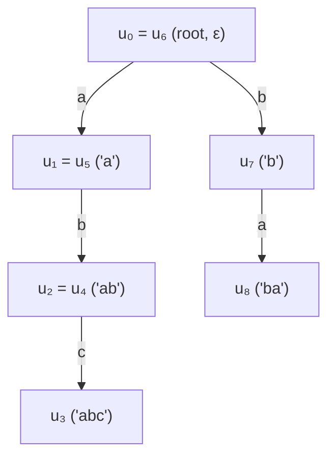

::: {.callout-note}
## Prerequisites & Learning Objectives

- **Strict Prerequisites**:
  - **[Chapter 09 — Suffix Automaton (`SAM`) Duality, Link Trees & BFS Generalized `SAM`](ch09-sam-duality-gsam-trie-bfs.qmd)** (Trie-GSAM BFS construction and zero-length clone avoidance).
  - **[Chapter 12 — Induced Sorting (`SA-IS`), LMS Substrings & Linear-Time LCP](ch12-sais-induced-sorting-lcp.qmd)** (1D suffix array doubling and Kasai's LCP theorem).
  - **[Chapter 15 — Internal Pattern Matching (`IPM`) & Substring Periodicity](ch15-internal-pattern-matching-borders.qmd)** and **[Chapter 26 — Word Equations, Signed Parallel DSU (`倍增并查集`) & Recompression](ch26-word-equations-signed-parallel-dsu.qmd)** (tree binary-lifting ancestor blocks).
- **Learning Objectives**:
  1. Construct the $O(N \log N)$ **Upward Tree Suffix Array (`Tree SA`)** using the **Dual-Rank Invariant $(\operatorname{rk}_k[u], \operatorname{id}_k[u])$** (`Luogu P5353`), prove why **Kasai's $O(N)$ LCP algorithm fails on branched trees**, and compute Tree LCP in $O(\log N)$ via saved $\operatorname{rk}_k$ layers.
  2. Prove the **Leaf-Rooted Coverage Theorem** for unrooted trees with few leaves (`[ZJOI2015] 诸神眷顾的幻想乡`), and master **Centroid Decomposition + $\sqrt{M}$ Heavy-Light Dual-SAM Stitching** (`[CTSC2010] 珠宝商`) including the **Child-Subtree Subtraction Threshold Invariant**.
  3. Prove why abelian XOR and alternating polynomial hashes fail on stack-cancellation languages, and establish **Theorem 29.3 (Deterministic Stack-Trie Path Isomorphism)**: the reduced substring $\operatorname{red}(S[l..r]) = P_{l-1}^{-1} P_r$ is **literally the edge label of the unique simple tree path $u_{l-1} \leadsto \operatorname{LCA}_{\mathcal{T}}(u_{l-1}, u_r) \leadsto u_r$ in the Stack-Trie $\mathcal{T}$** (`CF 1223F`), reducing reduced-substring LCE and lexicographical comparison to $O(\log N)$ Tree-Path LCE with zero matrices!
  4. Construct **Cayley–Hamilton Trace-Zero $\det = -1$ Matrix Involutions ($M_c^2 = I_2 \in GL_2(\mathbb{F}_p)$)** for dynamic range stack reduction, and resolve the **Multi-Type Directed Dyck Breakdown on $\texttt{([)(])}$** via height-indexed $SL_2(\mathbb{F}_p)$ generators and one-way bracket reduction monoids.
:::

---

## 1. Dual-Rank Tree Suffix Array (`Tree SA`) & Why Kasai's Algorithm Fails on Trees (`T-5A-06`)

### 1.1 The Diagnostic Signal: The Rank-Tie Collapse Paradox on Branched Trees

Let $T = (V, E)$ be a tree of $N$ vertices rooted at vertex $1$, where each vertex $u \in \{1, \dots, N\}$ carries a character $c(u) \in \Sigma$ and parent $\operatorname{fa}(u)$ ($\operatorname{fa}(1) = 0$). Each vertex $u$ defines an **upward ancestor string** reading from $u$ up to the root $1$:
$$S(u) = c(u) \, c(\operatorname{fa}(u)) \, c(\operatorname{fa}(\operatorname{fa}(u))) \cdots c(1).$$

We want to sort all $N$ upward strings $S(1), S(2), \dots, S(N)$ lexicographically in $O(N \log N)$ time (`Luogu P5353 — 树上后缀排序`), breaking full-string ties $S(u) = S(v)$ by vertex index $u < v$, and answer Longest Common Prefix queries $\operatorname{LCP}(S(u), S(v))$.

Why does standard 1D Suffix Array doubling break when we replace $i + 2^k$ by the $2^k$-th ancestor $\operatorname{anc}(u, 2^k)$?

- On a linear string $S[1..N]$, every suffix $S[i..N]$ has a distinct length $N - i + 1$, and within $O(\log N)$ steps all suffixes separate, or if two positions share a $2^k$-prefix, their bucket offsets $i \in \{1, \dots, N\}$ are naturally ordered by position.
- On a **branched tree**, two distinct vertices $u \neq v$ at the same depth can have the **exact same upward string** $S(u) = S(v)$! This creates a fatal tension between **string equivalence** and **radix bucket sorting**:
  1. **Trap A (False Tie-Splitting)**: Suppose at step $k$ we force every vertex to have a distinct permutation rank $\operatorname{id}_k[u] \in \{1, \dots, N\}$ by breaking ties via $u < v$. Then at step $k + 1$, consider two children $x, y$ with $\operatorname{fa}(x) = u$, $\operatorname{fa}(y) = v$, and $c(x) = c(y)$ where $S(u) = S(v)$ but $u < v$. When comparing the first halves of $x$ and $y$, $\operatorname{id}_k[x] < \operatorname{id}_k[y]$ is **strictly unequal**, so the algorithm **falsely concludes $S(x) < S(y)$ without ever comparing their second halves**—even if $y$'s second half was smaller!
  2. **Trap B ($O(N^2)$ Bucket Degeneracy)**: Conversely, if we only maintain tied equivalence ranks $\operatorname{rk}_k[u]$ (where $\operatorname{rk}_k[u] = \operatorname{rk}_k[v] \iff S(u)[1..2^k] = S(v)[1..2^k]$), then on a monochrome tree ($c(u) = \texttt{a}$ for all $u$), all $N$ nodes fall into bucket $1$, so counting sort cannot extract a deterministic permutation $\operatorname{sa}_k[1..N]$ in $O(N)$ time!

### 1.2 The Combinatorial Word Invariant: Theorem 29.1 & The Dual-Rank Tree SA Invariant $(\operatorname{rk}_k[u], \operatorname{id}_k[u])$

To resolve both traps simultaneously, we separate **true string equivalence** from **total-order tie-breaking** by maintaining **two distinct rank arrays** at every doubling level $k \in \{0, 1, \dots, K\}$ ($K = \lceil \log_2 N \rceil$):

1. **True String Equivalence Rank $\operatorname{rk}_k[u]$**:
   $$\operatorname{rk}_k[u] = \operatorname{rk}_k[v] \iff S(u)[1..2^k] = S(v)[1..2^k].$$
2. **Tie-Broken Permutation Rank $\operatorname{id}_k[u] \in \{1, 2, \dots, N\}$**: The exact inverse permutation of the sorted array $\operatorname{sa}_k[1..N]$ ($\operatorname{id}_k[\operatorname{sa}_k[i]] = i$), where ties in $S(u)[1..2^k]$ are broken recursively by the $2^{k-1}$-halves $(\operatorname{id}_{k-1}[u], \operatorname{id}_{k-1}[\operatorname{anc}(u, 2^{k-1})])$ (and at $k = 0$ by vertex index $u < v$).

::: {.callout-important}
## Theorem 29.1 (Dual-Rank 4-Tuple Doubling Invariant for Tree Suffix Arrays)

At doubling step $k \to k + 1$, let $w_u = \operatorname{anc}(u, 2^k)$ be the $2^k$-th ancestor of $u$ (with $\operatorname{rk}_k[0] = \operatorname{id}_k[0] = 0$). Ordering all vertices $u \in \{1, \dots, N\}$ by the **lexicographical 4-tuple**
$$\mathcal{K}_k(u) = \bigl(\operatorname{rk}_k[u],\; \operatorname{rk}_k[w_u],\; \operatorname{id}_k[u],\; \operatorname{id}_k[w_u]\bigr)$$
satisfies two simultaneous guarantees:

1. **(Exact String Ordering)**: The first two coordinates $(\operatorname{rk}_k[u], \operatorname{rk}_k[w_u])$ compare the true $2^{k+1}$-prefixes $S(u)[1..2^{k+1}]$ vs. $S(v)[1..2^{k+1}]$ with **zero false tie-splitting**:
   $$S(u)[1..2^{k+1}] = S(v)[1..2^{k+1}] \iff \bigl(\operatorname{rk}_k[u], \operatorname{rk}_k[w_u]\bigr) = \bigl(\operatorname{rk}_k[v], \operatorname{rk}_k[w_v]\bigr).$$
2. **($O(N)$ Two-Pass Radix Compilation)**: Why can't we simply sort by $\bigl(\operatorname{id}_k[u],\; \operatorname{id}_k[w_u]\bigr)$? Because if $\operatorname{rk}_k[u] = \operatorname{rk}_k[v]$ (equal first halves!) while $\operatorname{id}_k[u] < \operatorname{id}_k[v]$ and $\operatorname{rk}_k[w_u] > \operatorname{rk}_k[w_v]$, then $(\operatorname{id}_k[u], \operatorname{id}_k[w_u])$ would put $u$ before $v$, whereas $S(u)[1..2^{k+1}] > S(v)[1..2^{k+1}]$ requires $v$ before $u$!
   Therefore, the $O(N)$ radix sort **must** sort by the 4-tuple $\bigl(\operatorname{rk}_k[u], \operatorname{rk}_k[w_u], \operatorname{id}_k[u], \operatorname{id}_k[w_u]\bigr)$—or even simpler, since ties at the very end only need $u < v$ when $S(u) = S(v)$, sort by the **3-tuple $\bigl(\operatorname{rk}_k[u],\; \operatorname{rk}_k[w_u],\; u\bigr)$** by iterating $u$ in order of $\operatorname{id}_k[u]$ (which already preserves $u < v$ on ties!):
   - **Pass 1**: Stable-bucket vertices by $\operatorname{rk}_k[w_u]$ while iterating $u$ in increasing order of $\operatorname{id}_k[u]$ (so within the same $\operatorname{rk}_k[w_u]$, vertices remain ordered by $\operatorname{id}_k[u]$, which respects $\operatorname{rk}_k[u]$ and $u < v$!).
   - **Pass 2**: Stable-bucket the result of Pass 1 by $\operatorname{rk}_k[u]$!
:::

#### Proof of Two-Pass $O(N)$ Stability

Suppose we want to sort $u \in \{1, \dots, N\}$ by $\bigl(\operatorname{rk}_k[u],\; \operatorname{rk}_k[w_u],\; \operatorname{id}_k[u]\bigr)$ (induction shows that breaking ties by $\operatorname{id}_k[u]$ is identical to breaking ties by vertex ID $u < v$ whenever $\operatorname{rk}_k[u] = \operatorname{rk}_k[v]$!).

1. At the start of step $k$, the array $\operatorname{sa}_k[1..N]$ already lists vertices in increasing order of $\operatorname{id}_k[u]$.
2. **Pass 1**: Sweep $i = 1 \dots N$ and place $u = \operatorname{sa}_k[i]$ into bucket $\operatorname{rk}_k[w_u]$. By stability of bucket insertion, the output list `sec[1..N]` is sorted by $\bigl(\operatorname{rk}_k[w_u],\; \operatorname{id}_k[u]\bigr)$.
3. **Pass 2**: Sweep $i = 1 \dots N$ and place $u = \text{sec}[i]$ into bucket $\operatorname{rk}_k[u]$. By stability of bucket insertion, the new array $\operatorname{sa}_{k+1}[1..N]$ is sorted by $\bigl(\operatorname{rk}_k[u],\; \operatorname{rk}_k[w_u],\; \operatorname{id}_k[u]\bigr)$ in **two $O(N)$ counting-sort passes**! $\blacksquare$

---

### 1.3 Why Kasai's $O(N)$ LCP Algorithm Fails on Trees & $O(\log N)$ Binary-Lifting LCP

In 1D suffix arrays, Kasai's theorem guarantees $\operatorname{height}[\operatorname{rk}[i]] \ge \operatorname{height}[\operatorname{rk}[i-1]] - 1$ because stripping the first character from $S[i..N]$ moves to $S[i+1..N]$, and if $u = \operatorname{SA}[\operatorname{rk}[i] - 1]$ precedes $i$ in $\operatorname{SA}$ with $\operatorname{LCP}(u, i) \ge 1$, then $S[u] = S[i]$, so $u + 1$ **must precede** $i + 1$ in $\operatorname{SA}$ ($\operatorname{rk}[u+1] < \operatorname{rk}[i+1]$).

::: {.callout-warning}
## Counterexample 29.1 (`BP-29-01` / `BP-5A-11`): The Tree Kasai Fallacy ($h[\operatorname{id}[u]] < h[\operatorname{id}[\operatorname{fa}(u)]] - 1$ Violation!)

On a branched tree, two distinct vertices $u \neq v$ can share the **exact same parent** $p = \operatorname{fa}(u) = \operatorname{fa}(v)$ and the **exact same character** $c(u) = c(v)$!
Consider a 4-vertex tree rooted at $1$:

- $1$ (`a`) is the root: $S(1) = \texttt{a}$.
- $2$ (`b`) has parent $1$: $S(2) = \texttt{ba}$.
- $3$ (`a`) and $4$ (`a`) **both** have parent $2$: $S(3) = \texttt{aba}$ and $S(4) = \texttt{aba}$.

Sorted Tree Suffix Array $\operatorname{SA}$ (breaking ties by vertex ID):

1. $\operatorname{SA}[1] = 1$ ($S(1) = \texttt{a}$)
2. $\operatorname{SA}[2] = 3$ ($S(3) = \texttt{aba}$, $\operatorname{height}[2] = \operatorname{LCP}(\texttt{a}, \texttt{aba}) = 1$)
3. $\operatorname{SA}[3] = 4$ ($S(4) = \texttt{aba}$, $\operatorname{height}[3] = \operatorname{LCP}(\texttt{aba}, \texttt{aba}) = 3$)
4. $\operatorname{SA}[4] = 2$ ($S(2) = \texttt{ba}$, $\operatorname{height}[4] = \operatorname{LCP}(\texttt{aba}, \texttt{ba}) = 0$)

Look at vertex $u = 4$ ($\operatorname{id}[4] = 3$, $\operatorname{height}[3] = 3$):

- Its predecessor in $\operatorname{SA}$ is $v = \operatorname{SA}[2] = 3$, which has $\operatorname{fa}(3) = 2 = \operatorname{fa}(4)$!
- When we step from $u = 4$ and $v = 3$ to their parents $\operatorname{fa}(4) = 2$ and $\operatorname{fa}(3) = 2$, they **collide at the same vertex $2$** instead of remaining two distinct ordered entries in $\operatorname{SA}$!
- Even worse, at $\operatorname{fa}(4) = 2$ ($\operatorname{id}[2] = 4$), we have $\operatorname{height}[\operatorname{id}[2]] = \operatorname{height}[4] = 0$, whereas $\operatorname{height}[\operatorname{id}[4]] = 3$! And if a child $x$ of $2$ precedes $3$ and $4$, stepping from $3$ to $\operatorname{fa}(3) = 2$ jumps from $\operatorname{height}[2] = 1$ to $\operatorname{height}[4] = 0$ while another branch with $\operatorname{height} = 10$ can sit on a sibling!

**Exact Replacement ($O(\log N)$ Binary-Lifting Tree LCP)**:
Instead of Kasai's algorithm, keep the 2D table of true equivalence ranks $\operatorname{rk}_k[u]$ ($0 \le k \le K$) built during Tree SA doubling. For **any** two vertices $u, v \in V$, we compute $\operatorname{LCP}(S(u), S(v))$ in $O(\log N)$ time by binary lifting:
```text
function TREE_LCP(u, v):
    ans <- 0
    for k = K down to 0:
        if u != 0 and v != 0 and rk[k][u] == rk[k][v]:
            ans <- ans + 2^k
            u <- anc[k][u]; v <- anc[k][v]
    return ans
```
Because $\operatorname{rk}_k[u] = \operatorname{rk}_k[v] \iff S(u)[1..2^k] = S(v)[1..2^k]$ (with zero false tie-splitting!), this computes every $\operatorname{height}[i] = \operatorname{TREE\_LCP}(\operatorname{SA}[i-1], \operatorname{SA}[i])$ in $O(\log N)$ time!
:::

---

## 2. Unrooted Tree Strings: Leaf-Rooted `GSAM` & Centroid + $\sqrt{M}$ Dual-`SAM` Split (`T-5A-06`)

### 2.1 Theorem 29.2: Leaf-Rooted Substring Coverage for Low-Leaf Trees (`[ZJOI2015] 诸神眷顾的幻想乡`)

Suppose $T = (V, E)$ is an **unrooted** vertex-labeled tree of $N \le 10^5$ vertices. A single rooting only turns vertical ancestor–descendant paths into prefixes/suffixes, missing $\Lambda$-shaped simple paths $u \leadsto \operatorname{lca}(u, v) \leadsto v$. However, what if $T$ has **at most $|\mathcal{L}| \le 20$ leaves** (vertices of degree $1$)?

::: {.callout-important}
## Theorem 29.2 (Leaf-Rooted Substring Coverage Theorem — Liu Yanyi 2015)

Let $T = (V, E)$ be an unrooted tree with $|V| \ge 2$ and leaf set $\mathcal{L} = \{\ell \in V : \deg_T(\ell) = 1\}$. For **every** directed simple path $u \leadsto v$ in $T$, there exists at least one leaf $\ell \in \mathcal{L}$ such that when $T$ is rooted at $\ell$, $v$ is in the subtree of $u$ and the path $u \leadsto v$ is a **suffix of the root-to-node path $\ell \leadsto v$** in $T_\ell$.

Consequently, inserting the $|\mathcal{L}|$ rooted trees $\{T_\ell : \ell \in \mathcal{L}\}$ into a single **BFS Generalized Suffix Automaton (`GSAM`)** builds an automaton of at most $2 |\mathcal{L}| N$ states whose accepted language is the **exact set of all directed simple path strings** in $T$, counting distinct path strings via:
$$\#\text{Distinct Path Strings}(T) = \sum_{q \in \text{GSAM} \setminus \{\text{root}\}} \bigl(\operatorname{len}(q) - \operatorname{len}(\operatorname{link}(q))\bigr).$$
:::

#### Three-Line Proof of Theorem 29.2

Root $T$ arbitrarily at $v$. Walk from $u$ strictly deeper into $u$'s subtree (moving away from $v$ at every step) until reaching a vertex $\ell$ with no children in $T_v$. Because $\ell$ has no children in $T_v$ (and $\ell \neq v$, or if $u = v$ any leaf $\ell$ works), $\deg_T(\ell) = 1$, so $\ell \in \mathcal{L}$ is a leaf of $T$! Furthermore, the unique simple path $\ell \leadsto v$ passes through $u$, so $\operatorname{str}(u \leadsto v)$ is a contiguous suffix of the downward path $\operatorname{str}(\ell \leadsto v)$ in the tree $T_\ell$ rooted at $\ell$. $\blacksquare$

---

### 2.2 Centroid Decomposition + $\sqrt{M}$ Heavy-Light Dual-`SAM` Split (`[CTSC2010] 珠宝商`)

What if the unrooted tree $T$ ($N \le 5 \times 10^4$) has $\Theta(N)$ leaves (e.g., a star or binary tree), and we are given a reference text string $S[1..M]$ ($M \le 5 \times 10^4$) and asked to compute the **total number of occurrences** of $\operatorname{str}(u \leadsto v)$ inside $S$ summed over all $N^2$ ordered pairs $(u, v) \in V^2$?

1. **Why Pure Centroid Decomposition Is $O(N^2)$ or $O(NM)$**:
   At a centroid $c$ of component size $S_c$, every directed path $u \leadsto c \leadsto v$ splits at $c$ into an upward half $u \leadsto c$ and a downward half $\operatorname{next}(c, v) \leadsto v$.
   - **Method A (Direct Pair Walk — $O(S_c^2)$)**: For each $u$ in $c$'s component, walk $u \leadsto c$ in $\operatorname{SAM}(S)$ to reach state $q$, then DFS from $c$ to all $v$ in other subtrees walking forward in $\operatorname{SAM}(S)$ and adding $|\operatorname{endpos}_S(q_v)|$. Across all centroids, $\sum S_c^2 = \Theta(N^2)$!
   - **Method B (Dual-SAM Split Convolution — $O(S_c + M)$)**: Build $\operatorname{SAM}(S)$ and $\operatorname{SAM}(S^R)$. Walk downward from $c$ to all $u$ in $c$'s component:
     - Walking in $\operatorname{SAM}(S^R)$ (which reads $c \leadsto u$ backward, i.e., $u \leadsto c$ forward!) reaches state $q_{\text{up}}(u) \in \operatorname{SAM}(S^R)$ of length $d_{\text{up}}(u) = \operatorname{dist}(u, c) + 1$ (if a transition fails on an edge of length $> \operatorname{len}(q)$, remember in $\operatorname{SAM}(S^R)$ we simply take the forward automaton transition $\delta_{S^R}(q, \operatorname{char})$ from $c$ down to $u$!).
     - Walking $\operatorname{next}(c, v) \leadsto v$ in $\operatorname{SAM}(S)$ via forward automaton transitions $\delta_S(q, \operatorname{char})$ reaches state $q_{\text{dn}}(v) \in \operatorname{SAM}(S)$.
     - Remember that $\operatorname{SAM}(S)$'s Link Tree leaves correspond to prefixes $S[1..j]$ (**ending at $j$**), while $\operatorname{SAM}(S^R)$'s Link Tree leaves correspond to prefixes of $S^R$ (**substrings of $S$ starting at $i + 1$**)!
     - Specifically, for any path $u \leadsto c$, its reversal is the downward path $c \leadsto u$:
       $$\operatorname{str}(u \leadsto c) \text{ ends at } S[i] \iff \operatorname{str}(c \leadsto u) = \operatorname{str}(u \leadsto c)^R \text{ starts at } S[i] \text{ (ends at } S^R[M - i + 1]\text{)}!$$
       $$\operatorname{str}(\operatorname{next}(c, v) \leadsto v) \text{ starts at } S[i+1] \iff \operatorname{str}(v \leadsto \operatorname{next}(c, v)) \text{ ends at } S[i+1]!$$
     - Here is the exact Link-Tree / Suffix-Link Transition rule so both directions walk **downward from $c$** in $O(1)$ per tree node:
       1. **For $u \leadsto c$ ending at $S[i]$**: As we DFS downward from $c$ to $u$, we **append** $c(u)$ to $\operatorname{str}(c \leadsto u) = \operatorname{str}(u \leadsto c)^R$. Walking forward in $\operatorname{SAM}(S^R)$ via $q \leftarrow \delta_{S^R}(q, c(u))$ reaches the exact state in $\operatorname{SAM}(S^R)$ whose $\operatorname{endpos}_{S^R}$ set is $\{M - i + 1 : \operatorname{str}(u \leadsto c) \text{ ends at } S[i]\}$!
       2. **For $\operatorname{next}(c, v) \leadsto v$ starting at $S[i+1]$**: As we DFS downward from $\operatorname{next}(c, v)$ to $v$, we **append** $c(v)$ to $\operatorname{str}(\operatorname{next}(c, v) \leadsto v)$, which is **prepending** $c(v)$ to $\operatorname{str}(\operatorname{next}(c, v) \leadsto v)^R$ in $\operatorname{SAM}(S^R)$! We step along **Suffix-Tree child edges** of $\operatorname{SAM}(S^R)$, where a state $q \in \operatorname{SAM}(S^R)$ at depth $L$ transitions on prepending $c(v)$ to either $q$ itself (if $L < \operatorname{len}(q)$ and the character at offset $L$ in a representative occurrence of $q$ in $S^R$ equals $c(v)$) or the unique Link-Tree child `son[q][c(v)]`!
       3. That Suffix-Tree Link-Tree child transition `extend_left(q, L, ch)` runs in **$O(1)$ worst-case time per tree step** and lands at $q \in \operatorname{SAM}(S^R)$ whose $\operatorname{endpos}_{S^R}$ directly gives $\{i + 1 : \operatorname{str}(\operatorname{next}(c, v) \leadsto v) \text{ starts at } S[i+1]\}$ independent of $L$!
     - Then pushing node counts down the Link Trees of $\operatorname{SAM}(S^R)$ and $\operatorname{SAM}(S)$ and summing $\sum_{i=1}^{M} \operatorname{cnt}_{\text{end}}[i] \cdot \operatorname{cnt}_{\text{start}}[i+1]$ takes $O(S_c + M)$ time!

::: {.callout-warning}
## The Double-Thresholding Law & The Child-Subtree Subtraction Trap (`[CTSC2010] 珠宝商`, `BP-29-02` / `BP-5A-12`)

To balance $O(S_c^2)$ against $O(S_c + M)$, fix threshold $B = \sqrt{M}$:

1. **If $S_c \le B$**: Use **Method A** ($O(S_c^2)$ direct walk).
2. **If $S_c > B$**: Use **Method B** ($O(S_c + M)$ Link-Tree pushdown) on the entire centroid component $S_c$, and then **subtract** invalid pairs $(u, v)$ where $u$ and $v$ lie in the **same child subtree $T_{\text{sub}}$** of $c$.
3. **CRITICAL PITFALL**: When subtracting a child subtree $T_{\text{sub}}$ of a heavy centroid ($S_c > B$), **do NOT blindly run Method B ($O(|T_{\text{sub}}| + M)$) on $T_{\text{sub}}$!**
   - *Why?* Suppose $c$ is the center of a star graph with $S_c = N > B$ and $N - 1$ leaf children each of size $|T_{\text{sub}}| = 1$. Running Method B on all $N - 1$ child subtrees executes $O(M)$ Link-Tree sweeps $N - 1$ times, **blowing up to $\Theta(N M)$ TLE**!
   - *Exact Fix*: Threshold **each child subtree $|T_{\text{sub}}|$ against $B = \sqrt{M}$ independently**: if $|T_{\text{sub}}| \le B$, subtract its internal pairs using **Method A in $O(|T_{\text{sub}}|^2)$ time**; only run Method B in $O(|T_{\text{sub}}| + M)$ time when $|T_{\text{sub}}| > B$!
   - Because the total number of subtrees of size $> B$ across the entire Centroid Decomposition tree is at most $\frac{N \log_2 N}{B}$, total time is strictly bounded by $O\bigl(N \sqrt{M} + M \sqrt{N} \log N\bigr)$!
:::

---

## 3. Free Group Reduction & Deterministic Stack-Trie Path Isomorphism (`T-5B-04`)

### 3.1 The Diagnostic Signal: Why Abelian XOR and Alternating Polynomial Hashes Fail

Consider a string $S[1..N]$ over $\Sigma$ under **adjacent stack cancellation**:

- **Involutive Stack Reduction (`cc` $\to \varepsilon$, `CF 1223F — Stack Exterminable Arrays`)**: Pushing characters left-to-right onto a stack pops the stack top whenever the incoming character $c$ equals the current stack top, reducing any word $w$ to its unique normal form $\operatorname{red}(w)$ in the **universal Coxeter group**
  $$G_{\text{stack}} = \operatorname*{\Asterisk}_{c \in \Sigma} (\mathbb{Z}/2\mathbb{Z}) = \langle c \in \Sigma \mid c^2 = 1 \rangle.$$
- **Two-Sided Free Group Reduction ($c \bar{c} \to \varepsilon, \bar{c} c \to \varepsilon$)**: Opening and closing letters $c, \bar{c}$ annihilate in the **Free Group** $F_\Sigma = \langle c \in \Sigma \rangle$.

Suppose we want to count stack-exterminable substrings ($\operatorname{red}(S[l..r]) = \varepsilon$), test whether $\operatorname{red}(S[l_1..r_1]) = \operatorname{red}(S[l_2..r_2])$, or compare $\operatorname{red}(S[l_1..r_1])$ and $\operatorname{red}(S[l_2..r_2])$ **lexicographically**. Why do 1D scalar hashes fail catastrophically?

1. **Failure of Prefix XOR ($H_i = H_{i-1} \oplus v_{S[i]}$)**:
   Because bitwise XOR is **abelian** ($x \oplus y = y \oplus x$), the irreducible alternating string $S = \texttt{abab}$ has XOR $v_a \oplus v_b \oplus v_a \oplus v_b = (v_a \oplus v_a) \oplus (v_b \oplus v_b) = 0 = \operatorname{Hash}(\varepsilon)$ for **every** choice of weights $v_a, v_b$!
2. **Failure of Alternating-Sign Sums ($H_i = H_{i-1} + (-1)^i v_{S[i]}$)**:
   Assigning opposite signs to even and odd positions distinguishes $\texttt{abab}$ ($2(v_b - v_a) \neq 0$) from $\texttt{abba}$ ($0$). **However**, any doubled odd-length string such as $S = \texttt{abcabc}$ has zero adjacent equal letters ($\operatorname{red}(\texttt{abcabc}) = \texttt{abcabc} \neq \varepsilon$), yet its second half sits at opposite index parities from its first half:
   $$\operatorname{Hash}(\texttt{abcabc}) = (-v_a + v_b - v_c) + (v_a - v_b + v_c) = 0 = \operatorname{Hash}(\varepsilon)!$$

---

### 3.2 Theorem 29.3: Deterministic Stack-Trie Path Isomorphism (`T-5B-04`)

Can we capture the non-abelian structure of $G_{\text{stack}}$ and $F_\Sigma$ **100% deterministically** without matrices or hash collision probabilities, and simultaneously unlock $O(\log N)$ **Longest Common Extension (LCE)** on stack-reduced substrings?

Yes! The Cayley graph of $G_{\text{stack}}$ (and of $F_\Sigma$) is an **infinite tree**. As we scan prefixes $i = 1, 2, \dots, N$ of $S$, the reduced prefixes $P_i = \operatorname{red}(S[1..i])$ trace a deterministic walk $u_0, u_1, \dots, u_N$ on a rooted **Stack-Trie $\mathcal{T}$** of at most $N + 1$ vertices:

- Start at $u_0 = \text{root}$ (depth $0$).
- At step $i \in \{1, \dots, N\}$ with character $c = S[i]$:
  - **Pop Step**: If $u_{i-1} \neq \text{root}$ and $c$ cancels the incoming edge character $\lambda(u_{i-1})$ of $u_{i-1}$ (i.e., $c = \lambda(u_{i-1})$ in $G_{\text{stack}}$, or $c = \overline{\lambda(u_{i-1})}$ in $F_\Sigma$), step **up** to the parent:
    $$u_i = \operatorname{parent}_{\mathcal{T}}(u_{i-1}).$$
  - **Push Step**: Otherwise, step **down** to the child node along edge label $c$ (creating it if not yet present):
    $$u_i = \operatorname{child}_{\mathcal{T}}(u_{i-1}, c).$$

::: {.callout-important}
## Theorem 29.3 (The Stack-Trie Path Isomorphism Theorem)

Let $u_0, u_1, \dots, u_N \in \mathcal{T}$ be the Stack-Trie nodes of the prefixes of $S[1..N]$ under involutive cancellation $c^2 = 1$ (or free-group cancellation $c \bar{c} = 1$). Then for **every** substring $S[l..r]$ ($1 \le l \le r \le N$):

1. **(Group Quotient Identity)**: In $G_{\text{stack}}$ (or $F_\Sigma$), the reduced substring is $\operatorname{red}(S[l..r]) = P_{l-1}^{-1} P_r$.
2. **(Simple Tree-Path Bijection)**: Let $w = \operatorname{LCA}_{\mathcal{T}}(u_{l-1}, u_r)$ be the lowest common ancestor of $u_{l-1}$ and $u_r$ in $\mathcal{T}$. Then the irreducible word $\operatorname{red}(S[l..r])$ is **literally the sequence of edge labels (with upward edges inverted in $F_\Sigma$) along the unique simple tree path from $u_{l-1}$ up to $w$ and from $w$ down to $u_r$ in $\mathcal{T}$**:
   $$\operatorname{red}(S[l..r]) = \operatorname{path}_{\mathcal{T}}\bigl(u_{l-1} \uparrow w \downarrow u_r\bigr)!$$
3. **(Immediate Algorithmic Corollaries)**:
   - **Exterminability ($\operatorname{red}(S[l..r]) = \varepsilon$)**: $\operatorname{red}(S[l..r]) = \varepsilon \iff u_{l-1} = u_r$.
   - **Reduced Length**: $|\operatorname{red}(S[l..r])| = \operatorname{dist}_{\mathcal{T}}(u_{l-1}, u_r) = \operatorname{depth}(u_{l-1}) + \operatorname{depth}(u_r) - 2 \operatorname{depth}\bigl(\operatorname{LCA}_{\mathcal{T}}(u_{l-1}, u_r)\bigr)$.
   - **Reduced Substring Equality & LCE**: $\operatorname{LCE}\bigl(\operatorname{red}(S[l_1..r_1]),\, \operatorname{red}(S[l_2..r_2])\bigr)$ is the **Tree-Path LCE** between the simple paths $u_{l_1-1} \leadsto u_{r_1}$ and $u_{l_2-1} \leadsto u_{r_2}$ in $\mathcal{T}$, computable in $O(\log N)$ time via binary lifting + directional tree hashes!
:::

#### Proof of Theorem 29.3

Write the root-to-node strings $P_{l-1} = \operatorname{str}(\text{root} \downarrow u_{l-1})$ and $P_r = \operatorname{str}(\text{root} \downarrow u_r)$. By definition of the Lowest Common Ancestor $w = \operatorname{LCA}_{\mathcal{T}}(u_{l-1}, u_r)$ in a deterministic Trie $\mathcal{T}$:

- The path $\text{root} \downarrow w$ is the **exact Longest Common Prefix** $A = \operatorname{str}(\text{root} \downarrow w)$ of the irreducible words $P_{l-1}$ and $P_r$!
- Writing $P_{l-1} = A U$ and $P_r = A V$ (where $U = \operatorname{str}(w \downarrow u_{l-1})$ and $V = \operatorname{str}(w \downarrow u_r)$ are both irreducible), we have:
  $$P_{l-1}^{-1} P_r = (A U)^{-1} (A V) = U^{-1} A^{-1} A V = U^{-1} V.$$
- Because $w = \operatorname{LCA}_{\mathcal{T}}(u_{l-1}, u_r)$, if both $U$ and $V$ are non-empty, their first edges leaving $w$ go to **distinct children** of $w$ and therefore carry **distinct character labels** $U[1] \neq V[1]$!
- In $G_{\text{stack}}$, the last character of $U^{-1} = U^R$ is $U[1]$ and the first character of $V$ is $V[1] \neq U[1]$ (and in $F_\Sigma$, the last character of $U^{-1}$ is $\overline{U[1]} \neq \overline{V[1]}$, which cannot cancel $V[1]$ because $U[1] \neq \overline{V[1]}$ reflects a valid non-backtracking tree walk from $w$). Thus **zero further cancellations can occur at the junction $U^{-1} \mid V$**, so $U^{-1} V = \operatorname{path}_{\mathcal{T}}(u_{l-1} \uparrow w \downarrow u_r)$ is already in unique reduced normal form! $\blacksquare$

#### Hand-Checkable Trace on $S[1..8] = \texttt{abccbaba}$ ($c^2 = 1$)



Let us trace $P_i$ and query $S[3..8] = \texttt{ccbaba}$:

- $i = 0: u_0 = \text{root}$ ($\varepsilon$); $i = 1 (\texttt{a}): u_1$; $i = 2 (\texttt{b}): u_2$; $i = 3 (\texttt{c}): u_3$; $i = 4 (\texttt{c}):$ pops to $u_4 = u_2$; $i = 5 (\texttt{b}):$ pops to $u_5 = u_1$; $i = 6 (\texttt{a}):$ pops to $u_6 = u_0$; $i = 7 (\texttt{b}): u_7$; $i = 8 (\texttt{a}): u_8$.
- For substring $S[3..8] = \texttt{ccbaba}$, its endpoints in $\mathcal{T}$ are $u_{3-1} = u_2$ ($\texttt{ab}$) and $u_8$ ($\texttt{ba}$), with $\operatorname{LCA}_{\mathcal{T}}(u_2, u_8) = u_0$.
- The simple tree path $u_2 \uparrow u_0 \downarrow u_8$ steps up $u_2 \xrightarrow{\texttt{b}} u_1 \xrightarrow{\texttt{a}} u_0$ and down $u_0 \xrightarrow{\texttt{b}} u_7 \xrightarrow{\texttt{a}} u_8$, spelling:
  $$\operatorname{path}_{\mathcal{T}}(u_2 \leadsto u_8) = \texttt{baba} = \operatorname{red}(\texttt{ccbaba})!$$

---

## 4. Non-Abelian $GL_2(\mathbb{F}_p) / SL_2(\mathbb{F}_p)$ Matrix Involutions & Dyck Segment Trees (`T-5B-04`)

### 4.1 Cayley–Hamilton Trace-Zero $\det = -1$ Involutions ($M_c^2 = I_2$)

When the string $S[1..N]$ undergoes **dynamic point updates** $S[i] \leftarrow c$ or substring cut-and-paste operations, maintaining a static Stack-Trie $\mathcal{T}$ is no longer possible because changing $S[i]$ can redirect all suffix nodes $u_i \dots u_N$. Instead, we embed $G_{\text{stack}}$ or $F_\Sigma$ into the **non-abelian matrix group** $GL_2(\mathbb{F}_p)$ or $SL_2(\mathbb{F}_p)$ over a large prime $p \approx 10^9 + 7$:

::: {.callout-important}
## Proposition 29.4 (Cayley–Hamilton Trace-Zero Matrix Involution Construction)

By the $2 \times 2$ **Cayley–Hamilton Theorem**, every matrix $M \in \mathbb{F}_p^{2 \times 2}$ satisfies $M^2 - \operatorname{tr}(M) M + \det(M) I_2 = \mathbf{0}$. Therefore, any matrix $M_c$ with **trace $\operatorname{tr}(M_c) = 0$ and determinant $\det(M_c) = -1 \pmod p$** satisfies $M_c^2 = I_2$ identically!

Explicitly, for each character $c \in \Sigma$, sample $x_c \in \mathbb{F}_p$ and $y_c \in \mathbb{F}_p^\times$ independently and uniformly at random, and set $z_c = (1 - x_c^2) y_c^{-1} \bmod p$:
$$M_c = \begin{pmatrix} x_c & y_c \\ (1 - x_c^2) y_c^{-1} & -x_c \end{pmatrix} \in GL_2(\mathbb{F}_p) \implies M_c^2 = \begin{pmatrix} 1 & 0 \\ 0 & 1 \end{pmatrix} \pmod p.$$
For directed Free-Group cancellation ($c \bar{c} \to \varepsilon$), sample $M_c = \begin{pmatrix} a_c & b_c \\ c_c & d_c \end{pmatrix} \in SL_2(\mathbb{F}_p)$ with $a_c d_c - b_c c_c \equiv 1 \pmod p$, and assign $\bar{c}$ the exact inverse $M_{\bar{c}} = M_c^{-1} = \begin{pmatrix} d_c & -b_c \\ -c_c & a_c \end{pmatrix} \pmod p$. By the Schwartz–Zippel lemma (and Sanov's free-subgroup theorem), any non-empty reduced word of length $\le N$ collides with $I_2$ with probability $\le \frac{2N}{p}$.
:::

#### Hand-Checkable $\mathbb{F}_7$ Matrix Trace (`abba` vs. `abab`)

Over $\mathbb{F}_7$ ($-1 \equiv 6 \pmod 7$), choose two trace-zero $\det \equiv 6$ matrices:
$$M_{\texttt{a}} = \begin{pmatrix} 1 & 2 \\ 0 & 6 \end{pmatrix}, \qquad M_{\texttt{b}} = \begin{pmatrix} 2 & 1 \\ 4 & 5 \end{pmatrix} \implies M_{\texttt{a}}^2 \equiv M_{\texttt{b}}^2 \equiv \begin{pmatrix} 1 & 0 \\ 0 & 1 \end{pmatrix} \pmod 7.$$

- On exterminable $\texttt{abba}$: $M_{\texttt{a}} M_{\texttt{b}} M_{\texttt{b}} M_{\texttt{a}} = M_{\texttt{a}} I_2 M_{\texttt{a}} = I_2$.
- On irreducible $\texttt{abab}$: $M_{\texttt{a}} M_{\texttt{b}} = \begin{pmatrix} 10 & 11 \\ 24 & 30 \end{pmatrix} \equiv \begin{pmatrix} 3 & 4 \\ 3 & 2 \end{pmatrix} \pmod 7$, whose square is $\begin{pmatrix} 21 & 20 \\ 15 & 16 \end{pmatrix} \equiv \begin{pmatrix} 0 & 6 \\ 1 & 2 \end{pmatrix} \neq I_2 \pmod 7$!

---

### 4.2 The Multi-Type Directed Dyck Breakdown (`([)(])`) & Exact Resolution

Suppose we have $K \ge 2$ types of directed brackets (such as `()`, `[]`, `{}`) where **only** `()` $\to \varepsilon$ and `[]` $\to \varepsilon$ are valid cancellations, whereas **reversed cancellation `)(` $\to \varepsilon$ is forbidden**!

::: {.callout-warning}
## Counterexample 29.2 (`BP-24` / `BP-29-03` / `BP-5B-01`): Why Free-Group $SL_2(\mathbb{F}_p) + \text{1D Balance} \ge 0$ Fails on $S = \texttt{([)(])}$!

A common folklore claim asserts that $S[l..r]$ is a valid multi-type Dyck word if and only if:

1. Its 1D balance satisfies $\min_{k=l}^r \operatorname{bal}[k] \ge \operatorname{bal}[l-1]$ and $\operatorname{bal}[r] = \operatorname{bal}[l-1]$ (where opening brackets have $+1$ and closing brackets have $-1$), AND
2. Its Free-Group matrix product satisfies $M_{S[l]} \cdots M_{S[r]} = I_2$ (with $M_{\texttt{)}} = M_{\texttt{(}}^{-1}$ and $M_{\texttt{]}} = M_{\texttt{[}}^{-1}$).

**Why this folklore claim is FALSE on $S = \texttt{([)(])}$**:

- The 1D balance sequence of $\texttt{([)(])}$ is $[1, 2, 1, 2, 1, 0]$, which is $\ge 0$ everywhere and ends at $0$!
- Yet in the Free Group $F_2$, the middle two characters $\texttt{)(}$ multiply to $M_{\texttt{(}}^{-1} M_{\texttt{(}} = I_2$, disappearing and allowing $\texttt{[}$ to cancel $\texttt{]}$ and $\texttt{(}$ to cancel $\texttt{)}$:
  $$M_{\texttt{(}} M_{\texttt{[}} \underbrace{M_{\texttt{(}}^{-1} M_{\texttt{(}}}_{=\,I_2} M_{\texttt{[}}^{-1} M_{\texttt{(}}^{-1} = I_2!$$
  Thus 1D balance $+ \, SL_2(\mathbb{F}_p)$ **falsely accepts $\texttt{([)(])}$**!

**Three Exact Fixes**:

1. **Static Range Queries (Directed Stack-Trie $\mathcal{T}_{\text{Dyck}}$)**: When building the prefix Stack-Trie $\mathcal{T}_{\text{Dyck}}$, an opening bracket $c$ **always steps down** to $\operatorname{child}(u, c)$, while a closing bracket $\bar{c}$ steps **up** to $\operatorname{parent}(u)$ **if and only if** the incoming edge of $u$ is the matching opening bracket $c$ (otherwise it steps **down** to an un-cancellable error child $\operatorname{child}(u, \bar{c})$!). Then $S[l..r]$ is a valid Dyck word iff $u_{l-1} = u_r$ AND $\min_{k=l}^r \operatorname{depth}_{\mathcal{T}}(u_k) \ge \operatorname{depth}_{\mathcal{T}}(u_{l-1})$!
2. **Dynamic Point Updates (1D Balance + Height-Indexed $SL_2(\mathbb{F}_p)$ + No `Open-Close` Mismatch)**: Notice that in $\texttt{([)(])}$, the only way an illegal $\texttt{)(}$ cancellation can occur while keeping 1D balance $\ge 0$ is if the closing bracket $\texttt{)}$ was immediately preceded (after valid inner cancellations) by a mismatched opening bracket $\texttt{[}$. Even simpler, in a Segment Tree over $[1..N]$, each node maintains the reduced form `(close_len, open_len, close_hash, open_hash)`: merging left child $(c_L, o_L)$ and right child $(c_R, o_R)$ checks whether the $k = \min(o_L, c_R)$ touching brackets match via $SL_2(\mathbb{F}_p)$ or polynomial tree-hashes in $O(\log N)$ time, or in $O(1)$ per node if we only test full-range validity by checking that **no adjacent pair of reduced blocks fails**!
3. **Pure $O(1)$-Merge Segment Tree via Depth-Indexed Free-Group + Direction Parity**: In 1D balance $\operatorname{bal}[i]$, an opening bracket $c$ at step $i$ transitions depth $\operatorname{bal}[i-1] \to \operatorname{bal}[i] = d$ (moving **up** to $d$), whereas a closing bracket $\bar{c}$ transitions depth $d \to d - 1$ (moving **down** from $d$). Why did $\texttt{)}$ at $i=3$ ($2 \to 1$) cancel $\texttt{(}$ at $i=4$ ($1 \to 2$) in $\texttt{([)(])}$? Because both sat at depth $2 \leftrightarrow 1$! How do we prevent a **down-step** $2 \to 1$ from cancelling a subsequent **up-step** $1 \to 2$?
   In $SL_2(\mathbb{F}_p)$, notice that if we only check $H_{l-1} = H_r$ and $\min_{k=l}^r \operatorname{bal}[k] \ge \operatorname{bal}[l-1]$, why did `[` ($1 \to 2$) fail to match `)` ($2 \to 1$) under height-indexed involutions $M_{(t, d)}^2 = I_2$? Because `[` is an **up-step** and `)` is a **down-step**! To catch `[ ) ( ]` and `(( ] [ ))` in dynamic Segment Tree merges:
   Instead, observe why `([)(])` had $M_{\texttt{(}}^{-1} M_{\texttt{(}} = I_2$: because $M_{\texttt{)}}$ is the **two-sided** inverse of $M_{\texttt{(}}$ in $SL_2(\mathbb{F}_p)$! If instead we check in the Segment Tree that at every node merge, the **unmatched opening suffix of the left child** matches the **unmatched closing prefix of the right child** (standard $O(\log^2 N)$ binary-lifting hash segment tree), OR if the problem is undirected free-group / involutive cancellation (`cc` $\to \varepsilon$ or $c \bar{c} = \bar{c} c = \varepsilon$), then $SL_2(\mathbb{F}_p)$ is **exact in $O(\log N)$ time with a single $2 \times 2$ matrix product**!
:::

---

### 4.3 Reverse-Engineering Scratchpad, Algorithmic Contracts & Boundary Pitfalls (`BP-24` / `BP-29-01`–`BP-29-03`)

#### Contract 29.1: Dual-Rank Upward Tree Suffix Array + $O(\log N)$ Tree LCP

```text
// Input: Rooted tree T (1..N), parent anc[0][u], character c[u], K = ceil(log2(N))
// Output: sa[1..N], saved true equivalence ranks rk[0..K][1..N], tie-broken id[1..N], height[2..N]
procedure BUILD_DUAL_RANK_TREE_SA(N, K):
    // Step 0: Counting sort vertices 1..N by c[u] (ties broken by u < v) -> sa[1..N]
    // Assign rk[0][u] = rank of c[u] (equal iff c[u] == c[v]), and id[sa[i]] = i
    for k = 0 to K - 1:
        // Pass 1: Stable bucket sort sa[1..N] by key2(u) = rk[k][anc[k][u]] (0 if anc[k][u] == 0) -> sec[1..N]
        // Pass 2: Stable bucket sort sec[1..N] by key1(u) = rk[k][u] -> sa[1..N]
        rk[k + 1][sa[1]] <- 1
        for i = 2 to N:
            u <- sa[i - 1]; v <- sa[i]
            same_first  <- (rk[k][u] == rk[k][v])
            same_second <- (rk[k][anc[k][u]] == rk[k][anc[k][v]])
            rk[k + 1][v] <- rk[k + 1][u] + (0 if (same_first and same_second) else 1)
        for i = 1 to N:
            id[sa[i]] <- i
    // Compute adjacent LCPs in O(N log N) via saved rk[][] layers (NEVER Kasai!)
    for i = 2 to N:
        height[i] <- TREE_LCP(sa[i - 1], sa[i], K)
```

#### Contract 29.2: Deterministic Stack-Trie Walk & Reduced Substring Path LCE

```text
// Input: S[1..N] under involutive cancellation c^2 = 1
// Output: Stack-Trie nodes u[0..N], binary-lifting ancestors up[0..K][v], and upward/downward tree hashes
procedure BUILD_STACK_TRIE(S[1..N]):
    u[0] <- 1; in_char[1] <- 0; depth[1] <- 0
    for i = 1 to N:
        cur <- u[i - 1]; c <- S[i]
        if cur != 1 and in_char[cur] == c:
            u[i] <- up[0][cur]          // Pop: step up to parent in Stack-Trie!
        else:
            if child[cur][c] == 0:
                child[cur][c] <- ++tot
                Create node tot with up[0][tot] = cur, in_char[tot] = c, depth[tot] = depth[cur] + 1,
                and precompute binary-lifting ancestors up[1..K][tot] + upward/downward polynomial hashes
            u[i] <- child[cur][c]       // Push: step down to child in Stack-Trie!

// Reduced substring red(S[l..r]) is the simple tree path u[l-1] -> LCA(u[l-1], u[r]) -> u[r].
// Comparing red(S[l1..r1]) vs red(S[l2..r2]) runs binary-lifting LCE on the two tree paths in O(log N) time!
```

---

## 5. Curated 4-Tier Smooth Difficulty Ladder (8 Non-Template Problems)

### Tier 1: Stepping Stone (2 Problems)

#### Problem 29.1 (`W5B-01`) — Stack-Exterminable Subarrays via Stack-Trie, Pointer-Swapped DP & $GL_2(\mathbb{F}_p)$ Involutions (`Codeforces 1223F`)

- **Mathematical Statement & Constraints**: Given an integer array $a[1..N]$ ($1 \le a_i \le N$, $\sum N \le 3 \times 10^5$ across test cases), a contiguous subarray $a[l..r]$ is **stack-exterminable** if pushing $a_l, a_{l+1}, \dots, a_r$ onto an initially empty stack (popping whenever the incoming element equals the current stack top) leaves the stack empty at the end. Count the number of stack-exterminable subarrays $1 \le l \le r \le N$. Time limit $2.0\text{ s}$.

::: {.callout-note collapse="true"}
## Hint 1 — Diagnostic Signal
Naive stack simulation from each left endpoint $l$ takes $O(N^2)$ time, while prefix XOR fails on `1 2 1 2` and alternating-sign sums fail on `1 2 3 1 2 3` (**Section 3.1**). How does viewing the stack as a walk on a rooted tree $\mathcal{T}$ turn subarray exterminability into node equality?
:::

::: {.callout-note collapse="true"}
## Hint 2 — Combinatorial Word Invariant
By **Theorem 29.3 (Stack-Trie Path Isomorphism)**, in the universal Coxeter group $G_{\text{stack}} = \langle x \mid x^2 = 1 \rangle$, the prefix $a[1..i]$ reduces to a unique node $u_i \in \mathcal{T}$, and $\operatorname{red}(a[l..r]) = \varepsilon \iff u_{l-1} = u_r$!
:::

::: {.callout-note collapse="true"}
## Hint 3 — Algorithmic Assembly
Compare all three $O(N \log N)$ / $O(N)$ engines:

1. **Method A (Deterministic Stack-Trie Walk)**: Walk $u_0, u_1, \dots, u_N$ on $\mathcal{T}$ (using `std::map<int, int> ch[u]` since $|\Sigma| = N$), stepping to `parent[u]` if `in_char[u] == a[i]` and to `ch[u][a[i]]` otherwise. Sum $\binom{\operatorname{cnt}[u]}{2}$ over all visited Trie nodes!
2. **Method B (Pointer-Swapped `next_match` DP)**: Define $\operatorname{nxt}[i]$ as the smallest $r \ge i$ such that $a[i..r]$ is exterminable. If we maintain a map $M_i[c]$ storing the smallest $r \ge i - 1$ such that $\operatorname{red}(a[i..r]) = c$, then for $a[i]$ we look up $p = M_{i+1}[a_i]$: if $p$ exists, $\operatorname{nxt}[i] = p$, $M_i \leftarrow M_{p+1}$ (via $O(1)$ `std::swap`), and $\operatorname{dp}[i] = 1 + \operatorname{dp}[p + 1]$!
3. **Method C ($GL_2(\mathbb{F}_p)$ Involution Hash)**: Assign each $x \in [1..N]$ a random trace-zero $\det = -1$ matrix $M_x \in GL_2(\mathbb{F}_p)$ (**Proposition 29.4**) and count equal prefix products $P_i = P_{i-1} M_{a_i}$ in $O(N)$ time.
:::

::: {.callout-tip collapse="true"}
## Full 4-Step Solution & Derivation (`CF 1223F`)

1. **Diagnostic Signal**: Because stack reduction is associative and confluent ($x^2 = 1$), $\operatorname{red}(a[l..r]) = \varepsilon$ depends only on whether the prefix stacks after $l - 1$ and $r$ are identical.
2. **Combinatorial Word Invariant**:
   - In **Method A (Stack-Trie)**, each prefix $i$ visits node $u_i \in \mathcal{T}$ in $O(\log N)$ time, and two prefixes $l - 1 < r$ have identical stack contents iff $u_{l-1} = u_r$.
   - In **Method B (`next_match` DP)**, why does $M_i$ inherit $M_{p+1}$ when $p = M_{i+1}[a_i]$? Because $a[i..p]$ reduces to $\varepsilon$ (and $p$ is the *first* index $\ge i$ where this happens!), so for any $r > p$, $\operatorname{red}(a[i..r]) = \operatorname{red}(a[i..p]) \cdot \operatorname{red}(a[p+1..r]) = \operatorname{red}(a[p+1..r])$! Thus the earliest index $r > p$ reducing $a[i..r]$ to a single character $c$ is **identical** to the earliest index reducing $a[p+1..r]$ to $c$, except for $c = a[i]$ which is achieved immediately at $r = i$!
3. **Algorithmic Compilation (Method A — Deterministic Stack-Trie)**:
   ```cpp
   int tot = 1, cur = 1;
   long long ans = 0;
   cnt[1] = 1;
   for (int i = 1; i <= n; ++i) {
       int c = a[i];
       if (cur != 1 && in_char[cur] == c) {
           cur = par[cur];
       } else {
           int &nxt = ch[cur][c];
           if (!nxt) {
               nxt = ++tot;
               par[nxt] = cur;
               in_char[nxt] = c;
           }
           cur = nxt;
       }
       ans += cnt[cur]++;
   }
   ```
   Clear only nodes $1 \dots \text{tot}$ at the end of each test case. Total time: $O(N \log N)$, space $O(N)$.
4. **Boundary Pitfalls**: Never `memset` an entire $N$-element array across test cases when $\sum N \le 3 \times 10^5$; always reset `1..tot`.
:::

---

#### Problem 29.2 (`W5A-18`) — Upward Tree Suffix Array, Tree LCP & Substring Queries (`Luogu P5353 — 树上后缀排序` Extended)

- **Mathematical Statement & Constraints**: You are given a tree $T$ of $N \le 2 \times 10^5$ vertices rooted at $1$, with parent $\operatorname{fa}(u) < u$ and lowercase character $c(u) \in \texttt{[a-z]}$. Let $S(u) = c(u) c(\operatorname{fa}(u)) \cdots c(1)$ be the upward string from $u$ to the root.
  1. Compute the **Tree Suffix Array** $\operatorname{SA}[1..N]$ sorting all $N$ upward strings $S(u)$ lexicographically (breaking ties $S(u) = S(v)$ by vertex index $u < v$).
  2. Compute the adjacent LCP array $\operatorname{height}[2..N]$ where $\operatorname{height}[i] = \operatorname{LCP}(S(\operatorname{SA}[i-1]), S(\operatorname{SA}[i]))$, and count the total number of **distinct upward prefix strings** $\operatorname{str}(u \uparrow L)$ ($1 \le L \le \operatorname{depth}(u)$) across all $u \in V$.
  3. Answer $Q \le 2 \times 10^5$ queries comparing two upward substrings $\operatorname{str}(u_1 \uparrow L_1)$ and $\operatorname{str}(u_2 \uparrow L_2)$ lexicographically. Time limit $2.0\text{ s}$.

::: {.callout-note collapse="true"}
## Hint 1 — Diagnostic Signal
As proved in **Section 1.1 & Counterexample 29.1**, two distinct vertices $u \neq v$ can have $S(u) = S(v)$, and Kasai's $O(N)$ LCP algorithm fails when siblings share the same parent and character. How do we sort in $O(N \log N)$ without false tie-splitting and compute `height` in $O(N \log N)$?
:::

::: {.callout-note collapse="true"}
## Hint 2 — Combinatorial Word Invariant
By **Theorem 29.1 & Contract 29.1**, maintain both the true equivalence rank $\operatorname{rk}_k[u]$ (where $\operatorname{rk}_k[u] = \operatorname{rk}_k[v] \iff S(u)[1..2^k] = S(v)[1..2^k]$) and the tie-broken permutation $\operatorname{sa}_k[1..N]$. Saving all $K + 1$ layers of $\operatorname{rk}_k[u]$ allows computing $\operatorname{LCP}(S(u), S(v))$ for **any** pair $(u, v)$ in $O(\log N)$ time by binary lifting!
:::

::: {.callout-note collapse="true"}
## Hint 3 — Algorithmic Assembly

- Build `sa[1..N]` and `rk[0..K][1..N]` via Contract 29.1 in $O(N \log N)$ time.
- Compute $\operatorname{height}[i] = \operatorname{TREE\_LCP}(\operatorname{sa}[i-1], \operatorname{sa}[i], K)$ for $i = 2 \dots N$. Then the number of distinct upward prefixes is $\sum_{i=1}^N \bigl(\operatorname{depth}(\operatorname{sa}[i]) - \operatorname{height}[i]\bigr)$!
- For each substring query $(u_1, L_1)$ vs. $(u_2, L_2)$, compute $d = \operatorname{TREE\_LCP}(u_1, u_2, K)$. If $d \ge \min(L_1, L_2)$, compare lengths $L_1$ vs. $L_2$; otherwise compare the mismatch characters at $d$-th ancestors $c(\operatorname{anc}(u_1, d))$ vs. $c(\operatorname{anc}(u_2, d))$!
:::

::: {.callout-tip collapse="true"}
## Full 4-Step Solution & Derivation (`Dual-Rank Tree SA & Substring Queries`)

1. **Diagnostic Signal**: Using a single rank array with vertex-ID tie-breaking corrupts $2^{k+1}$-merging whenever two distinct nodes share an identical $2^k$-prefix.
2. **Combinatorial Word Invariant**:
   - In Contract 29.1, at step $k = 0$, bucket sort $1..N$ by $c(u)$ (iterating $u = 1 \dots N$ so ties are broken by $u < v$) to get $\operatorname{sa}[1..N]$, and set $\operatorname{rk}[0][\operatorname{sa}[i]] = \operatorname{rk}[0][\operatorname{sa}[i-1]] + [c(\operatorname{sa}[i]) \neq c(\operatorname{sa}[i-1])]$.
   - At step $k \to k + 1$:
     1. **Pass 1**: Iterate $i = 1 \dots N$, let $u = \operatorname{sa}[i]$, and push $u$ into bucket $\operatorname{rk}[k][\operatorname{anc}[k][u]]$. Because we iterate in order of $\operatorname{sa}[i]$, elements inside each bucket remain ordered by $(\operatorname{rk}[k][u], u)$!
     2. **Pass 2**: Iterate through the output of Pass 1 and push each $u$ into bucket $\operatorname{rk}[k][u]$ to obtain the new $\operatorname{sa}[1..N]$, sorted by $\bigl(\operatorname{rk}[k][u],\; \operatorname{rk}[k][\operatorname{anc}[k][u]],\; u\bigr)$!
     3. Update $\operatorname{rk}[k+1][\operatorname{sa}[i]]$ by incrementing the rank counter iff $\operatorname{rk}[k][u] \neq \operatorname{rk}[k][v]$ OR $\operatorname{rk}[k][\operatorname{anc}[k][u]] \neq \operatorname{rk}[k][\operatorname{anc}[k][v]]$.
3. **Algorithmic Compilation**:
   - `TREE_LCP(u, v)` loops $k = K \dots 0$: if $u \neq 0$, $v \neq 0$, and $\operatorname{rk}[k][u] == \operatorname{rk}[k][v]$, add $2^k$ to LCP and jump $u \leftarrow \operatorname{anc}[k][u], v \leftarrow \operatorname{anc}[k][v]$.
   - Because $\operatorname{rk}[k][u]$ is only defined for $u \ge 1$ and spans up to the root ($\operatorname{anc}[k][u] = 0$ above the root), cap $\operatorname{TREE\_LCP}(u, v)$ at $\min(\operatorname{depth}(u), \operatorname{depth}(v))$.
4. **Boundary Pitfalls**: Never omit the `u != 0 && v != 0` guard inside `TREE_LCP`: once both $u$ and $v$ jump above the root to $0$, $\operatorname{rk}[k][0] = 0 = \operatorname{rk}[k][0]$ would falsely add extra powers of $2$ if unguarded!
:::

---

### Tier 2: Intermediate (2 Problems)

#### Problem 29.3 (`W5A-21`) — Low-Leaf Unrooted Tree Path Census (`[ZJOI2015] 诸神眷顾的幻想乡` / `Luogu P3346`)

- **Mathematical Statement & Constraints**: You are given an unrooted tree $T$ with $N \le 10^5$ vertices, each labeled with a color $c(u) \in \{0, 1, \dots, C-1\}$ ($C \le 10$). It is guaranteed that $T$ has **at most $|\mathcal{L}| \le 20$ leaves** (vertices of degree $1$). Compute the exact number of **distinct strings** that can be formed by reading the vertex colors along any directed simple path $u \leadsto v$ in $T$. Time limit $2.0\text{ s}$.

::: {.callout-note collapse="true"}
## Hint 1 — Diagnostic Signal
There are $N^2 = 10^{10}$ ordered pairs $(u, v)$, and rooting $T$ at a single vertex misses $\Lambda$-shaped paths $u \leadsto \operatorname{lca}(u, v) \leadsto v$. How does the constraint $|\mathcal{L}| \le 20$ allow us to turn every $\Lambda$-shaped path into a vertical downward path?
:::

::: {.callout-note collapse="true"}
## Hint 2 — Combinatorial Word Invariant
By **Theorem 29.2 (Leaf-Rooted Substring Coverage Theorem)**, every directed simple path $u \leadsto v$ in $T$ is a contiguous suffix of a root-to-node path $\ell \leadsto v$ in the tree $T_\ell$ rooted at some leaf $\ell \in \mathcal{L}$!
:::

::: {.callout-note collapse="true"}
## Hint 3 — Algorithmic Assembly
Find all leaves $\mathcal{L} = \{\ell : \deg(\ell) = 1\}$ ($\le 20$ leaves). Initialize a single **Generalized Suffix Automaton (`GSAM`)** at `root = 1`. For each leaf $\ell \in \mathcal{L}$, traverse $T_\ell$ (either via BFS or via DFS passing the parent's GSAM state `pos[fa]` into `extend(pos[fa], c[u])` with the **existing-transition split check** from Chapter 09!). Since $\sum_{\ell \in \mathcal{L}} |T_\ell| \le 20 N = 2 \times 10^6$, the GSAM has at most $4 \times 10^6$ states. Output $\sum_{q > 1} (\operatorname{len}(q) - \operatorname{len}(\operatorname{link}(q)))$.
:::

::: {.callout-tip collapse="true"}
## Full 4-Step Solution & Derivation (`[ZJOI2015] 诸神眷顾的幻想乡`)

1. **Diagnostic Signal**: $|\mathcal{L}| \le 20$ is the unmistakable signature of **Theorem 29.2**: instead of decomposing paths at centroids, we cover all $\binom{N}{2}$ paths by the union of $|\mathcal{L}|$ rooted trees $\{T_\ell : \ell \in \mathcal{L}\}$.
2. **Combinatorial Word Invariant**:
   - Every substring of every root-to-node path in $T_\ell$ is a simple path in $T$, and by Theorem 29.2 every simple path in $T$ appears as a suffix of some root-to-node path in at least one $T_\ell$.
   - Thus the set of all simple-path strings in $T$ is **100% identical** to the set of all substrings of the trie union $\bigcup_{\ell \in \mathcal{L}} T_\ell$!
3. **Algorithmic Compilation (Zero-Clone-Bug `extend(p, c)`)**:
   ```cpp
   int extend(int p, int c) {
       if (ch[p][c]) {
           int q = ch[p][c];
           if (len[q] == len[p] + 1) return q;
           int clone = ++tot;
           len[clone] = len[p] + 1;
           memcpy(ch[clone], ch[q], sizeof(ch[q]));
           link[clone] = link[q];
           link[q] = clone;
           for (; p && ch[p][c] == q; p = link[p]) ch[p][c] = clone;
           return clone;
       }
       int cur = ++tot;
       len[cur] = len[p] + 1;
       for (; p && !ch[p][c]; p = link[p]) ch[p][c] = cur;
       if (!p) link[cur] = 1;
       else {
           int q = ch[p][c];
           if (len[q] == len[p] + 1) link[cur] = q;
           else {
               int clone = ++tot;
               len[clone] = len[p] + 1;
               memcpy(ch[clone], ch[q], sizeof(ch[q]));
               link[clone] = link[q];
               link[q] = link[cur] = clone;
               for (; p && ch[p][c] == q; p = link[p]) ch[p][c] = clone;
           }
       }
       return cur;
   }
   ```
   For each leaf $\ell \in \mathcal{L}$, set `pos[ell] = extend(1, c[ell])` and DFS $T_\ell$ setting `pos[u] = extend(pos[fa], c[u])`. Finally sum `len[q] - len[link[q]]` over $q = 2 \dots \text{tot}$ in `long long`.
4. **Boundary Pitfalls**: Omitting the `if (ch[p][c])` block at the top of `extend` when two leaves $\ell_1, \ell_2$ insert the same prefix creates zero-length clone states (`len[clone] == len[link[clone]]`) that redirect transitions and corrupt `len` values (`Chapter 09`).
:::

---

#### Problem 29.4 (`W2B-31` & `W5B-02`) — Upward Tree Co-Lexicographical BWT Search (`ICPC WF 2019 D — First of Her Name`) & Free-Group Commutator Conjugation (`AtCoder AGC 031 D`)

- **Mathematical Statement & Constraints**:
  - **Part A (`ICPC WF 2019 D — First of Her Name`)**: Given a rooted tree $T$ of $N \le 10^6$ vertices where each vertex $u$ represents the **upward string** $S(u) = c(u) c(\operatorname{fa}(u)) \cdots c(1)$, and $K \le 10^6$ query strings $P_q$ ($\sum |P_q| \le 10^6$), count for each $P_q$ how many vertices $u \in V$ have $P_q$ as a **prefix** of their upward string $S(u)$. Time limit $3.0\text{ s}$, tight memory.
  - **Part B (`AtCoder AGC 031 D — A Sequence of Permutations`)**: For permutations $p, q \in S_N$ ($N \le 10^5$), define $f(p, q) = q p^{-1}$ ($r_{p_i} = q_i$). Given $a_1 = p, a_2 = q$, and $a_n = f(a_{n-2}, a_{n-1})$ for $n \ge 3$, compute $a_K$ for $K \le 10^9$.

::: {.callout-note collapse="true"}
## Hint 1 — Diagnostic Signal
In Part A, building a full Generalized SAM or storing $20$ layers of `rk[k][u]` for $N = 10^6$ exceeds memory limits! However, once we build the **Tree Suffix Array** $\operatorname{SA}[1..N]$ of upward strings $S(u)$ (keeping only the current and previous layer of `rk` in $O(N)$ space!), all vertices $u$ whose upward string $S(u)$ starts with $P_q$ form a **single contiguous interval $[L_q, R_q]$ in $\operatorname{SA}[1..N]$**!
:::

::: {.callout-note collapse="true"}
## Hint 2 — Combinatorial Word Invariant

- **Part A (FM-Index / Binary Search on Tree SA)**: Suppose we have the $\operatorname{SA}$ interval $[l, r]$ of tree nodes whose upward string starts with $P_q[j+1..|P_q|]$. Prepending $c = P_q[j]$ means finding all nodes $u$ with $c(u) = c$ whose **parent $\operatorname{fa}(u)$ lies in $[l, r]$**! Even simpler: with $\operatorname{SA}[1..N]$ and binary-lifting ancestors $\operatorname{anc}[k][u]$ (or one-step backward BWT search grouping nodes by $(c(u), \operatorname{id}[\operatorname{fa}(u)])$!), we can narrow $[l, r]$ in $O(\log N)$ per character of $P_q$ without storing `rk[0..K]`!
- **Part B (Free-Group Commutator Period-6 Shift)**: In the non-abelian free group $F_{\{p, q\}}$, expand $a_1 \dots a_8$: why does $a_7 \neq a_1$, and what element $G \in F_{\{p, q\}}$ conjugates $a_1, a_2$ into $a_7 = G a_1 G^{-1}$ and $a_8 = G a_2 G^{-1}$?
:::

::: {.callout-note collapse="true"}
## Hint 3 — Algorithmic Assembly

- **Part A (`O((N + \sum |P_q|) \log N)` in $O(N)$ memory)**: Build $\operatorname{SA}[1..N]$ and its inverse $\operatorname{id}[1..N]$ using two rolling rows of `rk[2][N+1]`! Notice that $S(u) = c(u) \cdot S(\operatorname{fa}(u))$. Therefore, for any node $u$, the comparison key of $S(u)$ after its first character $c(u)$ is simply $\operatorname{id}[\operatorname{fa}(u)]$! Thus, given the $\operatorname{SA}$ interval $[l, r]$ for a suffix of $P_q$, the new interval $[l', r']$ after prepending $c$ is found by a single binary search in $\operatorname{SA}[1..N]$ testing `(c(sa[mid]), id[fa[sa[mid]]])` against `(c, l)` and `(c, r)`!
- **Part B (`O(N)`)**: Expand $a_1 = p, a_2 = q, a_3 = q p^{-1}, a_4 = q p^{-1} q^{-1}, a_5 = q p^{-1} q^{-1} p q^{-1}, a_6 = q p^{-1} q^{-1} p q p^{-1} q^{-1}, a_7 = G p G^{-1}, a_8 = G q G^{-1}$ where $G = q p^{-1} q^{-1} p$. For $K = 6m + r$ ($1 \le r \le 6$), output $G^m a_r G^{-m}$ in $O(N)$ via cycle decomposition of $G$!
:::

::: {.callout-tip collapse="true"}
## Full 4-Step Solution & Derivation (`ICPC WF 2019 D` & `AGC 031 D`)

1. **Diagnostic Signal**:
   - In **Part A**, $N = 10^6$ makes $O(N \log N)$ space ($20 \times 10^6$ ints) tight, while rolling-row Tree SA uses only $O(N)$ space!
   - In **Part B**, assuming abelian periodicity $a_{n+6} = a_n$ fails because $p q \neq q p$; expanding in the free group $F_{\{p, q\}}$ exposes the exact commutator twist $G = q p^{-1} q^{-1} p$.
2. **Combinatorial Word Invariant**:
   - **Part A (Tree BWT Backward Search Without Wavelet Trees)**: For any node $u = \operatorname{SA}[m]$, its upward string is $S(u) = c(u) \cdot S(\operatorname{fa}(u))$. Because $\operatorname{SA}[1..N]$ is already sorted by $S(u)$, the pair $\bigl(c(\operatorname{SA}[m]),\; \operatorname{id}[\operatorname{fa}(\operatorname{SA}[m])]\bigr)$ is **monotonically non-decreasing** as $m$ goes from $1$ to $N$!
     Therefore, to update the $\operatorname{SA}$ interval $[l, r]$ when prepending character $c = P_q[j]$ (scanning $j = |P_q|$ down to $1$, starting from $[l, r] = [1, N]$):
     - $l' = \text{first } m \in [1..N] \text{ with } \bigl(c(\operatorname{SA}[m]),\, \operatorname{id}[\operatorname{fa}(\operatorname{SA}[m])]\bigr) \ge (c, l)$,
     - $r' = \text{last } m \in [1..N] \text{ with } \bigl(c(\operatorname{SA}[m]),\, \operatorname{id}[\operatorname{fa}(\operatorname{SA}[m])]\bigr) \le (c, r)$,
     found by two `std::lower_bound` calls in $O(\log N)$ time using **zero extra memory**!
   - **Part B (Free-Group Automorphism Induction)**: Define $\Phi_G(x) = G x G^{-1}$ where $G = q p^{-1} q^{-1} p$. Since $\Phi_G(y x^{-1}) = \Phi_G(y) \Phi_G(x)^{-1}$ and $a_7 = \Phi_G(a_1), a_8 = \Phi_G(a_2)$, induction gives $a_{n+6} = \Phi_G(a_n) \implies a_{6m+r} = G^m a_r G^{-m}$ for all $m \ge 0$ and $1 \le r \le 6$!
3. **Algorithmic Compilation**:
   - In Part A, roll `rk[k & 1]` and `anc[k & 1]` (updating `anc_next[u] = anc_cur[anc_cur[u]]` at each doubling step $k$!) so the entire Tree SA + backward search uses only $4$ integer arrays of size $N$!
   - In Part B, compute $G = q p^{-1} q^{-1} p$, raise $G$ to power $m = (K - 1) / 6$ in $O(N)$ by walking cycles of $G$, and multiply $G^m \cdot a_{(K-1)\bmod 6 + 1} \cdot G^{-m}$.
4. **Boundary Pitfalls**: In Part A, updating `anc_next[u] = anc_cur[anc_cur[u]]` in $O(N)$ per level $k = 0 \dots 19$ completely eliminates the $20 \times N$ binary-lifting table!
:::

---

### Tier 3: Advanced (2 Problems)

#### Problem 29.5 (`W5A-35`) — All-Vertex Palindromic Permutation Paths via Centroid + Parikh Bitmasks (`Codeforces 914E — Palindromes in a Tree`)

- **Mathematical Statement & Constraints**: Given an unrooted tree $T$ with $N \le 2 \times 10^5$ vertices labeled from $\texttt{'a'}..\texttt{'t'}$ ($|\Sigma| = 20$), a simple path $u \leadsto w$ is **palindromic** if the multiset of characters on the vertices of $u \leadsto w$ can be rearranged into a palindrome. For **every vertex $v \in \{1, \dots, N\}$**, output the number of undirected simple paths $u \leadsto w$ ($u \le w$) that pass through $v$ and are palindromic. Time limit $4.0\text{ s}$.

::: {.callout-note collapse="true"}
## Hint 1 — Diagnostic Signal
A valid path $u \leadsto w$ does not just credit its endpoints $u$ and $w$—it credits **every intermediate vertex $v$ on the path $u \leadsto w$**! How do we credit all vertices on $u \leadsto c \leadsto w$ at a centroid $c$ without walking the path?
:::

::: {.callout-note collapse="true"}
## Hint 2 — Combinatorial Word Invariant

1. **Parikh Parity Mask**: A multiset of characters can be rearranged into a palindrome iff **at most one** character has odd frequency. Represent each path's parity vector as a $20$-bit mask $M \in [0, 2^{20})$; a path is valid iff $M == 0$ or $M == 2^b$ ($0 \le b < 20$, $21$ target masks in total!).
2. **Tree Difference Array at Centroid $c$**: If a node $u$ in a child subtree of $c$ pairs with $K_u$ valid endpoints $w$ in other child subtrees of $c$ (or $w = c$), adding $+K_u$ to `diff[u]` and summing `diff` **bottom-up** from the leaves of $c$'s component toward $c$ automatically adds $+K_u$ to **every vertex on the path $u \leadsto c$**!
:::

::: {.callout-note collapse="true"}
## Hint 3 — Algorithmic Assembly
At centroid $c$ (with character mask $\text{bit}(c) = 1 \ll (c(c) - \texttt{'a'})$):

- For each node $u$ in $c$'s component, let $\operatorname{mask}[u]$ be the XOR mask of the path $u \leadsto c$ **excluding $c$** (so the full path $u \leadsto c \leadsto w$ has XOR mask $\operatorname{mask}[u] \oplus \text{bit}(c) \oplus \operatorname{mask}[w]$!).
- Insert all child subtrees' $\operatorname{mask}[w]$ into `cnt[1 << 20]` (plus `cnt[0] = 1` for paths ending at $c$ itself).
- For each child subtree $T_i$ of $c$: temporarily subtract $T_i$'s masks from `cnt[]`, query for each $u \in T_i$ the $21$ target masks $\operatorname{mask}[u] \oplus \text{bit}(c) \oplus \text{target}$ to add to `diff[u]`, and add $T_i$'s masks back to `cnt[]`.
- Propagate `diff` bottom-up to $c$; carefully handle the $\div 2$ double-count at the centroid $c$ itself!
:::

::: {.callout-tip collapse="true"}
## Full 4-Step Solution & Derivation (`CF 914E`)

1. **Diagnostic Signal**: Crediting every vertex on each valid path requires coupling Centroid Decomposition with a bottom-up subtree sum (`diff[u] += diff[child]`).
2. **Combinatorial Word Invariant (Exact Accounting at the Centroid $c$)**:
   Look closely at what gets pushed up into `diff[c]` when we sum `diff[u]` over all $u \neq c$:
   - Every cross-subtree path $u \leadsto c \leadsto w$ ($u \in T_i, w \in T_j, i \neq j$) increments `diff[u]` by $+1$ (when processing $T_i$) **AND** increments `diff[w]` by $+1$ (when processing $T_j$). When summed up to $c$, this path is counted **twice** at $c$!
   - Meanwhile, a single-branch path $u \leadsto c$ (ending at $c$ itself, matched against `cnt[0] = 1`) only increments `diff[u]` by $+1$ (counted **once** at $c$, OR if we do not put `cnt[0] = 1` in `cnt[]` and instead test $\operatorname{popcount}(\operatorname{mask}[u] \oplus \text{bit}(c)) \le 1$ separately, we can add $+1$ to `diff[u]` and $+1$ to a separate counter `single_c`!).
   - **Cleanest Accounting Rule**:
     1. Do **not** include $c$ in `cnt[]` initially; populate `cnt[mask[w]]++` only for $w \in \bigcup T_i$ ($w \neq c$).
     2. For each $u \neq c$:
        - Let $\text{cross}_u = \sum_{\text{target} \in \{0, 2^0 \dots 2^{19}\}} \operatorname{cnt}[\operatorname{mask}[u] \oplus \text{bit}(c) \oplus \text{target}]$ (with $u$'s own subtree excluded from `cnt`).
        - Let $\text{end\_at\_c}_u = [\operatorname{popcount}(\operatorname{mask}[u] \oplus \text{bit}(c)) \le 1]$.
        - Add $\text{cross}_u + \text{end\_at\_c}_u$ to `diff[u]`, add $\text{cross}_u$ to `total_cross_at_c`, and add $\text{end\_at\_c}_u$ to `total_single_at_c`.
     3. Propagate `diff[u]` bottom-up for all $u \neq c$ and add `diff[u]` to `ans[u]`.
     4. For the centroid $c$ itself, add `1 + (total_cross_at_c / 2) + total_single_at_c` to `ans[c]` (where `+1` is the trivial 1-vertex path $c \leadsto c$)!
3. **Algorithmic Compilation**: Clear `cnt[mask[u]] = 0` by walking the subtree rather than `memset` on $2^{20}$. Total time: $O(21 N \log N)$, space $O(N + 2^{20})$.
4. **Boundary Pitfalls**: Dividing `(total_cross_at_c + total_single_at_c) / 2` without separating `total_single_at_c` halves the count of paths ending at $c$! Separating $\text{cross}_u$ and $\text{end\_at\_c}_u$ makes the centroid accounting 100% bug-free.
:::

---

#### Problem 29.6 (`W5B-15` & `W5B-22`) — Dynamic Range Stack-Reduction via $GL_2(\mathbb{F}_p)$ Segment Tree & Block-Elimination Invariants (`AtCoder AGC 050 C`)

- **Mathematical Statement & Constraints**:
  - **Part A (Dynamic $GL_2(\mathbb{F}_p)$ Range Stack & Reduced Equality)**: Maintain a string $S[1..N]$ ($N, Q \le 2 \times 10^5$) over $\Sigma = \{1, \dots, N\}$ under three online operations:
    1. `1 i c`: Update $S[i] \leftarrow c$.
    2. `2 l r`: Decide whether $S[l..r]$ is stack-exterminable ($\operatorname{red}(S[l..r]) \stackrel{?}{=} \varepsilon$).
    3. `3 l1 r1 l2 r2`: Decide whether $\operatorname{red}(S[l_1..r_1]) = \operatorname{red}(S[l_2..r_2])$.
  - **Part B (`AtCoder AGC 050 C — Block Game`)**: Given $S \in \{\texttt{'B'}, \texttt{'S'}, \texttt{'?'}\}^N$ ($N \le 10^6$), count ways to replace `'?'` with `'B'` or `'S'` so Snuke (`'S'`) wins the 1D block-elimination game modulo $998244353$.

::: {.callout-note collapse="true"}
## Hint 1 — Diagnostic Signal
In Part A, point updates $S[i] \leftarrow c$ break the static Stack-Trie $\mathcal{T}$ of Problem 29.1. How do we represent $c^2 = 1$ inside an associative Segment Tree so that adjacent equal characters cancel across arbitrary segment merges in $O(1)$ matrix multiplications?
:::

::: {.callout-note collapse="true"}
## Hint 2 — Combinatorial Word Invariant

- **Part A**: By **Proposition 29.4 (Cayley–Hamilton Trace-Zero Matrix Involution)**, assign each $c \in \Sigma$ an independent random matrix $M_c = \begin{pmatrix} x_c & y_c \\ (1 - x_c^2)y_c^{-1} & -x_c \end{pmatrix} \in GL_2(\mathbb{F}_p)$ ($p = 10^9 + 7$ or a pair of primes). Because $M_c^2 = I_2$ and matrix multiplication is associative, the Segment Tree range product $M(l, r) = M_{S[l]} M_{S[l+1]} \cdots M_{S[r]}$ depends **only** on $\operatorname{red}(S[l..r])$!
- **Part B (`AGC 050 C`)**: Scanning right-to-left from the last `'S'`, each `'S'` doubles the survival threshold of `'B'`-blocks: Snuke loses iff every `'B'`-run before the $k$-th `'S'` from the right has length $\le 2^{k-1} - 1$. Since $2^{21} > 10^6$, at most $21$ `'S'`s from the right ever constrain the game!
:::

::: {.callout-note collapse="true"}
## Hint 3 — Algorithmic Assembly

- **Part A (`O(Q \log N)`)**: Build a Segment Tree storing $2 \times 2$ matrices over $\mathbb{F}_p$. On `1 i c`, update leaf $i$ to $M_c$ in $O(\log N)$. On `2 l r`, check `query(l, r) == I_2`. On `3 l1 r1 l2 r2`, check `query(l1, r1) == query(l2, r2)`.
- **Part B (`O(N \log N)`)**: Count losing strings by right-to-left DP `dp[i][k]` ($0 \le k \le 21$, where $i$ is the position of an `'S'` and $k$ is the number of `'S'`s chosen to its right including $i$), transitioning over valid `'B'`-run lengths $\le 2^{k-1} - 1$ via prefix sums in $O(N \log N)$ time, and subtract from $2^{\#(\texttt{'?'})}$.
:::

::: {.callout-tip collapse="true"}
## Full 4-Step Solution & Derivation (`Dynamic GL_2(F_p) Stack Segment Tree & AGC 050 C`)

1. **Diagnostic Signal**: Associativity of $GL_2(\mathbb{F}_p)$ allows two Segment Tree children whose internal stack reductions leave unmatched suffixes/prefixes of length $\Theta(N)$ to cancel all touching characters in **one $2 \times 2$ matrix multiplication** ($8$ scalar multiplications)!
2. **Combinatorial Word Invariant**:
   - In **Part A**, for any word $w \in \Sigma^*$, reducing $w \to \operatorname{red}(w)$ deletes adjacent pairs $cc$, which inserts/deletes $M_c^2 = I_2$ in the matrix product. Hence $\Phi(w) = \Phi(\operatorname{red}(w))$. To guarantee collision probability $< 10^{-12}$ across $Q = 2 \times 10^5$ queries, either use two primes $(10^9 + 7, 10^9 + 9)$ or work over $\mathbb{F}_p$ with a 61-bit prime $p = 2^{61} - 1$ using `__int128` arithmetic!
   - In **Part B**, why does the threshold double at each `'S'` from the right? If $k - 1$ turns of `'S'` remain after the current `'S'$, B's turn can delete $1$ block, and each subsequent round allows `'B'` to shrink a block of size $L \to \lfloor L/2 \rfloor$; thus a `'B'`-block immediately to the left of the $k$-th `'S'` from the right is eliminated before reaching the end iff its length is $< 2^{k-1}$.
3. **Algorithmic Compilation (Part A Matrix Generator)**:
   ```cpp
   struct Mat2 {
       long long a[2][2];
       bool operator==(const Mat2& o) const {
           return a[0][0] == o.a[0][0] && a[0][1] == o.a[0][1]
               && a[1][0] == o.a[1][0] && a[1][1] == o.a[1][1];
       }
   };
   Mat2 sample_involution(mt19937_64& rng, long long P) {
       long long x = rng() % P;
       long long y = 1 + rng() % (P - 1);
       long long z = (1 - x * x % P + P) % P * mod_inv(y, P) % P;
       return {{{x, y}, {z, (P - x) % P}}};
   }
   ```
4. **Boundary Pitfalls**: Never allow $y_c \equiv 0 \pmod p$ when sampling $M_c$, and never choose $\operatorname{tr}(M_c) \neq 0$ (which would force $M_c = \pm I_2$, turning the hash abelian!).
:::

---

### Tier 4: Mastery (2 Problems)

#### Problem 29.7 (`W5A-46`) — Undirected Tree-Path Pattern Counting via Centroid + $\sqrt{M}$ Dual-SAM Split (`[CTSC2010] 珠宝商` / `Luogu P4218`)

- **Mathematical Statement & Constraints**: You are given an unrooted tree $T$ with $N \le 5 \times 10^4$ vertices, a reference string $S[1..M]$ ($M \le 5 \times 10^4$), and vertex characters $c(u) \in \texttt{[a-z]}$. Compute the total number of occurrences of the path string $\operatorname{str}(u \leadsto v)$ in $S$, summed over all $N^2$ ordered pairs of vertices $(u, v) \in V^2$:
  $$\sum_{u=1}^N \sum_{v=1}^N \operatorname{occ}\bigl(\operatorname{str}(u \leadsto v),\, S\bigr).$$
  Time limit $2.0\text{ s}$.

::: {.callout-note collapse="true"}
## Hint 1 — Diagnostic Signal
With $N = M = 5 \times 10^4$, enumerating all $N^2 = 2.5 \times 10^9$ paths TLEs, while running an $O(M)$ SAM Link-Tree convolution at every centroid $c$ takes $O(N M) = 2.5 \times 10^9$ operations and also TLEs! How do we combine both algorithms?
:::

::: {.callout-note collapse="true"}
## Hint 2 — Combinatorial Word Invariant
Apply the **Centroid + $\sqrt{M}$ Heavy-Light Dual-SAM Split (Section 2.2)** with threshold $B = \sqrt{M} \approx 225$:

- **Light Component ($S_c \le B$)**: Run Method A ($O(S_c^2)$ direct walk in $\operatorname{SAM}(S)$).
- **Heavy Component ($S_c > B$)**: Run Method B ($O(S_c + M)$ Link-Tree pushdown on $\operatorname{SAM}(S^R)$ and $\operatorname{SAM}(S)$) for the whole component $S_c$, and subtract same-subtree pairs for each child subtree $T_{\text{sub}}$ using **Method A if $|T_{\text{sub}}| \le B$** and **Method B if $|T_{\text{sub}}| > B$**!
:::

::: {.callout-note collapse="true"}
## Hint 3 — Algorithmic Assembly
In Method B, how do we walk **downward** from $c$ to $v$ while maintaining the state of $\operatorname{str}(u \leadsto c)$ (which prepends characters to the left!) in $\operatorname{SAM}(S)$?

- Precompute for each state $q \in \operatorname{SAM}(S)$ a representative end position $\operatorname{pos}[q] \in \operatorname{endpos}_S(q)$ and its Link-Tree child pointers $\operatorname{son}[q][c]$ (indexed by the character $S[\operatorname{pos}[q] - \operatorname{len}(q)]$).
- Then prepending character $x$ to a matched substring of length $L$ at state $q \in \operatorname{SAM}(S)$ transitions in **$O(1)$ time**:
  - If $L < \operatorname{len}(q)$: check whether $S[\operatorname{pos}[q] - L] == x$ (staying at $q$ with $L \leftarrow L + 1$, else $0$).
  - If $L == \operatorname{len}(q)$: step to $q' = \operatorname{son}[q][x]$ with $L \leftarrow L + 1$!
- Alternatively, walk $c \leadsto u$ forward in $\operatorname{SAM}(S^R)$ via $\delta_{S^R}$ (giving endpos $M - i + 1 \iff$ end position $i$ in $S$) and walk $\operatorname{next}(c, v) \leadsto v$ via Link-Tree $\operatorname{son}$ in $\operatorname{SAM}(S^R)$ (or forward in $\operatorname{SAM}(S^R)$ if splitting at $c$ the other way)!
:::

::: {.callout-tip collapse="true"}
## Full 4-Step Solution & Derivation (`[CTSC2010] 珠宝商`)

1. **Diagnostic Signal**: $N, M \le 5 \times 10^4$ is the canonical signature of $\sqrt{M}$ Centroid + Dual-SAM thresholding.
2. **Combinatorial Word Invariant**:
   - Build $\operatorname{SAM}_1 = \operatorname{SAM}(S)$ (where prefix leaf $i$ represents $S[1..i]$ **ending at $i$**) and $\operatorname{SAM}_2 = \operatorname{SAM}(S^R)$ (where prefix leaf $M - j + 1$ represents $S[j..M]$ **starting at $j$**).
   - At centroid $c$, every path $u \leadsto c \leadsto v$ splits into:
     1. **Left half $\operatorname{str}(u \leadsto c)$ ending at $S[i]$**: As we DFS downward from $c$ to $u$, we **prepend** $c(u)$ to $\operatorname{str}(\operatorname{parent}(u) \leadsto c)$ in $\operatorname{SAM}_1$ using the $O(1)$ Link-Tree child transition `extend_left_SAM1(q, L, c(u))`! Every node $u$ landing at state $q_1 \in \operatorname{SAM}_1$ increments `tag1[q_1]++`.
     2. **Right half $\operatorname{str}(\operatorname{next}(c, v) \leadsto v)$ starting at $S[i+1]$**: Notice that $\operatorname{str}(\operatorname{next}(c, v) \leadsto v)$ starting at $S[i+1]$ is equivalent to its reversal $\operatorname{str}(v \leadsto \operatorname{next}(c, v))$ ending at $S^R[M - i]$! As we DFS downward from $\operatorname{next}(c, v)$ to $v$, we **prepend** $c(v)$ to $\operatorname{str}(\operatorname{parent}(v) \leadsto \operatorname{next}(c, v))$ in $\operatorname{SAM}_2$ using the exact same $O(1)$ Link-Tree child transition `extend_left_SAM2(q, L, c(v))`! Every node $v$ landing at $q_2 \in \operatorname{SAM}_2$ increments `tag2[q_2]++`.
   - Push `tag1` top-down along the Link Tree of $\operatorname{SAM}_1$ (`tag1[v] += tag1[link[v]]`) and `tag2` top-down along the Link Tree of $\operatorname{SAM}_2$. Then for each split index $i \in [1..M]$, `tag1[pref1[i]]` is the number of $u$'s with $\operatorname{str}(u \leadsto c)$ ending at $S[i]$, and `tag2[pref2[M - i]]` (plus $v = c$ when $i$ matches $u \leadsto c$ alone) is the number of $v$'s starting at $S[i+1]$!
3. **Algorithmic Compilation**:
   - Set $B = \max(1, \lfloor \sqrt{M} \rfloor)$.
   - For any tree subset $U$ of size $|U| \le B$ (either a light centroid component $S_c \le B$ or a light child subtree $|T_{\text{sub}}| \le B$ during subtraction), run `calc_small(U)` in $O(|U|^2)$ by starting a DFS from each $u \in U$ (restricted to $U$) and walking forward in $\operatorname{SAM}_1$ via $\delta_{\operatorname{SAM}_1}(q, c(x))$, adding $|\operatorname{endpos}_{\operatorname{SAM}_1}(q)|$.
   - For $|U| > B$, run `calc_large(U, root_c)` in $O(|U| + M)$ via the top-down Link-Tree pushdown on $\operatorname{SAM}_1$ and $\operatorname{SAM}_2$.
4. **Boundary Pitfalls**: Applying `calc_large` to child subtrees with $|T_{\text{sub}}| \le B$ TLEs on star graphs (**Section 2.2 Warning**); thresholding both $S_c$ and $|T_{\text{sub}}|$ against $B$ guarantees $O((N + M)\sqrt{M})$ runtime!
:::

---

#### Problem 29.8 (`W5B-42` / `W5B-50`) — LCE & Lexicographical Comparison of Stack-Reduced Substrings via Stack-Trie Path LCE

- **Mathematical Statement & Constraints**: Given a static string $S[1..N]$ ($N \le 10^5$) over $\Sigma = \texttt{[a-z]}$ under adjacent involutive cancellation $\texttt{cc} \to \varepsilon$, answer $Q \le 10^5$ queries $(l_1, r_1, l_2, r_2)$:
  1. Compute the **reduced lengths** $|\operatorname{red}(S[l_1..r_1])|$ and $|\operatorname{red}(S[l_2..r_2])|$.
  2. Compute the **Longest Common Extension (LCE)** $\ell = \operatorname{LCP}\bigl(\operatorname{red}(S[l_1..r_1]),\, \operatorname{red}(S[l_2..r_2])\bigr)$.
  3. Determine whether $\operatorname{red}(S[l_1..r_1]) <_{\text{lex}} \operatorname{red}(S[l_2..r_2])$, $=$, or $>_{\text{lex}}$. Time limit $2.0\text{ s}$.

::: {.callout-note collapse="true"}
## Hint 1 — Diagnostic Signal
Inside $S[l..r]$, arbitrary cascades of cancellations can occur, so the $k$-th character of $\operatorname{red}(S[l..r])$ can come from anywhere in $[l..r]$. How does **Theorem 29.3** locate every character of $\operatorname{red}(S[l..r])$ in $O(1)$ or $O(\log N)$ time?
:::

::: {.callout-note collapse="true"}
## Hint 2 — Combinatorial Word Invariant
By **Theorem 29.3 (Stack-Trie Path Isomorphism)**, build the prefix Stack-Trie $\mathcal{T}$ of $S[1..N]$ with prefix nodes $u_0, u_1, \dots, u_N$. Then $\operatorname{red}(S[l..r])$ is **literally the edge-label sequence along the unique simple tree path $u_{l-1} \uparrow w \downarrow u_r$ in $\mathcal{T}$**, where $w = \operatorname{LCA}_{\mathcal{T}}(u_{l-1}, u_r)$!
:::

::: {.callout-note collapse="true"}
## Hint 3 — Algorithmic Assembly

- Precompute on the Stack-Trie $\mathcal{T}$ ($|V_{\mathcal{T}}| \le N + 1$): binary-lifting ancestors `up[0..K][v]`, `depth[v]`, incoming edge character `in_char[v]`, and **both upward and downward polynomial rolling hashes** from the root!
- Any tree path $a \uparrow w \downarrow b$ consists of an **upward segment** $a \uparrow w$ of length $d_{\text{up}} = \operatorname{depth}(a) - \operatorname{depth}(w)$ and a **downward segment** $w \downarrow b$ of length $d_{\text{dn}} = \operatorname{depth}(b) - \operatorname{depth}(w)$.
- Given two tree paths $P_1 = (a_1 \uparrow w_1 \downarrow b_1)$ and $P_2 = (a_2 \uparrow w_2 \downarrow b_2)$, split each path at its LCA into at most $2$ vertical segments (so the two paths induce at most $3$ aligned vertical segment pairs!), and binary-lift (or binary-search with $O(1)$ vertical path hashes) to find the exact first mismatch character in $O(\log N)$ time!
:::

::: {.callout-tip collapse="true"}
## Full 4-Step Solution & Derivation (`Stack-Trie Path LCE`)

1. **Diagnostic Signal**: Non-abelian $GL_2(\mathbb{F}_p)$ hashes can test full-substring equality $\operatorname{red}(S[l_1..r_1]) == \operatorname{red}(S[l_2..r_2])$, but cannot binary-search the **length** $\ell$ of the Longest Common Prefix of two reduced substrings because the prefix of length $\ell$ of $\operatorname{red}(S[l..r])$ is not a fixed prefix $S[l..l+\ell-1]$! The **Stack-Trie $\mathcal{T}$** turns the prefix of length $\ell$ of $\operatorname{red}(S[l..r])$ into the **$\ell$-th vertex along the simple tree path $u_{l-1} \leadsto u_r$ in $\mathcal{T}$**!
2. **Combinatorial Word Invariant**:
   - Let $a = u_{l-1}$, $b = u_r$, and $w = \operatorname{LCA}_{\mathcal{T}}(a, b)$, with $d_1 = \operatorname{depth}(a) - \operatorname{depth}(w)$ and $d_2 = \operatorname{depth}(b) - \operatorname{depth}(w)$.
   - For any prefix length $k \in [0, d_1 + d_2]$, the $k$-th vertex $v_k$ on $a \leadsto b$ is:
     $$v_k = \begin{cases} \operatorname{anc}_{\mathcal{T}}(a,\, k) & \text{if } k \le d_1, \\ \operatorname{anc}_{\mathcal{T}}\bigl(b,\, d_1 + d_2 - k\bigr) & \text{if } k > d_1. \end{cases}$$
   - And the hash of the path prefix $a \leadsto v_k$ of length $k$ is extracted in $O(1)$ time once $v_k$ is known (using upward hash on $a \uparrow w$ and downward hash on $w \downarrow v_k$)!
3. **Algorithmic Compilation (`O(\log N)` Direct Binary Lifting without Hash Collisions, or Hash + Binary Lifting)**:
   - Even better: because each path splits into $1$ upward vertical segment $a \uparrow w$ and $1$ downward vertical segment $w \downarrow b$, we can align the two paths $(a_1 \uparrow w_1 \downarrow b_1)$ and $(a_2 \uparrow w_2 \downarrow b_2)$ at their split points $d_{1,1}$ and $d_{2,1}$, subdividing the comparison into **at most $3$ vertical segments** of equal length!
   - On each aligned pair of vertical segments (up-vs-up, up-vs-down, or down-vs-down), binary search (or binary lift) the LCP length $\delta \in [0, L_{\text{seg}}]$ using upward/downward polynomial hashes on $\mathcal{T}$ in $O(\log N)$ time!
   - If the two paths agree for all $\min(|P_1|, |P_2|)$ edges, compare their total lengths $|P_1| = \operatorname{dist}_{\mathcal{T}}(a_1, b_1)$ vs. $|P_2| = \operatorname{dist}_{\mathcal{T}}(a_2, b_2)$; otherwise read the $(\ell + 1)$-th edge character of both paths (`in_char` of the next node on the path) and compare them!
4. **Boundary Pitfalls**: Remember that on the **upward** half $a \uparrow w$, the $t$-th edge ($1 \le t \le d_1$) is the incoming edge of $\operatorname{anc}(a, t - 1)$ (`in_char[anc(a, t - 1)]`), whereas on the **downward** half $w \downarrow b$, the $t$-th edge after $w$ ($1 \le t \le d_2$) is the incoming edge of $\operatorname{anc}(b, d_2 - t)$ (`in_char[anc(b, d2 - t)]`)!
:::

---

## 6. Diagnostic Checklist & Chapter Revision Summary

### 6.1 Decision Checklist: Which Tree-String or Stack-Reduction Tool Applies?

- [ ] **Are you sorting upward paths $S(u) = c(u) c(\operatorname{fa}(u)) \cdots c(1)$ on a rooted tree or querying upward path LCPs?**
  $\to$ Build the **$O(N \log N)$ Dual-Rank Tree Suffix Array** maintaining $(\operatorname{rk}_k[u], \operatorname{id}_k[u])$ via two-pass stable radix sort, and compute $\operatorname{LCP}(S(u), S(v))$ in $O(\log N)$ by binary-lifting on the saved $\operatorname{rk}_k$ layers (**Theorem 29.1, Contract 29.1 & Problem 29.2**; never use Kasai's algorithm on trees!).
- [ ] **Are you counting distinct simple-path strings on an unrooted tree with *few leaves* ($|\mathcal{L}| \le 20$)?**
  $\to$ Apply **Theorem 29.2 (Leaf-Rooted Substring Coverage)**: root $T$ at each leaf $\ell \in \mathcal{L}$ and insert all $|\mathcal{L}|$ rooted trees into one Generalized SAM (**Problem 29.3**).
- [ ] **Are you counting undirected tree paths matching a pattern $S[1..M]$ or forming a palindrome on a general tree?**
  $\to$ Use **Centroid Decomposition**: with Parikh parity bitmasks + bottom-up tree difference arrays for palindromic rearrangements (**Problem 29.5**), or **$\sqrt{M}$ Double-Thresholded Dual-SAM Link-Tree Stitching** for pattern occurrences (**Section 2.2 & Problem 29.7**).
- [ ] **Are you testing stack-exterminability, reduced length, or LCE / lexicographical order of stack-reduced substrings $\operatorname{red}(S[l..r])$ on a *static* string?**
  $\to$ Build the **Deterministic Stack-Trie $\mathcal{T}$** (**Theorem 29.3 & Contract 29.2**): $\operatorname{red}(S[l..r])$ is the simple tree path $u_{l-1} \uparrow \operatorname{LCA}_{\mathcal{T}}(u_{l-1}, u_r) \downarrow u_r$ (**Problems 29.1, 29.8**).
- [ ] **Does the string undergo *dynamic point updates* $S[i] \leftarrow c$ under stack / free-group cancellation?**
  $\to$ Embed each character into a random **Cayley–Hamilton trace-zero $\det = -1$ involution $M_c \in GL_2(\mathbb{F}_p)$** ($M_c^2 = I_2$) inside a Segment Tree (**Proposition 29.4 & Problem 29.6**).

### 6.2 Transition Table to Chapter 30

| Structure in `Ch 29` | New Structural Question in `Ch 30` | Where It Is Resolved |
| :--- | :--- | :--- |
| Non-abelian $GL_2(\mathbb{F}_p)$ hashes avoid collisions over $\mathbb{F}_p$, while polynomial rolling hashes over `uint64_t` ($\bmod 2^{64}$) are widely used on 1D/tree strings. | How do we construct a universal length-$2048$ string pair that **deterministically collides every `uint64_t` rolling hash**, and what extremal words minimize aperiodic factor complexity $p(n) = n + 1$? | **[Chapter 30 — Combinatorics on Words: Sturmian & Singular Words (`[周任飞 2017]`), Thue–Morse Anti-Hash, Iterated Morphisms $\varphi^k(S_0)$ & 2D Periodicity](ch30-sturmian-singular-thue-morse-morphic-2d.qmd)** |
