# Post-Research Redesigned Curriculum Architecture: Advanced Stringology, Combinatorics on Words, Structural Periodicity & Algebraic/Automaton String Algorithms (`strings_research/CURRICULUM_ARCHITECTURE.md`)

> [!IMPORTANT]
> **Canonical Phase 1.5 Post-Research Textbook Architecture & Critic 3 Final Verification**
> This document (`strings_research/CURRICULUM_ARCHITECTURE.md`) is the definitive, zero-forward-reference master curriculum architecture for the fourth textbook (`strings/`) in the repository. It is synthesized bottom-up from the 115-iteration multilingual research corpus (`strings_research/TECHNIQUE_TAXONOMY.md`, covering all **57 technique families `T-1A-01` through `T-5B-08`** and 430+ cataloged non-template problems across `[EN]`, `[ZH]`, and `[JA]`), reconciling the three independent curriculum proposals (`curriculum_proposal_A.md`, `curriculum_proposal_B.md`, `curriculum_proposal_C.md`) and three critic verification passes (`curriculum_critic_1.md`, `curriculum_critic_2.md`, and Critic 3 below).

---

## 1. Executive Summary of the Post-Research Restructuring (`24-Chapter Seed` $\to$ `7 Parts, 30 Chapters + 7 Blind Checkpoints + 2 Capstones`)

### 1.1 Why the Pre-Research 24-Chapter Hypothesis Required Structural Expansion
The provisional 6-Part, 24-Chapter outline in `PLAN.md` §4 served as an initial scouting grid prior to Phase 1 discovery. Once the 115-iteration multi-cohort discovery loop completed across English (`[EN]`: Codeforces Div1, ICPC WF/Regionals, Universal Cup, POI, and theoretical stringology literature by Crochemore, Rytter, Kociumaka, Radoszewski, Bannai, Tiskin, Gawrychowski, Kempa, Prezza), Chinese (`[ZH]`: `国家集训队论文` by Xu Yi, Jin Ce, Zhong Zhixian, Zhou Renfei, and 2021 Unit-Monge treatises; NOI/WC/CTSC/ZJOI/SDOI/BJWC/THUPC; UOJ/LOJ/QOJ), and Japanese (`[JA]`: AtCoder `AGC`/`ARC`/`ABC`, JOI, and treatises by `noshi91`, `maspypy`, `henkoku`, `tatyam`, `snuke`), **six structural overloads and dependency inversions** in the 24-chapter seed became clear:

1. **The Suffix-Structure Five-Paradigm Overload (Seed `Ch 12` $\to$ Redesigned `Ch 12`, `Ch 13`, `Ch 14`)**:
   - Seed `Ch 12` attempted to pack Linear-Time Induced Sorting (`SA-IS`, Fischer's $O(N)$ Induced LCP, and `AGC 060 D` $\text{rk}$-descent duality `T-2B-01`), Three-Way Suffix Tree Isomorphism & Zero-Tree Virtual Suffix Trees (`后缀树虚树`, `T-2B-02`), DSU-on-Tree Suffix Tree Dominant Pairs (`启发式合并支配对`, `T-2B-03`), Bi-Directional Symmetric Compact DAWGs (`SCDAWG`, `T-2B-05`), and Dietz–Sleator 64-Bit Scapegoat Suffix Balanced Trees (`后缀平衡树`, `T-2B-06`) into a single chapter while leaving Compact DAWG (`CDAWG`) and Unamortized Persistent SAM (`T-2A-02`) without a dedicated home.
   - **Resolution**: Expand Part III into **6 chapters (`Ch 09`–`Ch 14`)**, separating `SA-IS` & $\text{rk}$-Descents (`Ch 12`), Zero-Tree Virtual Suffix Trees & $2N\log_2 N$ Dominant Pairs (`Ch 13`), and Compact / Persistent / Bi-Directional Suffix Structures (`CDAWG`, Persistent SAM, `SCDAWG` & Hash-Free Suffix Balanced Trees in `Ch 14`).
2. **Six-Method Convergence for Internal Borders (`[BJWC2018] Border 的四种求法`, `T-2B-04` in `Ch 15`)**:
   - Comparing all 6 canonical internal border algorithms (Dyadic Bounded-Ratio IPM AP Intersection, SAM Link-Tree HLD + Persistent SegTree Merge, Link-Tree Centroid Decomposition, Suffix Tree DSU-on-Tree, $\sqrt{N}$ SA-Neighborhood Split, and Runs 2D Sweep-Line) requires Border APs (`Ch 02`), Runs (`Ch 08`), Clipped `endpos` Merging (`Ch 10`), and Dominant Pairs (`Ch 13`). Placing `Ch 15` at the opening of Part IV guarantees $2, 8, 10, 11, 13 < 15$ with zero forward references.
3. **Decoupling Deterministic/Deque PAM Mechanics from Range Palindrome Queries & Inverse Reconstruction (`Ch 16`, `Ch 17`, `Ch 27`)**:
   - Seed `Ch 16` conflated pointer-level automaton engineering (`quick_link` / `slink`-skip Tree PAM `T-3A-01` and 4-Way Deque PAM lazy surface push-down `T-3A-02`) with 2D range queries (True $O(1)$ Two-Boundary Unclipped Range LPS `T-3A-03` and `[徐毅 2014]` `slink` periodic telescoping `T-3A-04`), palindromic factorization combinatorics (`T-3A-05`), and Inverse String Reconstruction from $\pi / Z / \text{rad}$ (`T-3A-06`).
   - **Resolution**: Dedicate `Ch 16` purely to **Unamortized, Tree & 4-Way Deque PAM Mechanics** (`T-3A-01`, `T-3A-02`), dedicate `Ch 17` to **Range Palindromes (`T-3A-03`, `T-3A-04`) & Rich/Even/2-Palindrome Combinatorics (`T-3A-05`)**, and relocate **Inverse String Reconstruction (`T-3A-06`)** to `Ch 27` alongside String Inequality Digraphs & Suffix Array Adjacency (`T-5A-03`), where both share the **Equality DSU + Forbidden/Directed DAG Chromatic Invariant**.
4. **Expanding Algebraic, Approximate, Structural-Isomorphism & Grammar-Compressed Matching (Seed `Ch 17` + `Ch 23` $\to$ Part V `Ch 18`–`Ch 21`)**:
   - Rather than squeezing FFT wildcards, $k$-mismatch, structural KMP, and SLPs into two disconnected chapters, Part V (`Ch 18`–`Ch 21`) forms a four-chapter **Non-Standard & Compressed Pattern Matching** arc:
     - `Ch 18`: 1-NTT Degree-Reduced Indicator Wildcards, Kalai Projection, 3-in-2 Complex FFT & the `CF 1334G` Involution/Affine Hierarchy (`T-3B-01`, `T-3B-02`).
     - `Ch 19`: Landau–Vishkin Kangaroo Jumps, Wavefronts & the Clifford–Gawrychowski–Uznański $O(N\sqrt{k\log k})$ $2k$-Period Dichotomy (`T-3B-03`).
     - `Ch 20`: Unified Window-Clipped Structural KMP (`p-KMP`, `Order-KMP`, `Cartesian-KMP`), Baker's `p-SA`, Binary Abelian Parikh Envelopes & Barton et al.'s $1/z$ Weighted Suffix Trees (`T-3B-04`, `T-5B-06`).
     - `Ch 21`: Locally Consistent Parsing (`Cole–Vishkin` 6-Coloring & **Jeż's Recompression** `T-3B-05`), **Kempa–Prezza String Attractors $\gamma(S)$ & $\tau$-Synchronizing Sets (`T-5B-05`)**, and **Kärkkäinen–Ukkonen LZ77/SLP 2D Orthogonal Range Indexing (`T-5B-08`)**. Placing `Ch 21` in Part V ensures Jeż's Recompression is taught *before* Huge-$N$ ($10^{18}$) Word Equations (`Ch 26`, `T-5A-02`) invoke it.
5. **Fixing the `DP套DP` vs. Allison–Dix Bit-Parallel LCS Forward Reference in Part VI (`Ch 22`–`Ch 25`)**:
   - In the 24-chapter seed and Proposal A, `DP套DP` (`T-4A-05`) preceded Bit-Parallel LCS (`T-4B-05`), even though Stage 1 of the `DP套DP` compiler for LCS (`[TJOI2018] 游园会`) uses the **4-instruction Allison–Dix hardware borrow identity** ($V' = X \mathbin{\&} \sim(X-Y)$) to transition horizontal DP differences $\Delta_j \in \{0, 1\}$!
   - **Resolution**: In Part VI (`Ch 22`–`Ch 25`), teach **Subsequence Automata (`DASG`), Hébrard's Arch Factorization, Simon's Congruence $\sim_k$ & $O(|\Sigma|)$ Matrix-Free Invertible Subsequence Matrices (`Ch 22`, `T-4B-01..03`)** and **Bit-Parallel Alignment (`Allison–Dix`, `Myers`, `Hirschberg`) & Tiskin's Seaweed Matrices (`海草矩阵` Unit-Monge $\boxdot$ & $O(N\log^2 N)$ Range LIS) (`Ch 23`, `T-4B-04..05`)** *before* **Goulden–Jackson Cluster GFs & the `UCup` $t = 1 + u$ Binomial Moment Shift (`Ch 24`, `T-4A-01..03`)** and **Conway's Casino Martingale PGFs, Pattern Races & the 4-Stage `DP套DP` Compiler (`Ch 25`, `T-4A-04..05`)**.
6. **Decompressing Part VII (`Ch 26`–`Ch 30`): Word Equations, Inverse/Inequality Graphs, Wheeler/RLBWT Move Structures, Tree/Stack-Trie Reduction & Morphic Words**:
   - Part VII cleanly separates **Signed & Tree Binary-Lifting DSU + $10^{18}$ Period Folding (`Ch 26`, `T-5A-01..02`)**, **Inverse Reconstruction + SA Adjacency & Inequality Digraphs (`Ch 27`, `T-3A-06, T-5A-03`)**, **De Bruijn, AC-DFA BEST Theorem, Multi-Cycle `BBWT`, Wheeler Graphs & Nishimoto–Tabei $O(1)$ RLBWT Move Structures (`Ch 28`, `T-5A-04..05`)**, **Strings on Trees (`Dual-Rank Tree SA`, `Leaf GSAM`, `[CTSC2010] 珠宝商` Centroid Dual-SAM) + Deterministic Stack-Trie Path Isomorphism & Non-Abelian $GL_2/SL_2(\mathbb{F}_p)$ Group Hashing (`Ch 29`, `T-5A-06, T-5B-04`)**, and **Sturmian & `[周任飞 2017]` Rytter's Singular Words, Thue–Morse Anti-Hash, Iterated Morphisms $\varphi^k(S_0)$ & 2D Witness Duels (`Ch 30`, `T-5B-01..03, T-5B-07`)**.

### 1.2 Critic 3 Final Verification Verdict (Reconciling Proposals A, B, C and Critics 1 & 2)

| Verification Criterion | Critic 3 Audit Result | How the Final Synthesis Resolves All Critic 1 & Critic 2 Findings |
| :--- | :--- | :--- |
| **1. Strict 57-for-57 Technique Bijection (`T-1A-01..T-5B-08`)** | **PASS (57 / 57, Zero Split Primary Homes)** | Critic 1 noted that Proposal A split 4 IDs (`T-1B-02`, `T-2A-02`, `T-2B-02`, `T-5A-02`) across two chapters, while Critic 2 noted that `Ch 16` should separate PAM mechanics from Rich Words (`T-3A-05`). In our final synthesis, **every single one of the 57 IDs has a unique primary chapter home** (`Ch 05` for `T-1B-02`, `Ch 14` for `T-2A-02`, `Ch 13` for `T-2B-02`, `Ch 26` for `T-5A-02`, and `Ch 17` for `T-3A-05`), with cross-chapter applications explicitly linked as backward prerequisite edges ($j < k$). |
| **2. Zero-Forward-Reference Prerequisite DAG** | **PASS (0 Cycles, $j < k$ on All 64 Dependency Edges)** | Resolves Hazard 1 (`Ch 23` Allison–Dix `<` `Ch 25` `DP套DP`), Hazard 2 (`Ch 26` Signed DSU `<` `Ch 27` Inverse/Inequality Graphs), Hazard 3 (`Ch 15` IPM `<` `Ch 21` Jeż Recompression SLPs `<` `Ch 26` $10^{18}$ Word Equations), Hazard 4 (`Ch 02, 08, 10, 11, 13` `<` `Ch 15` `[BJWC2018]` 6-Method Borders), and Hazard 5 (`Ch 05` Necklace Bijection & `Ch 12` `SA-IS` `<` `Ch 28` Linear-Time `BBWT`/RLBWT; `Ch 26` Tree DSU `<` `Ch 29` Tree Strings & Stack-Trie). |
| **3. Cognitive Load & Per-Chapter Problem Density** | **PASS (1–3 IDs/Chapter;Avg 1.90 IDs/Chapter)** | Every chapter teaches **one unified mathematical invariant family** and hosts an **8–9 problem 4-Tier Smooth Difficulty Ladder** (`Stepping Stone` $\to$ `Intermediate` $\to$ `Advanced` $\to$ `Mastery`), totaling **248 per-chapter problems + 52 Blind Checkpoint problems + 30 Capstone Synthesis problems (330 non-template problems, plus 88 quarantined templates `R-01..R-88`)**. |
| **4. Blind Checkpoint (`CP-I`–`CP-VII`) Decoy Discrimination** | **PASS (7 Checkpoints + Diagnostic Decoy Pairs)** | Every Part groups chapters with competing contest surface symptoms and embeds Critic 2's **Diagnostic Decoy Pairs** so readers must diagnose the underlying word invariant without chapter spoilers. |
| **5. Quarto Website & Sidebar Parity (`_quarto.yml`)** | **PASS (`id: strings` Matches `fps` & `flows`)** | Enforces `strings/chapters/ch01-...qmd` through `ch30-...qmd`, `strings/checkpoints/cp01-part1-...qmd` through `cp07-part7-...qmd`, `strings/capstones/synthesis.qmd` + `problem-archive-guide.qmd`, and concise Roman-numeral middle-dot (`I · ...` to `VII · ...`) sidebar headers under 42 characters. |

---

## 2. Canonical File Tree & Quarto Navigation Blueprint (`strings/`)

### 2.1 Complete Directory & File Tree (`strings/`)

```text
strings/
├── index.qmd                                                       # Portal, Assumed Baseline, 4-Step Protocol & 32-Symptom Diagnostic Router
├── notation.qmd                                                    # Canonical Stringology Notation (Border, Per, diff/slink, Cand, Runs, endpos, Seaweed, Attractor)
├── study-plan.qmd                                                  # Multi-Track Study Roadmaps (ICPC, NOI/UCup, Grandmaster) & Blind Checkpoint Rules
├── sources.qmd                                                     # Master Bibliography & Multilingual Rosetta Stone ([EN] <-> [ZH] <-> [JA])
├── chapters/
│   ├── ch01-fine-wilf-periodicity-orbits.qmd                       # Part I   (Ch 01): T-1A-01
│   ├── ch02-weak-periodicity-border-aps.qmd                        # Part I   (Ch 02): T-1A-02
│   ├── ch03-border-modulo-shortest-path.qmd                        # Part I   (Ch 03): T-1A-03
│   ├── ch04-series-link-dp-kmp-pam.qmd                             # Part I   (Ch 04): T-1A-04, T-1A-05
│   ├── ch05-lyndon-factorization-duval-necklaces.qmd               # Part II  (Ch 05): T-1B-01, T-1B-02
│   ├── ch06-significant-suffixes-substrings.qmd                    # Part II  (Ch 06): T-1B-03
│   ├── ch07-lyndon-arrays-cartesian-trees.qmd                      # Part II  (Ch 07): T-1B-04
│   ├── ch08-runs-theorem-squares-sweep.qmd                         # Part II  (Ch 08): T-1B-05, T-1B-06
│   ├── ch09-sam-duality-gsam-trie-bfs.qmd                          # Part III (Ch 09): T-2A-01
│   ├── ch10-sam-endpos-segtree-merge.qmd                           # Part III (Ch 10): T-2A-03
│   ├── ch11-dynamic-sam-lct-stratification.qmd                     # Part III (Ch 11): T-2A-04, T-2A-05
│   ├── ch12-sais-induced-sorting-lcp.qmd                           # Part III (Ch 12): T-2B-01
│   ├── ch13-virtual-suffix-trees-dominant-pairs.qmd                # Part III (Ch 13): T-2B-02, T-2B-03
│   ├── ch14-cdawg-scdawg-suffix-balanced-trees.qmd                 # Part III (Ch 14): T-2A-02, T-2B-05, T-2B-06
│   ├── ch15-internal-pattern-matching-borders.qmd                  # Part IV  (Ch 15): T-2B-04
│   ├── ch16-deterministic-tree-deque-pam.qmd                       # Part IV  (Ch 16): T-3A-01, T-3A-02
│   ├── ch17-range-palindromes-rich-words.qmd                       # Part IV  (Ch 17): T-3A-03, T-3A-04, T-3A-05
│   ├── ch18-fft-wildcard-involution-matching.qmd                   # Part V   (Ch 18): T-3B-01, T-3B-02
│   ├── ch19-kmismatch-wavefront-period-dichotomy.qmd               # Part V   (Ch 19): T-3B-03
│   ├── ch20-structural-isomorphism-weighted-strings.qmd            # Part V   (Ch 20): T-3B-04, T-5B-06
│   ├── ch21-locally-consistent-parsing-slp-attractors.qmd          # Part V   (Ch 21): T-3B-05, T-5B-05, T-5B-08
│   ├── ch22-dasg-arch-simon-invertible-matrices.qmd                # Part VI  (Ch 22): T-4B-01, T-4B-02, T-4B-03
│   ├── ch23-bit-parallel-lcs-seaweed-matrices.qmd                  # Part VI  (Ch 23): T-4B-05, T-4B-04
│   ├── ch24-goulden-jackson-moment-shift-fps.qmd                   # Part VI  (Ch 24): T-4A-01, T-4A-02, T-4A-03
│   ├── ch25-martingale-pgfs-automaton-dp-of-dp.qmd                 # Part VI  (Ch 25): T-4A-04, T-4A-05
│   ├── ch26-word-equations-signed-parallel-dsu.qmd                 # Part VII (Ch 26): T-5A-01, T-5A-02
│   ├── ch27-inverse-reconstruction-inequality-dags.qmd             # Part VII (Ch 27): T-3A-06, T-5A-03
│   ├── ch28-debruijn-best-bwt-wheeler-rlbwt.qmd                    # Part VII (Ch 28): T-5A-04, T-5A-05
│   ├── ch29-tree-strings-stack-trie-sl2-hashing.qmd                # Part VII (Ch 29): T-5A-06, T-5B-04
│   └── ch30-sturmian-singular-thue-morse-morphic-2d.qmd            # Part VII (Ch 30): T-5B-01, T-5B-02, T-5B-03, T-5B-07
├── checkpoints/
│   ├── cp01-part1-periodicity-borders-slink.qmd                    # CP-I   (Blind Checkpoint for Part I:   Ch 01–04)
│   ├── cp02-part2-lyndon-candidates-runs.qmd                       # CP-II  (Blind Checkpoint for Part II:  Ch 05–08)
│   ├── cp03-part3-suffix-structures-dominant-pairs.qmd             # CP-III (Blind Checkpoint for Part III: Ch 09–14)
│   ├── cp04-part4-ipm-deque-range-palindromes.qmd                  # CP-IV  (Blind Checkpoint for Part IV:  Ch 15–17)
│   ├── cp05-part5-fft-isomorphism-slp-indexing.qmd                 # CP-V   (Blind Checkpoint for Part V:   Ch 18–21)
│   ├── cp06-part6-subsequences-seaweed-string-gfs.qmd              # CP-VI  (Blind Checkpoint for Part VI:  Ch 22–25)
│   └── cp07-part7-equations-trees-groups-morphic.qmd               # CP-VII (Blind Checkpoint for Part VII: Ch 26–30)
└── capstones/
    ├── synthesis.qmd                                               # Capstone 1: Grandmaster Multi-Part Synthesis Reserves (Syn-01..Syn-30)
    └── problem-archive-guide.qmd                                   # Capstone 2: Master Problem Archive Guide, Judge Index & Quarantine Ledger (R-01..R-88)
```

### 2.2 Canonical Quarto Sidebar Blueprint (`_quarto.yml` `id: strings`)

```yaml
    - id: strings
      title: "Advanced Strings & Combinatorics on Words"
      style: "docked"
      collapse-level: 2
      contents:
        - section: "Start here"
          contents:
            - strings/index.qmd
            - strings/notation.qmd
            - strings/study-plan.qmd
        - section: "I · Periodicity, Borders & slink DP"
          contents:
            - strings/chapters/ch01-fine-wilf-periodicity-orbits.qmd
            - strings/chapters/ch02-weak-periodicity-border-aps.qmd
            - strings/chapters/ch03-border-modulo-shortest-path.qmd
            - strings/chapters/ch04-series-link-dp-kmp-pam.qmd
            - strings/checkpoints/cp01-part1-periodicity-borders-slink.qmd
        - section: "II · Lyndon Theory, Cand & Runs"
          contents:
            - strings/chapters/ch05-lyndon-factorization-duval-necklaces.qmd
            - strings/chapters/ch06-significant-suffixes-substrings.qmd
            - strings/chapters/ch07-lyndon-arrays-cartesian-trees.qmd
            - strings/chapters/ch08-runs-theorem-squares-sweep.qmd
            - strings/checkpoints/cp02-part2-lyndon-candidates-runs.qmd
        - section: "III · Suffix Structures & Dominant Pairs"
          contents:
            - strings/chapters/ch09-sam-duality-gsam-trie-bfs.qmd
            - strings/chapters/ch10-sam-endpos-segtree-merge.qmd
            - strings/chapters/ch11-dynamic-sam-lct-stratification.qmd
            - strings/chapters/ch12-sais-induced-sorting-lcp.qmd
            - strings/chapters/ch13-virtual-suffix-trees-dominant-pairs.qmd
            - strings/chapters/ch14-cdawg-scdawg-suffix-balanced-trees.qmd
            - strings/checkpoints/cp03-part3-suffix-structures-dominant-pairs.qmd
        - section: "IV · Internal Matching & Palindromes"
          contents:
            - strings/chapters/ch15-internal-pattern-matching-borders.qmd
            - strings/chapters/ch16-deterministic-tree-deque-pam.qmd
            - strings/chapters/ch17-range-palindromes-rich-words.qmd
            - strings/checkpoints/cp04-part4-ipm-deque-range-palindromes.qmd
        - section: "V · FFT, Isomorphism & Grammar SLPs"
          contents:
            - strings/chapters/ch18-fft-wildcard-involution-matching.qmd
            - strings/chapters/ch19-kmismatch-wavefront-period-dichotomy.qmd
            - strings/chapters/ch20-structural-isomorphism-weighted-strings.qmd
            - strings/chapters/ch21-locally-consistent-parsing-slp-attractors.qmd
            - strings/checkpoints/cp05-part5-fft-isomorphism-slp-indexing.qmd
        - section: "VI · Subsequences, Seaweed & String GFs"
          contents:
            - strings/chapters/ch22-dasg-arch-simon-invertible-matrices.qmd
            - strings/chapters/ch23-bit-parallel-lcs-seaweed-matrices.qmd
            - strings/chapters/ch24-goulden-jackson-moment-shift-fps.qmd
            - strings/chapters/ch25-martingale-pgfs-automaton-dp-of-dp.qmd
            - strings/checkpoints/cp06-part6-subsequences-seaweed-string-gfs.qmd
        - section: "VII · Equations, Trees, Groups & Words"
          contents:
            - strings/chapters/ch26-word-equations-signed-parallel-dsu.qmd
            - strings/chapters/ch27-inverse-reconstruction-inequality-dags.qmd
            - strings/chapters/ch28-debruijn-best-bwt-wheeler-rlbwt.qmd
            - strings/chapters/ch29-tree-strings-stack-trie-sl2-hashing.qmd
            - strings/chapters/ch30-sturmian-singular-thue-morse-morphic-2d.qmd
            - strings/checkpoints/cp07-part7-equations-trees-groups-morphic.qmd
        - section: "Capstones & Reference"
          contents:
            - strings/capstones/synthesis.qmd
            - strings/capstones/problem-archive-guide.qmd
            - strings/sources.qmd
```

---

## 3. Detailed Part-by-Part & Chapter-by-Chapter Specification (`Ch 01`–`Ch 30` & `CP-I`–`CP-VII`)

Every chapter strictly adheres to the **6-Section Pedagogical Contract**:
- `§1` **Diagnostic Signal & Prerequisite Contract**: Concrete objects, query geometry, why naive whole-string `SAM`/`SA`/`PAM`/`KMP` takes $\Omega(N^2)$ time or memory, and exact prerequisites.
- `§2` **Core Combinatorial Word Invariants & Zero-Magic Proofs**: Alignment diagrams, double-overlap equalities, and self-contained proofs.
- `§3` **Reverse-Engineering Scratchpad & Algorithmic Compilation**: Step-by-step transition derivation, exact index boundaries, and pseudocode/contracts for non-standard machinery.
- `§4` **Boundary Pitfalls, Sturmian/Fibonacci Stress Cases & Broken-Invariant Counterexamples**: Explicit small strings that break naive shortcuts.
- `§5` **Curated 4-Tier Smooth Difficulty Problem Ladder (8–10 Non-Template Problems)**: Self-contained mathematical statements, exact constraints, progressive collapsible hints (`Hint 1: Diagnostic Signal`, `Hint 2: Word Invariant`, `Hint 3: Algorithmic Assembly`), and full collapsible derivations.
- `§6` **Diagnostic Checklist & Chapter Revision Summary**: Decision criteria and transition table to subsequent chapters.

---

### Part I: Structural Periodicity, Border Algebra & Series-Link (`slink`) DP (`Ch 01`–`Ch 04` + `CP-I`)

#### `Ch 01` — `strings/chapters/ch01-fine-wilf-periodicity-orbits.qmd`
- **Title**: Period–Border Duality, the Fine–Wilf Theorem, and Sub-Threshold Orbit Counting
- **Assigned Technique IDs**: `T-1A-01`
- **Strict Prerequisite Chapters**: None (Assumes baseline `KMP` $\pi$ array and `Z`-array).
- **Core Mathematical Invariants & Theorems Taught (4-Step Zero-Magic Outline)**:
  1. *Diagnostic Signal*: Simultaneous periods $p, q$ on $S[1..N]$, periodic overlap constraints, or counting valid strings of length $N$ admitting periods $p, q$ both above and below the Fine–Wilf threshold.
  2. *Word Invariant*: **Period–Border Bijection** ($b \in \text{Border}(S) \iff p = |S|-b \in \text{Per}(S)$, $p_{\min}(S) = |S| - \pi[|S|]$); **Fine–Wilf Theorem** ($p, q \in \text{Per}(S[1..N])$ and $N \ge p + q - \gcd(p, q) \implies \gcd(p, q) \in \text{Per}(S[1..N])$), proved via both the **Directed Hamiltonian Path on $\mathbb{Z}/(p+q)\mathbb{Z}$** and the **First-Return Map $\psi(x) = ((x + p - 1) \bmod q) + 1$**; **Sub-Threshold Exact Orbit Formula** proving that for $\max(p, q) \le N < p + q - \gcd(p, q)$, removing $p + q - N$ return edges splits $\{1, \dots, N\}$ into **exactly $C(N; p, q) = p + q - N$ independent character orbits**, giving $|\Sigma|^{p + q - N}$ valid strings; and the **Castelli–Mignosi–Restivo Three-Period Theorem**.
  3. *Algorithmic Compilation*: $O(\log \min(p, q))$ Euclidean period contraction above threshold; $O(1)$ closed-form orbit counting $|\Sigma|^{p+q-N}$ below threshold; $O(N \log \log N)$ divisor-sieve LCE periodicity testing on substrings.
  4. *Boundary Pitfalls & Counterexamples*: `BP-1A-01` (Using weak bound $N \ge p+q$ instead of $p+q-\gcd(p,q)$, or assuming $\gcd(p,q)$ holds at $N = p+q-\gcd(p,q)-1$: at $(p,q)=(5,8), N=11$, the Central Sturmian word `abaababaaba` has $5, 8 \in \text{Per}(S)$ and $5+8-11=2$ orbits); `BP-1A-02` (Confusing weak period $p \in \text{Per}(S)$ with full period $p \mid |S|$).
- **Section-by-Section Blueprint**: `§1` Period–Border Duality & Weak vs. Full Periods $\to$ `§2` Fine–Wilf Theorem: Hamiltonian Path & Return-Map Proofs $\to$ `§3` Sub-Threshold Orbit Formula ($p+q-N$) & Three-Period Threshold $\to$ `§4` Central Sturmian Extremal Words (`abaababaaba`) & Pitfalls $\to$ `§5` 4-Tier Problem Ladder $\to$ `§6` Diagnostic Summary.
- **Target 4-Tier Smooth Difficulty Ladder (8 Problems)**:
  - *Stepping Stone (2)*: `W1A-01` (`[BOI 2009] Radio Transmission`), `W1A-02` (`CF 535D — Tavas and Malekas`).
  - *Intermediate (2)*: `W1A-11` (`[POI 2012] OKR-A Horrible Poem`), `W1A-09` (`CF 432D — Prefixes and Suffixes`).
  - *Advanced (2)*: `W1A-15` (`UCup / QOJ` Sub-Threshold Dual-Period Orbit Counting $|\Sigma|^{p+q-N}$), `W1A-19` (`ARC 060 F — Best Representation`).
  - *Mastery (2)*: `W1A-24` (`AtCoder AGC 032 F — One Third`), `W1A-30` (Multi-Period Interval Contraction & Three-Period Extremal Construction).

#### `Ch 02` — `strings/chapters/ch02-weak-periodicity-border-aps.qmd`
- **Title**: The Weak Periodicity Lemma, $O(\log N)$ Border Arithmetic Progressions, and Shortcut Link Duality (`slink` vs. `anc`)
- **Assigned Technique IDs**: `T-1A-02`
- **Strict Prerequisite Chapters**: `Ch 01`
- **Core Mathematical Invariants & Theorems Taught (4-Step Zero-Magic Outline)**:
  1. *Diagnostic Signal*: Iterating over all borders of $S[1..u]$, answering online short-append KMP queries (`CF 1721E`), or maintaining dynamic border weights under online character arrivals (`CF 1286E`) where naive $\pi$-chain walking degrades to $\Theta(N)$ per step.
  2. *Word Invariant*: **Half-Length Single-AP Theorem** (all borders of $S[1..u]$ of length $\ge \lceil u/2 \rceil$ have period $p \le \lfloor u/2 \rfloor$ divisible by $p_{\min} = u - \pi[u]$, forming a single AP with step $d = \text{diff}[u] = u - \pi[u]$); **Exact $\frac{2}{3}$ and $\frac{1}{2}$ Length-Drop Inequalities** (whenever $d_2 = \pi[u] - \pi[\pi[u]] < d_1 = u - \pi[u]$, overlap $2\pi[u] - u < d_2$ forces $\pi[u] < \frac{2}{3}u$ and $\pi[\pi[u]] < \frac{1}{2}u$, partitioning $\text{Border}(S[1..u])$ into $\le \lceil \log_2 u \rceil$ half-open APs $(\text{slink}[u], u]$); and the **Next-Character Equality & Coarsening Theorem** ($\text{diff}[u] = \text{diff}[\pi[u]] \implies S[\pi[\pi[u]]+1] = S[\pi[u]+1]$, proving `anc[u]` is an exact coarsening of `slink[u]`).
  3. *Algorithmic Compilation*: $O(N)$ precomputation of `diff[u]` and `slink[u]`; $O(\log N)$ border AP traversal per prefix; online KMP automaton extension without modifying base tables (`CF 1721E`); amortized $O(N \log N)$ active-border deletion on KMP via `slink` skipping (`CF 1286E`).
  4. *Boundary Pitfalls & Counterexamples*: `BP-1A-03` (Closed-interval $[\text{slink}[u], u]$ double-counting the chain boundary $\text{slink}[u]$—must use half-open $(\text{slink}[u], u]$ with shortest border $\text{len}[\text{slink}[u]] + \text{diff}[u]$); using `anc[N]` before $S[N+1]$ is known in online append queries.
- **Section-by-Section Blueprint**: `§1` Why $\pi$-Chains Can Be $\Theta(N)$ Deep $\to$ `§2` Half-Length Single-AP Theorem & $\frac{2}{3} / \frac{1}{2}$ Length-Drop Proof $\to$ `§3` `slink[u]` vs. `anc[u]` Coarsening Duality & Active-Border Deletion $\to$ `§4` Half-Open Interval Invariant & Counterexamples $\to$ `§5` 4-Tier Problem Ladder $\to$ `§6` Diagnostic Summary.
- **Target 4-Tier Smooth Difficulty Ladder (8 Problems)**:
  - *Stepping Stone (2)*: `W1A-05` (`[POI 2006] OKR-Periods of Words`), `W1A-06` (`CF 1721E — Prefix Function Queries`).
  - *Intermediate (2)*: `W1A-12` (`Luogu P5829 — 【模板】失配树` / Border LCA with Periodicity Constraints), `W1A-18` (`CF 1286E — Fedya the Potter Strikes Back`).
  - *Advanced (2)*: `W1A-28` (`[SDOI2019] 连续子序列`), `W1A-22` (`CF 1764G` / Inverse Border AP Realizability).
  - *Mastery (2)*: `W1A-31` (Dynamic Weighted Border Maintenance with Range Minima), `W1A-35` (Extremal Border-AP Tree Construction & Sturmian Depth Analysis).

#### `Ch 03` — `strings/chapters/ch03-border-modulo-shortest-path.qmd`
- **Title**: Border-Group Modulo Shortest Path (`同余最短路`) and Residue-Cycle Monotonic Queues
- **Assigned Technique IDs**: `T-1A-03`
- **Strict Prerequisite Chapters**: `Ch 01`, `Ch 02`
- **Core Mathematical Invariants & Theorems Taught (4-Step Zero-Magic Outline)**:
  1. *Diagnostic Signal*: Given $S[1..N]$ ($N \le 5 \times 10^5$) and target length bound $W \le 10^{18}$, repeatedly overlapping $S$ along any border $b \in \text{Border}(S)$ adds period weight $p = N - b \in \text{Per}(S)$; we must count achievable lengths $\le W$ or find minimum-weight combinations (`[WC2016] 论战捆竹竿`).
  2. *Word Invariant*: By `Ch 01` and `Ch 02`, the $\Theta(N)$ period weights $\{N - b : b \in \text{Border}(S)\}$ partition into $K \le \lceil \log_2 N \rceil$ arithmetic progressions $\mathcal{A}_k = \{x_k + j \cdot d_k \mid 0 \le j \le c_k\}$ ($x_k = N - b_{\max,k}$). Switching the shortest-path modulus dynamically to $m = x_k$ makes the base period $x_k \equiv 0 \pmod{x_k}$ free (zero residue shift) and turns the remaining items $x_k + j \cdot d_k$ ($1 \le j \le c_k$) into a bounded-width sliding window of width $c_k$ along each of the $\gcd(d_k, x_k)$ directed residue cycles of step $+d_k \pmod{x_k}$.
  3. *Algorithmic Compilation*: Two-phase transition per AP block $(x_k, d_k, c_k)$: (1) **Modulus Switch ($m_{\text{old}} \to x_k$)** projecting $D_{\text{old}}[r] \to D_{\text{new}}[D_{\text{old}}[r] \bmod x_k]$ and relaxing $x_k / \gcd(m_{\text{old}}, x_k) - 1$ steps forward by $+m_{\text{old}}$ from each cycle argmin $u_{\min}$; (2) **Residue-Cycle Monotonic Queue** unrolling each $+d_k \pmod{x_k}$ cycle from its argmin $v_0$ and relaxing a width-$c_k$ sliding window in $O(N \log N)$ total time and $O(N)$ space.
  4. *Boundary Pitfalls & Counterexamples*: `BP-1A-04` (Pushing old $D_{\text{old}}[v_t] - t \cdot d_k$ into the monotonic deque *before* updating $D[v_t]$ from `dq.front()` restricts each pass to a 0-1 choice instead of unbounded knapsack reuse—must update $D[v_t]$ *first*, then push updated $D[v_t] - t \cdot d_k$); starting cycle relaxation at residue $0$ instead of cycle argmin $v_0$.
- **Section-by-Section Blueprint**: `§1` Overlapping String Concatenation as Period-Weight Knapsack $\to$ `§2` Grouping Periods into $O(\log N)$ APs & Dynamic Modulus Switching $\to$ `§3` Argmin-Anchored Residue-Cycle Unrolling & Monotonic Queue Compilation $\to$ `§4` Unbounded vs. 0-1 Deque Push Order Pitfalls $\to$ `§5` 4-Tier Problem Ladder $\to$ `§6` Diagnostic Summary.
- **Target 4-Tier Smooth Difficulty Ladder (8 Problems)**:
  - *Stepping Stone (2)*: `W1A-14` (Two-Period & Few-Period Frobenius / Modulo Shortest Path), `W1A-20` (Single-AP Residue-Cycle Monotonic Queue Knapsack).
  - *Intermediate (2)*: `W1A-29` (Dynamic Modulus Switching Between Period Groups), `W1A-32` (Multi-String Overlap Shortest Path with Small Period Base).
  - *Advanced (2)*: `W1A-33` (`[WC2016] 论战捆竹竿` / Luogu P4156 / UOJ #179), `W1A-36` (Minimum-Step Overlapping String Generation for $W \le 10^{18}$).
  - *Mastery (2)*: `W1A-38` (Bounded-Copy & Weighted Border-Group Modulo Shortest Path), `W1A-41` (Forbidden-Residue & Multi-Target Border Concatenation Counting).

#### `Ch 04` — `strings/chapters/ch04-series-link-dp-kmp-pam.qmd`
- **Title**: Series-Link (`slink` / `diff`) DP Acceleration on KMP & PAM, Double-End Interleaving, and Binomial Moment Splitting
- **Assigned Technique IDs**: `T-1A-04`, `T-1A-05`
- **Strict Prerequisite Chapters**: `Ch 02`
- **Core Mathematical Invariants & Theorems Taught (4-Step Zero-Magic Outline)**:
  1. *Diagnostic Signal*: A 1D string partition DP $dp[r] = \bigoplus_{L \in \mathcal{A}(r)} w(L) \otimes dp[r - L]$ transitions over all palindromic suffixes or borders of $S[1..r]$ at $N \le 10^6$, or partitions $S$ into symmetric blocks $s_i = s_{k+1-i}$ (`CF 932G`), interval reversals $A[l..r]^R = B[l..r]$ (`CF 906E`), or polynomial length weights $w(L) = P(L)$.
  2. *Word Invariant*: **Shift-Overlap Invariant (`Theorem 4.1`)**: For a `slink` chain head $u$ at right endpoint $r$ with step $d = \text{diff}[u]$, when $\text{diff}[u] = \text{diff}[\text{fail}[u]] = d$, the left endpoints $\mathcal{I}(u, r) = \{r - \ell_1, \dots, r - \ell_k\}$ of $(\text{slink}[u], u]$ decompose as $\mathcal{I}(u, r) = \mathcal{I}(\text{fail}[u], r - d) \sqcup \{r - \text{len}[\text{slink}[u]] - d\}$. Moreover, $v = \text{fail}[u]$ occurred at $r - d$, was a chain head at $r - d$ (otherwise period $d$ would extend $u$ at $r$), and was never visited in $(r - d, r)$, so `g[fail[u]]` already holds the exact aggregate over $\mathcal{I}(\text{fail}[u], r - d)$! **Double-End & Reversal Interleaving Bijections**: $S[1..m] = S[N-m+1..N] \iff$ even palindrome prefix of $T = S[1]S[N]S[2]S[N-1]\dots$; $A[l..r]^R = B[l..r] \iff$ even palindrome of $T = A[1]B[1]A[2]B[2]\dots$. **Binomial Left-Endpoint Invariance (`T-1A-05`)**: While length $L = r - i$ shifts by $+d$, the left endpoint $i = r - L$ is invariant, so $(r - i)^m = \sum_{t=0}^m \binom{m}{t}(-1)^t r^{m-t} i^t$ decouples $r^{m-t}$ from $g_t[u] = \sum_{i \in \mathcal{I}(u,r)} i^t dp[i]$.
  3. *Algorithmic Compilation*: $O(N \log N)$ `g[u]` rolling accumulator loop `for (u = last; u > 0; u = slink[u])`; parity-gated `dp[r]` updates for interleaved strings; $(D+1)$-moment accumulators $g_0[u]\dots g_D[u]$ for degree-$D$ polynomial weights; sliding-window deques on `g[u]` for bounded length windows $L \in [L_{\min}, L_{\max}]$.
  4. *Boundary Pitfalls & Counterexamples*: `BP-1A-05` (Initializing `g[u] = dp[r - len[u]]` instead of `dp[r - len[slink[u]] - diff[u]]`—$r - \text{len}[u]$ is the oldest element already inside `g[fail[u]]`, whereas $r - \text{len}[\text{slink}[u]] - d$ is the single newly entering element!); `BP-1A-06` (Skipping `g[u]` updates at odd $r$ in `CF 932G`/`906E` when an even $r$ with odd $d$ reads `g[fail[u]]` from odd $r - d$).
- **Section-by-Section Blueprint**: `§1` Quadratic Palindrome/Border Partition Bottleneck $\to$ `§2` Proof of the Shift-Overlap Invariant & Why `g[fail[u]]` Is Up-to-Date $\to$ `§3` Double-End (`CF 932G`) & Reversal (`CF 906E`) Interleaving Reductions $\to$ `§4` Binomial Left-Endpoint Splitting (`w(L)=P(L)`), Parity Filtering & Pitfalls (`BP-1A-05`, `BP-1A-06`) $\to$ `§5` 4-Tier Problem Ladder $\to$ `§6` Diagnostic Summary.
- **Target 4-Tier Smooth Difficulty Ladder (9 Problems)**:
  - *Stepping Stone (2)*: `W1A-34` (Minimum & Counting Palindrome Factorization in $O(N \log N)$), `W1A-27` (`[CERC 2014] Virus Synthesis` / Luogu P4762).
  - *Intermediate (2)*: `W1A-25` (`CF 932G — Palindrome Partition`), `W1A-37` (KMP Border Partition DP via `slink` Accumulators).
  - *Advanced (3)*: `W1A-26` (`CF 906E — Reverses`), `W1A-40` (Even/Odd Parity-Restricted & Minimum-Length Palindrome Partitioning), `W1A-42` (Lexicographically Optimal Minimum Palindrome Cut Reconstruction).
  - *Mastery (2)*: `W1A-39` (Polynomial-Weighted Palindrome Partition DP $\sum L^m dp[r-L]$ via Binomial Moment Split), `W1A-43` (Length-Windowed $L \in [L_{\min}, L_{\max}]$ Monotonic-Deque `slink` DP).

#### `CP-I` — `strings/checkpoints/cp01-part1-periodicity-borders-slink.qmd`
- **Title**: Blind Checkpoint I — Structural Periodicity, Border APs & `slink` DP
- **Diagnostic Scope & Decoy Design (7 Unspoiled Problems)**: Tests blind recognition across `Ch 01`–`Ch 04`, featuring the **`Ch 02` vs. `Ch 04` Online Border Decoy Pair** (online active-border weight deletion `CF 1286E` vs. fixed-left-endpoint `g[u]` shift-overlap DP) and the **`Ch 01` vs. `Ch 03` Periodicity Decoy Pair** (static sub-threshold orbit counting vs. dynamic modulus residue-cycle knapsack).

---

### Part II: Lyndon Theory, Significant Suffixes & The Runs Theorem (`Ch 05`–`Ch 08` + `CP-II`)

#### `Ch 05` — `strings/chapters/ch05-lyndon-factorization-duval-necklaces.qmd`
- **Title**: Chen–Fox–Lyndon Factorization, Duval's Automaton, All-Prefix State Sharing, and Necklace Bijections
- **Assigned Technique IDs**: `T-1B-01`, `T-1B-02`
- **Strict Prerequisite Chapters**: `Ch 01`
- **Core Mathematical Invariants & Theorems Taught (4-Step Zero-Magic Outline)**:
  1. *Diagnostic Signal*: Finding minimum cyclic shifts, greedy concatenation orders ($A^\omega < B^\omega$), all-prefix CFL factor counts and minimum suffixes in $O(N)$ time, $O(M)$ Lyndon factorization of a Run-Length Encoded string $S = c_1^{a_1}\dots c_M^{a_M}$ ($\sum a_t \le 10^{18}$), or necklace/De Bruijn bijections (`T-1B-02`).
  2. *Word Invariant*: **Four-Way Lyndon Equivalence** ($w \in \mathcal{L} \iff \forall w=uv, uv < vu \iff w < v \iff w \prec v$); **Chen–Fox–Lyndon (CFL) Uniqueness** ($S = w_1 \dots w_k$ with $w_i \in \mathcal{L}$ and $w_1 \ge \dots \ge w_k$, where $w_1$ is the longest Lyndon prefix and $w_k$ is the smallest nonempty suffix); **All-Prefix Duval State-Sharing Invariant (`Theorem 2.4`)** (when Duval inspects $S[r]$ at outer anchor $i$ with period $p = r + 1 - j$ and $S[i..r] = w^d w'$, the CFL tail of $w'$ is identical up to shift $+dp$ to the state at $r' = r - dp$ visited in the same outer phase); **RLE Block Boundary Invariant** (no Lyndon factor of length $> 1$ ever starts or ends strictly inside a unary block $c_t^{a_t}$); **Witt's Necklace Formula** ($L_\sigma(N) = \frac{1}{N}\sum_{d \mid N}\mu(N/d)\sigma^d$), **FKM De Bruijn Generation**, and the **Gil–Scott / Kufleitner Lyndon-Cycle Bijection** under $\omega$-order $X^\omega \le Y^\omega$.
  3. *Algorithmic Compilation*: Duval's 3-pointer $(i, j, k)$ algorithm in $< 2N$ comparisons ($\Phi = 2i + k$); $O(1)$ per-prefix transition from $r' = r - dp$ (`Luogu P6127`); $O(M)$ RLE Duval; $O(1)$ amortized FKM necklace generator.
  4. *Boundary Pitfalls & Counterexamples*: Reversed-alphabet $>$ maximum-suffix asymmetry (the last CFL factor under $>$ does not break prefix ties to the longest suffix—instead, Duval's outer pointer $i$ under $>$ directly gives the longest maximum suffix!); comparing CFL factors by finite order $X < Y$ instead of infinite periodic order $X^\omega < Y^\omega$ (`ab` vs. `aba`).
- **Section-by-Section Blueprint**: `§1` Lyndon Words, CFL Uniqueness & $\omega$-Order Greedies $\to$ `§2` Duval's Automaton, Potential Proof & Reversed-Order Max-Suffix Pointer $\to$ `§3` All-Prefix State Sharing ($r \to r - dp$) & $O(M)$ RLE Duval $\to$ `§4` Witt's Formula, FKM De Bruijn & Lyndon-Cycle Bijection (`T-1B-02`) $\to$ `§5` 4-Tier Problem Ladder $\to$ `§6` Diagnostic Summary.
- **Target 4-Tier Smooth Difficulty Ladder (8 Problems)**:
  - *Stepping Stone (2)*: `W1B-02` (`CF 1537E2 — Erase and Extend`), `W1B-05` (`AtCoder ARC 050 D — Suffix Concat`).
  - *Intermediate (2)*: `W1B-15` (`Luogu P6127` / All-Prefix CFL Factorization via $r \to r - dp$), `W1B-18` (FKM $k$-ary De Bruijn Lex-Smallest Cycle Generation).
  - *Advanced (2)*: `W1B-35` ($O(M)$ RLE Lyndon Factorization & Minimum Cyclic Shift for $N \le 10^{18}$), `W1B-21` (Lexicographically Minimal String Partition into $\le K$ Blocks).
  - *Mastery (2)*: `W1B-36` (Bijective BWT Forward & Inverse Lyndon-Cycle Reconstruction), `W1B-38` (Dynamic RLE Lyndon Maintenance & Witt Necklace Burnside Synthesis).

#### `Ch 06` — `strings/chapters/ch06-significant-suffixes-substrings.qmd`
- **Title**: The Significant Suffixes (`显著后缀`) Theorem, 1-Survivor Segment Tree Merging, and Dyadic SA-RMQ
- **Assigned Technique IDs**: `T-1B-03`
- **Strict Prerequisite Chapters**: `Ch 02`, `Ch 05`
- **Core Mathematical Invariants & Theorems Taught (4-Step Zero-Magic Outline)**:
  1. *Diagnostic Signal*: Querying the lexicographically minimal (or maximal) suffix or cyclic shift of $S[l..r]$, or maintaining candidate optimal suffixes of $S[l..r]$ under arbitrary right-extensions $S[i..r] + T$ (`[ZJOI2017] 字符串`, `[JSOI2019] 节日庆典`).
  2. *Word Invariant*: **Tandem-Annihilation & Doubling Theorem (`Theorem 3.1`)**: If $u, v \in \text{Suf}(U)$ satisfy $|u| < |v| < 2|u|$ and $u \sqsubset v$, then $u = w u'$ and $v = w^2 u'$ for some nonempty suffix $u'$ and period block $w$ ($|w| = |v|-|u|$); by left-cancellation of lexicographical order, $\min(u'T, vT) < uT < \max(u'T, vT)$ for **every** right-extension $T \in \Sigma^*$, so $u$ is strictly dominated and surviving candidates double in length ($|\text{Cand}(U)| \le \lfloor \log_2 |U| \rfloor + 1$). **Segment Tree `pushup` 1-Survivor Theorem (`Theorem 3.2`)**: When merging `[L, M]` and `[M+1, R]`, all suffixes starting in `[L, M]` have lengths in $[R-M+1, R-L+1]$ with ratio $\le 2$, so **at most ONE candidate from `left_child` survives in $\text{Cand}([L, R])$**! **Static $T = \varepsilon$ Shortest-Border Reduction** & **Dyadic SA-Rank RMQ Band Extraction**.
  3. *Algorithmic Compilation*: $O(N \log N)$ online prefix maintenance via Z-array comparisons (`[JSOI2019]`); $O(N)$ Segment Tree build + $O(Q \log^2 N + N\sqrt{N})$ range query with $\sqrt{N}$-block rolling hash (`[ZJOI2017]`); Segment-Tree-Free Dyadic SA-Rank RMQ in $O(\log(r-l+1))$ query time and $O(N)$ space.
  4. *Boundary Pitfalls & Counterexamples*: Left-truncation non-inclusion $\text{Cand}_{\min}(S[l..r]) \not\subseteq \text{Cand}_{\min}(S[1..r])$ (on $S = \texttt{aaba}$, $\text{Cand}_{\min}(S[1..4]) = \{\texttt{a}(4), \texttt{aaba}(1)\}$ kills $\texttt{aba}(2)$, but on $[2, 4]$ index $1$ is cut off and $\texttt{aba}(2)$ revives!); appending $+\infty$ for maximum suffix falsely favors shorter prefixes at $T = \varepsilon$.
- **Section-by-Section Blueprint**: `§1` Why Substring & Right-Extension Queries Break Duval $\to$ `§2` Tandem-Annihilation Proof of $|\text{Cand}(U)| \le \lfloor \log_2 |U| \rfloor + 1$ $\to$ `§3` Online Prefix (`[JSOI2019]`) & Segment Tree 1-Survivor `pushup` (`[ZJOI2017]`) $\to$ `§4` Segment-Tree-Free Dyadic SA-RMQ & Left-Truncation Counterexamples $\to$ `§5` 4-Tier Problem Ladder $\to$ `§6` Diagnostic Summary.
- **Target 4-Tier Smooth Difficulty Ladder (8 Problems)**:
  - *Stepping Stone (2)*: `W1B-08` (Static Substring Minimum Suffix via $T=\varepsilon$ Shortest Border), `W1B-03` (`[JSOI2019] 节日庆典` / Luogu P5287).
  - *Intermediate (2)*: `W1B-20` (Static Substring Maximum Suffix & Minimum Suffix via Dyadic SA-RMQ), `W1B-24` (Substring Minimum Suffix with Appended Query Pattern $T$).
  - *Advanced (2)*: `W1B-22` (`[ZJOI2017] 字符串` / Luogu P3642), `W1B-25` (Substring Minimum Cyclic Shift Queries in $O(\log N)$).
  - *Mastery (2)*: `W1B-37` (Tree-Path Significant Suffixes & Minimum Suffix Queries via HLD), `W1B-41` (Dynamic Range Character Shift + Minimum Suffix Maintenance).

#### `Ch 07` — `strings/chapters/ch07-lyndon-arrays-cartesian-trees.qmd`
- **Title**: Lyndon Arrays ($\lambda_<, \lambda_>$), Double-Order Monotonic Stacks, and Min-Cartesian Lyndon Tree Isomorphism
- **Assigned Technique IDs**: `T-1B-04`
- **Strict Prerequisite Chapters**: `Ch 05`
- **Core Mathematical Invariants & Theorems Taught (4-Step Zero-Magic Outline)**:
  1. *Diagnostic Signal*: Computing the longest Lyndon prefix $\lambda[i]$ starting at every index $i \in [1..N]$ in $O(N)$ time, constructing the Lyndon Tree of $S$, or maintaining online/persistent right-append Lyndon factorizations in worst-case $O(\log N)$ time per step.
  2. *Word Invariant*: **Next-Smaller-Suffix Identity (`Theorem 4.1`)**: With $S[N+1..N] = \varepsilon = -\infty$, the right endpoint $R_{\mathcal{L}}[i] = i + \lambda[i] - 1$ satisfies $R_{\mathcal{L}}[i] + 1 = \text{nsv}[i] = \min\{j \in [i+1, N+1] \mid S[j..N] < S[i..N]\}$. **Min-Cartesian Tree Isomorphism (`Theorem 4.2`)**: In $\$S[1..N]$, the standard factorization $w = uv$ of any Lyndon node $S[l..r]$ splits at $m = \arg\min_{j \in [l+1, r]} \text{rk}[j]$, so internal nodes of the Lyndon Tree of $\$S$ are **canonically isomorphic to the Min-Cartesian Tree of $\text{rk}[2..N+1]$** (where Cartesian node $m$ with span $[L_m, R_m]$ represents $S[L_m-1..R_m]$).
  3. *Algorithmic Compilation*: $O(N)$ monotonic stack over $\text{rk}_<[i]$ and $\text{rk}_>[i]$ (built on character-inverted $\overline{S}[t] = |\Sigma|+1-S[t]$); $O(N)$ Min-Cartesian Lyndon Tree construction; worst-case $O(\log N)$ persistent/online CFL factorization via binary lifting on the right spine.
  4. *Boundary Pitfalls & Counterexamples*: **The $S = \texttt{bab}$ Negated-Rank Trap** (negating $-\text{rk}_<$ to simulate reversed order $>$ reverses proper-prefix containment and falsely claims $\texttt{bab} <_> \texttt{b}$, labeling bordered $\texttt{bab}$ as a $>-$Lyndon word! Must invert characters $\overline{S}$ keeping sentinel $0 = -\infty$ or compare via $O(1)$ LCE); forgetting the $-1$ left index shift $[L_m - 1 .. R_m]$ on the Cartesian tree of $\text{rk}[2..N+1]$.
- **Section-by-Section Blueprint**: `§1` Lyndon Prefixes at Every Index $\to$ `§2` Next-Smaller-Suffix Identity & The $S=\texttt{bab}$ Negated-Rank Trap $\to$ `§3` Min-Cartesian Tree Isomorphism of the Lyndon Tree $\to$ `§4` Persistent / Worst-Case $O(\log N)$ Online Lyndon Factorization $\to$ `§5` 4-Tier Problem Ladder $\to$ `§6` Diagnostic Summary.
- **Target 4-Tier Smooth Difficulty Ladder (8 Problems)**:
  - *Stepping Stone (2)*: `W1B-12` (Double-Order Lyndon Array Construction $\lambda_<, \lambda_>$), `W1B-14` (Standard Factorization & Lyndon Tree Traversal).
  - *Intermediate (2)*: `W1B-19` (`AtCoder AGC 023 F — 01 on Tree` / Lyndon Tree Greedy Exchange), `W1B-23` (All-Substrings Longest Lyndon Prefix Sum via Cartesian Tree).
  - *Advanced (2)*: `W1B-28` (Longest Lyndon Substring in $S[l..r]$ Queries), `W1B-30` (Counting Distinct Lyndon Substrings via Lyndon Tree + SAM).
  - *Mastery (2)*: `W1B-39` (Persistent Online Worst-Case $O(\log N)$ Lyndon Factorization on Version Trees), `W1B-42` (Dynamic Right-Spine Lyndon Tree Queries with Substring Splits).

#### `Ch 08` — `strings/chapters/ch08-runs-theorem-squares-sweep.qmd`
- **Title**: The Runs Theorem (Bannai et al.), the Three-Squares Lemma, and 2D Sweep-Line over Periodic Runs
- **Assigned Technique IDs**: `T-1B-05`, `T-1B-06`
- **Strict Prerequisite Chapters**: `Ch 01`, `Ch 06`, `Ch 07`
- **Core Mathematical Invariants & Theorems Taught (4-Step Zero-Magic Outline)**:
  1. *Diagnostic Signal*: Enumerating, counting, or querying squares $w^2$, $k$-th powers $w^k$, $AABB$ decompositions, or maximal periodic substrings (`Runs`) globally or inside $S[L_q..R_q]$ (`[NOI2016] 优秀的拆分`, Universal Cup Runs problems).
  2. *Word Invariant*: **Lyndon-Root Disjointness Proof of $|\mathcal{R}(S)| \le N - 1$ & $\sum \text{exp}(R) < 3N$ (`Theorem 5.2` — Bannai et al. 2017)**: Choosing $<_R \in \{<, >\}$ so $S[r+1] <_R S[r+1-p]$ ensures every full period window inside $[l+1, r-p+1]$ starts at an interior $<_R$-Lyndon root $i \ge l+1 \ge 2$ with $\lambda_{<_R}[i] = p$ and $S[i] <_R S[i-1]$; because $S[i] < S[i-1]$ and $S[i] > S[i-1]$ are disjoint, the root sets $B(R) \subseteq \{2..N\}$ are pairwise disjoint across all runs! **The $< 2N$ Representative Squares Lemma (`T-1B-05`)** & **Crochemore–Rytter Three-Squares Lemma (`T-1B-06`)**: If $u^2, v^2, w^2$ are prefixes with $0 < |u| < |v| < |w|$ and $u$ primitive, then $|w| \ge |u| + |v|$; consequently, at most $2$ distinct squares can have their **last (rightmost)** occurrence starting at any index $i$, bounding distinct squares by $\le 2N - 2$. **Fine–Wilf Substring Run-Clipping Non-Collision**: No two distinct global runs $R_1, R_2$ ($p_1 < p_2$) can clip to the same sub-interval of length $\ge 2p_2$ inside $S[L_q..R_q]$.
  3. *Algorithmic Compilation*: Method A ($O(N \log N)$ harmonic LCE checkpoint gluing at $(kp, (k+1)p)$) and Method B ($O(N)$ Lyndon-array seeding $j = R_{\mathcal{L},\prec}[i], p = j-i+1, l = i - \text{LCS}(i-1, j), r = j + \text{LCP}(i, j+1)$) with primitive deduplication on $(l, r)$; 2D $(L, R)$-plane Fenwick/Segment Tree sweep-lines over runs and representative squares.
  4. *Boundary Pitfalls & Counterexamples*: Failing to deduplicate non-primitive harmonic multiples $2p, 3p$ on the same $[l, r]$ in Method A; falsely assuming $\le 2$ squares *start* at index $i$ ($\Theta(\log N)$ primitive squares start at $i=1$ in a Fibonacci word, and $\Theta(N)$ non-primitive squares start at $i=1$ in $\texttt{a}^N$—the bound $\le 2$ holds only for *rightmost* occurrences!).
- **Section-by-Section Blueprint**: `§1` Maximal Periodic Runs & Why Naive Square Enumeration Is $\Theta(N^2)$ $\to$ `§2` Bannai et al.'s Lyndon-Root Disjointness Proof ($|\mathcal{R}(S)| < N, \sum e < 3N$) $\to$ `§3` $O(N \log N)$ Harmonic LCE vs. $O(N)$ Lyndon-Array Enumeration & Three-Squares Hierarchy (`T-1B-06`) $\to$ `§4` $< 2N$ Representative Squares & 2D Sweep-Line Range Queries $\to$ `§5` 4-Tier Problem Ladder $\to$ `§6` Diagnostic Summary.
- **Target 4-Tier Smooth Difficulty Ladder (9 Problems)**:
  - *Stepping Stone (2)*: `W1B-01` (`[NOI2016] 优秀的拆分` / Luogu P1117), `W1B-10` (Exact Runs Enumeration & Primitive Deduplication Verification).
  - *Intermediate (2)*: `W1B-31` (Square-Free String Partitioning DP in $O(N)$ via Three-Squares / Runs), `W1B-34` (Counting & Summing Over Distinct Square Substrings via $< 2N$ Representatives).
  - *Advanced (3)*: `W1B-26` (Substring Run Counting $|\mathcal{R}(S[L_q..R_q])|$ via 2D Sweep-Line), `W1B-29` (Range Square Multiplicity Queries in $S[L_q..R_q]$), `W1B-33` (Sum of $f(\text{occ}(w^2), |w|)$ over All Distinct Squares).
  - *Mastery (2)*: `W1B-40` (Palindromic Runs $w = P_1 P_2$ & $k$-th Power Substring Range Queries), `W1B-43` (Lexicographically K-th Run & Dynamic Run Clipping).

#### `CP-II` — `strings/checkpoints/cp02-part2-lyndon-candidates-runs.qmd`
- **Title**: Blind Checkpoint II — Lyndon Theory, Significant Suffixes & Periodic Runs
- **Diagnostic Scope & Decoy Design (7 Unspoiled Problems)**: Features the **`Ch 05` vs. `Ch 06` Minimum Suffix Decoy Pair** (all-prefix $T=\varepsilon$ Duval state sharing $r \to r-dp$ vs. substring / right-extension $T \ne \varepsilon$ Significant Suffixes $|\text{Cand}| \le \lfloor \log_2 N \rfloor + 1$) and the **`Ch 07` vs. `Ch 08` Lyndon-Root Decoy Pair**.

---

### Part III: Suffix Automata, Suffix Trees, Dominant Pairs & Bi-Directional Suffix Structures (`Ch 09`–`Ch 14` + `CP-III`)

#### `Ch 09` — `strings/chapters/ch09-sam-duality-gsam-trie-bfs.qmd`
- **Title**: SAM $\leftrightarrow \text{ST}(S^R)$ Blumer–Crochemore Duality and 3-Case Trie-BFS Generalized SAM (`广义 SAM`)
- **Assigned Technique IDs**: `T-2A-01`
- **Strict Prerequisite Chapters**: None (Assumes single-string SAM and Suffix Array baseline).
- **Core Mathematical Invariants & Theorems Taught (4-Step Zero-Magic Outline)**:
  1. *Diagnostic Signal*: Multi-string substring statistics over $\mathcal{S} = \{S_1, \dots, S_k\}$ ($\sum |S_i| = L$) or a compressed Trie $\mathcal{T}$ of $V$ vertices without sentinel bloat, or converting prefix `LCP` queries on $S$ into Link-Tree LCA queries on $\text{SAM}(S^R)$.
  2. *Word Invariant*: **Blumer–Crochemore Reversal Duality (`Theorem 3.2`)**: $\mathcal{T}_{\text{link}}(\text{SAM}(S)) \cong \text{ST}(S^R)$ and $\mathcal{T}_{\text{link}}(\text{SAM}(S^R)) \cong \text{ST}(S)$, where state $u$ represents the contiguous suffix-length interval $[\text{len}(\text{link}(u))+1, \text{len}(u)]$ sharing $\text{endpos}_S(u)$. **3-Case Generalized SAM (`GSAM`) Invariant**: When extending $p$ by $c$ and $\delta(p, c) = q \ne 0$ already exists, if $\text{len}(q) = \text{len}(p)+1$ (**Case 2**), return $q$; if $\text{len}(q) > \text{len}(p)+1$ (**Case 3**), allocate **only `clone`** (never `cur`!) and return `clone`. **Binary-Alphabet $\Theta(V^2)$ Trie-DFS Counterexample (`Theorem 3.3`)**: On the compressed Trie of $\{\texttt{a}^k\texttt{b} \mid 1 \le k \le m\}$ ($V = 2m+1$), DFS visits $\texttt{a}^m\texttt{b}$ first and triggers Case 3 at every $k = m-1\dots 1$, walking $k+1$ links for $\sum (k+1) = \Theta(V^2)$ total steps; **BFS processes vertices in non-decreasing depth $\text{len}(p)$ and runs in strict $O(V|\Sigma|)$ time**.
  3. *Algorithmic Compilation*: 3-Case `extend_gsam(p, c)`; Trie-BFS construction queue; multi-string bitmask / color counting on $\mathcal{T}_{\text{link}}$.
  4. *Boundary Pitfalls & Counterexamples*: **Zero-Length Clone Bug (`Counterexample 3.4`)** on $\{\texttt{ab}, \texttt{b}\}$ when calling single-string `extend(c)` after `last = 1` reset (creates unreachable ghost state with $\text{len}(u) - \text{len}(\text{link}(u)) = 0$ that steals $S_2$'s $\text{endpos}$ weight!); running Trie-DFS instead of Trie-BFS.
- **Section-by-Section Blueprint**: `§1` Endpos Equivalence Classes & Reversal Duality ($\text{SAM}(S) \leftrightarrow \text{ST}(S^R)$) $\to$ `§2` The Zero-Length Clone Bug & 3-Case GSAM Invariant $\to$ `§3` Proof of the $\Theta(V^2)$ Trie-DFS Counterexample & $O(V|\Sigma|)$ Trie-BFS Theorem $\to$ `§4` Multi-String Substring Aggregation Patterns $\to$ `§5` 4-Tier Problem Ladder $\to$ `§6` Diagnostic Summary.
- **Target 4-Tier Smooth Difficulty Ladder (8 Problems)**:
  - *Stepping Stone (2)*: `W2A-05` (`CF 204E — Little Elephant and Strings`), `W2A-14` (`CF 452E — Three Strings`).
  - *Intermediate (2)*: `W2A-08` (`[USACO 2017 Dec Plat] Standing Out from the Herd`), `W2A-11` (`CF 235C — Cyclical Quest`).
  - *Advanced (2)*: `W2A-02` (Compressed-Trie BFS GSAM Substring Counting), `W2A-19` (`CF 316G3 — Good Substrings`).
  - *Mastery (2)*: `W2A-29` (Multi-Dictionary Weighted Common Substring Optimization on GSAM), `W2A-31` (Dynamic Trie-BFS GSAM with Subtree Color Queries).

#### `Ch 10` — `strings/chapters/ch10-sam-endpos-segtree-merge.qmd`
- **Title**: SAM + Persistent Segment Tree Merging on $\text{endpos}$ and Substring Containment Clipping
- **Assigned Technique IDs**: `T-2A-03`
- **Strict Prerequisite Chapters**: `Ch 09`
- **Core Mathematical Invariants & Theorems Taught (4-Step Zero-Magic Outline)**:
  1. *Diagnostic Signal*: Restricting SAM queries (occurrence counts, interval LCS, optimal nested repeats, or lexicographically next substring) to an arbitrary substring $S[l..r]$ (`[NOI2018] 你的名字`, `CF 1037H`, `CF 666E`, `CF 700E`).
  2. *Word Invariant*: **Substring Containment Clipping Identity**: A pattern $P \in E(u)$ of length $L$ occurs inside $S[l..r]$ iff $L \le r - l + 1$ and $\text{endpos}_S(u) \cap [l + L - 1, r] \ne \emptyset$ (because any ending position $e \in [l, l + L - 2]$ has starting position $e - L + 1 < l$ and sticks out past the left boundary!). **Predecessor Maximum-Length Jump**: At state $u$, the longest prefix of $P$ occurring in $S[l..r]$ inside $u$'s subtree has length $L_{\text{valid}}(u) = \min(L_{\text{raw}}, e_{\max} - l + 1)$ where $e_{\max} = \max(\text{endpos}_S(u) \cap [1, r])$. **Single-Witness Sufficiency (`CF 700E`)**: All strings in $E(u)$ share identical $\text{endpos}_S(u)$, so testing if ancestor $v$ occurs $\ge 2$ times inside $u$ requires checking only one arbitrary witness $e_0 = \text{any\_pos}[u]$ via $\text{endpos}(v) \cap [e_0 - \text{len}(u) + \text{len}(v), e_0] \ne \emptyset$.
  3. *Algorithmic Compilation*: Bottom-up persistent `merge(x, y, l, r)` on $\mathcal{T}_{\text{link}}$ in $O(N \log N)$ time and space (allocating fresh node `z = ++seg_sz` whenever $x \ne 0$ and $y \ne 0$); Link-Tree binary lifting in $O(\log N)$ to locate $S[l..r]$; two-pointer clipped matching on $\text{SAM}(S)$ (`[NOI2018] 你的名字`).
  4. *Boundary Pitfalls & Counterexamples*: In-place destructive Segment Tree merge corrupting child trees needed by queries on $u$; querying unclipped $[l, r]$ instead of $[l + L - 1, r]$ (`Counterexample 4.3`); jumping $u \leftarrow \text{link}(u)$ immediately when $\text{endpos}(u) \cap [l+L-1, r] = \emptyset$ without first shrinking $L$ to $e_{\max} - l + 1$ inside $[\text{len}(\text{link}(u))+1, L-1]$.
- **Section-by-Section Blueprint**: `§1` Why Whole-String SAM Fails on $S[l..r]$ $\to$ `§2` Persistent Segment Tree Merging on $\text{endpos}$ & The `[l+L-1, r]` Clipping Identity $\to$ `§3` Predecessor Length Jumps (`[NOI2018] 你的名字`) & Single-Witness Chains (`CF 700E`) $\to$ `§4` Destructive-Merge & Unclipped-Boundary Counterexamples $\to$ `§5` 4-Tier Problem Ladder $\to$ `§6` Diagnostic Summary.
- **Target 4-Tier Smooth Difficulty Ladder (9 Problems)**:
  - *Stepping Stone (2)*: `W2A-23` (`CF 666E — Forensic Examination`), `W2A-20` (`[HEOI2016/TJOI2016] 字符串` / Luogu P4094).
  - *Intermediate (2)*: `W2A-24` (`CF 700E — Cool Slogans`), `W2A-27` (Substring K-th Occurrence & Minimal Period via $\text{endpos}$ SegTree).
  - *Advanced (3)*: `W2A-25` (`CF 1037H — Security`), `W2A-30` (`CF 1491H` / Substring Lexicographical Predecessor), `W2A-33` (Multi-Query Interval Longest Common Substring).
  - *Mastery (2)*: `W2A-34` (`[NOI2018] 你的名字` / Luogu P4770), `W2A-38` (Weighted Substring Containment Optimization with Clipped $\text{endpos}$ DP).

#### `Ch 11` — `strings/chapters/ch11-dynamic-sam-lct-stratification.qmd`
- **Title**: Dynamic SAM + Link-Cut Tree (`access` Color-Chain Sweeping) and Intra-State Length Stratification
- **Assigned Technique IDs**: `T-2A-04`, `T-2A-05`
- **Strict Prerequisite Chapters**: `Ch 09`, `Ch 10`
- **Core Mathematical Invariants & Theorems Taught (4-Step Zero-Magic Outline)**:
  1. *Diagnostic Signal*: Online right-append occurrence queries (`[BZOJ 2555]`), offline/online range $[l, r]$ distinct substring or polynomial length-sum queries (`Luogu P6292`), or building directed graphs / 2-SAT over substring prefix/suffix relations (`[十二省联考 2019] 字符串问题`, `[Code+#3] 白金元首与莫斯科`).
  2. *Word Invariant*: **Solid-Chain Last-Occurrence Telescoping (`Theorem 4.1`)**: When sweeping right endpoint $r = 1\dots N$, calling `access(v_r)` on $\mathcal{T}_{\text{link}}$ partitions the root-to-$v_r$ path into $O(\log N)$ solid splay chains $C = (u_1 \dots u_k)$ sharing previous last-occurrence $p_{\text{old}}$; because $\text{len}(\text{link}(u_{j+1})) = \text{len}(u_j)$, their start-position intervals tile **without gaps** into $[p_{\text{old}} - \text{len}(u_k) + 1, p_{\text{old}} - \text{len}(\text{link}(u_1))]$! **Second-Largest Occurrence Sweeping ($e_2(u, r)$)** for range repeats. **Intra-State Length Stratification (`T-2A-05`)**: On $\mathcal{T}_{\text{link}}(\text{SAM}(S^R))$, $B_j$ is a prefix of $A_i$ iff $u(B_j)$ is a strict ancestor of $u(A_i)$, OR $u(B_j) = u(A_i)$ and $|B_j| \le |A_i|$—requiring intra-state sorting by length (with $B_j$ before $A_i$ on ties $|B_j| = |A_i|$) and Link-Tree HLD graph optimization.
  3. *Algorithmic Compilation*: Online LCT-SAM `cut`/`link` with `access+splay` lazy flushing (`[BZOJ 2555]`); $O(N \log^2 N + Q \log N)$ LCT `access` color-chain sweep + range-add Fenwick Tree (`Luogu P6292`); $O((N+M)\log N)$ intra-state chain + HLD segment-tree graph/2-SAT compilation (`[十二省联考 2019]`).
  4. *Boundary Pitfalls & Counterexamples*: Splitting $q \to \text{clone}$ in online LCT-SAM without calling `access(q); splay(q);` first (leaves un-pushed path-add lazy tags above $q$, corrupting `clone`'s count!); connecting $B_j$ to the whole SAM state $u$ without intra-state length sorting (falsely allows longer $B_j$ to transition to shorter $A_i$ in the same state).
- **Section-by-Section Blueprint**: `§1` Dynamic Right-Append SAM with LCT & The `clone` Lazy-Tag Hazard $\to$ `§2` LCT `access` Solid-Chain Telescoping for Range Distinct Substrings (`Luogu P6292`) $\to$ `§3` Second-Largest Occurrence Sweeping ($e_2(u,r)$) for Range Repeats $\to$ `§4` Intra-State Length Stratification & Link-Tree HLD Graph / 2-SAT Compilation (`T-2A-05`) $\to$ `§5` 4-Tier Problem Ladder $\to$ `§6` Diagnostic Summary.
- **Target 4-Tier Smooth Difficulty Ladder (8 Problems)**:
  - *Stepping Stone (2)*: `W2A-26` (`[BZOJ 2555] SubString`), `W2A-32` (Substring Prefix-Implication DAG without Cycles).
  - *Intermediate (2)*: `W2A-35` (`Luogu P6292 — 区间本质不同子串个数`), `W2A-36` (`[SDOI2017]` / Polynomial Length-Sum of Range Distinct Substrings).
  - *Advanced (2)*: `W2A-37` (`[十二省联考 2019] 字符串问题` / Luogu P5284), `W2A-42` (Range Longest Repeated Substring & Repeat Count via $e_2(u, r)$ LCT Sweep).
  - *Mastery (2)*: `W2A-39` (`[Code+#3] 白金元首与莫斯科` / 2-SAT with Prefix-Exclusion on Link-Tree HLD), `W2A-43` (Weighted Substring Dominance DAG with Tarjan SCC + Intra-State Stratification).

#### `Ch 12` — `strings/chapters/ch12-sais-induced-sorting-lcp.qmd`
- **Title**: Linear-Time Induced Sorting (`SA-IS`), Fischer's Induced LCP, and $\text{rk}$-Descent Duality
- **Assigned Technique IDs**: `T-2B-01`
- **Strict Prerequisite Chapters**: `Ch 09`
- **Core Mathematical Invariants & Theorems Taught (4-Step Zero-Magic Outline)**:
  1. *Diagnostic Signal*: Suffix sorting at $N \le 10^7$ or over recursive integer alphabets, or counting/characterizing strings by their Suffix Array descent set (`AtCoder AGC 060 D`).
  2. *Word Invariant*: **$\text{rk}$-Descent Duality (`Lemma 1.1`)**: Index $i$ is $L$-type ($S[i..N] > S[i+1..N]$) iff $\text{rk}[i] > \text{rk}[i+1]$, and $S$-type iff $\text{rk}[i] < \text{rk}[i+1]$, establishing a bijection between $L/S$ type strings and permutations with prescribed SA descents! **Intra-Bucket $L < S$ Partition** (within any character bucket $c$, all $L$-suffixes precede all $S$-suffixes) and **LMS-Substring Prefix-Free Order Homomorphism** (no LMS-substring is a proper prefix of another under $(S[\cdot], \text{type}(\cdot))$, and there are $\le \lfloor N/2 \rfloor$ LMS indices). **Fischer's $O(N)$ Induced `height` (LCP) Theorem**.
  3. *Algorithmic Compilation*: 3-Pass `InduceSort` (`LMS` at bucket tails $\to$ left-to-right $L$-pass $\to$ right-to-left $S$-pass) in $O(N)$ time; Fischer's induced LCP in $O(N)$; Inclusion–Exclusion + FPS divide-and-conquer over $L/S$ runs for `AGC 060 D`.
  4. *Boundary Pitfalls & Counterexamples*: Comparing LMS-substrings by characters only without $(S[\cdot], \text{type}(\cdot))$ (`Counterexample`: in `aba$`, two LMS slices with identical characters but different terminal $L/S$ types have opposite suffix continuation orders and must not be merged!); forgetting that step 1 of `SA-IS` is only an approximate LMS bucket sort before the recursive call.
- **Section-by-Section Blueprint**: `§1` $L/S$ Suffix Classification & $\text{rk}$-Descent Duality (`AGC 060 D`) $\to$ `§2` LMS-Substring Prefix-Free Homomorphism & The 3-Pass `InduceSort` Engine $\to$ `§3` Fischer's $O(N)$ Induced LCP Construction $\to$ `§4` The $(S[\cdot], \text{type}(\cdot))$ LMS Equality Trap $\to$ `§5` 4-Tier Problem Ladder $\to$ `§6` Diagnostic Summary.
- **Target 4-Tier Smooth Difficulty Ladder (8 Problems)**:
  - *Stepping Stone (2)*: `W2B-02` (Large-Alphabet Recursive Integer `SA-IS` Stress & LMS Canonicalization), `W2B-05` (Permutation to Minimal-Alphabet String via $\text{rk}$-Descent Duality).
  - *Intermediate (2)*: `W2B-14` (Cyclic Shift Induced Sorting for Necklaces & `BBWT`), `W2B-18` (Fischer's Linear-Time Induced LCP with Memory-Tight Constraints).
  - *Advanced (2)*: `W2B-39` (Counting Valid Strings for Partially Specified SA / $L$-$S$ Type Masks), `W2B-43` (Parameterized & Generalized Induced Sorting over Multi-Strings).
  - *Mastery (2)*: `W2B-42` (`AtCoder AGC 060 D — Same Descent Set`), `W2B-44` (Dynamic Alphabet Compression & Sublinear-Word Induced Suffix Sorting).

#### `Ch 13` — `strings/chapters/ch13-virtual-suffix-trees-dominant-pairs.qmd`
- **Title**: Zero-Tree Virtual Suffix Trees (`后缀树虚树`) and Suffix Tree Dominant Pairs (`启发式合并支配对`)
- **Assigned Technique IDs**: `T-2B-02`, `T-2B-03`
- **Strict Prerequisite Chapters**: `Ch 10`, `Ch 12`
- **Core Mathematical Invariants & Theorems Taught (4-Step Zero-Magic Outline)**:
  1. *Diagnostic Signal*: Aggregating $\sum_{u \in A_q, v \in B_q} f(\text{LCP}(u, v))$ over query subsets of $k_q$ substrings (`CF 1073G`, `[NOI2015] 品酒大会`), or answering range queries $(l, r)$ optimizing $g(\text{LCP}(S[a..N], S[b..N]), a, b)$ over all $\binom{r-l+1}{2}$ pairs $l \le a < b \le r$ (`CF 1043G`, `CF 1098F`).
  2. *Word Invariant*: **Three-Way Suffix Tree Isomorphism (`T-2B-02`)**: $\mathcal{T}_{\text{ST}}(S) \cong \mathcal{T}_{\text{link}}(\text{SAM}(S^R)) \cong \text{Min-Cartesian Tree}(\text{height}[2..N])$. **Zero-Tree Substring Virtual Suffix Tree**: Sorting $k$ query substrings $U_t = S[l_t..r_t]$ by $(\text{rk}[l_t], |U_t|)$ and building the Min-Cartesian tree over adjacent clipped LCEs $h_t = \min(\text{LCE}(l_{t-1}, l_t), |U_{t-1}|, |U_t|)$ constructs the exact Virtual Suffix Tree in $O(k \log k)$ time **without ever building an explicit Suffix Tree or running DFS/LCA**! **DSU-on-Tree Predecessor/Successor Dominance (`T-2B-03`)**: When merging a light child's suffix indices into the heavy `std::set` at Suffix Tree node $u$ (string depth $\ell_u$), any non-adjacent pair is strictly dominated in $[a, b]$-interval containment by the immediate predecessor/successor pairs $(i^-, i, \ell_u)$ and $(i, i^+, \ell_u)$, generating **at most $2N \log_2 N$ dominant triples** across the entire tree!
  3. *Algorithmic Compilation*: Monotonic stack on `height[2..N]` with equal-height contraction (`CF 616F`); $O(\sum k_q \log k_q)$ Zero-Tree Virtual Suffix Tree DP (`CF 1073G`); $O(N \log^2 N)$ DSU-on-Tree dominant-pair extraction + 2-threshold 2D sweep splitting $b + \ell_u - 1 \le r$ (`Fenwick_A`) vs. $b + \ell_u - 1 > r$ (`Fenwick_B`, clipped to $r - b + 1$).
  4. *Boundary Pitfalls & Counterexamples*: Omitting unique leaf edges ($\text{occ}=1$, length $(N - \text{SA}[r] + 1) - \max(h_r, h_{r+1})$) on the `height` Cartesian tree; evaluating uncontracted equal-height Cartesian nodes when weights can be negative (`CF 616F`); forgetting to clip $\ell_u$ to $r - b + 1$ in range substring queries.
- **Section-by-Section Blueprint**: `§1` Three-Way Isomorphism ($\text{ST} \cong \text{SAM}(S^R) \cong \text{Cartesian}(\text{height})$) & Equal-Height Contraction $\to$ `§2` Zero-Tree Substring Virtual Suffix Trees via Adjacent Clipped LCEs (`CF 1073G`) $\to$ `§3` DSU-on-Tree Predecessor/Successor Dominance ($\le 2N\log_2 N$ Pairs) $\to$ `§4` Two-Threshold 2D Sweep for Right-Clipped Substring Queries $\to$ `§5` 4-Tier Problem Ladder $\to$ `§6` Diagnostic Summary.
- **Target 4-Tier Smooth Difficulty Ladder (9 Problems)**:
  - *Stepping Stone (2)*: `W2B-01` (`[AHOI2013] 差异` / Luogu P4248), `W2B-04` (`[NOI2015] 品酒大会` / Luogu P2178).
  - *Intermediate (2)*: `W2B-03` (`CF 802I — Fake News (hard)`), `W2B-15` (`CF 616F — Expensive Strings`).
  - *Advanced (3)*: `W2B-11` (`CF 1073G — Yet Another LCP Problem`), `W2B-35` (Range $[l, r]$ Longest Repeated Substring via Dominant Pairs), `W2B-22` (`CF 873F — Forbidden Indices`).
  - *Mastery (2)*: `W2B-36` (`CF 1043G — Speckled Band`), `W2A-40` (`CF 1098F — Ж-function`).

#### `Ch 14` — `strings/chapters/ch14-cdawg-scdawg-suffix-balanced-trees.qmd`
- **Title**: Compact, Persistent & Bi-Directional Suffix Structures: `CDAWG`, `SCDAWG`, and Hash-Free Suffix Balanced Trees (`后缀平衡树`)
- **Assigned Technique IDs**: `T-2A-02`, `T-2B-05`, `T-2B-06`
- **Strict Prerequisite Chapters**: `Ch 09`, `Ch 12`
- **Core Mathematical Invariants & Theorems Taught (4-Step Zero-Magic Outline)**:
  1. *Diagnostic Signal*: Compressing unary right-extension chains into **maximal repeats** (`CDAWG`), supporting unamortized version-tree SAM branching (`append(version_v, c)`), maintaining distinct substrings/repeats under online two-ended `push_front`/`push_back` (`SCDAWG`), or supporting online encrypted `push_front`/`pop_front` with suffix rank and LCP queries (`[BZOJ 3682] Phorni`).
  2. *Word Invariant*: **Symmetric Maximal-Repeat Vertex Bijection (`T-2A-02`)**: Compacting every non-terminal state $u \in \text{SAM}(S)$ of DAG out-degree $1$ yields $\text{CDAWG}(S)$, whose internal vertices correspond bijectively to maximal repeats $\overleftarrow{w} = w = \overrightarrow{w}$ ($V_{\text{CDAWG}}(S) = V_{\text{CDAWG}}(S^R) = O(\log N)$ on Fibonacci words). **Persistent Ancestor-Transition Inheritance (`anc_trans[u][c]`)** eliminates amortized link walks in worst-case $O(\log |\Sigma|)$ per version step. **Two-Sided Closure Commutativity & Ukkonen–Weiner Frontier Duality (`T-2B-05`)** in `SCDAWG`. **Dietz–Sleator 64-Bit Scapegoat Midpoint Tags & Hash-Free BST RMQ LCP (`T-2B-06`)**: Prepending $c$ preserves the relative order of all existing suffixes ($\text{suf}(n) = c + \text{suf}(n-1)$ compares in $O(1)$ via `(c, tag[n-1])`), and $\text{LCP}(\text{suf}(n), u^-) = 1 + \text{LCP}(\text{suf}(n-1), u^- - 1)$ computes exact adjacent `height` via BST range-minimum without hashing!
  3. *Algorithmic Compilation*: Persistent bitwise-trie SAM (`anc_trans[u][c]`) in $O(\log |\Sigma|)$ worst-case time; `SCDAWG` active-frontier maintenance; Scapegoat Suffix Balanced Tree ($\alpha = 0.75$, `uint64_t` midpoint tags in $[0, 2^{62}]$) in $O(\log N)$ per `push_front`/`pop_front` and $O(|P|\log N)$ pattern counting via $(P, -\infty)$ and $(P, +\infty)$ rank split.
  4. *Boundary Pitfalls & Counterexamples*: Running amortized `while (p && !ch[p][c]) p = link[p];` on a star-branched version tree ($\Theta(N^2)$ TLE + sibling overwrite); attempting `push_back(c)` on a Suffix Balanced Tree (appending $c$ flips the relative order of existing suffixes (`a` vs. `ab` + `z`), destroying BST order!); 53-bit IEEE-754 `double` tag underflow in randomized Treaps.
- **Section-by-Section Blueprint**: `§1` Compact DAWG (`CDAWG`) & Maximal-Repeat Symmetry $\to$ `§2` Unamortized Persistent SAM on Version Trees (`anc_trans[u][c]`) $\to$ `§3` Bi-Directional `SCDAWG` & Ukkonen–Weiner Active-Frontier Duality $\to$ `§4` Hash-Free Suffix Balanced Trees (`后缀平衡树`) & Dietz–Sleator 64-Bit Tags $\to$ `§5` 4-Tier Problem Ladder $\to$ `§6` Diagnostic Summary.
- **Target 4-Tier Smooth Difficulty Ladder (8 Problems)**:
  - *Stepping Stone (2)*: `W2B-37` (`[BZOJ 3682] Phorni`), `W2B-41` (`CDAWG` Maximal Repeat Compaction & Fibonacci Compression).
  - *Intermediate (2)*: `W2B-38` (`[BZOJ 4768] wxh loves substring` / Online `push_front`/`pop_front` Pattern Occurrences), `W2B-39B` (Online Encrypted Prepend with Dynamic Lexicographical K-th Suffix).
  - *Advanced (2)*: `W2A-41` (Online Persistent Version-Tree SAM Substring Queries), `W2B-45` (Tree-Branched Suffix Balanced Tree with Ancestor LCP RMQ).
  - *Mastery (2)*: `W2B-40` (Bi-Directional `SCDAWG` Online `push_front` / `push_back` Distinct Substring & Repeat Maintenance), `W2B-46` (Two-Ended Affix Automaton with Range Occurrence Queries).

#### `CP-III` — `strings/checkpoints/cp03-part3-suffix-structures-dominant-pairs.qmd`
- **Title**: Blind Checkpoint III — SAM/GSAM, Endpos Merging, LCT, Virtual Suffix Trees & Dominant Pairs
- **Diagnostic Scope & Decoy Design (8 Unspoiled Problems)**: Features the **3-Way `Ch 10` vs. `Ch 13` vs. `Ch 14` Substring Query Decoy Triad** (external pattern containment in $S[l..r]$ via $[l+L-1,r]$-clipped $\text{endpos}$ Segment Tree Merge vs. internal pairwise LCP optimization in $S[l..r]$ via $2N\log_2 N$ Dominant Pairs vs. online encrypted `push_front` via Suffix Balanced Trees).

---

### Part IV: Internal Pattern Matching (IPM) & Advanced Palindromic Structures (`Ch 15`–`Ch 17` + `CP-IV`)

#### `Ch 15` — `strings/chapters/ch15-internal-pattern-matching-borders.qmd`
- **Title**: Kociumaka's Basic Substring Dictionary, Bounded-Ratio IPM, and the 6 Methods of Substring Borders (`[BJWC2018]`)
- **Assigned Technique IDs**: `T-2B-04`
- **Strict Prerequisite Chapters**: `Ch 02`, `Ch 08`, `Ch 10`, `Ch 13`
- **Core Mathematical Invariants & Theorems Taught (4-Step Zero-Magic Outline)**:
  1. *Diagnostic Signal*: Answering internal substring queries on $S$: $O(1)$ LCE, concatenation comparison, global substring `Rank`/`Select`, bounded-ratio internal occurrences $\text{Occ}(S[l_1..r_1], S[l_2..r_2])$, or the longest proper border / shortest period of $S[l..r]$ (`[BJWC2018] Border 的四种求法`).
  2. *Word Invariant*: **Bounded-Ratio IPM Arithmetic Progression Theorem (`Theorem 4.1` — Kociumaka et al.)**: When $|P| \le |T| < 2|P|$, all occurrences of $P$ in $T$ overlap on a common nonempty core, so $\text{Occ}(P, T)$ forms a **single arithmetic progression** with step $d = \text{per}(P)$. **Dyadic Scale Coverage**: Any border $b \in [2^m, 2^{m+1}-1]$ of $W = S[l..r]$ satisfies $b < 2 \cdot 2^m$, so $b$ is a valid border iff $i = r - b + 1$ lies in the intersection of the AP of $P_m = S[l..l+2^m-1]$ in the tail window and the AP of $Q_m = S[r-2^m+1..r]$ in the head window! **Complete 6-Method Synthesis for `[BJWC2018]`**: (1) Dyadic IPM AP Intersection, (2) SAM Link-Tree HLD + Persistent SegTree Merge, (3) Link-Tree Centroid Decomposition, (4) Suffix Tree DSU-on-Tree, (5) $\sqrt{N}$ SA-Neighborhood + Short Fallback, and (6) Runs Sweep-Line + Short Fallback.
  3. *Algorithmic Compilation*: 2D Wavelet Matrix / Chairman Tree on $(\text{SA}(S), \text{SA}(S^R))$; $O(\log N)$ dyadic IPM border solver via $O(1)$ AP intersection; $O(N \log N + Q \log^2 N)$ Link-Tree HLD + SegTree solver; $O(1)$ internal shortest period query (`b >= |W|/2` via IPM, else divisor sieve on $|W|$).
  4. *Boundary Pitfalls & Counterexamples*: **One-Sided $P_m$ Check Failure** (`Counterexample`: on $W = \texttt{ababacababab}$ of length $12$, $b=6$ is not a border because $W[6]=\texttt{c} \ne \texttt{b}=W[12]$, yet $P_2 = \texttt{abab}$ matches $W[7..10] = \texttt{abab}$ at $i=7$—omitting the symmetric suffix check $Q_m$ falsely accepts $b=6$!); failing to exclude the improper border $i = l$ ($b = |W|$).
- **Section-by-Section Blueprint**: `§1` Kociumaka's Basic Substring Dictionary (LCE, Rank, Select & Bi-SA 2D Grids) $\to$ `§2` Proof of the Bounded-Ratio IPM Single-AP Theorem ($|T|<2|P|$) $\to$ `§3` Dyadic Scale Coverage ($P_m \cap Q_m$) & The One-Sided Check Counterexample $\to$ `§4` Head-to-Head Comparison of All 6 Methods for `[BJWC2018] Border 的四种求法` $\to$ `§5` 4-Tier Problem Ladder $\to$ `§6` Diagnostic Summary.
- **Target 4-Tier Smooth Difficulty Ladder (8 Problems)**:
  - *Stepping Stone (2)*: `W2B-13` (`CF 504E — Misha and LCP on Tree`), `W2B-25` (Global Substring Rank & K-th Lexicographical Substring Select).
  - *Intermediate (2)*: `W2B-28` (Bounded-Ratio Internal Pattern Matching $\text{Occ}(S[l_1..r_1], S[l_2..r_2])$), `W2B-30` (Substring Concatenation Comparison & Periodicity Testing).
  - *Advanced (2)*: `W2B-33` (`[BJWC2018] Border 的四种求法` / Luogu P4482), `W2B-34` ($O(1)$ Internal Shortest Period & Substring Border Count Queries).
  - *Mastery (2)*: `W2B-47` (Internal Border-AP Weighted Sum Queries on $S[l..r]$), `W2B-48` (2D Bi-SA Orthogonal Range Pattern Matching with Prefix-Suffix Constraints).

#### `Ch 16` — `strings/chapters/ch16-deterministic-tree-deque-pam.qmd`
- **Title**: Unamortized Deterministic PAM (`quick_link` / `slink`-Skip), Persistent Tree PAM, and 4-Way Double-Ended Deque PAM (`双向 PAM`)
- **Assigned Technique IDs**: `T-3A-01`, `T-3A-02`
- **Strict Prerequisite Chapters**: `Ch 04`
- **Core Mathematical Invariants & Theorems Taught (4-Step Zero-Magic Outline)**:
  1. *Diagnostic Signal*: Rollback or version-tree PAM queries (`append(v, c)`), tree-path palindrome queries (`[钟知闲 2017]`), or online 4-way deque operations (`push_front`, `push_back`, `pop_front`, `pop_back`) maintaining distinct and total palindromes in worst-case $O(1)$ time.
  2. *Word Invariant*: **Uniform Preceding-Character Lemma (`Lemma 1.1` — `T-3A-01`)**: For any PAM state $u$ with period $d = \text{diff}[u]$ and ancestor $v \in (\text{slink}[u], u)$ ($\text{len}[v] \ge d$), symmetry of $u$ and prefix containment of $\text{fail}[u]$ give $S[i - \text{len}[v] - 1] = S[i - \text{len}[\text{fail}[u]] - 1]$—every internal node in a `slink` AP is preceded by the **exact same character**, enabling $O(\log N)$ alphabet-free `slink`-skip or $O(1)$ `quick_link[u][c]`! **Shared-Trie Tree PAM Node Invariance** (`[钟知闲 2017]`). **Palindrome Reversal Self-Duality & Unique Vanishing Palindrome Theorem (`T-3A-02`)**: Popping $S[R]$ can destroy at most one distinct palindrome $u = \text{max\_suff}[R]$ (iff $\text{cnt}[u]$ drops to $0$), and **Non-Cascading Lazy Surface Push-Down** updates only $\text{max\_pref}[R - \text{len}[u] + 1] \leftarrow \max(\dots, \text{fail}[u])$ in worst-case $O(1)$ time without touching deeper sub-palindromes!
  3. *Algorithmic Compilation*: `quick_link[u][c]` in $O(|\Sigma|)$ or persistent BST $O(\log |\Sigma|)$ space; alphabet-free `slink`-skip in $O(\log N)$ time and $O(1)$ space; 4-Way Deque PAM maintaining `max_pref[L..R]`, `max_suff[L..R]`, `cnt[u]`, and `active_distinct` in worst-case $O(1)$ per `push`/`pop`.
  4. *Boundary Pitfalls & Counterexamples*: Amortized fail-chain walk TLE ($\Theta(N^2)$) on a star-branched version tree (`a^k` + $k$ branches); forgetting to update **both** `last_pref` and `last_suff` when a new palindrome spans the entire active deque ($\text{len}[w] = R - L + 1$); physically freeing PAM nodes on `pop` when an interior occurrence of the same palindrome may later resurface as a boundary suffix.
- **Section-by-Section Blueprint**: `§1` Why Star-Branched Trees & Deques Break Amortized PAM $\to$ `§2` Proof of the Uniform Preceding-Character Lemma (`quick_link` & `slink`-Skip) $\to$ `§3` Persistent & Shared-Trie Tree PAM (`[钟知闲 2017]`) $\to$ `§4` 4-Way Deque PAM: Unique Vanishing Palindrome & Lazy Surface Push-Down $\to$ `§5` 4-Tier Problem Ladder $\to$ `§6` Diagnostic Summary.
- **Target 4-Tier Smooth Difficulty Ladder (8 Problems)**:
  - *Stepping Stone (2)*: `W3A-07` (Rollback PAM with Worst-Case $O(1)$ `quick_link`), `W3A-18` (2-Way Push-Only Deque PAM: `push_front` & `push_back`).
  - *Intermediate (2)*: `W3A-15` (Persistent PAM on a Version Tree with Large Alphabet via `slink`-Skip), `W3A-23` (Queue-Like Sliding Window Palindrome Maintenance: `push_back` + `pop_front`).
  - *Advanced (2)*: `W3A-29` (`[国家集训队论文 2017 — 钟知闲]` Shared-Trie Tree-Path Palindrome Queries), `W3A-36` (Dynamic Sliding-Window Distinct & Total Palindrome Queries).
  - *Mastery (2)*: `W3A-35` (Full 4-Way Double-Ended Deque PAM: `push_front`, `push_back`, `pop_front`, `pop_back`), `W3A-40` (Persistent Deque PAM on Version Trees).

#### `Ch 17` — `strings/chapters/ch17-range-palindromes-rich-words.qmd`
- **Title**: Substring Palindrome Range Queries ($O(1)$ Range LPS & `slink` Telescoping), Rich Words, and Palindrome Factorizations
- **Assigned Technique IDs**: `T-3A-03`, `T-3A-04`, `T-3A-05`
- **Strict Prerequisite Chapters**: `Ch 04`, `Ch 11`, `Ch 16`
- **Core Mathematical Invariants & Theorems Taught (4-Step Zero-Magic Outline)**:
  1. *Diagnostic Signal*: Answering online/offline queries on $S[l..r]$ for the **Longest Palindromic Substring (`Range LPS`)**, total palindrome multiplicity, **Range Distinct Palindromes** (`[徐毅 2014]`, `LOJ #6071`), testing if $S[l..r]$ is a **Rich Word** ($|\text{Pal}(W)| = |W|+1$), or greedy even-palindrome / 2-palindrome / $\theta$-palindrome factorizations (`CF 1827C`, `POI XVII Antisymmetry`).
  2. *Word Invariant*: **True $O(1)$ Online Range LPS via Two-Boundary Unclipping (`Theorem 3.2` — `T-3A-03`)**: Let $c_L = \text{rightmost\_reach}[2l-1]$ and $c_R = \text{leftmost\_reach}[2r-1]$ on the Manacher array. Every center $c \in (c_L, c_R)$ has left endpoint $> 2l-1$ and right endpoint $< 2r-1$, so it is **100% unclipped** by $[l, r]$, reducing $\text{LPS}(l, r)$ to $\max(c_L - (2l-1) + 1,\; (2r-1) - c_R + 1,\; \max_{c \in (c_L, c_R)}(R_{\text{man}}[c]-1))$ in **true $O(1)$ time**! **Periodic Suffix Telescoping (`Theorem 4.1` — `T-3A-04`)**: Along any PAM `slink` chain $(u_1 \dots u_k)$ at right endpoint $r$, periodicity forces $\text{start}_{r-1}(u_j) = \text{start}_r(u_{j-1})$ ($2 \le j \le k$), so $+1$ and $-1$ Fenwick updates **telescope and cancel for all intermediate nodes**, leaving at most 2 point updates per chain! **Droubay–Pirillo Rich Words (`T-3A-05`)**: $|\text{Pal}(W)| \le |W|+1$ with equality iff every prefix has a unioccurrent LPS ($O(1)$ range test $l \ge L_{\text{rich}}[r]$); **Shortest Even-Palindrome Overlap Lemma (`CF 1827C`)** & **Top-2 `slink` 2-Palindrome Sufficiency**.
  3. *Algorithmic Compilation*: $O(N \log N)$ Sparse Table + linear sweeps for $O(1)$ `Range LPS`; midpoint-decoupled ($m_{\text{odd}}$ vs. $m_{\text{even}}$) Chairman Tree for multiplicity; $O((N+Q)\log^2 N)$ PAM `slink` telescoping + Euler-tour fail-tree RMQ + Fenwick Tree for Range Distinct Palindromes (`LOJ #6071`).
  4. *Boundary Pitfalls & Counterexamples*: Using a single midpoint $m = \lfloor(l+r)/2\rfloor$ for both odd and even Manacher centers (misclassifies even center at $m+0.5$); reading `last_end[u]` only at node $u$ instead of the fail-subtree maximum $\text{prev\_r}(u)$ in Range Distinct Palindromes; longest-palindrome greedy failure on 2-palindromes (`"bababcba" = "bab" + "abcba"`).
- **Section-by-Section Blueprint**: `§1` Three Regimes of Range LPS ($O(\log N)$ BS-RMQ, PAM `slink`, and True $O(1)$ Two-Boundary Unclipping) $\to$ `§2` Midpoint-Decoupled Chairman Tree for Range Palindrome Multiplicity $\to$ `§3` `[徐毅 2014]` Range Distinct Palindromes via `slink` Periodic Telescoping (`LOJ #6071`) $\to$ `§4` Rich Words ($L_{\text{rich}}[r]$), Even-Palindrome Greedy (`CF 1827C`), 2-Palindromes & $\theta$-Palindromes (`T-3A-05`) $\to$ `§5` 4-Tier Problem Ladder $\to$ `§6` Diagnostic Summary.
- **Target 4-Tier Smooth Difficulty Ladder (9 Problems)**:
  - *Stepping Stone (2)*: `W3A-05` (`[POI XVII] Antisymmetry` / Luogu P3501), `W3A-03` (`CF 1827C — Palindrome Partition`).
  - *Intermediate (2)*: `W3A-11` (Online Range Palindromic Substring Multiplicity via Midpoint Chairman Tree), `W3A-19` (Online 2-Palindrome Prefix Recognition & Rich Substring Range Queries `W3A-26`).
  - *Advanced (3)*: `W3A-21` (True $O(1)$ Online Range Longest Palindromic Substring via Two-Boundary Unclipping), `W3A-31` (`LOJ #6071` / `[国家集训队论文 2014 — 徐毅]` Range Distinct Palindromes), `W3A-33` (Unique Palindromic Factorization Existence & Counting).
  - *Mastery (2)*: `W3A-32` (Weighted & Length-Sum Range Distinct Palindromes via PAM + LCT `access`), `W3A-38` (Online Range Distinct Palindromes with Persistent Fenwick / `slink` Jumps).

#### `CP-IV` — `strings/checkpoints/cp04-part4-ipm-deque-range-palindromes.qmd`
- **Title**: Blind Checkpoint IV — Internal Pattern Matching, 6-Method Borders, Deque PAM & Range Palindromes
- **Diagnostic Scope & Decoy Design (7 Unspoiled Problems)**: Features the **`Ch 15` vs. `Ch 17` Range Border vs. Range LPS Decoy Pair** (non-hereditary substring borders requiring dyadic $P_m \cap Q_m$ IPM vs. center-hereditary substring palindromes admitting $O(1)$ two-boundary unclipping) and the **`Ch 16` vs. `Ch 17` Deque vs. Range Distinct Palindrome Decoy Pair**.

---

### Part V: Algebraic/FFT String Matching, $k$-Mismatch, Structural Isomorphism & Grammar-Compressed Strings (`Ch 18`–`Ch 21` + `CP-V`)

#### `Ch 18` — `strings/chapters/ch18-fft-wildcard-involution-matching.qmd`
- **Title**: Polynomial & FFT String Matching: 1-NTT Wildcards, Kalai's Projection, 3-in-2 FFT, and Involution/Affine Matching
- **Assigned Technique IDs**: `T-3B-01`, `T-3B-02`
- **Strict Prerequisite Chapters**: `Ch 02` (plus assumed KMP and FFT/NTT baseline).
- **Core Mathematical Invariants & Theorems Taught (4-Step Zero-Magic Outline)**:
  1. *Diagnostic Signal*: Exact or generalized pattern matching where character compatibility is non-transitive—wildcards `'?'`, distance thresholds $|i-j| \le k$ (`CF 528D`), permutation/involution matching (`CF 1334G`), affine matching $T_{i+j} = \alpha P_j + \beta$, or dominance/$L_1$ distance.
  2. *Word Invariant*: **Index-Reflection Cauchy Duality** ($P^R[k] = P[M-1-k]$ turns alignment correlation into standard polynomial multiplication at index $M-1+i$). **Degree-Reduced Indicator Encoding (`T-3B-01`)**: Mapping `'?'` to $(0, 0)$ and $c$ to $(1, \text{ord}(c) \in [1, |\Sigma|])$ gives $D_{\text{ind}}(i) = \sum u_{P[j]} u_{T[i+j]}(v_{P[j]}-v_{T[i+j]})^2 \le M(|\Sigma|-1)^2 \ll 998244353$, guaranteeing **zero modular wrap-around in 1 NTT prime**! **Kalai's Randomized $\mathbb{F}_p$ Projection** (1 NTT for one-sided wildcards, 2 NTTs for two-sided) & **3-in-2 Complex Conjugate FFT Packing** (5 real FFT passes instead of 9). **The `CF 1334G` 4-Method Hierarchy (`T-3B-02`)**: When $\pi^2 = \text{id}$ (2-cycles and fixed points), replacing each 2-cycle $\{a, b\}$ by representative $\min(a, b)$ and building $T'[j] = (T[j] == \pi(T[j]) \text{ ? } 0 : T[j])$ solves `CF 1334G` in **deterministic $O(N+M)$ time via KMP with zero FFTs**, whereas general $\pi$ requires Quartic 3-NTT, Unit-Circle Cosine 1-FFT, or 2-NTT Kalai. **First-Difference Cauchy–Schwarz Affine Matching** & **$\sqrt{M\log M}$ Value-Bucket Splitting**.
  3. *Algorithmic Compilation*: 3-pass 1-NTT indicator wildcard matcher; 5-pass complex 3-in-2 FFT; $O(N+M)$ canonical KMP for involutions; $O((N+M)\sqrt{M\log M})$ bucket-split FFT + brute-force intra-bucket correction for dominance and $L_1$ distance.
  4. *Boundary Pitfalls & Counterexamples*: Raw ASCII $c \in [97, 122]$ cubic penalty wrap-around $\equiv 0 \pmod{998244353}$ causing false positives; forgetting to verify $\sum \Delta P_j \Delta T_{i+j} > 0$ in Cauchy–Schwarz affine matching when $\alpha > 0$ is required.
- **Section-by-Section Blueprint**: `§1` Index-Reflection Duality & The Modulo-$998244353$ Cubic Overflow Trap $\to$ `§2` 1-NTT Degree-Reduced Indicator, Kalai Projection & 3-in-2 Complex FFT (`T-3B-01`) $\to$ `§3` The `CF 1334G` 4-Method Hierarchy ($\pi^2=\text{id}$ $O(N)$ KMP vs. General $\pi$ FFT) $\to$ `§4` Cauchy–Schwarz Affine Matching & $\sqrt{M\log M}$ Bucket Splitting (`T-3B-02`) $\to$ `§5` 4-Tier Problem Ladder $\to$ `§6` Diagnostic Summary.
- **Target 4-Tier Smooth Difficulty Ladder (8 Problems)**:
  - *Stepping Stone (2)*: `W3B-01` (`CF 528D — Fuzzy Search`), `W3B-03` (`[BZOJ 4503] 两个串`).
  - *Intermediate (2)*: `W3B-02` (`CF 827E — Rusty String`), `W3B-04` (`CF 1334G — Substring Search`: both $O(N)$ involution KMP and general $\pi$ FFT).
  - *Advanced (2)*: `W3B-18` (Affine Scale-and-Shift Pattern Matching $T_{i+j} = \alpha P_j + \beta$ via Cauchy–Schwarz), `W3B-21` (`[ZJOI2014] 力` / Multi-Constraint Wildcard & Cyclic Shift Convolution).
  - *Mastery (2)*: `W3B-24` (Dominance $\forall j, P_j \le T_{i+j}$ & $L_1$ Distance String Matching via $\sqrt{M\log M}$ Bucket Splitting), `W3B-37` (Subset / Bitmask Compatibility Matching via SOS-DP + FFT).

#### `Ch 19` — `strings/chapters/ch19-kmismatch-wavefront-period-dichotomy.qmd`
- **Title**: $k$-Mismatch & $k$-Edit String Matching: Kangaroo Jumps, Wavefront DP, and the $O(N\sqrt{k\log k})$ $2k$-Period Dichotomy
- **Assigned Technique IDs**: `T-3B-03`
- **Strict Prerequisite Chapters**: `Ch 01`, `Ch 15`, `Ch 18`
- **Core Mathematical Invariants & Theorems Taught (4-Step Zero-Magic Outline)**:
  1. *Diagnostic Signal*: Finding all alignments of $P[1..M]$ in $T[1..N]$ with Hamming distance $\le k$ ($k$-mismatch) or Levenshtein edit distance $\le k$ ($k$-edit) across small, moderate, and large $k$.
  2. *Word Invariant*: **Landau–Vishkin Kangaroo Decomposition**: Any alignment with $\le k$ mismatches decomposes into $\le k+1$ maximal exact-match segments jumped in $O(1)$ time via LCE; for edit distance $\le k$, the farthest-reaching wavefront $L_{e, d}$ on diagonal $d \in [-k, k]$ transitions via $1 + \text{LCE}$ in $O(N + k^2)$ time. **Abrahamson's $O(N\sqrt{M\log M})$ Heavy–Light Alphabet Split**. **Clifford–Gawrychowski–Uznański $2k$-Period Dichotomy (`Theorem 2.3`)**:
     - *Case A ($\text{per}(P) > 2k$, Aperiodic)*: Greedily extract $\le 2k$ disjoint mismatch witnesses justifying period break; any candidate alignment $i$ with $\text{Ham}(P, T[i..i+M-1]) \le k$ must agree with $P$ on $\ge k$ witnesses, bounding candidate shifts to $O(N/k)$ and verifying them via Kangaroo jumps in **$O(N)$ total time**!
     - *Case B ($\text{per}(P) = p \le 2k$, Near-Periodic)*: The second-order periodic difference $\text{diff}_p(S)[x] = \mathbf{1}[S[x] \ne S[x-p]]$ has support size $\le 2k$ on $P$ and $\le 4k$ on each window of $T$, reducing convolution over RLE-compressed period progressions to **$O(N\sqrt{k\log k})$ time**!
  3. *Algorithmic Compilation*: $O(Nk)$ Kangaroo LCE loop; $O(N + k^2)$ Landau–Vishkin diagonal wavefront DP; $O(N\sqrt{M\log M})$ heavy–light FFT + offset list; $O(N\sqrt{k\log k})$ $2k$-period dichotomy engine.
  4. *Boundary Pitfalls & Counterexamples*: Allowing Kangaroo cursor $j$ to jump past $M$ when $\text{LCE}(j, i+j-1)$ extends beyond the end of $P$ (must clamp $\ell = \min(\text{LCE}(j, i+j-1), M - j + 1)$!); off-by-one diagonal bounds $d \in [-k, k]$ in $k$-edit wavefront DP.
- **Section-by-Section Blueprint**: `§1` Landau–Vishkin $O(Nk)$ Kangaroo Jumps & $O(N+k^2)$ Edit Wavefront DP $\to$ `§2` Abrahamson's $O(N\sqrt{M\log M})$ Heavy–Light Alphabet Split $\to$ `§3` Proof of the Clifford–Gawrychowski–Uznański $2k$-Period Dichotomy ($O(N\sqrt{k\log k})$) $\to$ `§4` Boundary Clamping & Periodic RLE Pitfalls $\to$ `§5` 4-Tier Problem Ladder $\to$ `§6` Diagnostic Summary.
- **Target 4-Tier Smooth Difficulty Ladder (8 Problems)**:
  - *Stepping Stone (2)*: `W3B-15` ($k$-Mismatch Substring Search via $O(1)$ LCE Kangaroo Jumps), `W3B-08` (`[BZOJ 4259] 残缺的字符串`).
  - *Intermediate (2)*: `W3B-20` (Cyclic Shift with $\le k$ Mismatches & Lexicographically Smallest Near-Match), `W3B-25` (Abrahamson Heavy–Light $k$-Mismatch Distance Array).
  - *Advanced (2)*: `W3B-27` (Landau–Vishkin $O(N + k^2)$ Diagonal Wavefront $k$-Edit Alignment), `W3B-30` ($k$-Mismatch with Wildcards via Kangaroo + Randomized Kalai Filter).
  - *Mastery (2)*: `W3B-38` (Clifford–Gawrychowski–Uznański $O(N\sqrt{k\log k})$ $2k$-Period Dichotomy $k$-Mismatch), `W3B-41` (Internal $k$-Mismatch Queries on Substrings $S[l_1..r_1]$ vs. $S[l_2..r_2]$).

#### `Ch 20` — `strings/chapters/ch20-structural-isomorphism-weighted-strings.qmd`
- **Title**: Window-Clipped Structural Isomorphism (`p-KMP`, `Order-KMP`, `Cartesian-KMP`), `p-SA`, and $1/z$ Weighted Suffix Trees
- **Assigned Technique IDs**: `T-3B-04`, `T-5B-06`
- **Strict Prerequisite Chapters**: `Ch 02`, `Ch 12`
- **Core Mathematical Invariants & Theorems Taught (4-Step Zero-Magic Outline)**:
  1. *Diagnostic Signal*: Matching $P[1..M]$ in $T[1..N]$ up to bijective character renaming (`Parameterized Matching`), relative order isomorphism (`Order-Preserving Matching`), identical min-heap Cartesian tree shape (`Cartesian-Tree Matching`), binary Abelian Parikh vectors (`Jumbled Matching`), or probability threshold $\ge 1/z$ in a Position-Weight Matrix (`Weighted Strings`).
  2. *Word Invariant*: **Unified Window-Clipped Offset Invariant (`T-3B-04`, `T-5B-06`)**: Raw backward offsets $\text{prev}_S[x] = x - \text{last}[S[x]]$ (or Cartesian parent distances $\text{PD}_S[x] = x - \max\{k < x : S[k] \le S[x]\}$) are **not** hereditary on substrings because a predecessor outside the current match window $[x-q, x-1]$ becomes a first occurrence ($0$) when clipped! Defining $\text{clip}(v, q) = (v \le q \text{ ? } v : 0)$ restores prefix-suffix monotonicity so KMP runs in **strict $O(N+M)$ time with $O(1)$ transition checks**! **Order-Preserving `LMax`/`LMin` $O(1)$ Sufficiency**. **Baker's Single-Position Mutation Invariant for `p-SA`** (advancing $S[i..N] \to S[i+1..N]$ zeroes at most one offset at $p = \text{next}[i]$, enabling $O(1)$ dynamic LCE and $O(N \log N)$ `p-SA`). **Binary Abelian Parikh Envelope Continuity** ($\text{ones} \in [m_\ell, M_\ell]$). **Barton et al.'s Disjoint-Event Probability Sum Bound (`T-5B-06`)**: Divergent continuations from any prefix are disjoint events summing to $\le 1$, so **at most $\lfloor z \rfloor$ heavy branches** have probability $\ge 1/z$, decomposing a weighted string into $\lfloor z \rfloor$ deterministic strings of total length $O(Nz)$!
  3. *Algorithmic Compilation*: $O(N+M)$ `p-KMP` and `Cartesian-KMP`; $O((N+M)\log M)$ + $O(N)$ `Order-KMP`; $O(N \log N)$ persistent rolling-hash `p-SA`; $O(Nz)$ Heavy-String Weighted Suffix Tree.
  4. *Boundary Pitfalls & Counterexamples*: Comparing unclipped `prev_T[i]` against `prev_P[q+1]` (misses matches whenever $T[i]$ occurred prior to the current match window $i - q$!); inconsistent `<` vs. `<=` tie-breaking in Cartesian-Tree parent distances when duplicate values exist.
- **Section-by-Section Blueprint**: `§1` Why Raw Backward Offsets Break KMP Monotonicity $\to$ `§2` Window-Clipped `p-KMP` ($O(N+M)$) & Baker's Single-Mutation `p-SA` ($O(N\log N)$) $\to$ `§3` Order-Preserving KMP (`LMax`/`LMin`), Parent-Distance `Cartesian-KMP` & Abelian Parikh Envelopes $\to$ `§4` Barton et al.'s $1/z$ Heavy-String Decomposition & Weighted Suffix Trees (`T-5B-06`) $\to$ `§5` 4-Tier Problem Ladder $\to$ `§6` Diagnostic Summary.
- **Target 4-Tier Smooth Difficulty Ladder (8 Problems)**:
  - *Stepping Stone (2)*: `W3B-06` (Parameterized Pattern Matching via $O(N+M)$ Window-Clipped `p-KMP`), `W3B-34` (Binary Abelian / Jumbled Pattern Matching via Parikh Envelope $[m_\ell, M_\ell]$).
  - *Intermediate (2)*: `W3B-09` (Order-Preserving Pattern Matching via `LMax`/`LMin` KMP), `W5B-48` ($O(N+M)$ Parent-Distance Cartesian-Tree Pattern Matching).
  - *Advanced (2)*: `W3B-32` (Parameterized Suffix Array `p-SA` & Distinct Parameterized Substring Counting), `W3B-39` (Cartesian-Tree Substring Dictionary & Longest Common Cartesian Factor).
  - *Mastery (2)*: `W5B-47` ($1/z$ Heavy-String Decomposition & Weighted Suffix Tree Indexing on Position-Weight Matrices), `W3B-42` (Range Parameterized & Order-Isomorphic Periodicity Queries).

#### `Ch 21` — `strings/chapters/ch21-locally-consistent-parsing-slp-attractors.qmd`
- **Title**: Locally Consistent Parsing, Jeż Recompression SLPs, String Attractors $\gamma(S)$, and LZ77/SLP 2D Indexing
- **Assigned Technique IDs**: `T-3B-05`, `T-5B-05`, `T-5B-08`
- **Strict Prerequisite Chapters**: `Ch 02`, `Ch 08`, `Ch 09`, `Ch 15`
- **Core Mathematical Invariants & Theorems Taught (4-Step Zero-Magic Outline)**:
  1. *Diagnostic Signal*: Dynamic cut/paste/reverse/LCE on strings of length $\le 10^{18}$, pattern matching / palindrome / run counting on Straight-Line Programs (`SLPs`), computing minimum **String Attractors $\gamma(S)$** or **$\tau$-Synchronizing Sets**, or answering pattern queries on LZ77/SLP-compressed texts (`T-5B-08`).
  2. *Word Invariant*: **Three-Engine Alternating Contraction (`T-3B-05`)**: Alternating Maximal RLE (`RComp`: $c^\ell \to (c, \ell)$) with Pair Contraction (`PComp` via Cole–Vishkin deterministic 6-coloring, randomized local extrema, or **Jeż's $\Sigma_L \times \Sigma_R$ Recompression**) shrinks string length by $\le 5/6$ per level ($O(\log N)$ height) while modifying **at most $O(1)$ neighbor blocks per level** under split/concat/reverse! **Boundary-Seam Non-Proliferation**: Any occurrence of $P$, palindrome, or run in $X_u \to X_L X_R$ has a unique **primary seam** $(L, R)$ where it straddles the boundary; by `Ch 02`, seam occurrences form $O(\log |P|)$ border APs! **Kempa–Prezza String Attractor $\leftrightarrow$ SAM `minlen(q)` Hitting-Set Duality (`T-5B-05`)** & **Kempa–Kociumaka $\tau$-Synchronizing Sets**. **Kärkkäinen–Ukkonen Primary–Secondary Split & 2D Wavelet Orthogonal Range Indexing (`T-5B-08`)** for LZ77/SLPs.
  3. *Algorithmic Compilation*: $O(\log N)$ dynamic split/concat/reverse and collision-free $O(\log N)$ LCE on Locally Consistent Parse Trees; $O(|G| \cdot |P| \log |P|)$ exact pattern matching on SLPs; $O(z \log z)$ Wavelet Tree 2D grid + $O(m \log z + \text{occ})$ LZ77/SLP primary–secondary pattern indexing.
  4. *Boundary Pitfalls & Counterexamples*: Failing to terminate LCE recursion at the **first** RLE block where $\ell_1 \ne \ell_2$ (returns $\min(\ell_1, \ell_2)$ immediately—continuing into the next block compares shifted characters and causes exponential blowup!); testing SAM `maxlen(q)` instead of `minlen(q)` for String Attractors; double-counting a primary LZ77 occurrence that crosses multiple phrase boundaries $Z_k \mid Z_{k+1} \mid Z_{k+2}$ (must require $P[1..j]$ to lie strictly inside $Z_k$, $j \le |Z_k|$).
- **Section-by-Section Blueprint**: `§1` Three-Engine Alternating Contraction (`RComp` + Cole–Vishkin / Jeż Recompression) $\to$ `§2` Dynamic Split/Concat/Reverse & $O(\log N)$ LCE on SLPs $\to$ `§3` Primary-Seam Pattern Matching, Palindromes & Runs on Huge SLPs $\to$ `§4` Kempa–Prezza String Attractors $\gamma(S)$ & $\tau$-Synchronizing Sets (`T-5B-05`) $\to$ `§5` Kärkkäinen–Ukkonen LZ77/SLP 2D Orthogonal Range Indexing (`T-5B-08`) & 4-Tier Problem Ladder $\to$ `§6` Diagnostic Summary.
- **Target 4-Tier Smooth Difficulty Ladder (8 Problems)**:
  - *Stepping Stone (2)*: `W3B-35` (Exact Pattern Occurrence Counting on Static SLPs via Primary-Seam KMP), `W5B-45` (Minimum String Attractor Verification & SAM `minlen(q)` Hitting Set).
  - *Intermediate (2)*: `W5B-46` ($\tau$-Synchronizing Set Construction & $O(N/\tau)$-Anchor LCE Queries), `W3B-36` (Collision-Free $O(\log N)$ LCE & Lexicographical Sorting of SLP Variables).
  - *Advanced (2)*: `W3B-29` (Dynamic String Cut, Paste, Reverse & Substring Equality on $N \le 10^{18}$ via Locally Consistent Parsing), `W5B-50` (LZ77 / SLP Primary–Secondary 2D Wavelet Pattern Indexing).
  - *Mastery (2)*: `W3B-40` (Counting Palindromes, Squares & Runs in Grammar-Compressed Strings of Length $10^{18}$), `W3B-43` (Jeż Recompression Dynamic Word Maintenance with Range Periodicity Queries).

#### `CP-V` — `strings/checkpoints/cp05-part5-fft-isomorphism-slp-indexing.qmd`
- **Title**: Blind Checkpoint V — FFT Matching, $k$-Mismatch, Structural Isomorphism & Compressed Indexing
- **Diagnostic Scope & Decoy Design (7 Unspoiled Problems)**: Features the **`Ch 18` vs. `Ch 19` vs. `Ch 20` Generalized Matching Decoy Triad** (`CF 1334G` involution $\pi^2=\text{id}$ $O(N)$ KMP vs. general $\pi$ FFT vs. window-clipped `p-KMP`/`Cartesian-KMP` vs. $2k$-period $k$-mismatch dichotomy).

---

### Part VI: Subsequence Algebra, Tiskin's Seaweed Matrices, Cluster Generating Functions & `DP套DP` (`Ch 22`–`Ch 25` + `CP-VI`)

#### `Ch 22` — `strings/chapters/ch22-dasg-arch-simon-invertible-matrices.qmd`
- **Title**: Subsequence Automata (`DASG`), Arch Factorization, Simon's Congruence ($\sim_k$), and Invertible Subsequence Matrices
- **Assigned Technique IDs**: `T-4B-01`, `T-4B-02`, `T-4B-03`
- **Strict Prerequisite Chapters**: `Ch 09`
- **Core Mathematical Invariants & Theorems Taught (4-Step Zero-Magic Outline)**:
  1. *Diagnostic Signal*: Distinct subsequence counting, shortest uncommon substring/subsequence (`[HEOI2015] 最短不公共子串`), range $[l, r]$ Shortest Absent Subsequence (`Range SAS`), minimal distinguishing subsequence under Simon's Congruence ($\sim_k$), or answering $Q$ range queries $(l, r)$ for distinct/fixed-pattern subsequences in $S[l..r]$ in **$O(|\Sigma|)$ time without segment trees**.
  2. *Word Invariant*: **Leftmost-Prefix Dominance Bijection in $\text{DASG}(S)$ & The Four-Comb Product Automaton (`T-4B-01`)** over $\{\text{SAM}, \text{DASG}\}^2$; **Alphabet-Independent $O(|A||B|)$ Distinct Common Subsequences** via 2D predecessor rectangles $[\text{prev}_A[i'], i'-1] \times [\text{prev}_B[j'], j'-1]$. **Hébrard's Arch Factorization & Simon's Congruence (`T-4B-02`)**: Partitioning $S = \text{arch}_1 \dots \text{arch}_k \cdot \text{rest}(S)$ gives $\iota(S) = k, \text{sas}(S) = k+1$ with canonical witness $m_1 \dots m_k m_{k+1}$, lifted to $O(\log N)$ `Range SAS` via `jump[k][l]`, and Barker et al.'s $O(|U|+|V|)$ **Simon-Tree**. **Rank-1 Elementary Matrix Invertibility (`T-4B-03`)**: $M_c = I_{\sigma+1} + \mathbf{e}_c \mathbf{1}^T$ has $\det M_c = 1$ over any commutative ring $\mathcal{R}$ and exact $O(1)$-sparse inverse $M_c^{-1} = I_{\sigma+1} - \mathbf{e}_c(\mathbf{1} - 2\mathbf{e}_c)^T$; precomputing $\mathbf{u}_i^T = \mathbf{e}_{\sigma+1}^T P_i$ and $\mathbf{v}_i = P_i^{-1}\mathbf{1}$ in $O(1)$ per character answers range $[l, r]$ distinct subsequences via the 1D dot product **$\mathbf{u}_r^T \cdot \mathbf{v}_{l-1}$ in $O(|\Sigma|)$ time and zero segment trees**!
  3. *Algorithmic Compilation*: $O(N|\Sigma|)$ or persistent $O(N \log |\Sigma|)$ `DASG`; $O(|A||B|)$ 2D prefix-sum common subsequence DP; $O((N+Q)\log N)$ binary-lifting `Range SAS`; $O((N+Q)|\Sigma|)$ matrix-free prefix/inverse subsequence engine and Two-Stack Deque maintenance.
  4. *Boundary Pitfalls & Counterexamples*: Following suffix links `link[v]` in $\text{SAM}(B)$ during `[HEOI2015]` product BFS (drops prefixes of the current word!); using forward greedy $\arg\max_c \text{nxt}[u][c]$ instead of backward shortest-path DP for lex-smallest SAS (`ARC 081 E`); attempting matrix inversion on gap $\ge 2$ subsequence DP (`ABC 214 F`, $\det = 0$) or tropical $(\min, +)$ DP (`CF 750E`, no additive inverse)—both require Segment Trees.
- **Section-by-Section Blueprint**: `§1` $\text{DASG}(S)$, Four-Comb Product Automata (`[HEOI2015]`) & $O(|A||B|)$ Predecessor Rectangles $\to$ `§2` Hébrard's Arch Factorization, $O(\log N)$ Range SAS & Simon's Congruence ($\sim_k$) Tree $\to$ `§3` Elementary Subsequence Matrix Invertibility ($\det M_c = 1$) & Fixed-Pattern Unitriangular Inverses $\to$ `§4` Matrix-Free $O((N+Q)|\Sigma|)$ Bilinear Dot Product $\mathbf{u}_r^T \cdot \mathbf{v}_{l-1}$ & Non-Invertible Counterexamples $\to$ `§5` 4-Tier Problem Ladder $\to$ `§6` Diagnostic Summary.
- **Target 4-Tier Smooth Difficulty Ladder (9 Problems)**:
  - *Stepping Stone (2)*: `W4B-02` (`AtCoder ARC 081 E — Don't Be a Subsequence`), `W4B-12` (`CF 1149B — Three Religions`).
  - *Intermediate (2)*: `W4B-11` (`[HEOI2015] 最短不公共子串` / Luogu P4112), `W4B-15` (`CF 1426F` / Range Fixed-Pattern Subsequence Multiplicity via Unitriangular Inverse).
  - *Advanced (3)*: `W4B-07` (Alphabet-Independent $O(|A||B|)$ Distinct Common Subsequences), `W4B-24` ($O(\log N)$ Range Shortest Absent Subsequence via Arch Binary Lifting), `W4B-27` (Matrix-Free $O((N+Q)|\Sigma|)$ Range Distinct Subsequences).
  - *Mastery (2)*: `W4B-33` (Two-Stack Deque Distinct Subsequence Maintenance in Amortized $O(|\Sigma|)$), `W4B-41` (Minimal Distinguishing Subsequence under Simon's Congruence $\sim_k$ via Simon-Tree).

#### `Ch 23` — `strings/chapters/ch23-bit-parallel-lcs-seaweed-matrices.qmd`
- **Title**: Bit-Parallel Alignment (`Allison–Dix` & `Myers`), Tiskin's Seaweed Matrices (`海草矩阵`), and $O(N\log^2 N)$ Range LIS
- **Assigned Technique IDs**: `T-4B-05`, `T-4B-04`
- **Strict Prerequisite Chapters**: `Ch 22`
- **Core Mathematical Invariants & Theorems Taught (4-Step Zero-Magic Outline)**:
  1. *Diagnostic Signal*: High-speed LCS/Edit Distance at $N \le 10^5$ (`T-4B-05`), all-pairs semi-local substring LCS queries $\text{LCS}(A, B[l..r])$ or $\text{LCS}(A[1..i], B[l..r])$ (`[THUPC 2021] 区间 LCS`), or $O(N \log^2 N)$ Range Longest Increasing Subsequence $\text{LIS}(B[l..r])$ (`T-4B-04`).
  2. *Word Invariant*: **Allison–Dix 4-Instruction Hardware Borrow Identity (`Theorem 3.1` — `T-4B-05`)**: Encoding horizontal LCS differences $\Delta_j = dp[i][j] - dp[i][j-1] \in \{0, 1\}$ as bitmask $V$, the subtraction $X - Y$ ($X = V \mid M_{A[i]}$, $Y = (V \ll 1) \mid 1$) propagates hardware borrows across each interval $I_r = (j_{r-1}, j_r]$ of 0-bits, absorbed at the **earliest match** in $I_r$ so $V' = X \mathbin{\&} \sim(X - Y)$ updates 64 columns in **4 CPU instructions**! **Myers' Bit-Parallel Levenshtein Difference Vectors & Hirschberg $O(M+N)$-Space Bitset Alignment Reconstruction**. **Tiskin's Planar Uncrossing Permutation (`Seaweed Matrix`, `T-4B-04`)**: Tracing wires from top ports $1\dots N$ and left ports $0\dots -(M-1)$ with rule `if (A[i] == B[j] || u > W[j]) swap(u, W[j])` produces bottom port permutation $W[1..N]$ satisfying the **Unified Three-Family Semi-Local LCS Dominance Identity**: $\text{LCS}(A[1..i], B[l..r]) = \#\{k \in [l, r] \mid -i \le W[k] < l\}$! **$O(K \log K)$ Unit-Monge $\boxdot$ Staircase Merge** & **$O(N \log^2 N)$ Sparse Range LIS**.
  3. *Algorithmic Compilation*: $O(MN/w)$ Allison–Dix LCS and Myers Edit Distance; $O(MN + Q\log N)$ 2D Chairman-Tree Seaweed solver (`[THUPC 2021]`); $O(N \log^2 N)$ recursive Unit-Monge $\boxdot$ divide-and-conquer for Range LIS.
  4. *Boundary Pitfalls & Counterexamples*: Confusing top-to-bottom permutation $p[i]$ with bottom-to-top permutation $W[k]$ when negative left-border rowports $-i$ are present; scanning full $O(N/w)$ bitmasks inside Hirschberg recursive subproblems instead of slicing `[l_B..r_B]` (blows up to $O(N^2)$!).
- **Section-by-Section Blueprint**: `§1` Monotonic DP Differences & Proof of the Allison–Dix 4-Instruction Borrow Identity (`T-4B-05`) $\to$ `§2` Myers' Bit-Parallel Edit Distance & Hirschberg $O(M+N)$-Space Bitset Reconstruction $\to$ `§3` Tiskin's Seaweed Matrices: Planar Wire Uncrossing & Semi-Local LCS Dominance (`[THUPC 2021]`, `T-4B-04`) $\to$ `§4` $O(K\log K)$ Unit-Monge $\boxdot$ Staircase Multiplication & $O(N\log^2 N)$ Sparse Range LIS $\to$ `§5` 4-Tier Problem Ladder $\to$ `§6` Diagnostic Summary.
- **Target 4-Tier Smooth Difficulty Ladder (8 Problems)**:
  - *Stepping Stone (2)*: `W4B-19` (Allison–Dix Bit-Parallel LCS + Hirschberg $O(M+N)$-Space Alignment Reconstruction), `W4B-26` (Myers' Bit-Parallel Semi-Local Substring Edit Distance).
  - *Intermediate (2)*: `W4B-28` (`[THUPC 2021] 区间 LCS` / Luogu P7446), `W4B-36` (Bit-Parallel Circular & Windowed LCS).
  - *Advanced (2)*: `W4B-35` (Prefix–Substring LCS $\text{LCS}(A[1..i], B[l..r])$ via Signed Seaweed Rowports), `W4B-39` (Dynamic Character Appends `append_A` / `append_B` with Online Interval LCS Queries).
  - *Mastery (2)*: `W4B-42` ($O(N \log^2 N)$ Range Longest Increasing Subsequence $\text{LIS}(B[l..r])$ via Sparse Seaweed Unit-Monge $\boxdot$), `W4B-44` (Weighted Monge Braid Multiplication & Cyclic LCS).

#### `Ch 24` — `strings/chapters/ch24-goulden-jackson-moment-shift-fps.qmd`
- **Title**: The Goulden–Jackson Cluster Method, Bivariate $(t-1)$ Exact $k$-Occurrence FPS, and the $t=1+u$ Binomial Moment Shift
- **Assigned Technique IDs**: `T-4A-01`, `T-4A-02`, `T-4A-03`
- **Strict Prerequisite Chapters**: `Ch 01`, `Ch 18`
- **Core Mathematical Invariants & Theorems Taught (4-Step Zero-Magic Outline)**:
  1. *Diagnostic Signal*: Counting words of length $n$ avoiding $\mathcal{P} = \{P_1, \dots, P_m\}$ when $\sum |P_i|$ is too large for AC matrix exponentiation, counting words with **exactly $k$ occurrences** of $P$, weighted multi-pattern counting with embedded patterns ($P_a \subset P_b$), or computing $\mathbb{E}[\text{occ}_P(W)^K]$ for $n \le 10^{18}, |P| \le 10^5$ (`Universal Cup`).
  2. *Word Invariant*: **Guibas–Odlyzko Autocorrelation Polynomial (`T-4A-01`)**: $C_{i,j}(x) = \sum_{k \in \text{Overlap}(P_i, P_j)} x^{|P_j|-k}$ collapses the $O(\sum |P_i|)$-state AC automaton into an **$m \times m$ linear system** $\mathbf{C}(x)\mathbf{F}(x) = \mathbf{x}^{|\mathbf{P}|} F_\emptyset(x)$ with $\mathbf{C}(0) = I_m$ invertible over any commutative ring $\mathcal{R}[[x]]$. **Bivariate $(t-1)$ Cluster OGF (`T-4A-02`)**: $[t^k]F(x, t) = \frac{x^L D_1(x)^{k-1}}{D_0(x)^{k+1}}$ ($D_1 = (1-\sigma x)C_{P,P}(x) - (1-\sigma x + x^L)$), plus **Non-Antichain Embedded Substring Weight Absorption** ($\widetilde{W}_j, \widetilde{C}_{i,j}$) when $P_a$ is a substring of $P_b$. **The $t = 1 + u$ Binomial Moment Shift (`T-4A-03`)**: Setting $t = 1 + u$ replaces $(t-1)$ by $u$, so at $u=0$ all clusters vanish and $F(x, 1+u) = \frac{1}{1 - \sigma x - u x^L / (C_{P,P}(x) - u(C_{P,P}(x)-1))}$, **collapsing the denominator of $[u^j]F(x, 1+u)$ from degree-$jL$ $D_0(x)^{j+1}$ to $(1 - \sigma x)^{j+1}$ of degree $j+1$**, so $[x^n][u^j]F(x, 1+u)$ runs in **$O(KL \log(KL))$ time completely independent of $n \le 10^{18}$**!
  3. *Algorithmic Compilation*: $O(\sum |P_i| + m^2)$ KMP/AC overlap extraction + $O(m^3 d \log d)$ polynomial matrix solver; $O(N \log N)$ FPS `ln`/`exp` for exact $k$ occurrences; $O(KL \log(KL))$ FPS power + $O(KL)$ binomial coefficient dot product for $n \le 10^{18}$ moment queries.
  4. *Boundary Pitfalls & Counterexamples*: Building the avoidance system without filtering $\mathcal{P}$ to an antichain (if $P_a \subset P_b$, $\text{Overlap}(P_a, P_b)$ misses strict internal occurrences of $P_a$ inside $P_b$!); calling FPS `ln(D_1(x))` directly when $D_1(0) = 0$ (must factor out $x^{d_{\min}}$ where $d_{\min} = \min \text{Per}(P)$ before taking `ln`/`exp`).
- **Section-by-Section Blueprint**: `§1` Guibas–Odlyzko Overlap Polynomials $C_{i,j}(x)$ & $m \times m$ Avoidance Systems (`T-4A-01`) $\to$ `§2` Bivariate $(t-1)$ Exact $k$-Occurrence FPS & Factoring Out $x^{d_{\min}}$ (`T-4A-02`) $\to$ `§3` Non-Antichain Embedded Substring Weight Absorption $\to$ `§4` The `Universal Cup` $t = 1 + u$ Binomial Moment Shift for $n \le 10^{18}$ (`T-4A-03`) $\to$ `§5` 4-Tier Problem Ladder $\to$ `§6` Diagnostic Summary.
- **Target 4-Tier Smooth Difficulty Ladder (8 Problems)**:
  - *Stepping Stone (2)*: `W4A-01` (Single-Pattern Avoidance OGF & Bostan–Mori Coefficient Extraction), `W4A-04` (Multi-Pattern Antichain Avoidance via $m \times m$ Goulden–Jackson System).
  - *Intermediate (2)*: `W4A-08` (Counting Words of Length $N$ with Exactly $k$ Pattern Occurrences via FPS $\ln/\exp$), `W4A-22` (At-Least-$k$ & Modulo-$r$ Pattern Occurrence Counting).
  - *Advanced (2)*: `W4A-28` (Non-Antichain Weighted Multi-Pattern Cluster GF with Embedded Factors $P_a \subset P_b$), `W4A-34` (First-Passage & Unbordered Prefix Enumeration via Sherman–Morrison Inversion).
  - *Mastery (2)*: `W4A-39` (`Universal Cup / QOJ` Expected $K$-th Power of Pattern Occurrences for $n \le 10^{18}, |P| \le 10^5$ via $t=1+u$ Shift), `W4A-41` (Bivariate Multi-Pattern Moment Shift & Cross-Covariance at $n \le 10^{18}$).

#### `Ch 25` — `strings/chapters/ch25-martingale-pgfs-automaton-dp-of-dp.qmd`
- **Title**: Conway's Casino Martingale PGFs, Pattern Races (`[SDOI2017]`), the 4-Stage `DP套DP` Compiler, and Dynamic AC
- **Assigned Technique IDs**: `T-4A-04`, `T-4A-05`
- **Strict Prerequisite Chapters**: `Ch 23`, `Ch 24`
- **Core Mathematical Invariants & Theorems Taught (4-Step Zero-Magic Outline)**:
  1. *Diagnostic Signal*: Computing expected waiting times $\mathbb{E}[T_S]$, variance $\text{Var}(T_S)$, $k$-th occurrence waiting time $\mathbb{E}[T_{S,k}]$, multi-pattern race winning probabilities (`[SDOI2017] 硬币游戏`), counting outer strings $T \in \Sigma^n$ classified by an inner DP output $f(S, T)$ (`[TJOI2018] 游园会` LCS `DP套DP`), or online AC insertions/deletions (`CF 710F`).
  2. *Word Invariant*: **Conway's Casino Martingale & Optional Stopping (`T-4A-04`)**: A stream of fair-betting gamblers staking $1$ at each step accumulates terminal wealth $\Omega_{A, B} = \sum_{k \in \text{Overlap}(A, B)} \mathbb{P}(B[1..k])^{-1}$ when $A$ stops the game, yielding $\mathbb{E}[T_S] = \Omega_{S, S}$, exact variance, and the **$k$-th Occurrence Renewal Identity** $\mathbb{E}[T_{S, k}] = \mathbb{E}[T_{S, 1}] + \frac{k-1}{\mathbb{P}(S)}$! **Division-Free Pattern Race System**: $\Phi_{i, j} = \mathbb{P}(P_j)\Omega_{P_i, P_j} = \sum_{k \in \text{Overlap}(P_i, P_j)} \mathbb{P}(P_j[k+1..|P_j|])$ avoids division by zero when zero-probability letters exist, and starting from seed prefix $S_0$ shifts the RHS to $\mathbb{P}(P_j)(1 - \Omega_{S_0, P_j})$. **The 4-Stage `DP套DP` Compiler (`T-4A-05`)**: (1) Relative inner state encoding (using **`Ch 23`'s 4-instruction Allison–Dix bitmask** for LCS differences $\Delta_j \in \{0, 1\}$, or strip $dp[i]-i \in [-K, K+1]$ for Edit Distance), (2) Reachable DFA BFS discovery, (3) Hopcroft/Brzozowski DFA minimization, (4) Outer DP. **Bentley–Saxe Binary-Grouped Dynamic AC (`CF 710F`)**.
  3. *Algorithmic Compilation*: $O(|S|)$ KMP martingale solver; $O(\sum |P_i| + m^3)$ Gaussian elimination for pattern races; 4-stage `DP套DP` compiler in $O(n \cdot |\mathcal{Q}_{\min}| \cdot |\Sigma|)$; $O(L \log L \cdot |\Sigma|)$ binary-grouped AC for online insert/delete.
  4. *Boundary Pitfalls & Counterexamples*: Transposing winner $P_i$ (stopped string) and gambler $P_j$ (betting string) in $\Omega_{P_i, P_j}$ ($\Omega_{P_i, P_j} \ne \Omega_{P_j, P_i}$!); rebuilding a single AC automaton on every insertion ($O(L^2)$ TLE); forgetting `bad[u] |= bad[fail[u]]` in BFS order.
- **Section-by-Section Blueprint**: `§1` Conway's Casino Martingale, Mean, Variance & $k$-th Occurrence Renewal (`[CTSC2006]`) $\to$ `§2` Division-Free Multi-Player Pattern Races & Initial Seed Prefix $S_0$ (`[SDOI2017]`, `T-4A-04`) $\to$ `§3` The 4-Stage `DP套DP` State-Compression Compiler (Allison–Dix Inner Step + Hopcroft Minimization, `T-4A-05`) $\to$ `§4` Bentley–Saxe Binary-Grouped Dynamic Aho–Corasick (`CF 710F`) $\to$ `§5` 4-Tier Problem Ladder $\to$ `§6` Diagnostic Summary.
- **Target 4-Tier Smooth Difficulty Ladder (9 Problems)**:
  - *Stepping Stone (2)*: `W4A-02` (`[CTSC2006] 歌唱王国` / Luogu P4548), `W4A-05` (`[JSOI2007] 文本生成器` / Luogu P4052).
  - *Intermediate (2)*: `W4A-14` (`CF 710F — String Set Queries`), `W4A-19` (Variance $\text{Var}(T_S)$ & $k$-th Occurrence Waiting Time $\mathbb{E}[T_{S,k}]$).
  - *Advanced (3)*: `W4A-09` (`[SDOI2017] 硬币游戏` / Luogu P3706), `W4A-27` (`[JSOI2009] 有趣的游戏` & Seed-Prefix Pattern Races), `W4A-30` (`[TJOI2018] 游园会` / Luogu P4590 — LCS `DP套DP`).
  - *Mastery (2)*: `W4A-37` (Edit-Distance Strip `DP套DP` with Offline Hopcroft DFA Minimization), `W4A-42` (Palindromic / Lyndon Automaton `DP套DP` with Matrix Exponentiation).

#### `CP-VI` — `strings/checkpoints/cp06-part6-subsequences-seaweed-string-gfs.qmd`
- **Title**: Blind Checkpoint VI — Subsequence Matrices, Seaweed Braids, Cluster GFs & `DP套DP`
- **Diagnostic Scope & Decoy Design (8 Unspoiled Problems)**: Features the **`Ch 22` vs. `Ch 23` Range Subsequence/Alignment Decoy Pair** ($\det M_c = 1$ ring subsequence DP via $O(|\Sigma|)$ matrix-free dot product $\mathbf{u}_r^T\cdot \mathbf{v}_{l-1}$ vs. gap-2 $\det=0$ / tropical $(\min,+)$ Segment Tree vs. Tiskin's Seaweed permutation $W[k] < l$) and the **`Ch 24` vs. `Ch 25` $(t-1)$ vs. $t=1+u$ Moment Shift Decoy Pair**.

---

### Part VII: Word Equations, Inverse/Inequality Graphs, Wheeler/Tree Strings, $SL_2(\mathbb{F}_p)$ Groups & Combinatorics on Words (`Ch 26`–`Ch 30` + `CP-VII` + `Capstones`)

#### `Ch 26` — `strings/chapters/ch26-word-equations-signed-parallel-dsu.qmd`
- **Title**: Word Equations, Signed & Tree Binary-Lifting DSU (`倍增并查集`), and Huge-Length ($N \le 10^{18}$) Period Folding
- **Assigned Technique IDs**: `T-5A-01`, `T-5A-02`
- **Strict Prerequisite Chapters**: `Ch 01`, `Ch 21`
- **Core Mathematical Invariants & Theorems Taught (4-Step Zero-Magic Outline)**:
  1. *Diagnostic Signal*: Bulk substring equality constraints $S[l_1..r_1] = S[l_2..r_2]$ (`[SCOI2016] 萌萌哒`), palindrome/reversal constraints $S[l_1..r_1] = S[l_2..r_2]^R$, tree-path word equations $\text{str}(u_1 \rightsquigarrow v_1) = \text{str}(u_2 \rightsquigarrow v_2)$, or huge-length word equations ($N \le 10^{18}, M \le 10^5$).
  2. *Word Invariant*: **Lossless Dyadic Block Covering (`T-5A-01`)**: $[0, 2^k-1] \cup [L-2^k, L-1] = [0, L-1]$ ($k = \lfloor \log_2 L \rfloor$) replaces an $O(N)$ character loop with 2 merges at level $k$. **Signed Half-Block Pushdown & Root Self-Palindrome Bit `is_pal[k][r]`**: When $B_k(i) = B_k(r)^R$ ($d=1$), pushing to level $k-1$ cross-swaps halves $B_{k-1}(i) \leftrightarrow B_{k-1}(r+2^{k-1})^R$; if `find(k, x)` and `find(k, y)` are already in the same component with net reversal parity $1$, the root block $B_k(r)$ becomes a **self-palindrome (`is_pal[k][r] = 1`)** which must push $B_{k-1}(r) = B_{k-1}(r+2^{k-1})^R$ down! **Online Potential Amortization** ($\Phi = \sum (c_k + p_k) \le 2N(K+1)$). **LCA Upward-Path Splitting for Signed Tree Binary-Lifting DSU (`T-5A-02`)** & **Three Huge-$N$ ($10^{18}$) Contraction Engines**: (1) Plandowski / Fine–Wilf Euclidean period folding, (2) Dihedral reflection-to-translation reduction ($R_1 \circ R_2 = T_{\Delta}$), and (3) Jeż's Recompression (`Ch 21`).
  3. *Algorithmic Compilation*: $O(N \log N \cdot \alpha(N))$ top-down or online recursive Signed Binary-Lifting DSU; $O((N+M)\log N \cdot \alpha(N))$ Tree Binary-Lifting DSU; $O(M \log N \log(\max L))$ huge-$N$ interval-treap / Euclidean period folder.
  4. *Boundary Pitfalls & Counterexamples*: **The $N=4$ Self-Loop Bug (`Pitfall 1`)**: Returning early when `rx == ry` and `rel == 1` without setting `is_pal[k][rx] = 1`—on $N=4$, imposing $S[1..4] = S[1..4]^R$ has `rx == ry` at $k=1$, and returning early leaves $4$ components instead of $2$!
- **Section-by-Section Blueprint**: `§1` Lossless Dyadic Covering & Classical Parallel DSU (`[SCOI2016] 萌萌哒`) $\to$ `§2` Signed Reversal Pushdown, The Root `is_pal[k][r]` Bit & Online Potential Proof (`T-5A-01`) $\to$ `§3` LCA Upward-Path Splitting & Signed Tree Binary-Lifting DSU (`T-5A-02`) $\to$ `§4` Huge-Length ($N \le 10^{18}$) Word Equations via Euclidean Period Folding & Dihedral Reflections $\to$ `§5` 4-Tier Problem Ladder $\to$ `§6` Diagnostic Summary.
- **Target 4-Tier Smooth Difficulty Ladder (8 Problems)**:
  - *Stepping Stone (2)*: `W5A-01` (`[SCOI2016] 萌萌哒` / Luogu P3295), `W5A-06` (`CF 717A / Substring Equality Component Counting`).
  - *Intermediate (2)*: `W5A-14` (Signed Substring & Palindrome Word Equations with `is_pal[k][r]`), `W5A-29` (Online Word Equations with Immediate Component Queries).
  - *Advanced (2)*: `W5A-47` (Tree-Path Word Equations $\text{str}(u_1 \rightsquigarrow v_1) = \text{str}(u_2 \rightsquigarrow v_2)$ via Signed Tree Binary-Lifting DSU), `W5A-34` (Dihedral Reflection & Palindrome Overlap Equations at $N \le 10^{18}$).
  - *Mastery (2)*: `W5A-36` (Huge-Length $N \le 10^{18}$ Word Equations via Plandowski / Fine–Wilf Period Folding), `W5A-49` (Dynamic Rollback Word Equations with Conflict Detection).

#### `Ch 27` — `strings/chapters/ch27-inverse-reconstruction-inequality-dags.qmd`
- **Title**: Inverse String Reconstruction (`KMP` / `Z` / `Manacher` / `SA`) and String Inequality Digraphs
- **Assigned Technique IDs**: `T-3A-06`, `T-5A-03`
- **Strict Prerequisite Chapters**: `Ch 12`, `Ch 26`
- **Core Mathematical Invariants & Theorems Taught (4-Step Zero-Magic Outline)**:
  1. *Diagnostic Signal*: Reconstructing or counting valid strings from a given KMP $\pi$ array, Z-array, Manacher radius array (`T-3A-06`), or Suffix Array (`CF 1526E`, `ARC 044 D`), or solving systems of substring lexicographical inequalities $S[l_1..r_1] < S[l_2..r_2]$ and $S[l_1..r_1] \le S[l_2..r_2]$ (`T-5A-03`).
  2. *Word Invariant*: **Equality + Forbidden-Character Dual Decomposition & Chordal Chromatic Counting (`T-3A-06`)**: Every KMP $\pi$, Z-array, or Manacher entry decomposes into **Forced Prefix/Palindrome Equalities ($=$)** plus **at most 1 Forbidden-Character Mismatch ($\ne$) per termination step**; because each position $i$ only forbids characters from earlier indices $< i$ along the fail/border chain, the inequality graph on DSU components is **chordal (a DAG with a natural elimination ordering)**, so valid $\sigma$-alphabet colorings equal $\prod_v \max(0, \sigma - \text{deg}_{\text{prev}}(v))$! **The Suffix Array Adjacency Theorem (`Theorem 2.1` — `T-5A-03`)**: With sentinel $\text{rk}[N+1]=0$, adjacent $u = \text{SA}[i], v = \text{SA}[i+1]$ force $S[u] < S[v]$ iff $\text{rk}[u+1] > \text{rk}[v+1]$, yielding minimum alphabet $|\Sigma|_{\min} = D + 1$ and $\binom{N+K-1-D}{N}$ strings! **General $\{0, 1\}$-Weighted Inequality Digraphs** (feasible iff no weight-$1$ edge lies inside a Tarjan SCC) & **2-SAT Prefix Branching (`CF 568C`)**.
  3. *Algorithmic Compilation*: $O(N)$ or $O(N \log N)$ DSU contraction + chordal chromatic product + mandatory forward KMP/Z/Manacher verification pass; $O(N)$ SA adjacency scan; $O((N+M)\log N)$ Binary-Lifting DSU + Tarjan SCC condensation + DAG longest path for combined equality/inequality systems.
  4. *Boundary Pitfalls & Counterexamples*: **Local Validity Without Forward Verification Trap (`T-3A-06`)**: Accepting $\pi = [0, 1, 0, 1, 1]$ after checking only $\pi[i] \le \pi[i-1]+1$—the forced equalities $S[1]=S[2]=S[4]=S[5]$ and $S[3]\ne S[1]$ uniquely force $S = \texttt{aaba}\texttt{a}$, whose true KMP array has $\pi[5] = 2 \ne 1$! Always run forward KMP/Z/Manacher on the reconstructed string; omitting sentinel $\text{rk}[N+1]=0$ in SA Adjacency.
- **Section-by-Section Blueprint**: `§1` Inverse KMP $\pi$, Z-Array & Manacher: Equality + Forbidden-Edge Dual Decomposition (`T-3A-06`) $\to$ `§2` Chordal Graph Chromatic Product $\prod(\sigma - \text{deg}_{\text{prev}}(v))$ & Mandatory Forward Verification $\to$ `§3` The Suffix Array Adjacency Theorem (`CF 1526E`, `ARC 044 D`) (`T-5A-03`) $\to$ `§4` LCP-Witnessed Substring Inequality Digraphs, $\{0,1\}$ Tarjan SCCs & 2-SAT Prefix Branching (`CF 568C`) $\to$ `§5` 4-Tier Problem Ladder $\to$ `§6` Diagnostic Summary.
- **Target 4-Tier Smooth Difficulty Ladder (8 Problems)**:
  - *Stepping Stone (2)*: `W5A-03` (`AtCoder ARC 044 D — String Coloring`), `W5A-04` (`CF 1526E — Oolimry and Suffix Array`).
  - *Intermediate (2)*: `W3A-08` (Inverse KMP $\pi$ & Z-Array Realizability and Lex-Smallest Reconstruction), `W3A-14` (Inverse Manacher Radius Reconstruction & Chordal Chromatic Counting).
  - *Advanced (2)*: `W5A-08` (`[SDOI2017]` / Period & Border Array Reconstruction), `W5A-19` (`CF 568C — New Language` / 2-SAT Lexicographical Next Word).
  - *Mastery (2)*: `W5A-33` (Combined Substring Equations + LCP-Witnessed Inequalities via Binary-Lifting DSU + SCC Longest Path), `W5A-48` (Tree-Path Word Equations + Lexicographical Path Inequalities).

#### `Ch 28` — `strings/chapters/ch28-debruijn-best-bwt-wheeler-rlbwt.qmd`
- **Title**: De Bruijn Graphs, the AC-DFA BEST Theorem, BWT / `BBWT`, Wheeler Graphs, and $O(1)$ RLBWT Move Structures
- **Assigned Technique IDs**: `T-5A-04`, `T-5A-05`
- **Strict Prerequisite Chapters**: `Ch 05`, `Ch 12`
- **Core Mathematical Invariants & Theorems Taught (4-Step Zero-Magic Outline)**:
  1. *Diagnostic Signal*: Reconstructing or counting Eulerian strings with prescribed $k$-mer / AC-DFA transition multiplicities (`ABC 336 G`, `UOJ #607`), inverting single- or multi-cycle BWTs (`BBWT`), recognizing/querying Wheeler DFAs, or matching patterns on Run-Length Encoded BWTs (`RLBWT`) of length $N \le 10^{18}$ in $O(r)$ space (`T-5A-05`).
  2. *Word Invariant*: **Subword-to-Edge Eulerian Bijection & The AC-DFA BEST Theorem (`T-5A-04`)**: The number of valid strings inducing prescribed transition counts $\text{count}(u, c)$ on an Aho–Corasick DFA is $\det L_{\text{out}}^{(r)}(G_{\text{act}}) \cdot (\text{outdeg}(v_{\text{end}}) - 1)! \cdot \prod_{u \neq v_{\text{end}}} (\text{outdeg}(u) - 1)! \big/ \prod_{u, c} \text{count}(u, c)!$. **Lex-Smallest Hierholzer Post-Order Invariant**. **LF-Mapping Rank Preservation, Linear-Time Multi-Cycle `BBWT` Inversion & Wheeler Graph Two-Step Interval DFAs (`T-5A-05`)**. **Nishimoto–Tabei (2021) $O(1)$ RLBWT Move Structure**: Splitting RLBWT runs so each input interval intersects $\le 2$ output runs bounds the pointer-chase cascade and executes backward LF-steps `(run_id, offset)` in **strict $O(1)$ worst-case time and $O(r)$ space** without binary search or wavelet trees!
  3. *Algorithmic Compilation*: $O(|\Sigma|^{k-1})$ Hierholzer Eulerian generator; $O(V^3)$ Gaussian determinant for AC-DFA BEST counting; $O(N)$ Cyclic `SA-IS` + LF-cycle `BBWT` engine; $O(r)$ Nishimoto–Tabei Move Structure construction + $O(|P|)$ backward search.
  4. *Boundary Pitfalls & Counterexamples*: **The Parallel-Edge Indistinguishability Trap (`UOJ #607`)**: Dividing by $\prod_{u, v} A(u, v)!$ instead of $\prod_{u, c} \text{count}(u, c)!$ when two distinct characters $c_1 \ne c_2$ transition from $u$ to the same AC state $v$ (commonly $v = \text{root}$) — $u \xrightarrow{c_1} v$ and $u \xrightarrow{c_2} v$ produce **distinct strings** and must never be divided by $2!$! Failing to check active-graph connectedness before applying Matrix-Tree $\det L_{\text{out}}^{(r)}$.
- **Section-by-Section Blueprint**: `§1` De Bruijn Subword-to-Edge Bijection, Lex-Smallest Hierholzer & The BEST Theorem (`ABC 336 G`) $\to$ `§2` AC-DFA Eulerian String Counting & The Parallel-Edge Trap (`UOJ #607`, `T-5A-04`) $\to$ `§3` BWT LF-Mapping, Linear-Time Multi-Cycle `BBWT` & Wheeler Graph Interval DFAs (`T-5A-05`) $\to$ `§4` Nishimoto–Tabei $O(1)$ RLBWT Move Structures for $N \le 10^{18}$ $\to$ `§5` 4-Tier Problem Ladder $\to$ `§6` Diagnostic Summary.
- **Target 4-Tier Smooth Difficulty Ladder (8 Problems)**:
  - *Stepping Stone (2)*: `W5A-11` (`CF 508D — Tanya and Password`), `W5A-15` (Cyclic BWT Inversion & LF-Mapping Rank Queries).
  - *Intermediate (2)*: `W5A-24` (`AtCoder ABC 336 G — 16 Integers`), `W5A-31` (Multi-Cycle `BBWT` Necklace Counting & Linear-Time Reconstruction).
  - *Advanced (2)*: `W5A-41` (`UOJ #607` / AC-DFA BEST Theorem Eulerian String Counting), `W5A-38` (Wheeler Graph Recognition & Two-Step Interval DFA Pattern Matching).
  - *Mastery (2)*: `W5A-43` (RLBWT Pattern Matching for $N \le 10^{18}$ via Nishimoto–Tabei $O(1)$ Move Structure), `W5A-50` (Compressed Wheeler Graph Path Counting & Lex-Kth Path).

#### `Ch 29` — `strings/chapters/ch29-tree-strings-stack-trie-sl2-hashing.qmd`
- **Title**: Strings on Trees (`Tree SA`, `Tree GSAM`, Centroid Dual-SAM), Stack-Trie Path Isomorphism, and Non-Abelian $SL_2(\mathbb{F}_p)$ Group Hashing
- **Assigned Technique IDs**: `T-5A-06`, `T-5B-04`
- **Strict Prerequisite Chapters**: `Ch 09`, `Ch 12`, `Ch 15`, `Ch 26`
- **Core Mathematical Invariants & Theorems Taught (4-Step Zero-Magic Outline)**:
  1. *Diagnostic Signal*: Sorting upward tree paths (`Luogu P5353`), counting distinct path strings in trees with few leaves (`[ZJOI2015] 诸神眷顾的幻想乡`), counting all-pairs directed tree paths matching a pattern $P[1..M]$ (`[CTSC2010] 珠宝商`), or testing/comparing stack-reduced substrings $\text{red}(S[l..r])$ under `cc` $\to \varepsilon$ (`CF 1223F`) or directed Dyck brackets `()` $\to \varepsilon$ (`T-5B-04`).
  2. *Word Invariant*: **Dual-Rank Tree Suffix Array (`T-5A-06`)**: Because distinct tree nodes $u \ne v$ can represent the **exact same upward string**, maintaining both true equivalence $\text{rk}_k[u]$ (for $2^{k+1}$ merging) and tie-broken permutation $\text{id}_k[u] \in \{1..N\}$ (for $O(N)$ radix bucket sorting) prevents false tie-splitting! **20-Leaf Unrooted Tree GSAM Cover (`[ZJOI2015]`)** & **Centroid + $\sqrt{M}$ Dual-SAM Split (`[CTSC2010] 珠宝商`)** (thresholding both centroid component size $S_c$ and individual child subtrees $|T_{\text{sub}}|$ against $\sqrt{M}$). **Deterministic Stack-Trie Path Isomorphism (`Theorem 3.1.2` — `T-5B-04`)**: Walking prefixes $i = 1..N$ on a rooted **Stack-Trie $\mathcal{T}$** (stepping to `parent(u)` on cancellation, else child `ch[u][S[i]]`) maps the reduced substring $\text{red}(S[l..r]) = P_{l-1}^{-1}P_r$ **bijectively to the unique simple tree path $u_{l-1} \leadsto \text{LCA}_{\mathcal{T}}(u_{l-1}, u_r) \leadsto u_r$**, reducing $|\text{red}(S[l..r])|$ to $\text{dist}_{\mathcal{T}}(u_{l-1}, u_r)$ and lexicographical comparison of reduced substrings to **$O(\log N)$ Tree-Path LCE with zero matrices**! **Cayley–Hamilton Trace-Zero $\det = -1$ Involutions ($M_c^2 = I_2$ in $GL_2(\mathbb{F}_p)$)** & **Height-Indexed Dyck $SL_2(\mathbb{F}_p)$ Hashing $M_{(c, \text{bal}[i])}$**.
  3. *Algorithmic Compilation*: $O(N \log N)$ 4-tuple radix Dual-Rank Tree SA + $O(\log N)$ binary-lifting Tree LCP; $O(|\mathcal{L}| N |\Sigma|)$ Leaf-Rooted Tree GSAM; $O((N+M)\sqrt{M})$ `[CTSC2010] 珠宝商` solver; $O(N \log |\Sigma|)$ Stack-Trie + $O(\log N)$ Tree-Path LCE; $O(\log N)$ $2 \times 2$ $SL_2(\mathbb{F}_p)$ Segment Tree.
  4. *Boundary Pitfalls & Counterexamples*: Applying Kasai's $O(N)$ LCP on a tree (fails because $\text{parent}(u)$ and $\text{parent}(v)$ are no longer adjacent in Tree SA!); omitting the $\sqrt{M}$ check on child-subtree subtractions in `[CTSC2010]` ($\sum d_i^2 = \Theta(S_c^2)$ TLE on heavy branches); **Un-Indexed $SL_2(\mathbb{F}_p)$ Failure on `(( )( ))`** (1D balance is $[1, 2, 1, 2, 1, 0] \ge 0$ everywhere, yet un-indexed group multiplication cancels the inner `) (` unless generators are indexed by height $(c, \text{bal}[i])$!).
- **Section-by-Section Blueprint**: `§1` Dual-Rank Tree SA $(\text{rk}_k, \text{id}_k)$ & Why Kasai's Algorithm Fails on Trees (`Luogu P5353`) $\to$ `§2` Leaf-Rooted Tree GSAM (`[ZJOI2015]`) & Centroid + $\sqrt{M}$ Dual-SAM Split (`[CTSC2010] 珠宝商`, `T-5A-06`) $\to$ `§3` Deterministic Stack-Trie Path Isomorphism ($\text{red}(S[l..r]) \cong u_{l-1} \leadsto \text{LCA} \leadsto u_r$) & Tree-Path LCE (`T-5B-04`) $\to$ `§4` Non-Abelian $GL_2/SL_2(\mathbb{F}_p)$ Matrix Involutions & Height-Indexed Dyck Segment Trees $\to$ `§5` 4-Tier Problem Ladder $\to$ `§6` Diagnostic Summary.
- **Target 4-Tier Smooth Difficulty Ladder (9 Problems)**:
  - *Stepping Stone (2)*: `W5B-01` (`CF 1223F — Stack Exterminable Arrays`), `W5A-18` (`Luogu P5353 — 树上后缀排序`).
  - *Intermediate (2)*: `W5A-21` (`[ZJOI2015] 诸神眷顾的幻想乡` / Luogu P3346), `W2B-31` (`ICPC WF 2019 D — First of Her Name`).
  - *Advanced (3)*: `W5A-35` (`CF 914E — Palindromes in a Tree`), `W5B-15` (Dynamic Point-Update Range Dyck / Stack Reduction via Height-Indexed $SL_2(\mathbb{F}_p)$ Segment Tree), `W5B-22` (`AtCoder AGC 050 C` / `ARC 119 E` Stack-Cancellation Invariants).
  - *Mastery (2)*: `W5A-46` (`[CTSC2010] 珠宝商` / Luogu P4218 — Centroid + $\sqrt{M}$ Dual-SAM Split), `W5B-42` (Lexicographical Comparison & LCE of Stack-Reduced Substrings $\text{red}(S[l_1..r_1])$ vs. $\text{red}(S[l_2..r_2])$ via Stack-Trie Path LCE).

#### `Ch 30` — `strings/chapters/ch30-sturmian-singular-thue-morse-morphic-2d.qmd`
- **Title**: Combinatorics on Words: Sturmian & Singular Words (`[周任飞 2017]`), Thue–Morse Anti-Hash, Iterated Morphisms $\varphi^k(S_0)$, and 2D Periodicity
- **Assigned Technique IDs**: `T-5B-01`, `T-5B-02`, `T-5B-03`, `T-5B-07`
- **Strict Prerequisite Chapters**: `Ch 01`, `Ch 08`, `Ch 14`
- **Core Mathematical Invariants & Theorems Taught (4-Step Zero-Magic Outline)**:
  1. *Diagnostic Signal*: Queries on mechanical rotation words $\lfloor(n+1)\alpha+\rho\rfloor - \lfloor n\alpha+\rho\rfloor$ (`ABC 313 G`), Fibonacci prefixes $F_\infty[1..n]$ ($n \le 10^{18}$, `[周任飞 2017]`), universal `uint64_t` rolling-hash collision construction, pattern counting in $\varphi^k(S_0)$ ($k \le 10^{18}$) or $s_k = s_{k-1} + t_k + s_{k-1}$ (`CF 1466G`), or 2D grid pattern matching (`T-5B-07`).
  2. *Word Invariant*: **Six-Way Sturmian Equivalence & Rytter's Singular Words $w_k$ (`[周任飞 2017]` — `T-5B-01`)**: $p_{\mathbf{w}}(n) = n + 1 \iff$ 1-balanced $\iff$ mechanical word $s_{\alpha,\rho} \iff$ central bispecial palindromes $\pi_k$ ($F_k = \pi_k xy, |\pi_k| = f_k - 2$, hitting the Fine–Wilf threshold $f_k - 2 = f_{k-1} + f_{k-2} - 2$!). Flipping the determinant character of $\pi_k$ yields **Rytter's Singular Words $w_k$**, which partition all factors of $F_\infty$ into disjoint layers and compute exact distinct substrings, palindromes, and runs in $F_\infty[1..n]$ ($n \le 10^{18}$) in $O(\log n)$ time via Zeckendorf decomposition! **Prouhet–Thue–Morse Overlap-Freeness, Tarry–Escott Equal Power Sums & Universal Anti-`uint64_t` Hash (`T-5B-02`)**: $P_k(B) = \prod_{i=0}^{k-1}(1 - B^{2^i})$ has $v_2(P_k(B)) \ge \frac{k(k+1)}{2} = 66 \ge 64$ at $k=11$ ($|T_{11}| = 2048$) for every odd base $B$. **Three-Regime Iterated Morphic Pattern Counting (`T-5B-03`)**: (1) Expanding 2-letter junction matrix, (2) Mortal-character KMP functional composition, and (3) `CF 1466G` level promotion $r_0$. **Two-Dimensional Periodicity Lattices, Baker–Bird Row-ID AC+KMP & Vishkin's $O(1)$ 2D Witness Duel (`T-5B-07`)**.
  3. *Algorithmic Compilation*: $O(\log n)$ Zeckendorf / Singular-Word solver on $F_\infty[1..n]$; $O(2^k)$ Thue–Morse generator; 3-regime morphic pattern counter ($O(|\Sigma|^6\log k)$, $O(|\Sigma||P|\log k)$, and $O(|P|+|\Sigma|)$); $O(RC + rc)$ Baker–Bird & Vishkin 2D Duel matcher.
  4. *Boundary Pitfalls & Counterexamples*: Assuming Fibonacci word $F_k$ is a palindrome (only the central word $\pi_k$ after stripping the last 2 letters $ab/ba$ is a palindrome!); applying Regime 1 junction matrices when mortal/unit-growth letters $|\varphi^k(b)| = 1$ exist (`\varphi(a)=ab, \varphi(b)=b`); assigning distinct vertical KMP IDs to identical rows of $P$ in Baker–Bird.
- **Section-by-Section Blueprint**: `§1` 6-Way Sturmian Equivalence, Zeckendorf Addressing & `[周任飞 2017]` Rytter's Singular Words $w_k$ (`T-5B-01`) $\to$ `§2` Prouhet–Thue–Morse Overlap-Freeness, Tarry–Escott & Universal $|T_{11}|=2048$ Anti-`uint64_t` Hash (`T-5B-02`) $\to$ `§3` Three-Regime Pattern Counting in Iterated Morphisms $\varphi^k(S_0)$ & `CF 1466G` (`T-5B-03`) $\to$ `§4` 2D Periodicity Lattices, Baker–Bird AC+KMP & Vishkin's $O(1)$ 2D Witness Duel (`T-5B-07`) $\to$ `§5` 4-Tier Problem Ladder $\to$ `§6` Diagnostic Summary.
- **Target 4-Tier Smooth Difficulty Ladder (9 Problems)**:
  - *Stepping Stone (2)*: `W5B-02` (Universal Anti-`uint64_t` Polynomial Rolling-Hash Construction via $T_{11}$), `W5B-11` (Prouhet–Tarry–Escott Equal-Power-Sum Partitioning).
  - *Intermediate (2)*: `W5B-18` (`ICPC WF 2012 D — Fibonacci Words`), `W5B-06` (`CF 1466G — Song of the Sirens`).
  - *Advanced (3)*: `W5B-04` (`AtCoder ABC 313 G` / Mechanical Sturmian Prefix Factor Counting via Floor Sums), `W5B-27` (General Iterated Morphism $\varphi^k(S_0)$ Pattern Counting across Expanding & Mortal Regimes), `W5B-49` (Baker–Bird 2D Pattern Matching & Vishkin 2D Periodicity Witness Duel).
  - *Mastery (2)*: `W5B-31` (`[国家集训队论文 2017 — 周任飞]` Exact Distinct Substrings, Palindromes & Runs in Fibonacci Prefixes $F_\infty[1..n]$ for $n \le 10^{18}$ via Singular Words $w_k$), `W5B-44` (Sturmian Slope Reconstruction & Dynamic Ostrowski Numeration Queries).

#### `CP-VII` — `strings/checkpoints/cp07-part7-equations-trees-groups-morphic.qmd`
- **Title**: Blind Checkpoint VII — Word Equations, Inverse Strings, Wheeler/RLBWT, Tree Strings, $SL_2(\mathbb{F}_p)$ & Morphic Words
- **Diagnostic Scope & Decoy Design (8 Unspoiled Problems)**: Features the **`Ch 26` vs. `Ch 29` Reversal vs. Cancellation Decoy Pair** (static bulk palindrome equations $S[l_1..r_1] = S[l_2..r_2]^R$ via Signed Binary-Lifting DSU `is_pal[k][r]` vs. adjacent stack cancellation `cc -> empty` via Stack-Trie Path LCE / $SL_2(\mathbb{F}_p)$) and the **`Ch 28` vs. `Ch 30` $10^{18}$ String Query Decoy Pair** ($O(1)$ RLBWT Move Structure vs. Singular-Word / 3-Regime Morphic KMP).

#### Capstones — `strings/capstones/synthesis.qmd` & `strings/capstones/problem-archive-guide.qmd`
- **`strings/capstones/synthesis.qmd` (Grandmaster Multi-Chapter Synthesis Reserves `Syn-01`–`Syn-30`)**: 30 grandmaster multi-paradigm problems combining 2–4 distinct parts (e.g., Runs + SAM + Segment Tree Merging; Lyndon Significant Suffixes + Locally Consistent Parsing SLPs; Tiskin's Seaweed Matrices + `DP套DP`; PAM `slink` Telescoping + String Attractors; Tree Centroid Dual-SAM + Border APs).
- **`strings/capstones/problem-archive-guide.qmd`**: Cross-reference index to `strings_research/problem_archive.md`, judge-by-judge navigation table (`Codeforces`, `AtCoder`, `Luogu/NOI/WC/CTSC/ZJOI/SDOI/BJWC/THUPC`, `UOJ/LOJ/QOJ/UCup`, `POI/BOI/CERC/ICPC WF`), and the **Quarantined Pure-Template Ledger (`R-01..R-88`)**.

---

## 4. Strict Zero-Forward-Reference Prerequisite DAG & 57-Technique Bijection Verification Table

### 4.1 Complete 30-Chapter Zero-Forward-Reference Prerequisite DAG (`j < k` on Every Edge)

```mermaid
flowchart TD
  subgraph P1["Part I: Periodicity, Borders & slink DP (Ch 01-04)"]
    C01["Ch 01: Fine-Wilf & Orbits (T-1A-01)"] --> C02["Ch 02: Weak Periodicity & Border APs (T-1A-02)"]
    C02 --> C03["Ch 03: Border Modulo Shortest Path (T-1A-03)"]
    C02 --> C04["Ch 04: KMP/PAM slink DP (T-1A-04, T-1A-05)"]
  end
  subgraph P2["Part II: Lyndon Theory, Cand & Runs (Ch 05-08)"]
    C01 --> C05["Ch 05: CFL, Duval & Necklaces (T-1B-01, T-1B-02)"]
    C02 & C05 --> C06["Ch 06: Significant Suffixes (T-1B-03)"]
    C05 --> C07["Ch 07: Lyndon Arrays & Trees (T-1B-04)"]
    C01 & C06 & C07 --> C08["Ch 08: Runs Theorem & Squares (T-1B-05, T-1B-06)"]
  end
  subgraph P3["Part III: Suffix Structures & Dominant Pairs (Ch 09-14)"]
    C09["Ch 09: SAM/GSAM & Trie-BFS (T-2A-01)"] --> C10["Ch 10: SAM + SegTree Merge (T-2A-03)"]
    C09 & C10 --> C11["Ch 11: SAM + LCT & Length Split (T-2A-04, T-2A-05)"]
    C09 --> C12["Ch 12: SA-IS & rk-Descents (T-2B-01)"]
    C10 & C12 --> C13["Ch 13: Virtual ST & Dominant Pairs (T-2B-02, T-2B-03)"]
    C09 & C12 --> C14["Ch 14: CDAWG, Persistent SAM, SCDAWG & Suffix BST (T-2A-02, T-2B-05, T-2B-06)"]
  end
  subgraph P4["Part IV: Internal Matching & Palindromes (Ch 15-17)"]
    C02 & C08 & C10 & C13 --> C15["Ch 15: IPM & 6-Method Borders (T-2B-04)"]
    C04 --> C16["Ch 16: Deterministic/Tree/Deque PAM (T-3A-01, T-3A-02)"]
    C04 & C11 & C16 --> C17["Ch 17: O(1) Range LPS, Distinct Pal & Rich Words (T-3A-03, T-3A-04, T-3A-05)"]
  end
  subgraph P5["Part V: FFT, Isomorphism & Grammar SLPs (Ch 18-21)"]
    C02 --> C18["Ch 18: FFT Wildcard & Involution Matching (T-3B-01, T-3B-02)"]
    C01 & C15 & C18 --> C19["Ch 19: k-Mismatch & 2k-Period Split (T-3B-03)"]
    C02 & C12 --> C20["Ch 20: p-KMP, Order/Cartesian KMP & 1/z ST (T-3B-04, T-5B-06)"]
    C02 & C08 & C09 & C15 --> C21["Ch 21: LCParsing, SLPs, Attractors & LZ77 (T-3B-05, T-5B-05, T-5B-08)"]
  end
  subgraph P6["Part VI: Subsequences, Seaweed & String GFs (Ch 22-25)"]
    C09 --> C22["Ch 22: DASG, Arch/Simon & Invertible Matrices (T-4B-01, T-4B-02, T-4B-03)"]
    C22 --> C23["Ch 23: Bit-Parallel LCS & Seaweed Matrices (T-4B-05, T-4B-04)"]
    C01 & C18 --> C24["Ch 24: Goulden-Jackson & t=1+u Shift (T-4A-01, T-4A-02, T-4A-03)"]
    C23 & C24 --> C25["Ch 25: Martingale PGFs & DP-of-DP (T-4A-04, T-4A-05)"]
  end
  subgraph P7["Part VII: Equations, Trees, Groups & Words (Ch 26-30)"]
    C01 & C21 --> C26["Ch 26: Word Equations & Signed/Tree Parallel DSU (T-5A-01, T-5A-02)"]
    C12 & C26 --> C27["Ch 27: Inverse Strings & Inequality DAGs (T-3A-06, T-5A-03)"]
    C05 & C12 --> C28["Ch 28: De Bruijn, BEST, BWT, Wheeler & RLBWT (T-5A-04, T-5A-05)"]
    C09 & C12 & C15 & C26 --> C29["Ch 29: Tree Strings, Stack-Trie & SL2 Hashing (T-5A-06, T-5B-04)"]
    C01 & C08 & C14 --> C30["Ch 30: Sturmian, Singular, Thue-Morse, Morphic & 2D (T-5B-01..03, T-5B-07)"]
  end
```



### 4.2 Complete 57-Row Technique Bijection Verification Table (`T-1A-01` through `T-5B-08`)

Every single one of the **57 technique families** in `TECHNIQUE_TAXONOMY.md` maps to a **unique primary home chapter** in `Ch 01`–`Ch 30` with **zero omissions, zero duplicate primary homes, and zero forward references**:

| # | Technique ID | Canonical Technique Family Name (`TECHNIQUE_TAXONOMY.md`) | Unique Primary Home Chapter & Section | Prereq Check ($j < k$) |
| :---: | :--- | :--- | :--- | :---: |
| 1 | `T-1A-01` | Period–Border Duality, Fine–Wilf Theorem & Sub-Threshold Orbit Counting | `Ch 01` (`ch01-fine-wilf-periodicity-orbits.qmd` `§1–§4`) | $\emptyset < 1$ ✅ |
| 2 | `T-1A-02` | Weak Periodicity Lemma, Log-Block Border APs & `slink[u]` vs. `anc[u]` Duality | `Ch 02` (`ch02-weak-periodicity-border-aps.qmd` `§1–§4`) | $\{1\} < 2$ ✅ |
| 3 | `T-1A-03` | Border-Group Modulo Shortest Path (`同余最短路`) & Residue-Cycle Queues | `Ch 03` (`ch03-border-modulo-shortest-path.qmd` `§1–§4`) | $\{1, 2\} < 3$ ✅ |
| 4 | `T-1A-04` | Series-Link (`slink` / `diff`) DP Acceleration on PAM & KMP (with Interleaving) | `Ch 04` (`ch04-series-link-dp-kmp-pam.qmd` `§1–§3`) | $\{2\} < 4$ ✅ |
| 5 | `T-1A-05` | Polynomial-Weighted (`w(L)=P(L)`), Parity-Filtered & Windowed `slink` DP | `Ch 04` (`ch04-series-link-dp-kmp-pam.qmd` `§4`) | $\{2\} < 4$ ✅ |
| 6 | `T-1B-01` | Chen–Fox–Lyndon Factorization, Duval's Automaton, All-Prefix Sharing & RLE Duval | `Ch 05` (`ch05-lyndon-factorization-duval-necklaces.qmd` `§1–§3`) | $\{1\} < 5$ ✅ |
| 7 | `T-1B-02` | Witt's Necklace Formula, FKM De Bruijn Generation & Lyndon-Cycle `BBWT` Bijection | `Ch 05` (`ch05-lyndon-factorization-duval-necklaces.qmd` `§4`) | $\{1\} < 5$ ✅ |
| 8 | `T-1B-03` | Significant Suffixes (`显著后缀`) Theorem, 1-Survivor `pushup` & Dyadic SA-RMQ | `Ch 06` (`ch06-significant-suffixes-substrings.qmd` `§1–§4`) | $\{2, 5\} < 6$ ✅ |
| 9 | `T-1B-04` | Lyndon Arrays ($\lambda_<, \lambda_>$), Double-Order Stacks & Min-Cartesian Lyndon Tree | `Ch 07` (`ch07-lyndon-arrays-cartesian-trees.qmd` `§1–§4`) | $\{5\} < 7$ ✅ |
| 10 | `T-1B-05` | The Runs Theorem (Bannai et al.), $< 2N$ Representative Squares & 2D Run Sweeps | `Ch 08` (`ch08-runs-theorem-squares-sweep.qmd` `§1–§2, §4`) | $\{1, 6, 7\} < 8$ ✅ |
| 11 | `T-1B-06` | Crochemore–Rytter Three-Squares Lemma & Distinct Squares Density Hierarchy | `Ch 08` (`ch08-runs-theorem-squares-sweep.qmd` `§3`) | $\{1, 6, 7\} < 8$ ✅ |
| 12 | `T-2A-01` | Blumer–Crochemore SAM $\leftrightarrow \text{ST}(S^R)$ Duality & 3-Case Trie-BFS GSAM | `Ch 09` (`ch09-sam-duality-gsam-trie-bfs.qmd` `§1–§4`) | $\emptyset < 9$ ✅ |
| 13 | `T-2A-02` | Compact DAWG (`CDAWG` Maximal Repeats) & Unamortized Persistent/Tree SAM | `Ch 14` (`ch14-cdawg-scdawg-suffix-balanced-trees.qmd` `§1–§2`) | $\{9, 12\} < 14$ ✅ |
| 14 | `T-2A-03` | SAM + Persistent Segment Tree Merging on $\text{endpos}$ & Substring Clipping | `Ch 10` (`ch10-sam-endpos-segtree-merge.qmd` `§1–§4`) | $\{9\} < 10$ ✅ |
| 15 | `T-2A-04` | Dynamic SAM + Link-Cut Tree `access` Color-Chain & $e_2(u,r)$ Repeat Sweeps | `Ch 11` (`ch11-dynamic-sam-lct-stratification.qmd` `§1–§3`) | $\{9, 10\} < 11$ ✅ |
| 16 | `T-2A-05` | Intra-State Length Stratification & Link-Tree HLD Graph / 2-SAT (`[十二省联考]`) | `Ch 11` (`ch11-dynamic-sam-lct-stratification.qmd` `§4`) | $\{9, 10\} < 11$ ✅ |
| 17 | `T-2B-01` | Linear-Time Induced Sorting (`SA-IS`), Fischer's Induced LCP & $\text{rk}$-Descents | `Ch 12` (`ch12-sais-induced-sorting-lcp.qmd` `§1–§4`) | $\{9\} < 12$ ✅ |
| 18 | `T-2B-02` | Three-Way Suffix Tree Isomorphism & Zero-Tree Substring Virtual Suffix Trees | `Ch 13` (`ch13-virtual-suffix-trees-dominant-pairs.qmd` `§1–§2`) | $\{10, 12\} < 13$ ✅ |
| 19 | `T-2B-03` | Suffix Tree Dominant Pairs (`启发式合并支配对`, $\le 2N\log_2 N$ Pairs) | `Ch 13` (`ch13-virtual-suffix-trees-dominant-pairs.qmd` `§3–§4`) | $\{10, 12\} < 13$ ✅ |
| 20 | `T-2B-04` | Kociumaka's Basic Substring Dictionary, Bounded-Ratio IPM & 6-Method Borders | `Ch 15` (`ch15-internal-pattern-matching-borders.qmd` `§1–§4`) | $\{2, 8, 10, 13\} < 15$ ✅ |
| 21 | `T-2B-05` | Bi-Directional Suffix Structures: Symmetric Compact DAWG (`SCDAWG`) & Affix | `Ch 14` (`ch14-cdawg-scdawg-suffix-balanced-trees.qmd` `§3`) | $\{9, 12\} < 14$ ✅ |
| 22 | `T-2B-06` | Hash-Free Suffix Balanced Tree (`后缀平衡树`, 64-Bit Scapegoat Tags + BST RMQ) | `Ch 14` (`ch14-cdawg-scdawg-suffix-balanced-trees.qmd` `§4`) | $\{9, 12\} < 14$ ✅ |
| 23 | `T-3A-01` | Unamortized Deterministic PAM (`quick_link` / `slink`-Skip) & Shared-Trie Tree PAM | `Ch 16` (`ch16-deterministic-tree-deque-pam.qmd` `§1–§3`) | $\{4\} < 16$ ✅ |
| 24 | `T-3A-02` | Four-Way Double-Ended Deque PAM (`双向回文自动机`, Lazy Surface Push-Down) | `Ch 16` (`ch16-deterministic-tree-deque-pam.qmd` `§4`) | $\{4\} < 16$ ✅ |
| 25 | `T-3A-03` | Substring Palindrome Range Queries: True $O(1)$ Unclipped Range LPS & Multiplicity | `Ch 17` (`ch17-range-palindromes-rich-words.qmd` `§1–§2`) | $\{4, 11, 16\} < 17$ ✅ |
| 26 | `T-3A-04` | Range Distinct Palindromes via PAM `slink` Periodic Telescoping (`[徐毅 2014]`) | `Ch 17` (`ch17-range-palindromes-rich-words.qmd` `§3`) | $\{4, 11, 16\} < 17$ ✅ |
| 27 | `T-3A-05` | Rich Words ($L_{\text{rich}}[r]$), Even-Palindrome Greedy (`CF 1827C`), 2-Pal & $\theta$-Pal | `Ch 17` (`ch17-range-palindromes-rich-words.qmd` `§4`) | $\{4, 11, 16\} < 17$ ✅ |
| 28 | `T-3A-06` | Inverse String Reconstruction from KMP $\pi$, Z-Array & Manacher (Chordal Counting) | `Ch 27` (`ch27-inverse-reconstruction-inequality-dags.qmd` `§1–§2`) | $\{12, 26\} < 27$ ✅ |
| 29 | `T-3B-01` | 1-NTT Degree-Reduced Indicator Wildcards, Kalai Projection & 3-in-2 Complex FFT | `Ch 18` (`ch18-fft-wildcard-involution-matching.qmd` `§1–§2`) | $\{2\} < 18$ ✅ |
| 30 | `T-3B-02` | Involution Matching (`CF 1334G` 4-Method Hierarchy), Affine & $\sqrt{M\log M}$ Split | `Ch 18` (`ch18-fft-wildcard-involution-matching.qmd` `§3–§4`) | $\{2\} < 18$ ✅ |
| 31 | `T-3B-03` | $k$-Mismatch & $k$-Edit: Kangaroo Jumps, Wavefronts & $O(N\sqrt{k\log k})$ $2k$-Period Split | `Ch 19` (`ch19-kmismatch-wavefront-period-dichotomy.qmd` `§1–§4`) | $\{1, 15, 18\} < 19$ ✅ |
| 32 | `T-3B-04` | Window-Clipped Structural KMP (`p-KMP`, `Order-KMP`), Baker's `p-SA` & Abelian | `Ch 20` (`ch20-structural-isomorphism-weighted-strings.qmd` `§1–§3`) | $\{2, 12\} < 20$ ✅ |
| 33 | `T-3B-05` | Locally Consistent Parsing (`Cole–Vishkin` 6-Coloring, Jeż Recompression & SLPs) | `Ch 21` (`ch21-locally-consistent-parsing-slp-attractors.qmd` `§1–§3`) | $\{2, 8, 9, 15\} < 21$ ✅ |
| 34 | `T-4A-01` | Goulden–Jackson Cluster Method & Guibas–Odlyzko $m \times m$ Autocorrelation System | `Ch 24` (`ch24-goulden-jackson-moment-shift-fps.qmd` `§1`) | $\{1, 18\} < 24$ ✅ |
| 35 | `T-4A-02` | Bivariate $(t-1)$ Exact $k$-Occurrence FPS & Non-Antichain Weight Absorption | `Ch 24` (`ch24-goulden-jackson-moment-shift-fps.qmd` `§2–§3`) | $\{1, 18\} < 24$ ✅ |
| 36 | `T-4A-03` | The $t = 1 + u$ Binomial Moment Shift Trick (`Universal Cup` $n \le 10^{18}$) | `Ch 24` (`ch24-goulden-jackson-moment-shift-fps.qmd` `§4`) | $\{1, 18\} < 24$ ✅ |
| 37 | `T-4A-04` | Conway's Casino Martingale PGFs, $k$-th Occurrence Renewal & Pattern Races | `Ch 25` (`ch25-martingale-pgfs-automaton-dp-of-dp.qmd` `§1–§2`) | $\{23, 24\} < 25$ ✅ |
| 38 | `T-4A-05` | Automaton DP, the 4-Stage `DP套DP` Compiler (Hopcroft) & Binary-Grouped AC | `Ch 25` (`ch25-martingale-pgfs-automaton-dp-of-dp.qmd` `§3–§4`) | $\{23, 24\} < 25$ ✅ |
| 39 | `T-4B-01` | Subsequence Automaton (`DASG`), Four-Comb Product & $O(\|A\|\|B\|)$ Rectangles | `Ch 22` (`ch22-dasg-arch-simon-invertible-matrices.qmd` `§1`) | $\{9\} < 22$ ✅ |
| 40 | `T-4B-02` | Hébrard's Arch Factorization, $O(\log N)$ Range SAS & Simon's Congruence ($\sim_k$) | `Ch 22` (`ch22-dasg-arch-simon-invertible-matrices.qmd` `§2`) | $\{9\} < 22$ ✅ |
| 41 | `T-4B-03` | Invertible Subsequence Matrices ($\det M_c = 1$) & $O(\|\Sigma\|)$ Matrix-Free Queries | `Ch 22` (`ch22-dasg-arch-simon-invertible-matrices.qmd` `§3–§4`) | $\{9\} < 22$ ✅ |
| 42 | `T-4B-04` | Tiskin's Seaweed Matrices (`海草矩阵`), Unit-Monge $\boxdot$ & $O(N\log^2 N)$ Range LIS | `Ch 23` (`ch23-bit-parallel-lcs-seaweed-matrices.qmd` `§3–§4`) | $\{22\} < 23$ ✅ |
| 43 | `T-4B-05` | Bit-Parallel Alignment: Allison–Dix 4-Instruction Borrow, Myers & Hirschberg | `Ch 23` (`ch23-bit-parallel-lcs-seaweed-matrices.qmd` `§1–§2`) | $\{22\} < 23$ ✅ |
| 44 | `T-5A-01` | Word Equations & Signed Binary-Lifting DSU (`倍增并查集` with `is_pal[k][r]`) | `Ch 26` (`ch26-word-equations-signed-parallel-dsu.qmd` `§1–§2`) | $\{1, 21\} < 26$ ✅ |
| 45 | `T-5A-02` | Signed Tree Binary-Lifting DSU & Huge-Length ($N \le 10^{18}$) Period Folding | `Ch 26` (`ch26-word-equations-signed-parallel-dsu.qmd` `§3–§4`) | $\{1, 21\} < 26$ ✅ |
| 46 | `T-5A-03` | String Inequality Digraphs, SA Adjacency (`CF 1526E`), 2-SAT & $\{0,1\}$ SCCs | `Ch 27` (`ch27-inverse-reconstruction-inequality-dags.qmd` `§3–§4`) | $\{12, 26\} < 27$ ✅ |
| 47 | `T-5A-04` | De Bruijn Graphs, Lex-Smallest Hierholzer & AC-DFA BEST Theorem (`UOJ #607`) | `Ch 28` (`ch28-debruijn-best-bwt-wheeler-rlbwt.qmd` `§1–§2`) | $\{5, 12\} < 28$ ✅ |
| 48 | `T-5A-05` | BWT LF-Mapping, Multi-Cycle `BBWT`, Wheeler Graphs & $O(1)$ RLBWT Move Structure | `Ch 28` (`ch28-debruijn-best-bwt-wheeler-rlbwt.qmd` `§3–§4`) | $\{5, 12\} < 28$ ✅ |
| 49 | `T-5A-06` | Strings on Trees: Dual-Rank Tree SA, Leaf GSAM & `[CTSC2010]` Centroid Dual-SAM | `Ch 29` (`ch29-tree-strings-stack-trie-sl2-hashing.qmd` `§1–§2`) | $\{9, 12, 15, 26\} < 29$ ✅ |
| 50 | `T-5B-01` | Sturmian 6-Way Equivalence, Fibonacci & `[周任飞 2017]` Rytter's Singular Words $w_k$ | `Ch 30` (`ch30-sturmian-singular-thue-morse-morphic-2d.qmd` `§1`) | $\{1, 8, 14\} < 30$ ✅ |
| 51 | `T-5B-02` | Prouhet–Thue–Morse Overlap-Freeness, Tarry–Escott & Universal Anti-`uint64_t` Hash | `Ch 30` (`ch30-sturmian-singular-thue-morse-morphic-2d.qmd` `§2`) | $\{1, 8, 14\} < 30$ ✅ |
| 52 | `T-5B-03` | Three-Regime Pattern Counting in Iterated Morphisms $\varphi^k(S_0)$ & `CF 1466G` | `Ch 30` (`ch30-sturmian-singular-thue-morse-morphic-2d.qmd` `§3`) | $\{1, 8, 14\} < 30$ ✅ |
| 53 | `T-5B-04` | Free Group Reduction, Stack-Trie Path Isomorphism & $GL_2/SL_2(\mathbb{F}_p)$ Group Hashing | `Ch 29` (`ch29-tree-strings-stack-trie-sl2-hashing.qmd` `§3–§4`) | $\{9, 12, 15, 26\} < 29$ ✅ |
| 54 | `T-5B-05` | Kempa–Prezza String Attractors $\gamma(S)$ & Kempa–Kociumaka $\tau$-Synchronizing Sets | `Ch 21` (`ch21-locally-consistent-parsing-slp-attractors.qmd` `§4`) | $\{2, 8, 9, 15\} < 21$ ✅ |
| 55 | `T-5B-06` | Parent-Distance Cartesian-Tree KMP & Barton et al.'s $1/z$ Weighted Suffix Trees | `Ch 20` (`ch20-structural-isomorphism-weighted-strings.qmd` `§3–§4`) | $\{2, 12\} < 20$ ✅ |
| 56 | `T-5B-07` | 2D Periodicity Lattices, Baker–Bird Row-ID AC+KMP & Vishkin's $O(1)$ 2D Witness Duel | `Ch 30` (`ch30-sturmian-singular-thue-morse-morphic-2d.qmd` `§4`) | $\{1, 8, 14\} < 30$ ✅ |
| 57 | `T-5B-08` | LZ77 / SLP Primary–Secondary Split & 2D Wavelet-Tree Orthogonal Range Indexing | `Ch 21` (`ch21-locally-consistent-parsing-slp-attractors.qmd` `§5`) | $\{2, 8, 9, 15\} < 21$ ✅ |
