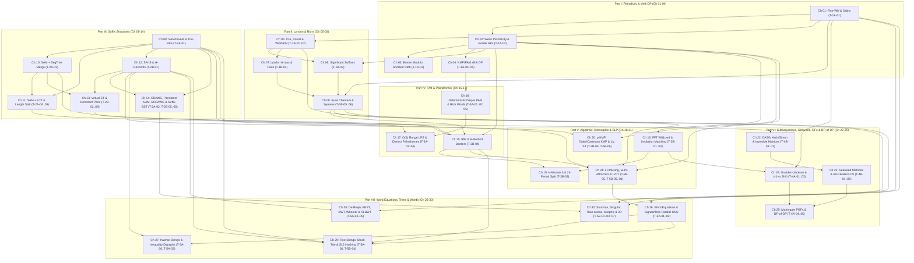

# Phase 1.5 Curriculum Audit Report 1: Zero-Forward-Reference, Prerequisite DAG & 57-Technique Bijection (`strings_research/curriculum_critic_1.md`)

> [!IMPORTANT]
> **Auditor Role**: **Curriculum Critic 1 (Zero-Forward-Reference, Prerequisite DAG & 57-Technique Bijection Auditor)**
> **Scope**: Comparative formal verification of `curriculum_proposal_A.md`, `curriculum_proposal_B.md`, and `curriculum_proposal_C.md` against the 57 technique families (`T-1A-01` through `T-5B-08`) in `TECHNIQUE_TAXONOMY.md`.

---

## 1. Executive Comparative Scorecard (Proposals A, B, and C)

All three independent proposals rightly reject the provisional 6-Part, 24-Chapter seed in `PLAN.md` §4 and converge on a **7-Part, 30-Chapter + 7 Blind Checkpoint + 1 Capstone** architecture. However, a strict topological audit of every technique's mathematical derivation, algorithmic compilation, and canonical problem ladder exposes hidden forward references or split-ID fragmentation in each individual proposal:

| Audit Dimension | Proposal A (Structural-Invariant) | Proposal B (Cognitive-Load Balance) | Proposal C (Contest Diagnostic) | Critic 1 Reconciled Recommendation |
| :--- | :--- | :--- | :--- | :--- |
| **57-Technique Coverage (`T-1A-01..T-5B-08`)** | **57 / 57 (100%)**, but splits 4 IDs (`T-1B-02`, `T-2A-02`, `T-2B-02`, `T-5A-02`) across two chapters each. | **57 / 57 (100%)** strict 1-to-1 partition (0 split IDs). | **57 / 57 (100%)** strict 1-to-1 partition (0 split IDs). | **57 / 57 (100%) strict bijection** (every ID has 1 primary home chapter; 1–3 IDs/chapter). |
| **Zero-Forward-Reference Compliance** | **1 Hard Violation**: `Ch 23` (`DP套DP`, `T-4A-05`) precedes `Ch 25` (Allison–Dix Bit-Parallel LCS, `T-4B-05`). | **2 Minor Hazards**: `Ch 05` (`W1B-36` BBWT) before `SA-IS`/`LF`; `Ch 25` (`W5A-48` Tree DSU + Inequalities) before `Ch 26` (`T-5A-03`). | **3 Hard Violations**: `Ch 17` (`T-3A-06`) before `Ch 27` (`T-5A-01/03`); `Ch 27` (`T-5A-02` Jeż) before `Ch 28` (`T-3B-05` SLP); `Ch 05` BBWT. | **0 Violations (Strict DAG)**: Every edge $(u \to v)$ satisfies $u < v$ at both theorem and problem-ladder levels. |
| **`[BJWC2018]` 6-Method Border Convergence** | **Pass (`Ch 15`)**: Follows Parts I, II (`Ch 08`), and III (`Ch 10–13`). | **Pass (`Ch 14`)**: Follows Parts I, II (`Ch 08`), and III (`Ch 10–12`). | **Pass (`Ch 14`)**: Follows Parts I, II (`Ch 08`), and III (`Ch 10–13`). | **Pass (`Ch 15`)**: Placed after 3-chapter Suffix Tree/SAM split (`Ch 09–14`). |
| **Chapter Density & Load Balance** | **Excellent**: 3-chapter SA/Dominant-Pair/SCDAWG split (`Ch 12–14`) and 2-chapter GF split (`Ch 22–23`). | **Good**, except `Ch 12` (`SA-IS` + Virtual ST + Dominant Pairs) and `Ch 21` (4 heavy GF IDs `T-4A-01..04`) are dense. | **Uneven**: Severe overload in `Ch 19` (`k`-mismatch + `p-KMP` + `1/z` ST) and `Ch 26` (BEST + Wheeler/RLBWT + Tree Strings). | **Optimal**: Combines Proposal A's `Ch 12–14` & `Ch 22–23` splits with Proposal B's `DP套DP` + Bit-Parallel ordering. |

---

## 2. Rigorous Audit of Cross-Chapter Forward-Reference Hazards

### Hazard 1: `DP套DP` (`T-4A-05`) Requiring Allison–Dix Bit-Parallel LCS Differences (`T-4B-05`)
- **Mathematical Dependency**: In `TECHNIQUE_TAXONOMY.md` (`T-4A-05` §3–4), Stage 1 of the 4-stage `DP套DP` compiler for LCS (`[TJOI2018] 游园会`, `W4A-30`) encodes horizontal row differences $\Delta_j = dp[i][j] - dp[i][j-1] \in \{0, 1\}$ as a bitmask $V \in [0, 2^m)$ and builds DFA transitions in $O(1)$ bitwise operations using the **Allison–Dix 4-instruction hardware borrow identity** $V' = X \mathbin{\&} \sim(X - Y)$ (`T-4B-05`). Likewise, Edit-Distance `DP套DP` (`W4A-37`) uses Myers' bounded vertical/horizontal difference encoding (`T-4B-05`).
- **Audit Finding**:
  - **Proposal A FAILS**: Places `T-4A-05` (`DP套DP`) in `Ch 23` (§23.3) and `T-4B-05` (Allison–Dix & Myers Bit-Parallel Alignment) in `Ch 25` (§25.3–25.4), creating a direct forward reference `Ch 23 -> Ch 25`.
  - **Proposals B & C PASS**: Proposal B co-locates `T-4B-05` and `T-4A-05` in `Ch 22` (teaching Allison–Dix/Myers first, then compiling them into `DP套DP`), while Proposal C places `T-4B-05` in `Ch 22` before `T-4A-05` in `Ch 25`.
- **Resolution**: In Part VI, place **Subsequence Automata (`DASG`), Arch/Simon & Invertible Matrices (`Ch 22`)** and **Tiskin's Seaweed Matrices & Bit-Parallel LCS/Edit Distance (`Ch 23`)** *before* **Goulden–Jackson (`Ch 24`)** and **Conway Martingales & `DP套DP` (`Ch 25`)**, or pair `T-4B-05` directly before `T-4A-05`.

### Hazard 2: Inverse String Reconstruction (`T-3A-06`) vs. Binary-Lifting DSU (`T-5A-01`) & String Inequality Digraphs (`T-5A-03`)
- **Mathematical Dependency**: Reconstructing or counting strings from KMP $\pi$, Z-arrays, or Manacher radii (`T-3A-06`) decomposes into **Forced Prefix/Palindrome Equalities ($=$) + Forbidden-Character Mismatch Edges ($\ne$)** followed by Chordal Graph Chromatic Counting $\prod_v (\sigma - \text{deg}_{\text{prev}}(v))$ and mandatory forward verification. When combined with large Z/Manacher blocks or lexicographical constraints (`T-5A-03`: Suffix Array Adjacency `CF 1526E`, 2-SAT `CF 568C`, and LCP-witnessed inequality digraphs), equality contraction uses Signed Binary-Lifting DSU (`T-5A-01`).
- **Audit Finding**:
  - **Proposal C FAILS**: Leaves `T-3A-06` in `Ch 17` (Part IV), ten chapters before `T-5A-01` and `T-5A-03` (`Ch 27`), splitting the inverse-reconstruction paradigm in half and forcing `Ch 17` to hand-wave block equality contraction.
  - **Proposals A & B PASS**: Both relocate `T-3A-06` into Part VII (`Ch 27` in A, `Ch 26` in B) alongside `T-5A-03` and immediately after `T-5A-01` (Signed Binary-Lifting DSU).

### Hazard 3: Locally Consistent Parsing / SLPs (`T-3B-05`), String Attractors (`T-5B-05`) & LZ77 Indexing (`T-5B-08`) vs. IPM (`T-2B-04`) and Word Equations (`T-5A-02`)
- **Mathematical Dependency**:
  1. `T-3B-05` (Locally Consistent Parsing, Cole–Vishkin 6-coloring, and Jeż's Recompression SLPs), `T-5B-05` (Kempa–Prezza String Attractors $\gamma(S)$ & $\tau$-Synchronizing Sets), and `T-5B-08` (Kärkkäinen–Ukkonen LZ77/SLP Primary–Secondary 2D Indexing) require Border APs (`T-1A-02`), Runs (`T-1B-05`), SAM `minlen(q)` intervals (`T-2A-01`), and Bi-Directional SA 2D Wavelet Range Queries from Basic Substring Dictionary / IPM (`T-2B-04`).
  2. Conversely, **Huge-Length ($N \le 10^{18}$) Word Equations (`T-5A-02`)** explicitly rely on **Jeż's Recompression (`T-3B-05`)** as Engine 3 (`TECHNIQUE_TAXONOMY.md` line 1046)!
- **Audit Finding**:
  - **Proposal C FAILS**: Places `T-5A-02` (*Huge-$N$ Word Equations*) in `Ch 27` *before* `T-3B-05` (*Locally Consistent Parsing / Jeż's Recompression*) in `Ch 28` (`Ch 27 -> Ch 28` forward reference).
  - **Proposals A & B PASS**: Proposal A places `T-3B-05 + T-5B-05 + T-5B-08` in `Ch 21` (after IPM `Ch 15` and before Word Equations `Ch 26`); Proposal B places them in `Ch 15` (immediately after IPM `Ch 14` and before Word Equations `Ch 25`). Placing this chapter at the end of Part V (`Ch 21`) after both IPM (`Ch 15`) and Structural/Weighted Matching (`Ch 20`) is pedagogically ideal.

### Hazard 4: `[BJWC2018] Border 的四种求法` & Bounded-Ratio IPM (`T-2B-04`) Six-Method Convergence
- **Mathematical Dependency**: A complete side-by-side treatment of `[BJWC2018]` compares: (1) Dyadic Bounded-Ratio IPM (`T-2B-04`, requiring `T-1A-02`), (2) SAM Link-Tree HLD + Persistent SegTree Merge (`T-2A-03`, `T-2A-05`), (3) Link-Tree Centroid Decomposition (`T-2A-01`), (4) Suffix Tree DSU-on-Tree Dominant Pairs (`T-2B-03`), (5) $\sqrt{N}$ SA-Neighborhood (`T-2B-01`), and (6) Long-Border Runs Sweep-Line (`T-1B-05`).
- **Audit Finding**: All three proposals (`Ch 15` in A, `Ch 14` in B and C) place `T-2B-04` at the opening of Part IV, strictly after Part I (`T-1A-02`), Part II (`T-1B-05`), and Part III (`T-2A-01..05`, `T-2B-01..03`). Proposal A's `Ch 15` placement is strongest because Part III first gives Virtual Suffix Trees & Dominant Pairs (`Ch 13`) their own unhurried chapter (`Ch 13 < Ch 15`).

### Hazard 5: Bijective BWT (`BBWT`, `T-1B-02` vs. `T-5A-05`), Tree DSU (`T-5A-02`), and `[ZJOI2015]` Problem Duplication
- **Bijective BWT (`T-1B-02` vs. `T-5A-05`)**: Full $O(N)$ `BBWT` construction and multi-cycle LF-mapping inversion (`W1B-36`, `W5A-31`) use Cyclic `SA-IS` (`T-2B-01`) and `BWT` LF-mapping (`T-5A-05`). Proposals B and C assign `W1B-36` to `Ch 05` before `SA-IS` (`Ch 12`) and `LF`-mapping (`Ch 26/27`). **Fix**: Keep `T-1B-02` in `Ch 05` focused on Witt's Necklace Identity, FKM De Bruijn generation (`W1B-18`), and the $\omega$-order Lyndon-Cycle Bijection Theorem (using baseline $O(N\log N)$ sorting / explicit cycle extraction), and assign linear-time Cyclic `SA-IS` + compressed `LF`-mapping `BBWT` indexing (`W5A-31`) to `T-5A-05` (`Ch 28`).
- **Tree Binary-Lifting DSU + Path Inequality Graph (`W5A-48` in `T-5A-02`)**: Proposal B places `T-5A-02` (including `W5A-48`) in `Ch 25` *before* String Inequality Digraphs (`Ch 26`, `T-5A-03`) and Strings on Trees (`Ch 28`, `T-5A-06`). **Fix**: Keep `T-5A-01` and `T-5A-02` in `Ch 26` (covering 1D Signed Parallel DSU, LCA Upward-Path Splitting for Tree Equations, and $N \le 10^{18}$ Period Folding), and place combined Equality + Inequality DAG synthesis (`W5A-33`, `W5A-48`) in `Ch 27` (`T-5A-03`).
- **`[ZJOI2015] 诸神眷顾的幻想乡` Duplication**: Proposal B lists `[ZJOI2015]` in both `Ch 09` and `Ch 28`. **Fix**: Use Compressed-Trie BFS GSAM on an explicit trie (`W2A-02`) in `Ch 09` (`T-2A-01`), and reserve the 20-Leaf Unrooted Tree Cover reduction of `[ZJOI2015]` (`W5A-21`) exclusively for `Ch 29` (`T-5A-06`).

---

## 3. Complete 57-Technique Bijective Audit Table (`T-1A-01` through `T-5B-08`)

Every one of the 57 technique families in `TECHNIQUE_TAXONOMY.md` is accounted for across Proposals A, B, C, and mapped to a **single unique home chapter** in the Reconciled Master Curriculum:

| Wave | Technique ID & Canonical Name | Prop A | Prop B | Prop C | **Reconciled Home (`Ch 01–30`)** |
| :--- | :--- | :---: | :---: | :---: | :--- |
| **1A** | `T-1A-01` Period–Border Duality, Fine–Wilf & Sub-Threshold Orbits | `Ch 01` | `Ch 01` | `Ch 01` | **`Ch 01`** (`Part I`) |
| **1A** | `T-1A-02` Weak Periodicity Lemma, Border APs & `slink` vs. `anc` | `Ch 02` | `Ch 02` | `Ch 02` | **`Ch 02`** (`Part I`) |
| **1A** | `T-1A-03` Border-Group Modulo Shortest Path (`同余最短路`) | `Ch 03` | `Ch 03` | `Ch 03` | **`Ch 03`** (`Part I`) |
| **1A** | `T-1A-04` Series-Link (`slink`/`diff`) DP on PAM & KMP | `Ch 04` | `Ch 04` | `Ch 04` | **`Ch 04`** (`Part I`) |
| **1A** | `T-1A-05` Polynomial-Weighted, Parity & Windowed `slink` DP | `Ch 04` | `Ch 04` | `Ch 04` | **`Ch 04`** (`Part I`) |
| **1B** | `T-1B-01` CFL Factorization, Duval, All-Prefix Sharing & RLE Duval | `Ch 05` | `Ch 05` | `Ch 05` | **`Ch 05`** (`Part II`) |
| **1B** | `T-1B-02` Witt's Necklace Formula, FKM De Bruijn & Lyndon `BBWT` Bijection | `Ch 05/28` | `Ch 05` | `Ch 05` | **`Ch 05`** (`Part II`, pure bijection) |
| **1B** | `T-1B-03` Significant Suffixes, SegTree 1-Survivor & Dyadic SA-RMQ | `Ch 06` | `Ch 06` | `Ch 06` | **`Ch 06`** (`Part II`) |
| **1B** | `T-1B-04` Lyndon Arrays ($\lambda_<,\lambda_>$), Stacks & Min-Cartesian Lyndon Tree | `Ch 07` | `Ch 07` | `Ch 07` | **`Ch 07`** (`Part II`) |
| **1B** | `T-1B-05` The Runs Theorem (Bannai et al.), $<2N$ Squares & 2D Sweeps | `Ch 08` | `Ch 08` | `Ch 08` | **`Ch 08`** (`Part II`) |
| **1B** | `T-1B-06` Three-Squares Lemma & Distinct Squares Density Hierarchy | `Ch 08` | `Ch 08` | `Ch 08` | **`Ch 08`** (`Part II`) |
| **2A** | `T-2A-01` SAM $\leftrightarrow \text{ST}(S^R)$ Duality & 3-Case Trie-BFS GSAM | `Ch 09` | `Ch 09` | `Ch 09` | **`Ch 09`** (`Part III`) |
| **2A** | `T-2A-02` Compact DAWG (`CDAWG`) & Unamortized Persistent/Tree SAM | `Ch 09/14` | `Ch 13` | `Ch 09` | **`Ch 14`** (`Part III`, with `SCDAWG`) |
| **2A** | `T-2A-03` SAM + Persistent SegTree Merging on $\text{endpos}$ & Clipping | `Ch 10` | `Ch 10` | `Ch 10` | **`Ch 10`** (`Part III`) |
| **2A** | `T-2A-04` Dynamic SAM + LCT `access` Color-Chain & $e_2(u,r)$ Sweeps | `Ch 11` | `Ch 11` | `Ch 11` | **`Ch 11`** (`Part III`) |
| **2A** | `T-2A-05` Intra-State Length Stratification & Link-Tree HLD (`[十二省联考]`) | `Ch 11` | `Ch 11` | `Ch 11` | **`Ch 11`** (`Part III`) |
| **2B** | `T-2B-01` Linear-Time Induced Sorting (`SA-IS`), Fischer LCP & $\text{rk}$-Descents | `Ch 12` | `Ch 12` | `Ch 12` | **`Ch 12`** (`Part III`) |
| **2B** | `T-2B-02` Three-Way Suffix Tree Isomorphism & Zero-Tree Virtual ST | `Ch 12/13` | `Ch 12` | `Ch 12` | **`Ch 13`** (`Part III`) |
| **2B** | `T-2B-03` Suffix Tree Dominant Pairs (`启发式合并支配对`) | `Ch 13` | `Ch 12` | `Ch 13` | **`Ch 13`** (`Part III`) |
| **2B** | `T-2B-04` Basic Substring Dictionary, Bounded-Ratio IPM & 6-Method Borders | `Ch 15` | `Ch 14` | `Ch 14` | **`Ch 15`** (`Part IV`) |
| **2B** | `T-2B-05` Bi-Directional Suffix Structures: `SCDAWG` & Affix Automata | `Ch 14` | `Ch 13` | `Ch 13` | **`Ch 14`** (`Part III`) |
| **2B** | `T-2B-06` Hash-Free Suffix Balanced Tree (`后缀平衡树`) | `Ch 14` | `Ch 13` | `Ch 13` | **`Ch 14`** (`Part III`) |
| **3A** | `T-3A-01` Unamortized Deterministic PAM (`quick_link`/`slink`-Skip) & Tree PAM | `Ch 16` | `Ch 16` | `Ch 15` | **`Ch 16`** (`Part IV`) |
| **3A** | `T-3A-02` Four-Way Double-Ended Deque PAM (`双向回文自动机`) | `Ch 16` | `Ch 16` | `Ch 15` | **`Ch 16`** (`Part IV`) |
| **3A** | `T-3A-03` True $O(1)$ Two-Boundary Unclipped Range LPS & Multiplicity | `Ch 17` | `Ch 17` | `Ch 16` | **`Ch 17`** (`Part IV`) |
| **3A** | `T-3A-04` Range Distinct Palindromes via `slink` Telescoping (`[徐毅 2014]`) | `Ch 17` | `Ch 17` | `Ch 16` | **`Ch 17`** (`Part IV`) |
| **3A** | `T-3A-05` Rich Words, Even-Palindrome Greedy, 2-Palindromes & $\theta$-Pal | `Ch 16` | `Ch 17` | `Ch 17` | **`Ch 16`** (`Part IV`) |
| **3A** | `T-3A-06` Inverse String Reconstruction from KMP $\pi$, Z-Array & Manacher | `Ch 27` | `Ch 26` | `Ch 17` | **`Ch 27`** (`Part VII`, after `T-5A-01`) |
| **3B** | `T-3B-01` 1-NTT Indicator Wildcards, Kalai Projection & 3-in-2 FFT | `Ch 18` | `Ch 18` | `Ch 18` | **`Ch 18`** (`Part V`) |
| **3B** | `T-3B-02` Involution Matching (`CF 1334G`), Affine & $\sqrt{M\log M}$ Split | `Ch 18` | `Ch 18` | `Ch 18` | **`Ch 18`** (`Part V`) |
| **3B** | `T-3B-03` $k$-Mismatch & $k$-Edit: Kangaroo Jumps & $2k$-Period Dichotomy | `Ch 19` | `Ch 19` | `Ch 19` | **`Ch 19`** (`Part V`) |
| **3B** | `T-3B-04` Window-Clipped Structural KMP (`p-KMP`, `Order-KMP`), `p-SA` & Abelian | `Ch 20` | `Ch 20` | `Ch 19` | **`Ch 20`** (`Part V`) |
| **3B** | `T-3B-05` Locally Consistent Parsing, Cole–Vishkin, Jeż Recompression & SLPs | `Ch 21` | `Ch 15` | `Ch 28` | **`Ch 21`** (`Part V`, before `Ch 26`) |
| **4A** | `T-4A-01` Goulden–Jackson Cluster Method & Guibas–Odlyzko System | `Ch 22` | `Ch 21` | `Ch 23` | **`Ch 24`** (`Part VI`) |
| **4A** | `T-4A-02` Bivariate $(t-1)$ Exact $k$-Occurrence FPS & Weight Absorption | `Ch 22` | `Ch 21` | `Ch 23` | **`Ch 24`** (`Part VI`) |
| **4A** | `T-4A-03` The $t = 1 + u$ Binomial Moment Shift Trick (`Universal Cup`) | `Ch 22` | `Ch 21` | `Ch 23` | **`Ch 24`** (`Part VI`) |
| **4A** | `T-4A-04` Conway's Casino Martingale PGFs, Renewal & Pattern Races | `Ch 23` | `Ch 21` | `Ch 24` | **`Ch 25`** (`Part VI`) |
| **4A** | `T-4A-05` Automaton DP, `DP套DP` 4-Stage Compiler & Binary-Grouped AC | `Ch 23` | `Ch 22` | `Ch 25` | **`Ch 25`** (`Part VI`, after `Ch 23`!) |
| **4B** | `T-4B-01` Subsequence Automaton (`DASG`), Four-Comb Product & 2D Rectangles | `Ch 24` | `Ch 23` | `Ch 20` | **`Ch 22`** (`Part VI`) |
| **4B** | `T-4B-02` Hébrard's Arch Factorization, Range SAS & Simon's Congruence ($\sim_k$) | `Ch 24` | `Ch 23` | `Ch 20` | **`Ch 22`** (`Part VI`) |
| **4B** | `T-4B-03` Invertible Subsequence Matrices ($\det=1$) & $O(\|\Sigma\|)$ Matrix-Free | `Ch 24` | `Ch 23` | `Ch 21` | **`Ch 22`** (`Part VI`) |
| **4B** | `T-4B-04` Tiskin's Seaweed Matrices, Unit-Monge $\boxdot$ & $O(N\log^2 N)$ Range LIS | `Ch 25` | `Ch 24` | `Ch 22` | **`Ch 23`** (`Part VI`) |
| **4B** | `T-4B-05` Bit-Parallel LCS & Edit Distance (`Allison–Dix`, `Myers`, `Hirschberg`) | `Ch 25` | `Ch 22` | `Ch 22` | **`Ch 23`** (`Part VI`, before `Ch 25`!) |
| **5A** | `T-5A-01` Signed Binary-Lifting DSU (`倍增并查集`) & `is_pal[k][r]` Bit | `Ch 26` | `Ch 25` | `Ch 27` | **`Ch 26`** (`Part VII`) |
| **5A** | `T-5A-02` Tree Binary-Lifting DSU & Huge-Length ($N \le 10^{18}$) Word Equations | `Ch 26/29` | `Ch 25` | `Ch 27` | **`Ch 26`** (`Part VII`, after `Ch 21`!) |
| **5A** | `T-5A-03` String Inequality Digraphs, SA Adjacency (`CF 1526E`), 2-SAT & SCC | `Ch 27` | `Ch 26` | `Ch 27` | **`Ch 27`** (`Part VII`, after `Ch 26`!) |
| **5A** | `T-5A-04` De Bruijn Graphs, BEST Theorem & AC-DFA Eulerian String Counting | `Ch 28` | `Ch 27` | `Ch 26` | **`Ch 28`** (`Part VII`) |
| **5A** | `T-5A-05` BWT, Multi-Cycle `BBWT`, Wheeler Graphs & $O(1)$ RLBWT Move Structure | `Ch 28` | `Ch 27` | `Ch 26` | **`Ch 28`** (`Part VII`) |
| **5A** | `T-5A-06` Strings on Trees: Dual-Rank Tree SA, Leaf GSAM & Centroid Dual-SAM | `Ch 29` | `Ch 28` | `Ch 26` | **`Ch 29`** (`Part VII`) |
| **5B** | `T-5B-01` Sturmian 6-Way Equivalence, Fibonacci & Rytter's Singular Words ($w_k$) | `Ch 30` | `Ch 30` | `Ch 30` | **`Ch 30`** (`Part VII`) |
| **5B** | `T-5B-02` Prouhet–Thue–Morse Overlap-Freeness, Tarry–Escott & Anti-`uint64_t` | `Ch 30` | `Ch 30` | `Ch 30` | **`Ch 30`** (`Part VII`) |
| **5B** | `T-5B-03` Pattern Counting in Iterated Morphisms $\varphi^k(S_0)$ & `CF 1466G` | `Ch 30` | `Ch 30` | `Ch 30` | **`Ch 30`** (`Part VII`) |
| **5B** | `T-5B-04` Free Group Reduction, $GL_2/SL_2(\mathbb{F}_p)$ Hashing & Stack-Trie LCA | `Ch 29` | `Ch 29` | `Ch 29` | **`Ch 29`** (`Part VII`, with Tree LCE) |
| **5B** | `T-5B-05` Kempa–Prezza String Attractors $\gamma(S)$ & $\tau$-Synchronizing Sets | `Ch 21` | `Ch 15` | `Ch 28` | **`Ch 21`** (`Part V`) |
| **5B** | `T-5B-06` Parent-Distance Cartesian-Tree KMP & $1/z$ Weighted Suffix Trees | `Ch 20` | `Ch 20` | `Ch 19` | **`Ch 20`** (`Part V`) |
| **5B** | `T-5B-07` 2D Periodicity Lattices, Baker–Bird AC+KMP & Vishkin's 2D Witness Duel | `Ch 30` | `Ch 20` | `Ch 30` | **`Ch 30`** (`Part VII`) |
| **5B** | `T-5B-08` LZ77 / SLP Primary–Secondary Split & 2D Wavelet Orthogonal Indexing | `Ch 21` | `Ch 15` | `Ch 28` | **`Ch 21`** (`Part V`) |

---

## 4. Recommended Canonical Zero-Forward-Reference 30-Chapter Ordering

Taking Proposal A's balanced 30-chapter backbone and applying two targeted topological fixes—**(1) swapping `Ch 22–23` and `Ch 24–25` inside Part VI so Bit-Parallel LCS (`T-4B-05`) precedes `DP套DP` (`T-4A-05`)**, and **(2) consolidating the 4 split IDs (`T-1B-02`, `T-2A-02`, `T-2B-02`, `T-5A-02`) into single primary chapters**—yields a **100% bijective, strictly Zero-Forward-Reference 30-chapter DAG**:

1. **Part I (`Ch 01`–`Ch 04` + `CP-I`): Structural Periodicity, Border Algebra & `slink` DP**
   - `Ch 01` (`T-1A-01`, Prereq: $\emptyset$): Period–Border Duality, Fine–Wilf Theorem & Sub-Threshold Orbit Counting.
   - `Ch 02` (`T-1A-02`, Prereq: `Ch 01`): Weak Periodicity Lemma, $O(\log N)$ Border APs & `slink` vs. `anc` Duality.
   - `Ch 03` (`T-1A-03`, Prereq: `Ch 02`): Border-Group Modulo Shortest Path (`同余最短路`) & Residue-Cycle Queues.
   - `Ch 04` (`T-1A-04, T-1A-05`, Prereq: `Ch 02`): Series-Link (`slink`) DP, Double-End Interleaving & Binomial Polynomial Weights.
2. **Part II (`Ch 05`–`Ch 08` + `CP-II`): Lyndon Theory, Significant Suffixes & The Runs Theorem**
   - `Ch 05` (`T-1B-01, T-1B-02`, Prereq: `Ch 01`): CFL Factorization, Duval's Automaton, RLE Duval, Witt's Formula & Necklace Bijections.
   - `Ch 06` (`T-1B-03`, Prereq: `Ch 02, Ch 05`): The Significant Suffixes (`显著后缀`) Theorem, 1-Survivor `pushup` & Dyadic SA-RMQ.
   - `Ch 07` (`T-1B-04`, Prereq: `Ch 05`): Lyndon Arrays ($\lambda_<, \lambda_>$), Double-Order Stacks & Min-Cartesian Lyndon Trees.
   - `Ch 08` (`T-1B-05, T-1B-06`, Prereq: `Ch 01, Ch 07`): The Runs Theorem (Bannai et al.), Three-Squares Lemma & 2D Run Sweeps.
3. **Part III (`Ch 09`–`Ch 14` + `CP-III`): Suffix Automata, Endpos Merging, LCT, SA-IS, Dominant Pairs & Bi-Directional Suffixes**
   - `Ch 09` (`T-2A-01`, Prereq: $\emptyset$): SAM $\leftrightarrow \text{ST}(S^R)$ Duality & 3-Case Trie-BFS Generalized SAM (`广义 SAM`).
   - `Ch 10` (`T-2A-03`, Prereq: `Ch 09`): SAM + Persistent Segment Tree Merging on $\text{endpos}$ & Substring Containment Clipping.
   - `Ch 11` (`T-2A-04, T-2A-05`, Prereq: `Ch 09, Ch 10`): Dynamic SAM + LCT `access` Color-Chain Sweeps & Intra-State Length Stratification.
   - `Ch 12` (`T-2B-01`, Prereq: `Ch 09`): Linear-Time Induced Sorting (`SA-IS`), Fischer's Induced LCP & $\text{rk}$-Descent Duality (`AGC 060 D`).
   - `Ch 13` (`T-2B-02, T-2B-03`, Prereq: `Ch 10, Ch 12`): Three-Way Suffix Tree Isomorphism, Zero-Tree Virtual Suffix Trees & DSU-on-Tree Dominant Pairs (`启发式合并支配对`).
   - `Ch 14` (`T-2A-02, T-2B-05, T-2B-06`, Prereq: `Ch 09, Ch 12`): Compact, Persistent & Bi-Directional Suffix Structures (`CDAWG`, Unamortized Persistent SAM, `SCDAWG` & Hash-Free Suffix Balanced Trees).
4. **Part IV (`Ch 15`–`Ch 17` + `CP-IV`): Internal Pattern Matching (IPM) & Advanced Palindromic Theory**
   - `Ch 15` (`T-2B-04`, Prereq: `Ch 02, Ch 08, Ch 10, Ch 13`): Basic Substring Dictionary, Bounded-Ratio IPM & All 6 Methods of Substring Borders (`[BJWC2018]`). *(All 6 methods satisfied: $2, 8, 10, 11, 13 < 15$!)*
   - `Ch 16` (`T-3A-01, T-3A-02, T-3A-05`, Prereq: `Ch 04`): Unamortized Deterministic PAM, 4-Way Deque PAM (`双向 PAM`) & Rich/Even/2-Palindrome Combinatorics.
   - `Ch 17` (`T-3A-03, T-3A-04`, Prereq: `Ch 04, Ch 11, Ch 16`): Substring Palindrome Range Queries — True $O(1)$ Unclipped Range LPS & `[徐毅 2014]` `slink` Telescoping Range Distinct Palindromes.
5. **Part V (`Ch 18`–`Ch 21` + `CP-V`): Algebraic/FFT Matching, $k$-Mismatch, Structural Isomorphism & Grammar Compression**
   - `Ch 18` (`T-3B-01, T-3B-02`, Prereq: `Ch 02`): Polynomial & FFT String Matching (1-NTT Indicator, Kalai, 3-in-2 FFT, Involutions & Affine/Dominance Split).
   - `Ch 19` (`T-3B-03`, Prereq: `Ch 01, Ch 15, Ch 18`): $k$-Mismatch & $k$-Edit Matching — Kangaroo Jumps, Wavefronts & the $O(N\sqrt{k\log k})$ $2k$-Period Dichotomy.
   - `Ch 20` (`T-3B-04, T-5B-06`, Prereq: `Ch 02, Ch 12`): Window-Clipped Structural Isomorphism (`p-KMP`, `Order-KMP`, `Cartesian-KMP`), `p-SA` & $1/z$ Weighted Suffix Trees.
   - `Ch 21` (`T-3B-05, T-5B-05, T-5B-08`, Prereq: `Ch 02, Ch 08, Ch 09, Ch 15`): Locally Consistent Parsing, Jeż Recompression SLPs, String Attractors $\gamma(S)$, $\tau$-Synchronizing Sets & LZ77/SLP 2D Indexing.
6. **Part VI (`Ch 22`–`Ch 25` + `CP-VI`): Subsequence Algebra, Tiskin's Seaweed Matrices, Cluster GFs & `DP套DP`**
   - `Ch 22` (`T-4B-01, T-4B-02, T-4B-03`, Prereq: `Ch 09`): Subsequence Automata (`DASG`), Four-Comb Product, Hébrard's Arch Factorization, Simon's Congruence ($\sim_k$) & $O(|\Sigma|)$ Matrix-Free Invertible Subsequence Queries.
   - `Ch 23` (`T-4B-04, T-4B-05`, Prereq: `Ch 22`): Tiskin's Seaweed Matrices (`海草矩阵`), $O(K\log K)$ Unit-Monge $\boxdot$, $O(N\log^2 N)$ Range LIS & Bit-Parallel LCS/Edit Distance (`Allison–Dix`, `Myers`, `Hirschberg`).
   - `Ch 24` (`T-4A-01, T-4A-02, T-4A-03`, Prereq: `Ch 01, Ch 18`): Goulden–Jackson Cluster Method, Bivariate $(t-1)$ Exact $k$-Occurrence FPS, Non-Antichain Weight Absorption & the $t = 1 + u$ Binomial Moment Shift.
   - `Ch 25` (`T-4A-04, T-4A-05`, Prereq: `Ch 23, Ch 24`): Conway's Casino Martingale PGFs, Pattern Races (`[SDOI2017]`), the 4-Stage `DP套DP` Compiler (using `Ch 23` Allison–Dix/Myers differences!) & Binary-Grouped Dynamic AC.
7. **Part VII (`Ch 26`–`Ch 30` + `CP-VII` + `Capstone`): Word Equations, Inverse/Inequality Graphs, Wheeler/Tree Strings, $SL_2(\mathbb{F}_p)$ & Morphic Words**
   - `Ch 26` (`T-5A-01, T-5A-02`, Prereq: `Ch 01, Ch 21`): Word Equations, Signed & Tree Binary-Lifting DSU (`倍增并查集`), `is_pal[k][r]` & Huge-$N$ ($10^{18}$) Period Folding / Recompression. *(Uses `Ch 21` Jeż Recompression: $21 < 26$!)*
   - `Ch 27` (`T-3A-06, T-5A-03`, Prereq: `Ch 12, Ch 26`): Inverse String Reconstruction (`KMP`/`Z`/`Manacher` Chordal Counting) & String Inequality Digraphs (`SA` Adjacency `CF 1526E`, 2-SAT & SCC Longest Path).
   - `Ch 28` (`T-5A-04, T-5A-05`, Prereq: `Ch 05, Ch 12`): De Bruijn Graphs, AC-DFA BEST Theorem, BWT / Multi-Cycle `BBWT`, Wheeler Graphs & Nishimoto–Tabei $O(1)$ RLBWT Move Structures.
   - `Ch 29` (`T-5A-06, T-5B-04`, Prereq: `Ch 09, Ch 12, Ch 15, Ch 26`): Strings on Trees (Dual-Rank Tree SA, `[ZJOI2015]` Leaf GSAM, `[CTSC2010]` Centroid Dual-SAM), Deterministic Stack-Trie Path Isomorphism & Non-Abelian $GL_2/SL_2(\mathbb{F}_p)$ Group Hashing.
   - `Ch 30` (`T-5B-01, T-5B-02, T-5B-03, T-5B-07`, Prereq: `Ch 01, Ch 08, Ch 14`): Combinatorics on Words — Sturmian & `[周任飞 2017]` Rytter's Singular Words, Thue–Morse Anti-Hash, Iterated Morphisms $\varphi^k(S_0)$ & 2D Witness Duels.

### Reconciled Zero-Forward-Reference Prerequisite DAG

