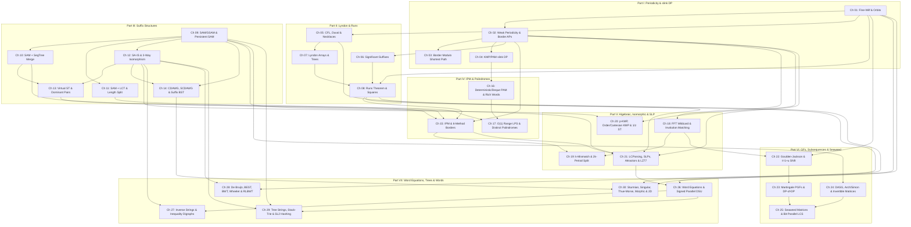

# Post-Research Curriculum Proposal A: The 7-Part, 30-Chapter Structural-Invariant Architecture (`strings_research/curriculum_proposal_A.md`)

> [!IMPORTANT]
> **Curriculum Architect Subagent A — Phase 1.5 Independent Redesign**
> This proposal (`strings_research/curriculum_proposal_A.md`) is an independent, bottom-up curriculum architecture designed from the reconciled 115-iteration discovery corpus (`strings_research/TECHNIQUE_TAXONOMY.md`, spanning all **57 technique families `T-1A-01..T-5B-08`** and 430+ cataloged problems). It dissolves the 10 research collection waves and regional buckets into a **7-Part, 30-Chapter + 7 Blind Checkpoint + 1 Grandmaster Capstone** textbook under `strings/` with a **strictly acyclic Zero-Forward-Reference Prerequisite DAG**.

---

## 1. Executive Summary & Architectural Diagnosis of the Pre-Research 24-Chapter Seed

The provisional 6-Part, 24-Chapter hypothesis in `PLAN.md` §4 served as a pre-research scouting grid, but the 115-iteration multilingual audit (`[EN]` / `[ZH]` `国家集训队论文` / `[JA]` treatises) uncovered **24 major structural and frontier sub-paradigms** that break the 24-chapter boundary:

1. **Severe Pedagogical Overcrowding in Suffix Structures (Seed `Ch 12`)**: Seed `Ch 12` attempted to squeeze Linear-Time Induced Sorting (`SA-IS`, Fischer's Induced LCP, and `AGC 060 D` $\text{rk}$-descent duality), Virtual Suffix Trees (`后缀树虚树`), DSU-on-Tree Suffix Tree Dominant Pairs (`启发式合并支配对`), Symmetric Compact DAWGs (`SCDAWG` / `CDAWG`), and Hash-Free Suffix Balanced Trees (`后缀平衡树`) into a single chapter. Each of these has its own non-trivial invariant and failure modes; cramming them violates the 4-step "Zero Magic Invariants" derivation standard.
2. **Forward-Reference Cycles Between Internal Pattern Matching (IPM), Runs, and Palindromes**: Seed `Ch 14` (`[BJWC2018] Border 的四种求法`) requires both SAM Link-Tree HLD/DSU-on-Tree (`T-2A-03..05`, `T-2B-03`) and Bannai et al.'s Runs Theorem (`T-1B-05`), while Seed `Ch 16` mixed Range Palindrome Queries (`T-3A-03`, `T-3A-04`), Rich Words (`T-3A-05`), and Inverse String Reconstruction (`T-3A-06`), even though Inverse Reconstruction from KMP/Z/Manacher is structurally coupled to String Inequality Digraphs and SA Adjacency (`T-5A-03`).
3. **Unplaced Frontier & Compressed-String Paradigms**: Newly synthesized topics—including **Kempa–Prezza String Attractors $\gamma(S)$ & $\tau$-Synchronizing Sets (`T-5B-05`)**, **Kärkkäinen–Ukkonen LZ77/SLP Primary–Secondary 2D Range Indexing (`T-5B-08`)**, **Parent-Distance Cartesian-Tree KMP & $1/z$ Weighted Suffix Trees (`T-5B-06`)**, **Universal Cup $t = 1 + u$ Binomial Moment Shift in Bivariate Goulden–Jackson (`T-4A-03`)**, **Hébrard's Arch Factorization & Simon's Congruence $\sim_k$ (`T-4B-02`)**, **$O(N\log^2 N)$ Sparse Range LIS via Tiskin's Seaweed $\boxdot$ (`T-4B-04`)**, **Nishimoto–Tabei $O(1)$ RLBWT Move Structures & Wheeler Graphs (`T-5A-05`)**, **Stack-Trie Path Isomorphism (`T-5B-04`)**, **Rytter's Singular Words in Fibonacci Strings (`T-5B-01`)**, and **Vishkin's 2D Witness Duel (`T-5B-07`)**—had no dedicated section homes in the 24-chapter seed.
4. **Duplicated Bijective BWT (`BBWT`) Across Waves 1B and 5A**: `T-1B-02` (Witt's Necklace Formula, FKM De Bruijn Generation, and Lyndon-Cycle `BBWT`) and `T-5A-05` (BWT, `BBWT`, Wheeler Graphs, and RLBWT Move Structures) overlap. We resolve this cleanly by teaching the **Chen–Fox–Lyndon Necklace Bijection, Witt's Formula & FKM Generation (`T-1B-02`)** in `Ch 05`, and building the **LF-Mapping, Multi-Cycle `BBWT` Inversion, Wheeler DFA & $O(1)$ RLBWT Move Structure (`T-5A-05`)** in `Ch 28` with an explicit backward link to `Ch 05`.

---

## 2. Summary of the 6 Structural Splits & Expansions (24 Chapters $\to$ 7 Parts, 30 Chapters)

| Redesign Action | Pre-Research Seed (`PLAN.md` §4) | Post-Research Architecture (`Proposal A`) | Pedagogical & Prerequisite Rationale |
| :--- | :--- | :--- | :--- |
| **Split 1: Suffix Array, Dominant Pairs & Bi-Directional Suffixes** | `Ch 12` (1 chapter) | **`Ch 12`, `Ch 13`, `Ch 14`** (3 chapters in Part III) | Separates `SA-IS` + Fischer LCP + $\text{rk}$-descent (`Ch 12`), Zero-Tree Virtual Suffix Trees + DSU-on-Tree Dominant Pairs `启发式合并支配对` (`Ch 13`), and `CDAWG` + `SCDAWG` + Hash-Free Suffix Balanced Trees `后缀平衡树` (`Ch 14`). |
| **Split 2: Approximate vs. Isomorphic Matching & Compressed Indexing** | `Ch 17` + `Ch 23` (2 chapters across Parts V & VI) | **Part V (`Ch 19`–`Ch 22`)** (4 dedicated chapters) | Splits Polynomial/FFT Wildcard & Involution Matching (`Ch 19`), $k$-Mismatch Kangaroo & $2k$-Period Dichotomy (`Ch 20`), Window-Clipped Structural KMP (`p-KMP`, `Order-KMP`, `Cartesian-KMP`) & $1/z$ Weighted Suffix Trees (`Ch 21`), and Locally Consistent Parsing / Jeż Recompression SLPs + String Attractors $\gamma(S)$ + $\tau$-Synchronizing Sets + LZ77/SLP 2D Indexing (`Ch 22`). |
| **Split 3: Goulden–Jackson Moment Shift vs. Martingale PGFs & `DP套DP`** | `Ch 18` + `Ch 19` (mixed with DASG) | **`Ch 23` & `Ch 24`** (Part VI) | Gives Goulden–Jackson, Bivariate $(t-1)$ Exact $k$-Occurrence FPS, Non-Antichain Weight Absorption & the $t=1+u$ Binomial Moment Shift (`Ch 23`) their own chapter before Conway's Casino Martingale PGFs, Pattern Races, `DP套DP` 4-Stage Compiler & Binary-Grouped AC (`Ch 24`). |
| **Split 4: Subsequence Algebra vs. Seaweed Unit-Monge Matrices** | `Ch 19` (half) + `Ch 20` | **`Ch 25` & `Ch 26`** (Part VI) | Dedicates `Ch 25` to DASG, Four-Comb Product Automata, Hébrard's Arch Factorization, Simon's Congruence $\sim_k$, and Matrix-Free $O(\|\Sigma\|)$ Invertible Subsequence Matrices (`T-4B-01..03`), and `Ch 26` to Tiskin's Seaweed Matrices, $O(K\log K)$ Unit-Monge $\boxdot$, $O(N\log^2 N)$ Range LIS, and Bit-Parallel LCS/Edit Distance (`T-4B-04..05`). |
| **Consolidation 5: Word Equations, Inverse Reconstruction & Inequality Graphs** | Split across `Ch 16` and `Ch 21` | **`Ch 27`** (Part VII) | Unifies Signed & Huge-$N$ Binary-Lifting DSU (`T-5A-01..02`), Inverse Reconstruction from KMP/Z/Manacher (`T-3A-06`), and String Inequality Digraphs / SA Adjacency (`T-5A-03`) into one cohesive constraint-satisfaction chapter. |
| **Coupling 6: Strings on Trees + Stack-Trie Path Isomorphism** | Split across `Ch 22` and `Ch 23` | **`Ch 28`, `Ch 29`, `Ch 30`** (Part VII) | Separates De Bruijn / BEST / BWT / Wheeler / $O(1)$ RLBWT Move Structures (`Ch 28`), pairs Strings on Trees + Tree Binary-Lifting DSU (`T-5A-06`, `T-5A-02`) directly with Deterministic Stack-Trie Path Isomorphism & Non-Abelian $SL_2(\mathbb{F}_p)$ Matrix Hashing (`T-5B-04`) in `Ch 29`, and dedicates `Ch 30` to Sturmian/Fibonacci Singular Words, Thue–Morse, Iterated Morphisms $\varphi^k(S_0)$, and 2D Periodicity Lattices (`T-5B-01..03`, `T-5B-07`). |

---

## 3. Complete 7-Part, 30-Chapter Curriculum Blueprint & Section-Level Technique Mapping

### Portal & Reference Pages (`strings/`)
- `strings/index.qmd`: Textbook overview, assumed baseline (Hash, KMP, Z, Trie, AC, Manacher, SA+LCP, SAM, PAM), the 4-Step "Zero Magic Invariants" protocol, and the 32-symptom Global Diagnostic Routing Matrix (`TECHNIQUE_TAXONOMY.md` §11).
- `strings/study-plan.qmd`: Multi-track study roadmaps (ICPC Regional $\to$ NOI/Universal Cup $\to$ Grandmaster String Theory) and Blind Checkpoint rules.
- `strings/notation.qmd`: Standardized stringology notation ($S[l..r]$, $\text{Border}(S)$, $\text{Per}(S)$, $\text{diff}/ \text{slink}$, $\text{Cand}(U)$, $\mathcal{R}(S)$, $\text{endpos}$, $\text{LCE}$, $\boxdot$ Unit-Monge product, $\sim_k$ Simon congruence, $\gamma(S)$ attractor).
- `strings/sources.qmd`: Annotated bibliography and `[EN]` $\leftrightarrow$ `[ZH]` $\leftrightarrow$ `[JA]` Rosetta Stone (`CITATIONS.md`).

---

### Part I: Structural Periodicity, Border Algebra & Series-Link (`slink`) DP (`Ch 01`–`Ch 04` + `CP-I`)

- **`Ch 01` (`strings/chapters/ch01-fine-wilf-periodicity.qmd`): Period–Border Duality, the Fine–Wilf Theorem & Sub-Threshold Orbit Counting**
  - *Techniques*: `T-1A-01`
    - `§1.1` Period–Border Bijection ($b \in \text{Border}(S) \iff |S|-b \in \text{Per}(S)$) & Weak vs. Full Periods (`BP-1A-02`)
    - `§1.2` The Fine–Wilf Theorem ($N \ge p + q - \gcd(p, q)$): Directed Hamiltonian Path & First-Return Cycle Proofs
    - `§1.3` Extremal Counterexamples at $p + q - \gcd(p, q) - 1$ via Central Sturmian / Fibonacci Words (`BP-1A-01`)
    - `§1.4` Sub-Threshold Exact Component Count ($p + q - N$ Orbits for $\max(p,q) \le N < p+q-\gcd(p,q)$) & Castelli–Mignosi–Restivo Three-Period Theorem
- **`Ch 02` (`strings/chapters/ch02-weak-periodicity-border-aps.qmd`): The Weak Periodicity Lemma, $O(\log N)$ Border APs & Shortcut Link Duality (`slink` vs. `anc`)**
  - *Techniques*: `T-1A-02`
    - `§2.1` Half-Length Single-AP Theorem & Exact $\frac{2}{3}$ / $\frac{1}{2}$ Length-Drop Inequalities ($\pi[\pi[u]] < u/2$)
    - `§2.2` Half-Open Series-Link Decomposition $(\text{slink}[u], u]$ & Avoiding Closed-Interval Double Counting (`BP-1A-03`)
    - `§2.3` Next-Character Equality Along `slink` Chains & Coarsening Duality Between `slink[u]` and `anc[u]` (`CF 1721E`)
    - `§2.4` Online Active-Border Maintenance & Amortized Deletion on KMP (`CF 1286E`)
- **`Ch 03` (`strings/chapters/ch03-border-modulo-shortest-path.qmd`): Border-Group Modulo Shortest Path (`同余最短路`) & Residue-Cycle Monotonic Queues**
  - *Techniques*: `T-1A-03`
    - `§3.1` From Concatenating Overlapping Copies of $S$ to Unbounded Knapsack over $O(\log N)$ Period APs (`[WC2016] 论战捆竹竿`)
    - `§3.2` Dynamic Modulus Switching ($m_{\text{old}} \to x_k$) via Argmin-Anchored Cycle Relaxation
    - `§3.3` Residue-Cycle Monotonic Queue Transitions & Unbounded vs. 0-1 Deque Push Order (`BP-1A-04`)
- **`Ch 04` (`strings/chapters/ch04-series-link-dp.qmd`): Series-Link (`slink` / `diff`) DP Acceleration on KMP & PAM**
  - *Techniques*: `T-1A-04`, `T-1A-05`
    - `§4.1` The Shift-Overlap Invariant: Why $\mathcal{I}(u, r) = \mathcal{I}(\text{fail}[u], r-d) \sqcup \{r - \text{len}[\text{slink}[u]] - d\}$ and Why $g[\text{fail}[u]]$ Is Up-to-Date
    - `§4.2` The "$r - \text{len}[u]$ vs. $r - \text{len}[\text{slink}[u]] - d$" Trap (`BP-1A-05`) & Odd-Index `g[u]` Maintenance (`BP-1A-06`)
    - `§4.3` Double-End Symmetric (`CF 932G`) and Interval-Reversal (`CF 906E`) Interleaving Bijections
    - `§4.4` Polynomial-Weighted `slink` DP ($w(L) = P(L)$) via Binomial Left-Endpoint Invariance (`T-1A-05`)
    - `§4.5` Parity-Filtered & Sliding-Window Length-Bounded `slink` DP (`T-1A-05`)
- **`CP-I` (`strings/checkpoints/cp01-periodicity-borders.qmd`): Blind Checkpoint I — Periodicity, Border APs & `slink` DP**

---

### Part II: Lyndon Theory, Significant Suffixes & The Runs Theorem (`Ch 05`–`Ch 08` + `CP-II`)

- **`Ch 05` (`strings/chapters/ch05-lyndon-factorization-duval.qmd`): Chen–Fox–Lyndon Factorization, Duval's Automaton, RLE Duval & Necklace Bijections**
  - *Techniques*: `T-1B-01`, `T-1B-02` *(Foundational Lyndon-Necklace & FKM Half)*
    - `§5.1` Four-Way Lyndon Equivalence, Chen–Fox–Lyndon Uniqueness & Lexicographical Greedies ($A^\omega < B^\omega$)
    - `§5.2` Duval's Three-Pointer Algorithm, Potential Bound ($< 2N$ Comparisons) & Reversed-Order Max-Suffix Pointer $i$
    - `§5.3` All-Prefix Duval State-Sharing Invariant ($r \to r - dp$, `Luogu P6127`) & $O(M)$ RLE Block-Boundary Duval (`T-1B-01`)
    - `§5.4` Witt's Necklace Formula, FKM Lex-Smallest De Bruijn Generation & The Lyndon-Cycle Bijection of Bijective BWT (`T-1B-02`)
- **`Ch 06` (`strings/chapters/ch06-significant-suffixes.qmd`): The Significant Suffixes (`显著后缀`) Theorem & Substring Suffix Optima**
  - *Techniques*: `T-1B-03`
    - `§6.1` Tandem-Annihilation Proof: Why $|u| < |v| < 2|u|$ Forces $\min(u'T, vT) < uT < \max(u'T, vT)$ and $|\text{Cand}(U)| \le \lfloor \log_2 |U| \rfloor + 1$
    - `§6.2` Online Prefix Significant Suffixes via Z-Array Comparisons (`[JSOI2019] 节日庆典`) & Left-Truncation Non-Inclusion Counterexamples
    - `§6.3` The Segment Tree `pushup` 1-Survivor Theorem & $\sqrt{N}$-Hash LCE Merging (`[ZJOI2017] 字符串`)
    - `§6.4` Segment-Tree-Free Dyadic SA-Rank RMQ Bands in $O(\log(r-l+1))$ Time & Static $T = \varepsilon$ Shortest-Border Reduction
- **`Ch 07` (`strings/chapters/ch07-lyndon-arrays-trees.qmd`): Lyndon Arrays ($\lambda_<, \lambda_>$), Double-Order Stacks & Min-Cartesian Lyndon Trees**
  - *Techniques*: `T-1B-04`
    - `§7.1` Next-Smaller-Suffix Identity ($R_{\mathcal{L}}[i] + 1 = \text{nsv}[i]$) & The $S = \texttt{bab}$ Negated-Rank Trap
    - `§7.2` Min-Cartesian Tree Isomorphism of the Lyndon Tree ($\text{rk}[2..N+1]$ with $-1$ Left Shift)
    - `§7.3` Persistent / Online Worst-Case $O(\log N)$ Lyndon Factorization via Right-Spine Binary Lifting
- **`Ch 08` (`strings/chapters/ch08-runs-theorem-squares.qmd`): The Runs Theorem (Bannai et al.), Three-Squares Lemma & 2D Run Sweeps**
  - *Techniques*: `T-1B-05`, `T-1B-06`
    - `§8.1` Lyndon-Root Disjointness Proof of $|\mathcal{R}(S)| < N$ and $\sum \text{exp}(R) < 3N$ (Bannai et al. 2017)
    - `§8.2` $O(N \log N)$ Harmonic LCE Gluing vs. $O(N)$ Lyndon-Array Seeding & Primitive Period Deduplication
    - `§8.3` The $< 2N$ Representative Squares Lemma, Crochemore–Rytter Three-Squares Lemma & Last-Occurrence Square Density (`T-1B-06`)
    - `§8.4` Fine–Wilf Substring Run-Clipping Non-Collision & 2D $(L, R)$-Sweep-Line Queries over Runs (`[NOI2016] 优秀的拆分`)
- **`CP-II` (`strings/checkpoints/cp02-lyndon-runs.qmd`): Blind Checkpoint II — Lyndon Theory, Significant Suffixes & Periodic Runs**

---

### Part III: Advanced Suffix Structures, Endpos Merging, LCT Sweeps & Bi-Directional Suffix Trees (`Ch 09`–`Ch 14` + `CP-III`)

- **`Ch 09` (`strings/chapters/ch09-sam-duality-gsam.qmd`): SAM $\leftrightarrow \text{ST}(S^R)$ Duality, 3-Case Generalized SAM (`广义 SAM`) & Persistent SAM**
  - *Techniques*: `T-2A-01`, `T-2A-02` *(Unamortized Persistent/Tree SAM Half)*
    - `§9.1` Blumer–Crochemore Reversal Duality ($\mathcal{T}_{\text{link}}(\text{SAM}(S)) \cong \text{ST}(S^R)$) & Equivalence Class Intervals $[\text{minlen}(u), \text{len}(u)]$
    - `§9.2` 3-Case Generalized SAM (`GSAM`) Construction & The Zero-Length Clone Bug (`Counterexample 3.4`)
    - `§9.3` Why Trie-DFS Takes $\Theta(V^2)$ on Binary Alphabets ($\{\texttt{a}^k\texttt{b}\}$) and Why Trie-BFS Runs in Strict $O(V|\Sigma|)$
    - `§9.4` Unamortized Persistent / Version-Tree SAM via `anc_trans[u][c]` Inheritance (`T-2A-02`)
- **`Ch 10` (`strings/chapters/ch10-sam-endpos-segment-tree-merge.qmd`): SAM + Persistent Segment Tree Merging on $\text{endpos}$ & Substring Clipping**
  - *Techniques*: `T-2A-03`
    - `§10.1` Bottom-Up Persistent Segment Tree Merging on $\mathcal{T}_{\text{link}}$ (Why Allocating New Nodes `z = ++seg_sz` Is Mandatory)
    - `§10.2` The Substring Containment Clipping Identity ($\text{endpos}_S(u) \cap [l + L - 1, r] \ne \emptyset$) & Unclipped Overflow Counterexamples
    - `§10.3` Predecessor Maximum-Length Jumps ($L_{\text{valid}}(u) = \min(L_{\text{raw}}, e_{\max}-l+1)$) & Intra-State Length Decrementing (`[NOI2018] 你的名字`, `CF 1037H`, `CF 700E`)
- **`Ch 11` (`strings/chapters/ch11-dynamic-sam-lct-hld.qmd`): Dynamic SAM + Link-Cut Tree Sweeps & Intra-State Length Stratification**
  - *Techniques*: `T-2A-04`, `T-2A-05`
    - `§11.1` Online Right-Append SAM with LCT Subtree Sums & The `clone` Split `access+splay` Lazy-Tag Hazard (`[BZOJ 2555]`)
    - `§11.2` Solid-Chain Last-Occurrence Telescoping (`access` Color-Chain Sweeping) for Range Distinct Substrings (`Luogu P6292`)
    - `§11.3` Second-Largest Occurrence Sweeping ($e_2(u, r)$) for Range Repeat Queries (`T-2A-04`)
    - `§11.4` Intra-State Length Stratification & Link-Tree HLD Graph / 2-SAT Compilation (`[十二省联考 2019] 字符串问题`, `T-2A-05`)
- **`Ch 12` (`strings/chapters/ch12-sais-induced-sorting.qmd`): Linear-Time Induced Sorting (`SA-IS`), Fischer's LCP & $\text{rk}$-Descent Duality**
  - *Techniques*: `T-2B-01`, `T-2B-02` *(Three-Way Suffix Tree Isomorphism Foundation)*
    - `§12.1` $L/S$ Suffix Classification, $\text{rk}$-Descent Duality ($\text{type}(i)=L \iff \text{rk}[i]>\text{rk}[i+1]$) & Counting Strings by Descent Set (`AGC 060 D`)
    - `§12.2` LMS-Substring Prefix-Free Order Homomorphism & The 3-Pass `InduceSort` Engine
    - `§12.3` Fischer's $O(N)$ Induced `height` (LCP) Construction & Three-Way Isomorphism ($\text{ST}(S) \cong \mathcal{T}_{\text{link}}(\text{SAM}(S^R)) \cong \text{Cartesian}(\text{height})$)
- **`Ch 13` (`strings/chapters/ch13-virtual-suffix-trees-dominant-pairs.qmd`): Zero-Tree Virtual Suffix Trees (`后缀树虚树`) & DSU-on-Tree Dominant Pairs (`启发式合并支配对`)**
  - *Techniques*: `T-2B-02` *(Virtual Suffix Tree Half)*, `T-2B-03`
    - `§13.1` `height` Min-Cartesian Tree Aggregations, Unique Leaf-Edge Lengths & Equal-Height Contraction with Negative Weights (`CF 616F`)
    - `§13.2` Zero-Tree Substring Virtual Suffix Trees via LCE Sorting + Adjacent Min-Cartesian Tree (`CF 1073G`, `T-2B-02`)
    - `§13.3` DSU-on-Tree Predecessor/Successor Dominance: Why $\le 2N \log_2 N$ Dominant Pairs $(i^-, i, \ell_u), (i, i^+, \ell_u)$ Span All $\binom{N}{2}$ Interactions (`T-2B-03`)
    - `§13.4` Two-Threshold 2D Sweep for Right-Clipped Substring Range Queries $\min(r - b + 1, \ell_u)$ (`CF 1043G`, `CF 1098F`)
- **`Ch 14` (`strings/chapters/ch14-cdawg-scdawg-suffix-balanced-trees.qmd`): Compact & Bi-Directional Suffix Structures — `CDAWG`, `SCDAWG` & Suffix Balanced Trees (`后缀平衡树`)**
  - *Techniques*: `T-2A-02` *(CDAWG Half)*, `T-2B-05`, `T-2B-06`
    - `§14.1` Compact DAWG (`CDAWG`) & Bijection with Maximal Repeats ($V_{\text{CDAWG}}(F_k) = O(k)$, `T-2A-02`)
    - `§14.2` Two-Sided Closure Commutativity, Symmetric Compact DAWG (`SCDAWG`), Affix Automata & Ukkonen–Weiner Frontier Duality (`T-2B-05`)
    - `§14.3` Dietz–Sleator 64-Bit Scapegoat Order Tags: Why `push_front` Preserves Suffix Order While `push_back` Flips It (`T-2B-06`)
    - `§14.4` Hash-Free Suffix Balanced Tree LCP Bootstrapping via BST Adjacent-`height` RMQ (`[BZOJ 3682] Phorni`)
- **`CP-III` (`strings/checkpoints/cp03-suffix-structures.qmd`): Blind Checkpoint III — SAM/GSAM, Endpos Merging, LCT, SA-IS, Dominant Pairs & Suffix Balanced Trees**

---

### Part IV: Internal Pattern Matching (IPM) & Advanced Palindromic Structures (`Ch 15`–`Ch 17` + `CP-IV`)

- **`Ch 15` (`strings/chapters/ch15-internal-pattern-matching-borders.qmd`): The Basic Substring Dictionary, Bounded-Ratio IPM & 6-Method Substring Borders (`[BJWC2018]`)**
  - *Techniques*: `T-2B-04`
    - `§15.1` Kociumaka's Basic Substring Dictionary ($O(1)$ LCE, Concatenation Comparison, Substring Rank/Select & 2D Bi-SA Range Queries)
    - `§15.2` Bounded-Ratio IPM Theorem: Why $\text{Occ}(P, T)$ Forms a Single AP When $|T| < 2|P|$
    - `§15.3` Dyadic Scale Coverage ($P_m$ in Tail $\cap$ $Q_m$ in Head) & Why One-Sided $P_m$ Checks Fail (`S = "ababacababab"`)
    - `§15.4` Head-to-Head Comparison of All 6 Canonical Methods for `[BJWC2018] Border 的四种求法` (Dyadic IPM vs. SAM HLD vs. Link-Tree Centroid vs. DSU-on-Tree vs. $\sqrt{N}$ SA vs. Runs Sweep)
- **`Ch 16` (`strings/chapters/ch16-deterministic-deque-pam-rich-words.qmd`): Unamortized Deterministic PAM, 4-Way Deque PAM (`双向 PAM`) & Palindrome Combinatorics**
  - *Techniques*: `T-3A-01`, `T-3A-02`, `T-3A-05`
    - `§16.1` Uniform Preceding-Character Lemma on `slink` Chains: Alphabet-Free $O(\log N)$ `slink`-Skip vs. $O(1)$ `quick_link[u][c]` & Shared-Trie Persistent/Tree PAM (`T-3A-01`)
    - `§16.2` 4-Way Double-Ended Deque PAM (`push/pop_front/back`): Unique Vanishing Palindrome & Non-Cascading Lazy Surface Push-Down (`T-3A-02`)
    - `§16.3` Droubay–Pirillo Rich Words ($|\text{Pal}(S)| \le |S|+1$), Two-Pointer Richness Boundary $L_{\text{rich}}[r]$ & $\theta$-Palindrome Even-Length Dichotomy (`T-3A-05`)
    - `§16.4` Shortest Even-Palindrome Greedy Factorization (`CF 1827C`) & Online 2-Palindrome Top-2 `slink` Sufficiency (`T-3A-05`)
- **`Ch 17` (`strings/chapters/ch17-range-palindrome-queries.qmd`): Substring Palindrome Range Queries — True $O(1)$ Range LPS & `slink` Periodic Telescoping**
  - *Techniques*: `T-3A-03`, `T-3A-04`
    - `§17.1` Online Range LPS in $O(\log N)$: Single-Binary-Search Manacher RMQ ($F(k)$ Step $\ge -3$) & PAM `slink` Ceiling Division
    - `§17.2` True $O(1)$ Online Range LPS via Two-Boundary Unclipping (`c_L = rightmost_reach[2l-1]`, `c_R = leftmost_reach[2r-1]`) + Sparse Table RMQ (`T-3A-03`)
    - `§17.3` Midpoint-Decoupled ($m_{\text{odd}}$ vs. $m_{\text{even}}$) Range Palindrome Multiplicity via Chairman Tree (`T-3A-03`)
    - `§17.4` `[徐毅 2014]` Range Distinct Palindromes (`LOJ 6071`): Why `slink` Start Positions Telescope ($\text{start}_{r-1}(u_j) = \text{start}_r(u_{j-1})$) to 2 Fenwick Updates (`T-3A-04`)
- **`CP-IV` (`strings/checkpoints/cp04-ipm-palindromes.qmd`): Blind Checkpoint IV — Internal Pattern Matching, 6-Method Borders, Deque PAM & Range Palindromes**

---

### Part V: Algebraic/FFT String Matching, Structural Isomorphism & Grammar-Compressed Strings (`Ch 18`–`Ch 21` + `CP-V`)

- **`Ch 18` (`strings/chapters/ch18-fft-wildcard-involution-matching.qmd`): Polynomial & Wildcard String Matching — 1-NTT Indicator, Kalai Projection, 3-in-2 FFT & Involutions**
  - *Techniques*: `T-3B-01`, `T-3B-02`
    - `§18.1` Index-Reflection Duality ($P^R$), Clifford–Clifford Cubic Penalty & The $\bmod 998244353$ Cubic Overflow Trap
    - `§18.2` Single-NTT Degree-Reduced Indicator Encoding (`u=1, v=c`), Kalai's Randomized $\mathbb{F}_p$ Projection & 3-in-2 Complex FFT Packing (`T-3B-01`)
    - `§18.3` The `CF 1334G` 4-Method Hierarchy: $O(N)$ KMP for Involutions ($\pi^2=\text{id}$) vs. Quartic NTT, Cosine FFT & 2-NTT Kalai (`T-3B-02`)
    - `§18.4` First-Difference Cauchy–Schwarz Affine Matching & $\sqrt{M\log M}$ Value-Bucket Splitting for Dominance/$L_1$ Distance (`T-3B-02`)
- **`Ch 19` (`strings/chapters/ch19-kmismatch-kedit-matching.qmd`): Approximate String Matching — Kangaroo Jumps, Wavefronts & The $2k$-Period Dichotomy**
  - *Techniques*: `T-3B-03`
    - `§19.1` Landau–Vishkin $O(Nk)$ Kangaroo Jumps via $O(1)$ LCE & $O(N + k^2)$ Diagonal Wavefront $k$-Edit Alignment
    - `§19.2` Abrahamson's $O(N\sqrt{M\log M})$ Heavy–Light Alphabet Frequency Split
    - `§19.3` Clifford–Gawrychowski–Uznański $O(N\sqrt{k\log k})$ $2k$-Period Dichotomy: Aperiodic $2k$-Witness Filter vs. Near-Periodic 2nd-Order Difference $\text{diff}_p$
- **`Ch 20` (`strings/chapters/ch20-structural-isomorphism-weighted-strings.qmd`): Window-Clipped Structural Isomorphism (`p-KMP`, `Order-KMP`, `Cartesian-KMP`) & $1/z$ Weighted Strings**
  - *Techniques*: `T-3B-04`, `T-5B-06`
    - `§20.1` Unified Window-Clipped Offset Invariant ($\text{clip}(\text{prev}_T[i], q)$) & $O(N+M)$ Parameterized KMP (`p-KMP`)
    - `§20.2` Baker's Single-Position Mutation Invariant for Parameterized Suffix Arrays (`p-SA`) & Dynamic $O(1)$ LCE (`T-3B-04`)
    - `§20.3` Order-Preserving KMP via `LMax`/`LMin` Predicates & Binary Abelian Parikh Envelope Continuity (`T-3B-04`)
    - `§20.4` Parent-Distance Cartesian-Tree KMP (`PD_S[x]`) & Barton et al.'s $1/z$ Heavy-String Decomposition for Position-Weight Matrices (`T-5B-06`)
- **`Ch 21` (`strings/chapters/ch21-locally-consistent-parsing-slp-attractors.qmd`): Locally Consistent Parsing, Jeż Recompression SLPs, String Attractors $\gamma(S)$ & $\tau$-Synchronizing Sets**
  - *Techniques*: `T-3B-05`, `T-5B-05`, `T-5B-08`
    - `§21.1` Three-Engine Alternating Contraction (`RComp` + Cole–Vishkin Deterministic 6-Coloring / Randomized Local Extrema / Jeż's $\Sigma_L \times \Sigma_R$ Recompression)
    - `§21.2` Dynamic Split/Concat/Reverse + $O(\log N)$ LCE on SLPs (Bounded Destroyed Context & RLE Early-Termination Invariant)
    - `§21.3` Boundary-Seam Non-Proliferation: Pattern Matching, Palindromes & Runs on Huge SLPs (`T-3B-05`)
    - `§21.4` Kempa–Prezza String Attractors $\gamma(S)$ (SAM `minlen(q)` Hitting-Set Duality) & Kempa–Kociumaka $\tau$-Synchronizing Sets (`T-5B-05`)
    - `§21.5` Kärkkäinen–Ukkonen Primary–Secondary Split & 2D Wavelet-Tree Orthogonal Range Indexing on LZ77 / SLPs (`T-5B-08`)
- **`CP-V` (`strings/checkpoints/cp05-algebraic-isomorphism-slp.qmd`): Blind Checkpoint V — FFT Matching, $k$-Mismatch, Structural Isomorphism, SLPs & Compressed Indexing**

---

### Part VI: Automaton Generating Functions, Subsequence Algebra & Tiskin's Seaweed Matrices (`Ch 22`–`Ch 25` + `CP-VI`)

- **`Ch 22` (`strings/chapters/ch22-goulden-jackson-moment-shift.qmd`): The Goulden–Jackson Cluster Method, Bivariate $(t-1)$ GFs & The $t=1+u$ Binomial Moment Shift**
  - *Techniques*: `T-4A-01`, `T-4A-02`, `T-4A-03`
    - `§22.1` Guibas–Odlyzko Autocorrelation Polynomials $C_{i,j}(x)$, End-Tagged Avoidance Systems & Commutative-Ring Invertibility ($\mathbf{C}(0) = I_m$, `T-4A-01`)
    - `§22.2` Bivariate $(t-1)$ Cluster OGF, Exact $k$-Occurrence FPS (`[t^k]F(x,t)`) & Factoring Out $x^{\min\text{Per}(P)}$ Before `ln`/`exp` (`T-4A-02`)
    - `§22.3` Non-Antichain Embedded Substring Weight Absorption ($\widetilde{W}_j, \widetilde{C}_{i,j}$) for Weighted Multi-Pattern Counting (`T-4A-02`)
    - `§22.4` The `Universal Cup` $t = 1 + u$ Binomial Moment Shift: Collapsing the Denominator to $(1-\sigma x)^{j+1}$ for $n \le 10^{18}, |P| \le 10^5$ (`T-4A-03`)
- **`Ch 23` (`strings/chapters/ch23-martingale-pgfs-automaton-dp.qmd`): Conway's Casino Martingale PGFs, Pattern Races (`[SDOI2017]`), `DP套DP` & Dynamic AC**
  - *Techniques*: `T-4A-04`, `T-4A-05`
    - `§23.1` Conway's Fair-Betting Martingale, Optional Stopping, Single-Pattern Mean/Variance & $k$-th Occurrence Renewal Waiting Time (`[CTSC2006] 歌唱王国`)
    - `§23.2` Division-Free Multi-Player Pattern Race Linear System ($\Phi_{i,j} = \mathbb{P}(P_j)\Omega_{P_i,P_j}$) & Initial Seed Prefix Shift $1 - \Omega_{S_0, P_j}$ (`[SDOI2017] 硬币游戏`, `T-4A-04`)
    - `§23.3` The 4-Stage `DP套DP` State-Compression Compiler: Relative Encoding, Reachable BFS, Hopcroft/Brzozowski Minimization & Outer DP (`T-4A-05`)
    - `§23.4` Bentley–Saxe Binary-Grouped Dynamic Aho–Corasick Automaton (`CF 710F`, `T-4A-05`)
- **`Ch 24` (`strings/chapters/ch24-dasg-arch-factorization-invertible-matrices.qmd`): Subsequence Automata (`DASG`), Arch Factorization, Simon's Congruence & Matrix-Free Invertible Transitions**
  - *Techniques*: `T-4B-01`, `T-4B-02`, `T-4B-03`
    - `§24.1` Leftmost-Prefix Dominance on $\text{DASG}(S)$, Four-Comb Product Automata (`[HEOI2015] 最短不公共子串`) & $O(|A||B|)$ 2D Predecessor-Rectangle Common Subsequences (`T-4B-01`)
    - `§24.2` Hébrard's Arch Factorization, Universality Index $\iota(S)$, $O(\log N)$ Binary-Lifting Range SAS & Barker et al.'s $O(|U|+|V|)$ Simon's Congruence ($\sim_k$) Tree (`T-4B-02`)
    - `§24.3` Elementary Rank-1 Subsequence Matrices ($\det M_c = 1$), Exact $O(1)$-Sparse Inverse $M_c^{-1}$ & Upper-Unitriangular Fixed-Pattern Inverses (`CF 1426F`, `T-4B-03`)
    - `§24.4` Matrix-Free $O((N+Q)|\Sigma|)$ Range Distinct Subsequences via 1D Bilinear Vectors $\mathbf{u}_r^T \cdot \mathbf{v}_{l-1}$ & Two-Stack Deque Maintenance (`T-4B-03`)
- **`Ch 25` (`strings/chapters/ch25-seaweed-matrices-bit-parallel-lcs.qmd`): Tiskin's Seaweed Matrices (`海草矩阵`), Unit-Monge $\boxdot$, $O(N\log^2 N)$ Range LIS & Bit-Parallel LCS**
  - *Techniques*: `T-4B-04`, `T-4B-05`
    - `§25.1` Planar Wire Uncrossing (`A[i]==B[j] || u > W[j]`) & Unified Three-Family Semi-Local LCS Dominance (`[THUPC 2021] 区间 LCS`)
    - `§25.2` $O(K\log K)$ Unit-Monge $\boxdot$ Staircase Merge & $O(N\log^2 N)$ Sparse Seaweed Divide-and-Conquer for Range LIS (`T-4B-04`)
    - `§25.3` Allison–Dix 4-Instruction Hardware Borrow Identity ($V' = X \mathbin{\&} \sim(X - Y)$) & Interval-Local Borrow Absorption (`T-4B-05`)
    - `§25.4` Myers' Bit-Parallel Levenshtein Difference Vectors & Hirschberg $O(MN/w)$-Time, $O(M+N)$-Space Bitset Alignment Reconstruction (`T-4B-05`)
- **`CP-VI` (`strings/checkpoints/cp06-gf-subsequences-seaweed.qmd`): Blind Checkpoint VI — Goulden–Jackson, Martingale PGFs, `DP套DP`, Invertible Subsequence Matrices & Seaweed LCS**

---

### Part VII: Word Equations, Graph/Tree Stringology, Non-Abelian Group Hashing & Combinatorics on Words (`Ch 26`–`Ch 30` + `CP-VII` + `Capstone`)

- **`Ch 26` (`strings/chapters/ch26-word-equations-parallel-dsu.qmd`): Word Equations, Signed Binary-Lifting DSU (`倍增并查集`) & Huge-$N$ ($10^{18}$) Period Folding**
  - *Techniques*: `T-5A-01`, `T-5A-02` *(Huge-$N$ Contraction Half)*
    - `§26.1` Lossless Dyadic Block Covering ($k = \lfloor \log_2 L \rfloor$) & Classical Parallel DSU (`[SCOI2016] 萌萌哒`)
    - `§26.2` Signed Reversal Pushdown, Root Self-Palindrome Bit `is_pal[k][r]` (The $N=4$ Self-Loop Bug) & Online Potential Amortization (`T-5A-01`)
    - `§26.3` Huge-Length ($N \le 10^{18}$) Word Equations: Plandowski / Fine–Wilf Euclidean Period Folding, Dihedral Reflections & Jeż's Recompression (`T-5A-02`)
- **`Ch 27` (`strings/chapters/ch27-inverse-reconstruction-inequality-graphs.qmd`): Inverse String Reconstruction (`KMP`/`Z`/`Manacher`/`SA`) & String Inequality Digraphs**
  - *Techniques*: `T-3A-06`, `T-5A-03`
    - `§27.1` Equality + Forbidden-Character Dual Decomposition for Inverse KMP $\pi$, Z-Array & Manacher Radii (`T-3A-06`)
    - `§27.2` Why Local Validity Fails Without Forward Verification ($\pi = [0,1,0,1,1]$) & The Chordal Chromatic Polynomial Product $\prod (\sigma - \text{deg}_{\text{prev}}(v))$ (`T-3A-06`)
    - `§27.3` The Suffix Array Adjacency Theorem (`CF 1526E`, `ARC 044 D`): Forced Strict Ascents $\text{rk}[u+1] > \text{rk}[v+1]$ & Sentinel $\text{rk}[N+1]=0$ (`T-5A-03`)
    - `§27.4` General LCP-Witnessed Substring Inequality Digraphs, 0-1 SCC Feasibility & 2-SAT Prefix Branching (`CF 568C`, `T-5A-03`)
- **`Ch 28` (`strings/chapters/ch28-debruijn-best-bwt-wheeler-graphs.qmd`): De Bruijn Graphs, the AC-DFA BEST Theorem, BWT / `BBWT`, Wheeler Graphs & $O(1)$ RLBWT Move Structures**
  - *Techniques*: `T-5A-04`, `T-5A-05`, `T-1B-02` *(Multi-Cycle `BBWT` Inversion Half)*
    - `§28.1` De Bruijn Subword-to-Edge Bijection, Lex-Smallest Hierholzer Post-Order Invariant & The BEST Theorem (`ABC 336 G`, `T-5A-04`)
    - `§28.2` Aho–Corasick DFA Eulerian String Counting & The Parallel-Edge Indistinguishability Trap ($\prod \text{count}(u, c)!$ vs. $\prod A(u, v)!$, `UOJ 607`)
    - `§28.3` BWT LF-Mapping, Sentinel-Free Bijective BWT (`BBWT`) Multi-Cycle Lyndon Reconstruction & Wheeler Graph Two-Step Interval DFAs (`T-5A-05`, `T-1B-02`)
    - `§28.4` Nishimoto–Tabei (2021) $O(1)$ RLBWT Move Structure via 2-Run Piecewise Translation Splitting for $N \le 10^{18}$ (`T-5A-05`)
- **`Ch 29` (`strings/chapters/ch29-tree-strings-stack-trie-sl2-hashing.qmd`): Strings on Trees, Tree Binary-Lifting DSU, Stack-Trie Path Isomorphism & Non-Abelian $SL_2(\mathbb{F}_p)$ Group Hashing**
  - *Techniques*: `T-5A-06`, `T-5A-02` *(Tree Binary-Lifting DSU Half)*, `T-5B-04`
    - `§29.1` Dual-Rank Tree Suffix Array $(\text{rk}_k[u], \text{id}_k[u])$, Why Kasai's Algorithm Fails on Trees & $O(\log N)$ Tree LCP (`Luogu P5353`, `T-5A-06`)
    - `§29.2` Leaf-Rooted Tree GSAM Cover (`[ZJOI2015]`) & Centroid + $\sqrt{M}$ Dual-SAM Split with Child-Subtree Thresholding (`[CTSC2010] 珠宝商`, `T-5A-06`)
    - `§29.3` LCA Path Splitting & Signed Tree Binary-Lifting DSU (`树上倍增并查集`) for Path Word Equations (`T-5A-02`)
    - `§29.4` Deterministic Stack-Trie Path Isomorphism ($\text{red}(S[l..r]) \cong u_{l-1} \leadsto \text{LCA} \leadsto u_r$) & Tree-Path LCE for Stack-Reduced Substrings (`T-5B-04`)
    - `§29.5` Non-Abelian $GL_2(\mathbb{F}_p)/SL_2(\mathbb{F}_p)$ Matrix Hashing (Cayley–Hamilton $\text{tr}=0, \det=-1$ Involutions) & Height-Indexed Dyck Hashing (`CF 1223F`, `T-5B-04`)
- **`Ch 30` (`strings/chapters/ch30-combinatorics-on-words-morphic-2d.qmd`): Combinatorics on Words — Sturmian/Fibonacci Singular Words, Thue–Morse, Iterated Morphisms $\varphi^k(S_0)$ & 2D Periodicity**
  - *Techniques*: `T-5B-01`, `T-5B-02`, `T-5B-03`, `T-5B-07`
    - `§30.1` Morse–Hedlund & 6-Way Sturmian Equivalence, Zeckendorf Addressing & `[周任飞 2017]` Rytter's Singular Words $w_k$ in Fibonacci Strings (`T-5B-01`)
    - `§30.2` Prouhet–Thue–Morse Overlap-Freeness, Tarry–Escott Equal-Power-Sum Identity & Universal $|T_{11}|=2048$ Anti-`uint64_t` Rolling-Hash Annihilation (`T-5B-02`)
    - `§30.3` Pattern Counting in Iterated Morphisms $\varphi^k(S_0)$ ($k \le 10^{18}$): 2-Letter Junction Matrix, Mortal-Character KMP Composition & `CF 1466G` Level Promotion (`T-5B-03`)
    - `§30.4` Two-Dimensional Periodicity Lattices, Baker–Bird Row-ID AC+KMP Matching & Vishkin's $O(1)$ 2D Witness Duel (`T-5B-07`)
- **`CP-VII` (`strings/checkpoints/cp07-word-equations-trees-morphic.qmd`): Blind Checkpoint VII — Word Equations, Inverse Strings, Wheeler/RLBWT, Tree Strings, $SL_2(\mathbb{F}_p)$ & Morphic Words**
- **`Capstone` (`strings/capstones/synthesis.qmd`): Grandmaster Multi-Chapter Synthesis Reserves (`Syn-01..Syn-30`)**

---

## 4. Complete Bijective Verification Table (`T-1A-01` through `T-5B-08` $\to$ Chapters `Ch 01`–`Ch 30`)

Every single one of the **57 technique families** in `TECHNIQUE_TAXONOMY.md` maps to a primary chapter and section with **zero omissions**:

| Wave | Technique ID | Short Name | Assigned Chapter & Section |
| :--- | :--- | :--- | :--- |
| **1A** | `T-1A-01` | Period–Border Duality, Fine–Wilf & Sub-Threshold Orbits | `Ch 01` (`§1.1`–`§1.4`) |
| **1A** | `T-1A-02` | Weak Periodicity Lemma, Border APs & `slink` vs. `anc` | `Ch 02` (`§2.1`–`§2.4`) |
| **1A** | `T-1A-03` | Border-Group Modulo Shortest Path (`同余最短路`) | `Ch 03` (`§3.1`–`§3.3`) |
| **1A** | `T-1A-04` | Series-Link (`slink` / `diff`) DP on PAM & KMP | `Ch 04` (`§4.1`–`§4.3`) |
| **1A** | `T-1A-05` | Polynomial-Weighted, Parity-Filtered & Windowed `slink` DP | `Ch 04` (`§4.4`–`§4.5`) |
| **1B** | `T-1B-01` | CFL Factorization, Duval, All-Prefix State Sharing & RLE Duval | `Ch 05` (`§5.1`–`§5.3`) |
| **1B** | `T-1B-02` | Bijective BWT (`BBWT`), Witt's Formula & FKM De Bruijn | `Ch 05` (`§5.4`) & `Ch 28` (`§28.3`) |
| **1B** | `T-1B-03` | Significant Suffixes, SegTree 1-Survivor & Dyadic SA-RMQ | `Ch 06` (`§6.1`–`§6.4`) |
| **1B** | `T-1B-04` | Lyndon Arrays, Double-Order Stacks & Min-Cartesian Lyndon Tree | `Ch 07` (`§7.1`–`§7.3`) |
| **1B** | `T-1B-05` | The Runs Theorem (Bannai et al.), $<2N$ Squares & 2D Run Sweeps | `Ch 08` (`§8.1`–`§8.4`) |
| **1B** | `T-1B-06` | Three-Squares Lemma & Distinct Squares Density Hierarchy | `Ch 08` (`§8.3`) |
| **2A** | `T-2A-01` | SAM $\leftrightarrow \text{ST}(S^R)$ Duality & 3-Case Trie-BFS Generalized SAM | `Ch 09` (`§9.1`–`§9.3`) |
| **2A** | `T-2A-02` | Compact DAWG (`CDAWG`) & Unamortized Persistent/Tree SAM | `Ch 09` (`§9.4`) & `Ch 14` (`§14.1`) |
| **2A** | `T-2A-03` | SAM + Persistent SegTree Merging on $\text{endpos}$ & Clipping | `Ch 10` (`§10.1`–`§10.3`) |
| **2A** | `T-2A-04` | Dynamic SAM + LCT `access` Color-Chain & $e_2(u,r)$ Sweeps | `Ch 11` (`§11.1`–`§11.3`) |
| **2A** | `T-2A-05` | Intra-State Length Stratification & Link-Tree HLD (`[十二省联考]`) | `Ch 11` (`§11.4`) |
| **2B** | `T-2B-01` | Linear-Time Induced Sorting (`SA-IS`), Fischer LCP & $\text{rk}$-Descents | `Ch 12` (`§12.1`–`§12.3`) |
| **2B** | `T-2B-02` | Three-Way Suffix Tree Isomorphism & Zero-Tree Virtual Suffix Trees | `Ch 12` (`§12.3`) & `Ch 13` (`§13.1`–`§13.2`) |
| **2B** | `T-2B-03` | Suffix Tree Dominant Pairs (`启发式合并支配对`) | `Ch 13` (`§13.3`–`§13.4`) |
| **2B** | `T-2B-04` | Basic Substring Dictionary, Bounded-Ratio IPM & 6-Method Borders | `Ch 15` (`§15.1`–`§15.4`) |
| **2B** | `T-2B-05` | Bi-Directional Suffix Structures: `SCDAWG` & Affix Automata | `Ch 14` (`§14.2`) |
| **2B** | `T-2B-06` | Hash-Free Suffix Balanced Tree (`后缀平衡树`) | `Ch 14` (`§14.3`–`§14.4`) |
| **3A** | `T-3A-01` | Unamortized Deterministic PAM (`quick_link` / `slink`-Skip) & Tree PAM | `Ch 16` (`§16.1`) |
| **3A** | `T-3A-02` | Four-Way Double-Ended Deque PAM (`双向回文自动机`) | `Ch 16` (`§16.2`) |
| **3A** | `T-3A-03` | True $O(1)$ Two-Boundary Unclipped Range LPS & Midpoint Multiplicity | `Ch 17` (`§17.1`–`§17.3`) |
| **3A** | `T-3A-04` | Range Distinct Palindromes via `slink` Periodic Telescoping (`[徐毅]`) | `Ch 17` (`§17.4`) |
| **3A** | `T-3A-05` | Rich Words, Even-Palindrome Greedy, Online 2-Palindromes & $\theta$-Pal | `Ch 16` (`§16.3`–`§16.4`) |
| **3A** | `T-3A-06` | Inverse String Reconstruction from KMP $\pi$, Z-Array & Manacher | `Ch 27` (`§27.1`–`§27.2`) |
| **3B** | `T-3B-01` | 1-NTT Indicator Wildcards, Kalai Projection & 3-in-2 Complex FFT | `Ch 18` (`§18.1`–`§18.2`) |
| **3B** | `T-3B-02` | Involution/Permutation Matching (`CF 1334G`), Affine & $\sqrt{M\log M}$ Split | `Ch 18` (`§18.3`–`§18.4`) |
| **3B** | `T-3B-03` | $k$-Mismatch & $k$-Edit: Kangaroo Jumps & $O(N\sqrt{k\log k})$ $2k$-Period Split | `Ch 19` (`§19.1`–`§19.3`) |
| **3B** | `T-3B-04` | Window-Clipped Structural KMP (`p-KMP`, `Order-KMP`), `p-SA` & Abelian | `Ch 20` (`§20.1`–`§20.3`) |
| **3B** | `T-3B-05` | Locally Consistent Parsing, Cole–Vishkin, Jeż Recompression & SLPs | `Ch 21` (`§21.1`–`§21.3`) |
| **4A** | `T-4A-01` | Goulden–Jackson Cluster Method & Guibas–Odlyzko Linear System | `Ch 22` (`§22.1`) |
| **4A** | `T-4A-02` | Bivariate $(t-1)$ Exact $k$-Occurrence FPS & Embedded Weight Absorption | `Ch 22` (`§22.2`–`§22.3`) |
| **4A** | `T-4A-03` | The $t = 1 + u$ Binomial Moment Shift Trick (`Universal Cup`) | `Ch 22` (`§22.4`) |
| **4A** | `T-4A-04` | Conway's Casino Martingale PGFs, Renewal Times & Pattern Races | `Ch 23` (`§23.1`–`§23.2`) |
| **4A** | `T-4A-05` | Automaton DP, `DP套DP` 4-Stage Compiler & Binary-Grouped Dynamic AC | `Ch 23` (`§23.3`–`§23.4`) |
| **4B** | `T-4B-01` | Subsequence Automaton (`DASG`), Four-Comb Product & 2D Rectangles | `Ch 24` (`§24.1`) |
| **4B** | `T-4B-02` | Hébrard's Arch Factorization, Range SAS & Simon's Congruence ($\sim_k$) | `Ch 24` (`§24.2`) |
| **4B** | `T-4B-03` | Invertible Subsequence Matrices ($\det=1$) & $O(\|\Sigma\|)$ Matrix-Free Queries | `Ch 24` (`§24.3`–`§24.4`) |
| **4B** | `T-4B-04` | Tiskin's Seaweed Matrices, Unit-Monge $\boxdot$ & $O(N\log^2 N)$ Range LIS | `Ch 25` (`§25.1`–`§25.2`) |
| **4B** | `T-4B-05` | Bit-Parallel LCS & Edit Distance (`Allison–Dix`, `Myers`, `Hirschberg`) | `Ch 25` (`§25.3`–`§25.4`) |
| **5A** | `T-5A-01` | Signed Binary-Lifting DSU (`倍增并查集`) & Root `is_pal[k][r]` Bit | `Ch 26` (`§26.1`–`§26.2`) |
| **5A** | `T-5A-02` | Tree Binary-Lifting DSU & Huge-Length ($N \le 10^{18}$) Word Equations | `Ch 26` (`§26.3`) & `Ch 29` (`§29.3`) |
| **5A** | `T-5A-03` | String Inequality Digraphs, SA Adjacency (`CF 1526E`), 2-SAT & SCC | `Ch 27` (`§27.3`–`§27.4`) |
| **5A** | `T-5A-04` | De Bruijn Graphs, BEST Theorem & AC-DFA Eulerian String Counting | `Ch 28` (`§28.1`–`§28.2`) |
| **5A** | `T-5A-05` | BWT, `BBWT`, Wheeler Graphs & Nishimoto–Tabei $O(1)$ RLBWT Move Structure | `Ch 28` (`§28.3`–`§28.4`) |
| **5A** | `T-5A-06` | Strings on Trees: Dual-Rank Tree SA, Tree GSAM & Centroid Dual-SAM | `Ch 29` (`§29.1`–`§29.2`) |
| **5B** | `T-5B-01` | Sturmian 6-Way Equivalence, Fibonacci & Rytter's Singular Words ($w_k$) | `Ch 30` (`§30.1`) |
| **5B** | `T-5B-02` | Prouhet–Thue–Morse Overlap-Freeness, Tarry–Escott & Anti-`uint64_t` Hash | `Ch 30` (`§30.2`) |
| **5B** | `T-5B-03` | Pattern Counting in Iterated Morphisms $\varphi^k(S_0)$ & `CF 1466G` | `Ch 30` (`§30.3`) |
| **5B** | `T-5B-04` | Free Group Reduction, $GL_2(\mathbb{F}_p)/SL_2(\mathbb{F}_p)$ Hashing & Stack-Trie LCA | `Ch 29` (`§29.4`–`§29.5`) |
| **5B** | `T-5B-05` | Kempa–Prezza String Attractors $\gamma(S)$ & $\tau$-Synchronizing Sets | `Ch 21` (`§21.4`) |
| **5B** | `T-5B-06` | Parent-Distance Cartesian-Tree KMP & $1/z$ Weighted Suffix Trees | `Ch 20` (`§20.4`) |
| **5B** | `T-5B-07` | 2D Periodicity Lattices, Baker–Bird AC+KMP & Vishkin's 2D Witness Duel | `Ch 30` (`§30.4`) |
| **5B** | `T-5B-08` | LZ77 / SLP Primary–Secondary Split & 2D Wavelet Orthogonal Indexing | `Ch 21` (`§21.5`) |

---

## 5. Strict Zero-Forward-Reference Prerequisite DAG

Every chapter `Ch k` depends **only** on the Assumed Reader Baseline and chapters `Ch j` with $j < k$:

### Verification of Key Non-Trivial Dependency Edges ($j < k$ Everywhere)
- **Why `Ch 15` (`[BJWC2018]` 6-Method Borders) sits after `Ch 02`, `Ch 08`, `Ch 10`, and `Ch 13`**: Its 6 methods compare Dyadic Bounded-Ratio IPM (`Ch 15` §15.2, grounded in `Ch 02`), SAM Link-Tree HLD + SegTree Merge (`Ch 10`–`Ch 11`), Link-Tree Centroid / DSU-on-Tree (`Ch 13`), and Long-Border Runs Sweep (`Ch 08`). Every prerequisite $2, 8, 10, 11, 13 < 15$.
- **Why `Ch 17` (`Range Distinct Palindromes`) sits after `Ch 11` and `Ch 16`**: `Ch 17` combines LCT `access` color-chain sweeping (`Ch 11`) with PAM `slink` periodic telescoping (`Ch 04`, `Ch 16`). Here $4, 11, 16 < 17$.
- **Why `Ch 21` (`SLPs, Attractors & LZ77`) sits after `Ch 08`, `Ch 09`, and `Ch 15`**: Seam pattern/palindrome/run counting on SLPs uses Border APs (`Ch 02`) and Runs (`Ch 08`), String Attractors $\gamma(S)$ use SAM `minlen(q)` intervals (`Ch 09`), and LZ77 2D range indexing uses bi-directional SA wavelet trees (`Ch 15`). All prerequisites $2, 8, 9, 15 < 21$.
- **Why `Ch 29` (`Strings on Trees & Stack-Trie / $SL_2(\mathbb{F}_p)$`) sits after `Ch 09`, `Ch 12`, and `Ch 26`**: Tree Binary-Lifting DSU extends `Ch 26`, Dual-Rank Tree SA and Tree GSAM extend `Ch 09` and `Ch 12`, and Stack-Trie Path Isomorphism reduces stack-exterminable substring comparisons directly to Tree-Path LCE from `§29.1`. All prerequisites $9, 12, 26 < 29$.
