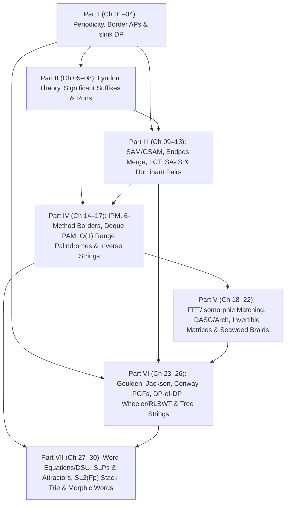

# Phase 1.5 Post-Research Textbook Curriculum Proposal C: Grandmaster Contest Problem-Solving & Diagnostic Routing Architecture (`strings_research/curriculum_proposal_C.md`)

> [!IMPORTANT]
> **Architectural Lens — Grandmaster Contest Problem-Solving & Diagnostic Routing**
> This proposal (`curriculum_proposal_C.md`) redesigns the `/strings/` textbook bottom-up from the complete 115-iteration Phase 1 discovery corpus (`TECHNIQUE_TAXONOMY.md`, 57 technique families `T-1A-01..T-5B-08`, and 430+ non-template problems across `[EN]`/`[ZH]`/`[JA]`).
>
> **Core Pedagogical Premise**: During an ICPC World Finals, Universal Cup, NOI/WC, or AtCoder Grand Contest round, a grandmaster does not ask *"Which research wave is this problem from?"* Instead, the contestant reads the **query geometry, constraint scale, and failure mode of naive string structures**, routes the symptom to a **combinatorial word invariant**, and compiles that invariant into an **algorithmic or algebraic engine**. This curriculum organizes the textbook into **7 Diagnostic Parts, 30 Focused Chapters, 7 Part-End Blind Checkpoints (`CP-I`–`CP-VII`), and 1 Grandmaster Synthesis Capstone**, achieving **100% coverage of all 57 technique families** with **strictly zero forward references**.

---

## 1. Executive Rationale: Why the Provisional 24-Chapter Seed Must Expand to 7 Parts & 30 Chapters

Auditing the Phase 1 corpus against the provisional 6-Part, 24-Chapter hypothesis in `PLAN.md` §4 exposes **six severe pedagogical bottlenecks and forward-reference hazards** that would cripple a contest-oriented reader if left unsplit:

1. **The Suffix Structure & Dominant-Pair Overload (`Wave 2A` + `Wave 2B`)**:
   - The provisional outline crammed `SA-IS`, `Virtual Suffix Trees`, `Dominant Pairs`, `SCDAWG`, and `Suffix Balanced Trees` into a single `Ch 12`. In contest practice, **Zero-Tree Virtual Suffix Trees** (`CF 1073G`) solve subset LCP aggregation, **DSU-on-Tree Dominant Pairs** (`CF 1043G`, $2N\log_2 N$ pairs) solve range pairwise LCP optimization, and **Hash-Free Suffix Balanced Trees** (`[BZOJ 3682]`) solve online encrypted front-prepend ranking. We expand Part III into **5 chapters (`Ch 09`–`Ch 13`)**, giving `SA-IS` + Virtual Suffix Trees (`Ch 12`) and Dominant Pairs + Bi-Directional `SCDAWG` + Suffix Balanced Trees (`Ch 13`) separate, breathing treatments.
2. **Eliminating the Forward Reference in `[BJWC2018]` 6-Method Substring Borders (`T-2B-04`)**:
   - The 6 canonical methods for internal border queries require Period–Border APs (`Part I`), Runs (`Part II`), SAM Link-Tree HLD + Segment Tree Merge (`Part III`), and 2D Suffix Array Range Queries (`Ch 14`). Placing `Ch 14` immediately after Part III ensures all 6 methods are derived and compared side-by-side with **zero forward references**.
3. **Decompressing Palindromic Structures, Range Queries, Rich Words & Inverse Reconstruction (`Wave 3A`)**:
   - Stuffing `Range LPS`, `Range Distinct Palindromes`, `Rich Words`, `Even-Palindrome Greedy`, `2-Palindromes`, `$\theta$-Palindromes`, and `Inverse KMP/Z/Manacher Reconstruction` into one chapter (`Ch 16` in the seed) mixes online data-structure engineering with pure word combinatorics. We split Part IV into **4 chapters (`Ch 14`–`Ch 17`)**: Internal Pattern Matching & 6-Method Borders (`Ch 14`), Unamortized/Persistent/4-Way Deque PAM (`Ch 15`), $O(1)$ Range LPS & `slink`-Telescoping Range Distinct Palindromes (`Ch 16`), and Rich Words, Palindromic Factorizations & Inverse Reconstruction (`Ch 17`).
4. **Separating Polynomial/FFT Matching from $k$-Mismatch & Window-Clipped Structural Isomorphism (`Wave 3B` + `T-5B-06`)**:
   - Wildcard/involution FFT convolutions (`T-3B-01`, `T-3B-02`) use frequency-domain algebra, whereas $k$-mismatch Kangaroo/period dichotomy (`T-3B-03`) and Parameterized / Order-Preserving / Cartesian-Tree matching (`T-3B-04`, `T-5B-06`) rely on LCE jumps and **window-clipped backward offsets**. Splitting them into `Ch 18` and `Ch 19` prevents algebraic and automaton ideas from blurring together.
5. **Reordering Subsequence/Seaweed/Bit-Parallel Engines (`Part V`) BEFORE `DP套DP` (`Part VI`) to Fix the Allison–Dix Forward Reference**:
   - In the seed outline, `DP套DP` (`Ch 19`) preceded Bit-Parallel LCS (`Ch 20`), even though the 4-stage `DP套DP` compiler for LCS (`[TJOI2018] 游园会`) requires the 4-instruction Allison–Dix hardware borrow identity (`T-4B-05`) to build transitions! Furthermore, `DASG` + Arch Factorization + Simon's Congruence (`T-4B-01`, `T-4B-02`), Invertible Subsequence Matrices (`T-4B-03`), and Tiskin's Seaweed Matrices (`T-4B-04`) are three distinct grandmaster paradigms. We dedicate `Ch 20`–`Ch 22` in Part V to these three pillars, and place Goulden–Jackson, Conway Martingales, and `DP套DP` in Part VI (`Ch 23`–`Ch 25`) with **zero forward references**.
6. **Splitting Grammar Compression (`SLP`) + Attractors + Synchronizing Sets from Non-Abelian $SL_2(\mathbb{F}_p)$ & Stack-Trie Reduction (`Part VII`)**:
   - Locally Consistent Parsing (`T-3B-05`), Kempa–Prezza String Attractors $\gamma(S)$ & $\tau$-Synchronizing Sets (`T-5B-05`), and LZ77 2D Orthogonal Range Indexing (`T-5B-08`) form a unified **Compressed String Indexing** chapter (`Ch 28`), whereas Free Group / Coxeter Stack Reduction, $GL_2(\mathbb{F}_p)/SL_2(\mathbb{F}_p)$ Matrix Hashing, and Stack-Trie Path Isomorphism (`T-5B-04`) form a dedicated **Non-Abelian Cancellation Algebra** chapter (`Ch 29`).

---

## 2. Master Prerequisite DAG & Diagnostic Routing Architecture (`7 Parts, 30 Chapters`)

---

## 3. Complete Chapter-by-Chapter Blueprint & 57-Technique Mapping (`Ch 01`–`Ch 30`)

### Portal & Reference Pages (`strings/`)
- `strings/index.qmd`: Textbook scope, prerequisite contract, and the **Grandmaster 60-Second Contest Diagnostic Router**.
- `strings/study-plan.qmd`: ICPC / NOI / AtCoder study tracks and Blind Checkpoint usage rules.
- `strings/notation.qmd`: Unified notation table ($\text{Border}(S)$, $\text{Per}(S)$, $\text{diff}$, `slink`, $\text{Cand}(U)$, $\mathcal{R}(S)$, $\text{endpos}$, Seaweed $\boxdot$, $\gamma(S)$).
- `strings/sources.qmd`: Master bibliography and Multilingual Stringology Rosetta Stone (`[EN]` $\leftrightarrow$ `[ZH]` $\leftrightarrow$ `[JA]`).

---

### Part I: Structural Periodicity, Border Algebra & Series-Link (`slink`) DP (`Ch 01`–`Ch 04` + `CP-I`)
*Contest Routing Theme: Exploiting overlapping periodicities and collapsing $\Theta(N)$ border/palindrome transitions into $\le \lceil \log_2 N \rceil$ arithmetic progressions.*

#### `Ch 01`: Period–Border Duality, the Fine–Wilf Theorem & Sub-Threshold Orbit Counting
- **Assigned Techniques**: `T-1A-01`
- **Diagnostic Contest Trigger**: Simultaneous periods $p, q$ on $S[1..N]$, word equations with periodic overlaps, or counting valid strings of length $N$ above or below $p + q - \gcd(p, q)$.
- **Core Invariants & Engines**: Exact bijection $b \in \text{Border}(S) \iff |S|-b \in \text{Per}(S)$; Hamiltonian path & first-return cycle proof of Fine–Wilf ($N \ge p+q-\gcd(p,q) \implies \gcd(p,q) \in \text{Per}(S)$); **Sub-Threshold Exact Orbit Formula** ($p + q - N$ connected components $\implies |\Sigma|^{p+q-N}$ strings when $\max(p,q) \le N < p+q-\gcd(p,q)$); Castelli–Mignosi–Restivo three-period threshold.
- **Pitfalls**: Weak vs. strict Fine–Wilf threshold off-by-one (`abaababaaba` at $N=11, p=5, q=8$); confusing weak period $p \in \text{Per}(S)$ with $p \mid |S|$.
- **Anchor Ladder**: `[BOI 2009] Radio Transmission` $\to$ `CF 535D` $\to$ `[POI 2012] A Horrible Poem` $\to$ `UCup Sub-Threshold Orbit Counting` / `AGC 032 F`.

#### `Ch 02`: The Weak Periodicity Lemma, Log-Block Border APs & Shortcut Link Duality (`slink` vs. `anc`)
- **Assigned Techniques**: `T-1A-02`
- **Diagnostic Contest Trigger**: Iterating over all borders of prefixes $S[1..u]$, online prefix-function extensions (`CF 1721E`), or maintaining monotone active border sets with weights (`CF 1286E`).
- **Core Invariants & Engines**: Half-length single-AP theorem (borders $\ge \lceil u/2 \rceil$ have step $d = u - \pi[u]$); exact $\pi[u] < \frac{2}{3}u$ and $\pi[\pi[u]] < \frac{1}{2}u$ period-break drop; proof that $\text{diff}[u] = \text{diff}[\pi[u]]$ forces $S[\pi[\pi[u]]+1] = S[\pi[u]+1]$, making `anc[u]` an exact coarsening of `slink[u]`.
- **Pitfalls**: Closed-interval $[\text{slink}[u], u]$ double-counting (`BP-1A-03`: always use half-open $(\text{slink}[u], u]$); precomputing `anc[N]` before $S[N+1]$ is known.
- **Anchor Ladder**: `CF 1721E — Prefix Function Queries` $\to$ `[SDOI2019] 连续子序列` $\to$ `CF 1286E — Fedya the Potter Strikes Back` $\to$ `CF 1764G / Inverse Border Realizability`.

#### `Ch 03`: Border-Group Modulo Shortest Path (`同余最短路`) & Residue-Cycle Monotonic Queues
- **Assigned Techniques**: `T-1A-03`
- **Diagnostic Contest Trigger**: Reaching target lengths $\le W$ ($W \le 10^{18}$) by overlapping copies of $S[1..N]$ ($N \le 5 \cdot 10^5$) along any border $b \in \text{Border}(S)$.
- **Core Invariants & Engines**: Partitioning $\Theta(N)$ period weights $N - b$ into $\le \lceil \log_2 N \rceil$ APs $\mathcal{A}_k = \{x_k + j d_k : 0 \le j \le c_k\}$; **Dynamic Modulus Switching** ($m_{\text{old}} \to x_k$) making $x_k \equiv 0 \pmod{x_k}$ free; **Residue-Cycle Unrolling** from cycle argmin $v_0$ with bounded-width $c_k$ monotonic deque relaxation in $O(N \log N)$ total time.
- **Pitfalls**: 0-1 vs. unbounded deque push order (`BP-1A-04`: must update $D[v_t]$ from `dq.front()` *before* pushing $D[v_t] - t \cdot d_k$); starting cycle relaxation at $0$ instead of cycle argmin $v_0$.
- **Anchor Ladder**: Period-knapsack warmup $\to$ Unbounded residue-cycle DP $\to$ `[WC2016] 论战捆竹竿` (`UOJ #179`) $\to$ Bounded-copy / weighted border shortest path.

#### `Ch 04`: Series-Link (`slink` / `diff`) DP Acceleration, Double-End Interleaving & Polynomial Weights
- **Assigned Techniques**: `T-1A-04`, `T-1A-05`
- **Diagnostic Contest Trigger**: 1D partition DPs $dp[r] = \bigoplus_{L \in \mathcal{A}(r)} w(L) \otimes dp[r-L]$ over all palindromic suffixes or borders at $N \le 10^6$, symmetric double-end partitions $s_i = s_{k+1-i}$, or polynomial weights $w(L) = P(L)$.
- **Core Invariants & Engines**: Shift-Overlap Decomposition $\mathcal{I}(u, r) = \mathcal{I}(\text{fail}[u], r-d) \sqcup \{r - \text{len}[\text{slink}[u]] - d\}$; proof that $v = \text{fail}[u]$ was a `slink` chain head at $r-d$ and unvisited in $(r-d, r)$; **Double-End & Reversal Interleaving Bijections** ($T = S[1]S[N]S[2]S[N-1]\dots$); **Binomial Left-Endpoint Invariance** $(r-i)^m = \sum \binom{m}{t}(-1)^t r^{m-t} i^t$ for degree-$D$ polynomial weights and parity/windowed sliding queues.
- **Pitfalls**: Initializing `g[u] = dp[r - len[u]]` (the oldest element, already in `g[fail[u]]`!) instead of `dp[r - len[slink[u]] - diff[u]]` (`BP-1A-05`); skipping `g[u]` updates at odd indices $r$ in interleaved strings (`BP-1A-06`).
- **Anchor Ladder**: `[CERC 2014] Virus Synthesis` $\to$ `CF 932G — Palindrome Partition` $\to$ `CF 906E — Reverses` $\to$ Polynomial-Weighted & Length-Windowed Palindrome Partition DP.

#### `CP-I`: Blind Checkpoint I — Periodicity, Border APs & `slink` DP (`strings/checkpoints/cp-1.qmd`)

---

### Part II: Lyndon Theory, Significant Suffixes & The Runs Theorem (`Ch 05`–`Ch 08` + `CP-II`)
*Contest Routing Theme: Canonical lexicographical factorizations, $O(\log N)$ suffix candidate sparsification under right-extensions, and bounding periodic runs by Lyndon roots.*

#### `Ch 05`: Chen–Fox–Lyndon (CFL) Factorization, Duval's Automaton, All-Prefix State Sharing & Bijective BWT (`BBWT`)
- **Assigned Techniques**: `T-1B-01`, `T-1B-02`
- **Diagnostic Contest Trigger**: Minimum cyclic shift, greedy concatenation order ($X^\omega < Y^\omega$), all-prefix minimum suffixes in $O(N)$, $O(M)$ RLE Lyndon factorization, or sentinel-free Bijective BWT (`BWTS`/`BBWT`).
- **Core Invariants & Engines**: Four-way Lyndon equivalence & CFL uniqueness ($S = w_1 \dots w_k$, $w_1 \ge \dots \ge w_k$); Duval's three-pointer automaton ($< 2N$ comparisons via $\Phi = 2i+k$); **All-Prefix State-Sharing Invariant** (`Theorem 2.4`: active prefix $S[1..r]$ inherits CFL tail from $r' = r - dp$ in $O(1)$); **RLE Block Boundary Invariant**; Witt's necklace identity & **Gil–Scott / Mantaci–Restivo–Rosone Bijective BWT** via $\omega$-order sorting of CFL factor rotations; FKM De Bruijn generation.
- **Pitfalls**: Using finite string order $X < Y$ instead of periodic order $X^\omega < Y^\omega$ in `BBWT`; taking the last CFL factor under $>$ for longest maximum suffix instead of Duval's outer pointer $i$.
- **Anchor Ladder**: `CF 1537E2 — Erase and Extend` $\to$ `ARC 050 D — Suffix Concat` $\to$ `Luogu P6127` (All-Prefix CFL via $r \to r-dp$) $\to$ RLE Duval & Bijective BWT Reconstruction.

#### `Ch 06`: The Significant Suffixes (`显著后缀`) Theorem, 1-Survivor `pushup` & Dyadic SA-RMQ Bands
- **Assigned Techniques**: `T-1B-03`
- **Diagnostic Contest Trigger**: Querying the lexicographically minimal/maximal suffix (or cyclic shift) of $S[l..r]$, or comparing $S[i..r] + T$ under arbitrary right-extensions $T$ (`[ZJOI2017] 字符串`, `[JSOI2019] 节日庆典`).
- **Core Invariants & Engines**: **Tandem-Annihilation Proof** ($|u| < |v| < 2|u|$ and $u \sqsubset v \implies v = w^2 u'$ and $\min(u'T, vT) < uT < \max(u'T, vT)$ for all $T$, forcing $|u_{i+1}| \ge 2|u_i|$ and $|\text{Cand}(U)| \le \lfloor \log_2 |U| \rfloor + 1$); **Segment Tree `pushup` 1-Survivor Theorem** (at most ONE candidate from `left_child` $[L, M]$ survives in $[L, R]$ because $R-L+1 \le 2(R-M+1)$); **Segment-Tree-Free Dyadic SA-RMQ** in $O(\log(r-l+1))$ query time and $O(N)$ space.
- **Pitfalls**: Assuming $\text{Cand}_{\min}(S[l..r]) \subseteq \text{Cand}_{\min}(S[1..r])$ ($\texttt{aaba}$ on $[2, 4]$ revives killed suffix $\texttt{aba}$!); appending $+\infty$ for maximum suffix.
- **Anchor Ladder**: `[JSOI2019] 节日庆典` (`Luogu P5287`) $\to$ Substring Minimum Suffix ($T=\varepsilon$) via Shortest Border $\to$ `[ZJOI2017] 字符串` (`Luogu P3642`) $\to$ Tree-Path Significant Suffixes via HLD.

#### `Ch 07`: Lyndon Arrays ($\lambda_<, \lambda_>$), Double-Order Monotonic Stacks & Min-Cartesian Lyndon Trees
- **Assigned Techniques**: `T-1B-04`
- **Diagnostic Contest Trigger**: Computing longest Lyndon prefixes $\lambda[1..N]$ in $O(N)$ time, building the Lyndon Tree of $S$, or maintaining online/persistent Lyndon factorizations in worst-case $O(\log N)$ time.
- **Core Invariants & Engines**: **Next-Smaller-Suffix Identity** ($R_{\mathcal{L}}[i] + 1 = \min\{j > i : S[j..N] < S[i..N]\}$); **Min-Cartesian Tree Isomorphism** (internal nodes of the Lyndon Tree of $\$S$ are canonically isomorphic to the Min-Cartesian Tree of $\text{rk}[2..N+1]$ with $-1$ left index shift); right-spine binary lifting for persistent CFL factorization.
- **Pitfalls**: **The $S = \texttt{bab}$ Negated-Rank Trap** (negating $-\text{rk}_<$ to simulate $>$ reverses prefix containment and falsely labels $\texttt{bab}$ as $>-$Lyndon; must build SA on character-inverted $\overline{S}$ or use LCE).
- **Anchor Ladder**: Lyndon Array Construction (`Luogu P6127`) $\to$ `AGC 023 F — 01 on Tree` $\to$ Longest Lyndon Substring in $S[l..r]$ $\to$ Persistent Online Lyndon Factorization.

#### `Ch 08`: The Runs Theorem (Bannai et al.), Three-Squares Hierarchy & 2D Sweep-Line over Periodic Runs
- **Assigned Techniques**: `T-1B-05`, `T-1B-06`
- **Diagnostic Contest Trigger**: Enumerating, counting, or querying squares $w^2$, $k$-th powers $w^k$, $AABB$ factorizations, or periodic substrings globally or inside $S[L_q..R_q]$.
- **Core Invariants & Engines**: **Lyndon-Root Disjointness Proof** of $|\mathcal{R}(S)| < N$ and $\sum \text{exp}(R) < 3N$ via disjoint interior Lyndon roots under $<_0$ and $<_1$; $O(N \log N)$ LCE harmonic checkpoint gluing vs. $O(N)$ Lyndon-array seeding; **Crochemore–Rytter Three-Squares Lemma** ($|w| \ge |u| + |v|$ when $u$ is primitive) & rightmost-occurrence proof of $\le 2N - 2$ distinct squares; **The $< 2N$ Representative Squares Lemma**; Fine–Wilf substring run-clipping non-collision & 2D $(L, R)$-plane sweep-line.
- **Pitfalls**: Failing to deduplicate harmonic multiples $2p, 3p$ on the same $[l, r]$ in LCE checkpoint gluing; assuming $\le 2$ squares *start* at index $i$ (holds only for *rightmost* occurrences!).
- **Anchor Ladder**: `[NOI2016] 优秀的拆分` (`Luogu P1117`) $\to$ Square-Free String Partitioning in $O(N)$ $\to$ Distinct Square SAM Locus Sum $\to$ Online/Offline Substring Run Counting $|\mathcal{R}(S[L_q..R_q])|$.

#### `CP-II`: Blind Checkpoint II — Lyndon Theory, Significant Suffixes & Runs (`strings/checkpoints/cp-2.qmd`)

---

### Part III: Suffix Automata, Suffix Trees, Dominant Pairs & Bi-Directional Suffix Indexing (`Ch 09`–`Ch 13` + `CP-III`)
*Contest Routing Theme: Navigating $\text{endpos}$ equivalence classes, clipping global suffix structures to substrings $S[l..r]$, and compressing $\binom{N}{2}$ suffix interactions into $O(N \log N)$ tree events.*

#### `Ch 09`: SAM $\leftrightarrow \text{ST}(S^R)$ Duality, 3-Case Generalized SAM (`GSAM`), CDAWG & Persistent SAM
- **Assigned Techniques**: `T-2A-01`, `T-2A-02`
- **Diagnostic Contest Trigger**: Multi-string substring statistics over $\mathcal{S} = \{S_1, \dots, S_k\}$ or a compressed Trie $\mathcal{T}$ of $V$ vertices, maximal repeat compaction (`CDAWG`), or online version-tree branching SAM queries.
- **Core Invariants & Engines**: Blumer–Crochemore reversal isomorphism $\mathcal{T}_{\text{link}}(\text{SAM}(S)) \cong \text{ST}(S^R)$; **3-Case GSAM Invariant** (reusing $q$ when $\text{len}(q)=\text{len}(p)+1$ and allocating *only* `clone` when $\text{len}(q) > \text{len}(p)+1$); **Proof of the $\Theta(V^2)$ Binary-Alphabet Trie-DFS Trap** on $\{\texttt{a}^k\texttt{b}\}$ vs. $O(V|\Sigma|)$ Trie-BFS; **CDAWG Maximal-Repeat Bijection** ($V_{\text{CDAWG}}(S) = V_{\text{CDAWG}}(S^R)$); unamortized Persistent SAM via `anc_trans[u][c]` inheritance in $O(\log |\Sigma|)$ worst-case time.
- **Pitfalls**: Zero-length clone bug from calling single-string `extend(c)` after `last = 1` reset; running DFS instead of BFS on a compressed Trie; using amortized link-walk loops on branched version trees.
- **Anchor Ladder**: `CF 204E` $\to$ `[USACO 2017 Dec Plat] Standing Out` $\to$ `CF 452E — Three Strings` $\to$ Online Persistent Version-Tree SAM & CDAWG Maximal Repeats.

#### `Ch 10`: SAM + Persistent Segment Tree Merging on $\text{endpos}$ & Substring Containment Clipping
- **Assigned Techniques**: `T-2A-03`
- **Diagnostic Contest Trigger**: Pattern occurrence counts, interval LCS, optimal nested repeats, or lexicographically next substring restricted to $S[l..r]$ (`[NOI2018] 你的名字`, `CF 1037H`, `CF 666E`, `CF 700E`).
- **Core Invariants & Engines**: **Substring Containment Clipping Identity** ($P \in E(u)$ of length $L$ occurs in $S[l..r] \iff L \le r-l+1$ and $\text{endpos}_S(u) \cap [l+L-1, r] \ne \emptyset$); **Predecessor Maximum-Length Jump** $L_{\text{valid}}(u) = \min(L_{\text{raw}}, e_{\max} - l + 1)$; bottom-up persistent `merge` allocating fresh nodes `z = ++seg_sz`.
- **Pitfalls**: Unclipped $[l, r]$ query matching a length-4 pattern inside a length-3 substring (`Counterexample 4.3`); jumping $u \leftarrow \text{link}(u)$ before exhausting shorter lengths inside $[\text{len}(\text{link}(u))+1, L-1]$ in `[NOI2018] 你的名字`.
- **Anchor Ladder**: `CF 666E — Forensic Examination` $\to$ `CF 700E — Cool Slogans` $\to$ `CF 1037H — Security` $\to$ `[NOI2018] 你的名字` (`Luogu P4770`).

#### `Ch 11`: Dynamic SAM + Link-Cut Tree `access` Color-Chain Sweeping & Intra-State Length Stratification
- **Assigned Techniques**: `T-2A-04`, `T-2A-05`
- **Diagnostic Contest Trigger**: Online character appends with occurrence queries (`[BZOJ 2555]`), range $[l, r]$ distinct substring / polynomial length-sum queries (`Luogu P6292`), or directed graph / 2-SAT compilation over substring prefix/suffix relations (`[十二省联考 2019] 字符串问题`).
- **Core Invariants & Engines**: **Solid-Chain Last-Occurrence Telescoping** (along an LCT chain sharing color $p_{\text{old}}$, start-position intervals tile without gaps into $[p_{\text{old}} - \text{len}(u_k) + 1, p_{\text{old}} - \text{len}(\text{link}(u_1))]$); second-largest occurrence $e_2(u, r)$ sweep; **Intra-State Length Stratification** (sorting substrings landing in state $u$ by length, placing $B_j$ before $A_i$ on ties $|B_j| = |A_i|$) + Link-Tree HLD graph optimization.
- **Pitfalls**: Splitting $q \to \text{clone}$ in online LCT-SAM without calling `access(q); splay(q);` first; connecting $B_j$ to the whole SAM state $u$ without intra-state length sorting.
- **Anchor Ladder**: `[BZOJ 2555] SubString` $\to$ `Luogu P6292` (Range Distinct Substrings via LCT `access`) $\to$ `[十二省联考 2019] 字符串问题` (`Luogu P5284`) $\to$ `[Code+#3] 白金元首与莫斯科` (2-SAT on Link Tree HLD).

#### `Ch 12`: Linear-Time Induced Sorting (`SA-IS`), Three-Way Suffix Tree Isomorphism & Zero-Tree Virtual Suffix Trees
- **Assigned Techniques**: `T-2B-01`, `T-2B-02`
- **Diagnostic Contest Trigger**: Suffix sorting at $N \le 10^7$ or over recursive integer alphabets, counting strings with a given SA descent set (`AGC 060 D`), or aggregating $\sum_{u \in A_q, v \in B_q} f(\text{LCP}(u, v))$ over query substring sets (`CF 1073G`, `[NOI2015] 品酒大会`).
- **Core Invariants & Engines**: $\text{rk}$-descent duality ($\text{type}(i)=L \iff \text{rk}[i] > \text{rk}[i+1]$); intra-bucket $L < S$ partition & **LMS-Substring Prefix-Free Homomorphism**; Fischer's $O(N)$ induced LCP; **Three-Way Isomorphism** $\mathcal{T}_{\text{ST}}(S) \cong \mathcal{T}_{\text{link}}(\text{SAM}(S^R)) \cong \text{Min-Cartesian Tree}(\text{height}[2..N])$; **Zero-Tree Substring Virtual Suffix Tree** built directly from adjacent LCEs $h_t = \min(\text{LCE}(l_{t-1}, l_t), |U_{t-1}|, |U_t|)$.
- **Pitfalls**: Comparing LMS-substrings by characters only without $(S[\cdot], \text{type}(\cdot))$; omitting $\text{occ}=1$ leaf edges on the `height` Cartesian tree; evaluating uncontracted equal-height nodes when weights are negative (`CF 616F`).
- **Anchor Ladder**: `[NOI2015] 品酒大会` $\to$ `CF 616F — Expensive Strings` $\to$ `CF 1073G — Yet Another LCP Problem` $\to$ `AtCoder AGC 060 D — Same Descent Set`.

#### `Ch 13`: Suffix Tree Dominant Pairs (`启发式合并支配对`), Bi-Directional SCDAWG & Hash-Free Suffix Balanced Trees
- **Assigned Techniques**: `T-2B-03`, `T-2B-05`, `T-2B-06`
- **Diagnostic Contest Trigger**: Optimizing $g(\text{LCP}(a, b), a, b)$ over $l \le a < b \le r$, online two-ended `push_front`/`push_back` substring maintenance, or encrypted online `push_front`/`pop_front` suffix ranking (`[BZOJ 3682]`).
- **Core Invariants & Engines**: **DSU-on-Tree Dominant Pair Sparsity** (only immediate predecessor/successor pairs $(i^-, i, \ell_u)$ and $(i, i^+, \ell_u)$ in the heavy `std::set` can be optimal, generating $\le 2N\log_2 N$ dominant triples); **Two-Sided Closure Commutativity** ($\overleftrightarrow{u}$) & Ukkonen–Weiner frontier duality in `SCDAWG`; **Dietz–Sleator 64-Bit Scapegoat Tags** ($\alpha = 0.75$, $\text{tag} \in [0, 2^{62}]$) + **Hash-Free BST RMQ LCP Recurrence** $\text{LCP}(\text{suf}(n), u^-) = 1 + \text{LCP}(\text{suf}(n-1), u^- - 1)$.
- **Pitfalls**: Forgetting to clip $\ell_u$ by $r - b + 1$ in Dominant Pairs; trying to `push_back` into a Suffix Balanced Tree (relative suffix order flips!); 53-bit `double` tag precision collapse in randomized Treaps.
- **Anchor Ladder**: `[BZOJ 3682] Phorni` $\to$ `[BZOJ 4768] wxh loves substring` $\to$ Range Longest Repeated Substring via Dominant Pairs $\to$ `CF 1043G` / `CF 1098F — Ж-function`.

#### `CP-III`: Blind Checkpoint III — SAM/GSAM, Endpos Merging, LCT, Virtual Suffix Trees & Dominant Pairs (`strings/checkpoints/cp-3.qmd`)

---

### Part IV: Internal Pattern Matching (IPM), Advanced Palindromic Theory & Inverse Reconstruction (`Ch 14`–`Ch 17` + `CP-IV`)
*Contest Routing Theme: Substring-to-substring dictionary queries $S[l..r]$, deterministic/deque/range palindromic engines, and inverse string restoration.*

#### `Ch 14`: Kociumaka's Basic Substring Dictionary, Bounded-Ratio IPM & The 6 Methods of Substring Borders (`[BJWC2018]`)
- **Assigned Techniques**: `T-2B-04`
- **Diagnostic Contest Trigger**: Finding occurrences of $P = S[l_1..r_1]$ inside $T = S[l_2..r_2]$, computing the longest proper border or shortest period of $S[l..r]$ (`[BJWC2018] Border 的四种求法`), or global substring `Rank`/`Select`.
- **Core Invariants & Engines**: **Bounded-Ratio IPM Arithmetic Progression Theorem** (when $|P| \le |T| < 2|P|$, $\text{Occ}(P, T)$ is a single AP with step $\text{per}(P)$); **Dyadic Scale Coverage** ($b \in [2^m, 2^{m+1}-1]$ is losslessly verified by intersecting the AP of $P_m = S[l..l+2^m-1]$ in the tail window with the AP of $Q_m = S[r-2^m+1..r]$ in the head window); complete side-by-side synthesis of **all 6 Canonical Methods** (1: Dyadic IPM AP Intersection, 2: SAM Link-Tree HLD + SegTree Merge, 3: Link-Tree Centroid Decomposition, 4: Link-Tree DSU-on-Tree, 5: $\sqrt{N}$ SA-Neighborhood Split, 6: Runs Sweep-Line + Short Fallback).
- **Pitfalls**: One-sided $P_m$ check without $Q_m$ (`S = "ababacababab"`, misses mismatch `'c'` in the suffix tail!); failing to exclude improper border $i = r$.
- **Anchor Ladder**: `CF 504E` $\to$ Substring Global Rank & Select $\to$ $O(1)$ Internal Shortest Period Queries $\to$ `[BJWC2018] Border 的四种求法` (`Luogu P4482`).

#### `Ch 15`: Unamortized Deterministic PAM (`quick_link` & `slink`-Skip), Persistent Tree PAM & 4-Way Deque PAM
- **Assigned Techniques**: `T-3A-01`, `T-3A-02`
- **Diagnostic Contest Trigger**: Rollback / version-tree PAM extensions, tree-path palindrome queries (`[钟知闲 2017]`), or online 4-way deque edits (`push_front`, `push_back`, `pop_front`, `pop_back`) maintaining distinct and total palindromes.
- **Core Invariants & Engines**: **Uniform Preceding-Character Lemma** (all internal nodes in a `slink` AP share the exact same preceding character $S[i - \text{len}(v) - 1]$, enabling $O(\log N)$ alphabet-free `slink`-skip or $O(1)$ `quick_link[u][c]`); **Shared-Trie Tree PAM Invariant**; **Unique Vanishing Palindrome Theorem** & **Non-Cascading Lazy Surface Push-Down** (`pop_back` at $R$ only demotes $u = \text{max\_suff}[R]$ and promotes $v = \text{fail}(u)$ to `max_pref[R - len(u) + 1]` in $O(1)$ worst-case time).
- **Pitfalls**: Amortized `fail` walk TLE on star-branched trees; forgetting to update both `last_pref` and `last_suff` when $\text{len}(u) = R - L + 1$; physically freeing PAM nodes on `pop`.
- **Anchor Ladder**: Rollback PAM (`Luogu P4555` variant) $\to$ 2-Way Push-Only Deque PAM $\to$ `[钟知闲 2017]` Persistent Tree-Path PAM $\to$ Full 4-Way Deque PAM with Pop.

#### `Ch 16`: Substring Palindrome Range Queries — $O(1)$ Unclipped Range LPS & `slink` Telescoping Range Distinct Palindromes
- **Assigned Techniques**: `T-3A-03`, `T-3A-04`
- **Diagnostic Contest Trigger**: Online queries $(l, r)$ for the Longest Palindromic Substring (`Range LPS`) or total palindromic multiplicity in $S[l..r]$, or offline/online queries for **distinct palindromes** in $S[l..r]$ (`[徐毅 2014]`, `LOJ #6071`).
- **Core Invariants & Engines**: Three regimes for `Range LPS`: (A) Single Binary Search + RMQ, (B) PAM `slink` ceiling division, and (C) **True $O(1)$ Online Range LPS via Two-Boundary Unclipping** (every Manacher center $c \in (c_L, c_R)$ strictly between the boundary-touching centers touches neither $l$ nor $r$, reducing `Range LPS` to one $O(1)$ Sparse-Table RMQ!); **Midpoint-Decoupled Chairman Tree** for multiplicity ($m_{\text{odd}}$ vs. $m_{\text{even}}$); **Periodic Suffix Telescoping Cancellation** (`start_{r-1}(u_j) = start_r(u_{j-1})` cancels all intermediate nodes in a `slink` chain, leaving at most 2 Fenwick point updates per chain!).
- **Pitfalls**: Using a single midpoint $m = \lfloor(l+r)/2\rfloor$ for both odd and even centers; reading `last_end[u]` only at node $u$ instead of the fail-subtree Euler-tour maximum $\text{prev\_r}(u)$.
- **Anchor Ladder**: Online Range Palindrome Multiplicity $\to$ $O(1)$ Online Range LPS via Two-Boundary Unclipping $\to$ `LOJ #6071` / `[徐毅 2014]` Range Distinct Palindromes $\to$ Weighted Range Distinct Palindromes via LCT `access`.

#### `Ch 17`: Rich Words, Palindromic Factorizations, $\theta$-Palindromes & Inverse String Reconstruction (KMP/Z/Manacher)
- **Assigned Techniques**: `T-3A-05`, `T-3A-06`
- **Diagnostic Contest Trigger**: Testing if $S[l..r]$ is rich ($|\text{Pal}(W)| = |W|+1$), minimal even-palindrome partitioning (`CF 1827C`), online 2-palindromes, Watson–Crick $\theta$-palindromes (`POI XVII Antisymmetry`), or reconstructing/counting strings from given KMP $\pi$, Z-array, or Manacher radii.
- **Core Invariants & Engines**: **Droubay–Pirillo Bound** ($\le |W|+1$) & unioccurrent longest palindromic suffix characterization of Rich Words ($O(1)$ two-pointer boundary $L_{\text{rich}}[r]$); **Shortest Even-Palindrome Overlap Lemma** (`CF 1827C`); **Online 2-Palindrome Top-2 `slink` Sufficiency**; $\theta$-palindrome even-length dichotomy; **Inverse Equality + Forbidden-Character Dual Decomposition** & **Chordal Chromatic Polynomial Product** $\prod_v \max(0, \sigma - \text{deg}_{\text{prev}}(v))$.
- **Pitfalls**: Longest-palindrome greedy failure on 2-palindromes (`"bababcba" = "bab" + "abcba"`); accepting local $\pi[i] \le \pi[i-1]+1$ conditions without running forward KMP/Z/Manacher verification (`pi = [0, 1, 0, 1, 1]` forces $\pi[5]=2 \ne 1$).
- **Anchor Ladder**: `POI XVII — Antisymmetry` $\to$ `CF 1827C — Palindrome Partition` $\to$ Inverse KMP/Z/Manacher Reconstruction & Chromatic Counting $\to$ Online 2-Palindrome & $O(1)$ Range Rich Substring Queries.

#### `CP-IV`: Blind Checkpoint IV — Internal Pattern Matching, Advanced Palindromes & Inverse Reconstruction (`strings/checkpoints/cp-4.qmd`)

---

### Part V: Algebraic String Matching, Structural Isomorphism & Subsequence / Seaweed Matrix Algebras (`Ch 18`–`Ch 22` + `CP-V`)
*Contest Routing Theme: Replacing non-transitive matching and quadratic subsequence/LCS dynamic programming with FFT convolutions, window-clipped canonical KMP, invertible matrices, Unit-Monge Seaweed braids, and hardware bit-parallelism.*

#### `Ch 18`: Polynomial & FFT String Matching — 1-NTT Indicator Wildcards, Kalai Projection, 3-in-2 FFT & Involution/Affine Matching
- **Assigned Techniques**: `T-3B-01`, `T-3B-02`
- **Diagnostic Contest Trigger**: Wildcard matching (`'?'`), threshold/subset matching (`CF 528D`), permutation/involution matching (`CF 1334G`), affine scale-and-shift matching $T_{i+j} = \alpha P_j + \beta$, or dominance/$L_1$-distance matching.
- **Core Invariants & Engines**: Index-reflection Cauchy duality ($P^R$); Clifford–Clifford cubic penalty vs. **Degree-Reduced Indicator Encoding** $(u, v) \in \{(0, 0), (1, c)\}$ where $\max D_{\text{ind}}(i) \le M(|\Sigma|-1)^2 < 998244353$ guarantees **zero false positives in 1 NTT prime**; **Kalai's Randomized Projection** (1 NTT for one-sided wildcards, 2 NTTs for two-sided); **3-in-2 Complex FFT conjugate packing** (5 passes instead of 9); **`CF 1334G` 4-Method Hierarchy** ($\pi^2 = \text{id} \implies O(N+M)$ KMP; general $\pi \implies$ quartic 3-NTT / unit-circle 1-FFT / Kalai 2-NTT); Cauchy–Schwarz first-difference affine matching; $\sqrt{M\log M}$ value-bucket splitting.
- **Pitfalls**: Raw ASCII $c \in [97, 122]$ cubic overflow modulo $998244353$; accepting $\alpha < 0$ in Cauchy–Schwarz affine matching when $\alpha > 0$ is required.
- **Anchor Ladder**: `CF 528D — Fuzzy Search` $\to$ `[BZOJ 4503] 两个串` $\to$ `CF 1334G — Substring Search` $\to$ Affine Scale-and-Shift & $\sqrt{M\log M}$ Dominance Matching.

#### `Ch 19`: $k$-Mismatch Kangaroo Jumps, the $O(N\sqrt{k\log k})$ $2k$-Period Dichotomy & Window-Clipped Structural Isomorphism
- **Assigned Techniques**: `T-3B-03`, `T-3B-04`, `T-5B-06`
- **Diagnostic Contest Trigger**: Pattern matching with $\le k$ mismatches or $\le k$ edits, or structural isomorphism matching under bijective renaming (`p-KMP`, `p-SA`), relative order (`Order-KMP`), Cartesian tree shape (`Cartesian-KMP`), binary Abelian Parikh vectors, or $1/z$ weighted strings (`PWM`).
- **Core Invariants & Engines**: Landau–Vishkin $O(Nk)$ LCE Kangaroo jumps & $O(N+k^2)$ diagonal edit-distance wavefront; Abrahamson's $O(N\sqrt{M\log M})$ heavy–light split; **Clifford–Gawrychowski–Uznański $2k$-Period Dichotomy** ($\text{per}(P) > 2k \implies 2k$-witness filter in $O(N)$; $\text{per}(P) = p \le 2k \implies$ 2nd-order periodic difference $\text{diff}_p$ in $O(N\sqrt{k\log k})$); **Unified Window-Clipped Canonical Encoding** $\text{clip}(\text{prev}_S[x], q) = (\text{prev}_S[x] \le q \text{ ? } \text{prev}_S[x] : 0)$ unifying $O(N+M)$ `p-KMP` and Parent-Distance `Cartesian-KMP`; Order-Preserving `LMax`/`LMin` $O(1)$ check; Baker's single-position mutation for $O(N \log N)$ `p-SA`; Binary Abelian Parikh discrete IVT envelope; **Barton et al. $\lfloor z \rfloor$ Heavy-String Decomposition** for weighted strings.
- **Pitfalls**: Allowing Kangaroo cursor $j$ to jump past $M$; comparing unclipped `prev_T[i]` against `prev_P[q]`; inconsistent `<` vs. `<=` tie-breaking in Cartesian-Tree parent distances.
- **Anchor Ladder**: `[BZOJ 4259] 残缺的字符串` $\to$ Parameterized & Order-Preserving KMP $\to$ Parent-Distance Cartesian-Tree KMP & $1/z$ Weighted Suffix Tree $\to$ $O(N\sqrt{k\log k})$ $k$-Mismatch via $2k$-Period Dichotomy.

#### `Ch 20`: Subsequence Automata (`DASG`), Four-Comb Product BFS, Hébrard's Arch Factorization & Simon's Congruence ($\sim_k$)
- **Assigned Techniques**: `T-4B-01`, `T-4B-02`
- **Diagnostic Contest Trigger**: Distinct subsequence DP, interleaved subsequence packing (`CF 1149B`), shortest uncommon substring/subsequence (`[HEOI2015]`), range $[l, r]$ Shortest Absent Subsequence (`Range SAS`), or minimal subsequence distinguishing $U \ne V$ under $\sim_k$.
- **Core Invariants & Engines**: Leftmost-prefix dominance bijection in $\text{DASG}(S)$; **Four-Comb Product Automaton** $\mathcal{A}^+(A) \times \mathcal{A}^-(B)$ for $\{\text{SAM}, \text{DASG}\}^2$; **Alphabet-Independent $O(|A||B|)$ Distinct Common Subsequences** via 2D predecessor rectangles $[\text{prev}_A[i'], i'-1] \times [\text{prev}_B[j'], j'-1]$; **Hébrard's Arch Factorization** (universality index $\iota(S) = k$, canonical last-letter absent witness $m_1 \dots m_k m_{k+1}$) + $O(\log N)$ binary lifting for `Range SAS`; **Simon's Congruence ($\sim_k$) & Barker et al.'s $O(|U|+|V|)$ Simon-Tree**.
- **Pitfalls**: Following `link[v]` in $\text{SAM}(B)$ during product BFS (drops prefix of current word!); using forward $\arg\max_c \text{nxt}[u][c]$ instead of backward shortest-path DP for lexicographically smallest SAS (`ARC 081 E`).
- **Anchor Ladder**: `AtCoder ARC 081 E` $\to$ `CF 1149B — Three Religions` $\to$ `[HEOI2015] 最短不公共子串` $\to$ $O(\log N)$ Range SAS & Simon-Tree Minimal Distinguishing Subsequence.

#### `Ch 21`: Invertible Subsequence Automaton Matrices ($\det M_c = 1$) & Matrix-Free $O((N+Q)|\Sigma|)$ Range Queries
- **Assigned Techniques**: `T-4B-03`
- **Diagnostic Contest Trigger**: $Q$ range queries $(l, r)$ or deque updates asking for distinct subsequences, weighted subsequences, or fixed-pattern subsequence counts in $S[l..r]$ modulo $M$, where Segment Tree matrix multiplication $O(Q|\Sigma|^3 \log N)$ TLEs.
- **Core Invariants & Engines**: **Rank-1 Elementary Transition Matrix & Exact Inverse** ($M_c = I_{\sigma+1} + \mathbf{e}_c \mathbf{1}^T$ has $\det M_c = 1$ over any commutative ring $\mathcal{R}$ and $O(1)$-sparse inverse $M_c^{-1} = I_{\sigma+1} - \mathbf{e}_c(\mathbf{1} - 2\mathbf{e}_c)^T$); **Matrix-Free Bilinear Dot Product** ($\mathbf{u}_i^T = 2\mathbf{u}_{i-1}^T - \mathbf{u}_{\text{last}[S[i]]-1}^T$ and lazy-offset column $\mathbf{v}_i = M_{S[i]}^{-1}\mathbf{v}_{i-1}$ answer $[l, r]$ via $\mathbf{u}_r^T \cdot \mathbf{v}_{l-1}$ in **$O(|\Sigma|)$ time and zero segment trees**!); upper-unitriangular inverse for fixed-pattern subsequence multiplicity.
- **Pitfalls**: Attempting matrix inversion on gap $\ge 2$ subsequence DP (`ABC 214 F`, $\det = 0$) or tropical $(\min, +)$ DP (`CF 750E`, no additive inverse)—both require Segment Trees.
- **Anchor Ladder**: `CF 1426F` (Fixed-Pattern Subsequence Multiplicity) $\to$ `CF 750E` vs. Invertibility Dichotomy $\to$ Matrix-Free $O((N+Q)|\Sigma|)$ Range Distinct Subsequences $\to$ Two-Stack Deque Distinct Subsequences.

#### `Ch 22`: Tiskin's Seaweed Matrices (`海草矩阵`), Unit-Monge $\boxdot$ Multiplication, Sparse Range LIS & Bit-Parallel LCS
- **Assigned Techniques**: `T-4B-04`, `T-4B-05`
- **Diagnostic Contest Trigger**: All-pairs semi-local LCS queries $\text{LCS}(A, B[l..r])$ or $\text{LCS}(A[1..i], B[l..r])$ (`[THUPC 2021]`), Range LIS on a permutation $B[l..r]$ ($N, Q \le 10^5$), or high-speed $N \le 10^5$ LCS / Edit Distance via bitsets.
- **Core Invariants & Engines**: **Planar Uncrossing Permutation (`Seaweed Matrix`)** (`if (A[i] == B[j] || u > W[j]) swap(u, W[j])`); **Three-Family Semi-Local LCS Dominance** ($\text{LCS}(A[1..i], B[l..r]) = \#\{k \in [l, r] : -i \le W[k] < l\}$); **$O(K \log K)$ Unit-Monge $\boxdot$ Staircase Merge** & **$O(N \log^2 N)$ Sparse Range LIS**; **Allison–Dix 4-Instruction Hardware Borrow Identity** ($V' = X \mathbin{\&} \sim(X - Y)$ where borrow stops at the earliest match inside each interval $I_r$); Myers' bit-parallel Levenshtein & Hirschberg $O(M+N)$-space bitset alignment reconstruction.
- **Pitfalls**: Confusing top-to-bottom $p[i]$ with bottom-to-top $W[k]$ when negative rowports $-i$ are queried; scanning full-length bitmasks inside Hirschberg recursion.
- **Anchor Ladder**: Bit-Parallel LCS + Hirschberg Alignment Reconstruction $\to$ `[THUPC 2021] 区间 LCS` $\to$ Prefix-Substring & Dynamic Seaweed LCS $\to$ $O(N \log^2 N)$ Range LIS via Sparse Unit-Monge $\boxdot$.

#### `CP-V`: Blind Checkpoint V — FFT/Isomorphic Matching, Subsequence Matrices & Seaweed Alignment (`strings/checkpoints/cp-5.qmd`)

---

### Part VI: Goulden–Jackson Cluster Generating Functions, Martingale PGFs, Automaton DP & Graph/Tree Stringology (`Ch 23`–`Ch 26` + `CP-VI`)
*Contest Routing Theme: Enumerative/probabilistic string algebra, compiling inner string DPs into minimized outer DFAs (`DP套DP`), and extending string indexing to De Bruijn/Wheeler graphs and trees.*

#### `Ch 23`: Goulden–Jackson Cluster Method, Bivariate $(t-1)$ Exact $k$-Occurrence FPS & the $t = 1 + u$ Binomial Moment Shift
- **Assigned Techniques**: `T-4A-01`, `T-4A-02`, `T-4A-03`
- **Diagnostic Contest Trigger**: Counting words of length $n$ avoiding $\mathcal{P} = \{P_1, \dots, P_m\}$ when $\sum |P_i|$ is large, counting words with **exactly $k$ occurrences** of $P$, or computing $\mathbb{E}[\text{occ}_P(W)^K]$ for huge $n \le 10^{18}$ and $|P| \le 10^5$.
- **Core Invariants & Engines**: Guibas–Odlyzko autocorrelation polynomial $C_{i,j}(x) = \sum_{k \in \text{Overlap}(P_i, P_j)} x^{|P_j|-k}$ & $m \times m$ cluster system; Sherman–Morrison rank-1 form & invertibility over any commutative ring ($\mathbf{C}(0) = I_m$); **Exact $k$-Occurrence OGF** $[t^k]F(x, t) = \frac{x^L D_1(x)^{k-1}}{D_0(x)^{k+1}}$ & **Non-Antichain Embedded Substring Weight Absorption**; **The $t = 1 + u$ Binomial Moment Shift** (collapsing the denominator from $D_0(x)^{k+1}$ to $(1-\sigma x)^{j+1}$ so $[x^n][u^j]F(x, 1+u)$ runs in $O(KL\log(KL))$ independent of $n \le 10^{18}$!).
- **Pitfalls**: Building $C_{i,j}(x)$ for avoidance without reducing $\mathcal{P}$ to an antichain; calling FPS $\ln(D_1(x))$ before factoring out $x^{\min\text{Per}(P)}$ ($D_1(0) = 0$!).
- **Anchor Ladder**: Single/Multi-Pattern Avoidance OGF $\to$ Exact $k$ Pattern Occurrences via FPS $\ln/\exp$ $\to$ Non-Antichain Weighted Cluster Counting $\to$ `UCup / QOJ` $t = 1 + u$ Binomial Moment Shift for $n \le 10^{18}$.

#### `Ch 24`: String Probability Generating Functions, Conway's Casino Martingale & Multi-Pattern Races (`[SDOI2017]`)
- **Assigned Techniques**: `T-4A-04`
- **Diagnostic Contest Trigger**: Expected waiting time $\mathbb{E}[T_S]$, variance $\text{Var}(T_S)$, $k$-th occurrence waiting time $\mathbb{E}[T_{S,k}]$, or winning probabilities $p_1 \dots p_m$ in a multi-pattern race.
- **Core Invariants & Engines**: **Conway's Casino Martingale & Optional Stopping Theorem** ($\mathbb{E}[T_S] = \Omega_{S,S} = \sum_{k \in \text{Border}(S)} \mathbb{P}(S[1..k])^{-1}$ and variance formula); **$k$-th Occurrence Renewal Identity** $\mathbb{E}[T_{S,k}] = \mathbb{E}[T_{S,1}] + \frac{k-1}{\mathbb{P}(S)}$; **Division-Free Pattern Race System** ($\Phi_{i,j} = \mathbb{P}(P_j)\Omega_{P_i, P_j}$) and **Initial Seed Prefix $S_0$ RHS Shift** $\mathbb{P}(P_j)(1 - \Omega_{S_0, P_j})$.
- **Pitfalls**: Transposing winner $P_i$ and gambler $P_j$ in $\Omega_{P_i, P_j}$; dividing by $\mathbb{P}(P_j) = 0$ when zero-probability letters exist.
- **Anchor Ladder**: `[CTSC2006] 歌唱王国` $\to$ Variance & $k$-th Occurrence Renewal Waiting Time $\to$ `[SDOI2017] 硬币游戏` $\to$ Pattern Race with Initial Seed Prefix $S_0$.

#### `Ch 25`: Automaton DP, the 4-Stage `DP套DP` Compiler (Hopcroft / Brzozowski) & Binary-Grouped Dynamic Aho–Corasick
- **Assigned Techniques**: `T-4A-05`
- **Diagnostic Contest Trigger**: Counting outer strings $T \in \Sigma^n$ classified by an inner DP output $f(S, T)$ (e.g., $\text{LCS}(S, T) = k$ for $|S| \le 20$, edit distance $\le 2$, regex games), or online AC pattern insertions/deletions (`CF 710F`).
- **Core Invariants & Engines**: **The 4-Stage `DP套DP` Compiler Pipeline**: (1) Relative/capped inner state encoding (using `Ch 22`'s 4-instruction Allison–Dix bitmask for LCS differences $\Delta_i \in \{0, 1\}$, or offset strip $dp[i]-i \in [-K, K+1]$ for Edit Distance), (2) Reachable DFA BFS discovery, (3) Hopcroft partition refinement / Brzozowski double-reversal minimization, (4) Outer DP / matrix exponentiation; **Bentley–Saxe Binary-Grouped Dynamic AC** (`CF 710F`).
- **Pitfalls**: Rebuilding a single AC automaton on every insertion ($O((\sum |P|)^2)$ TLE); forgetting `bad[u] |= bad[fail[u]]` in BFS order.
- **Anchor Ladder**: `[JSOI2007] 文本生成器` $\to$ `CF 710F — String Set Queries` $\to$ `[TJOI2018] 游园会` (LCS `DP套DP`) $\to$ Edit-Distance Strip `DP套DP` with Hopcroft Minimization.

#### `Ch 26`: De Bruijn BEST Theorem, Wheeler Graphs, $O(1)$ RLBWT Move Structures & Strings on Trees
- **Assigned Techniques**: `T-5A-04`, `T-5A-05`, `T-5A-06`
- **Diagnostic Contest Trigger**: Counting Eulerian strings with prescribed $k$-mer / AC-DFA transition counts (`ABC 336 G`, `UOJ 607`), BWT/Wheeler DFA pattern matching on $N \le 10^{18}$ run-length BWTs (`RLBWT`), sorting upward tree paths (`Luogu P5353`), leaf-rooted tree GSAM (`[ZJOI2015]`), or all-pairs tree path pattern matching (`[CTSC2010] 珠宝商`).
- **Core Invariants & Engines**: **De Bruijn / AC-DFA BEST Theorem** (dividing by $\prod_{u, c} \text{count}(u, c)!$) & Lex-Smallest Hierholzer post-order reversal; LF-mapping rank preservation, **Wheeler Graph two-step edge-rank transition**, and **Nishimoto–Tabei $O(1)$ RLBWT Move Structure**; **Dual-Rank Tree SA** $(\text{rk}_k[u], \text{id}_k[u])$, **Leaf-Rooted Tree GSAM** ($\le 2|\mathcal{L}|N$ states), and **Centroid + $\sqrt{M}$ Dual-SAM Split** (`[CTSC2010] 珠宝商`).
- **Pitfalls**: Dividing by parallel edge count $A(u, v)!$ instead of character transition $\text{count}(u, c)!$ on AC DFAs; applying Kasai's $O(N)$ LCP on branched trees; omitting the $\sqrt{M}$ threshold on child-subtree subtractions in `[CTSC2010] 珠宝商`.
- **Anchor Ladder**: `CF 508D` / `AtCoder ABC 336 G` $\to$ `Luogu P5353` (Dual-Rank Tree SA) & `[ZJOI2015] 诸神眷顾的幻想乡` $\to$ Wheeler Graph & $O(1)$ RLBWT Move Structure $\to$ `[CTSC2010] 珠宝商` & `UOJ 607`.

#### `CP-VI`: Blind Checkpoint VI — Cluster GFs, Conway Martingales, `DP套DP`, Wheeler/RLBWT & Tree Strings (`strings/checkpoints/cp-6.qmd`)

---

### Part VII: Word Equations, Grammar Compression (SLPs), Non-Abelian Stack Hashing & Frontier Combinatorics on Words (`Ch 27`–`Ch 30` + `CP-VII` + `Capstone`)
*Contest Routing Theme: Resolving bulk equality/inequality constraints at $N \le 10^{18}$, dynamic grammar-compressed indexing, non-abelian cancellation groups, and morphic/Sturmian word theory.*

#### `Ch 27`: Word Equations, Signed & Tree Binary-Lifting DSU (`倍增并查集`), SA Adjacency & $N \le 10^{18}$ Period Folding
- **Assigned Techniques**: `T-5A-01`, `T-5A-02`, `T-5A-03`
- **Diagnostic Contest Trigger**: Bulk substring/palindrome equations $S[l_1..r_1] = S[l_2..r_2]^{(\text{R})}$ on strings (`[SCOI2016] 萌萌哒`) or tree paths $u \rightsquigarrow v$, huge-length word equations ($N \le 10^{18}$), or string reconstruction from SA (`CF 1526E`) and substring inequalities $S[l_1..r_1] \le S[l_2..r_2]$.
- **Core Invariants & Engines**: **Lossless Dyadic Block Covering** & **Signed Half-Block Pushdown with Root Self-Palindrome Bit `is_pal[k][r]`**; LCA path splitting for **Signed Tree Binary-Lifting DSU**; **$N \le 10^{18}$ Contraction Engines** (Plandowski / Fine–Wilf Euclidean period folding & dihedral reflection-to-translation composition); **Suffix Array Adjacency Theorem** ($\text{rk}[u+1] > \text{rk}[v+1] \implies S[u] < S[v]$, giving $\binom{N+K-1-D}{N}$) & $\{0, 1\}$-weighted Tarjan SCC condensation DAGs.
- **Pitfalls**: Returning early on `find(k, x) == find(k, y)` when net reversal parity is $1$ without setting `is_pal[k][r] = 1` (`Pitfall 1`); omitting sentinel $\text{rk}[N+1] = 0$ in SA Adjacency.
- **Anchor Ladder**: `[SCOI2016] 萌萌哒` (`Luogu P3295`) $\to$ `CF 1526E — Oolimry and Suffix Array` $\to$ Signed Palindrome & Tree-Path Binary-Lifting DSU $\to$ $N \le 10^{18}$ Huge-Length Word Equations & Inequality DAGs.

#### `Ch 28`: Locally Consistent Parsing (`SLP` / Jeż Recompression), String Attractors $\gamma(S)$, $\tau$-Synchronizing Sets & LZ77 2D Indexing
- **Assigned Techniques**: `T-3B-05`, `T-5B-05`, `T-5B-08`
- **Diagnostic Contest Trigger**: Dynamic cut/paste/reverse/LCE on strings of length $\le 10^{18}$, pattern matching / palindrome / run counting on Straight-Line Programs (`SLPs`), minimum String Attractors $\gamma(S)$, $\tau$-Synchronizing Sets, or LZ77 compressed pattern indexing.
- **Core Invariants & Engines**: **Three-Engine Alternating Contraction** (RLE `RComp` + Cole–Vishkin 6-coloring / randomized local extrema / **Jeż's Recompression** $\Sigma_L \times \Sigma_R$), modifying $O(1)$ blocks per level; **Boundary-Seam Non-Proliferation** on SLPs ($O(\log |P|)$ border APs per seam); **Kempa–Prezza String Attractor $\leftrightarrow$ SAM `minlen(q)` Hitting-Set Duality**; **Kempa–Kociumaka $\tau$-Synchronizing Set Minimizer Rule**; **Kärkkäinen–Ukkonen Primary–Secondary Split** & Wavelet-Tree 2D orthogonal range indexing for LZ77/SLPs.
- **Pitfalls**: Continuing LCE tree traversal past a partial RLE block match $\ell_1 \ne \ell_2$; testing SAM `maxlen(q)` instead of `minlen(q)` for String Attractors; double-counting primary occurrences crossing multiple LZ77 phrase boundaries.
- **Anchor Ladder**: Dynamic Split/Concat/Reverse + $O(\log N)$ LCE $\to$ SAM `minlen` String Attractor & $\tau$-Synchronizing Set Construction $\to$ LZ77 / SLP Primary–Secondary 2D Pattern Indexing $\to$ Pattern Matching, Palindromes & Runs on Huge SLPs.

#### `Ch 29`: Free Group & Coxeter Stack Reduction, Non-Abelian $GL_2(\mathbb{F}_p) / SL_2(\mathbb{F}_p)$ Matrix Hashing & Stack-Trie Path Isomorphism
- **Assigned Techniques**: `T-5B-04`
- **Diagnostic Contest Trigger**: Substring stack-exterminability (`cc` $\to \varepsilon$ in `CF 1223F`, or directed brackets `()` $\to \varepsilon$), dynamic point updates with range stack reduction, or lexicographical comparison of stack-reduced substrings $\text{red}(S[l_1..r_1])$ vs. $\text{red}(S[l_2..r_2])$.
- **Core Invariants & Engines**: **Deterministic Stack-Trie Path Isomorphism Theorem** ($\text{red}(S[l..r]) = P_{l-1}^{-1}P_r$ is the exact edge-label sequence along the simple tree path $u_{l-1} \leadsto \text{LCA}_{\mathcal{T}}(u_{l-1}, u_r) \leadsto u_r$, reducing $|\text{red}(S[l..r])|$ to $\text{dist}_{\mathcal{T}}(u_{l-1}, u_r)$ and lexicographical comparison to $O(\log N)$ Tree-Path LCE with **zero matrices**!); **Cayley–Hamilton Trace-Zero $\det = -1$ Involution Matrices** ($M_c^2 = I_2$ in $GL_2(\mathbb{F}_p)$); **Height-Indexed Dyck $SL_2(\mathbb{F}_p)$ Hashing** $M_{(c, \text{bal}[i])}$ on Segment Trees.
- **Pitfalls**: Using un-indexed $SL_2(\mathbb{F}_p)$ generators with 1D balance on directed brackets (`(( )( ))` has balance $\ge 0$ everywhere but cancels inner `) (` unless indexed by height $\text{bal}[i]$!).
- **Anchor Ladder**: `CF 1223F — Stack Exterminable Arrays` $\to$ `AGC 050 C` / `ARC 119 E` $\to$ Dynamic Range Dyck Reduction via Height-Indexed $SL_2(\mathbb{F}_p)$ Segment Tree $\to$ Lexicographical Comparison of Reduced Substrings via Stack-Trie Path LCE.

#### `Ch 30`: Combinatorics on Words — Sturmian & Rytter's Singular Words, Thue–Morse Anti-Hash, Iterated Morphisms $\varphi^k(S_0)$ & 2D Witness Duels
- **Assigned Techniques**: `T-5B-01`, `T-5B-02`, `T-5B-03`, `T-5B-07`
- **Diagnostic Contest Trigger**: Queries on mechanical rotation words $\lfloor(n+1)\alpha+\rho\rfloor - \lfloor n\alpha+\rho\rfloor$ (`ABC 313 G`), Fibonacci prefixes $F_\infty[1..n]$ ($n \le 10^{18}$, `[周任飞 2017]`), `uint64_t` rolling-hash collision construction, pattern counting in $\varphi^k(S_0)$ ($k \le 10^{18}$) or $s_k = s_{k-1} + t_k + s_{k-1}$ (`CF 1466G`), or 2D grid pattern matching.
- **Core Invariants & Engines**: **6-Way Sturmian Equivalence** ($p(n)=n+1 \iff$ 1-balanced $\iff$ mechanical word $\iff$ central palindromes $\pi_k$); **Fibonacci Near-Commutativity, Zeckendorf Addressing & Rytter's Singular Words $w_k$** (`[周任飞 2017]`); **Thue–Morse Overlap-Freeness, Prouhet–Tarry–Escott Equal Power Sums & 2-Adic Valuation $v_2 \ge \frac{k(k+1)}{2} \ge 66$ at $k=11$**; **Three-Regime Morphic Pattern Counting** (Expanding 2-letter junction matrix, Mortal KMP functional composition, and `CF 1466G` level promotion $r_0$); **Baker–Bird 2D AC+KMP Matching & Vishkin's $O(1)$ 2D Witness Duel**.
- **Pitfalls**: Assuming $F_k$ is a palindrome (only $\pi_k$ of length $f_k - 2$ is!); using Regime 1 junction matrices when mortal/unit-growth letters $|\varphi^k(b)| = 1$ exist; assigning distinct vertical KMP IDs to identical rows of $P$ in Baker–Bird.
- **Anchor Ladder**: Universal Anti-`uint64_t` Thue–Morse Hash & Tarry–Escott Partition $\to$ `ICPC WF 2012 D` & `CF 1466G — Song of the Sirens` $\to$ `ABC 313 G` & `[周任飞 2017]` Singular-Word Counting on $F_\infty[1..n]$ $\to$ Baker–Bird & Vishkin 2D Witness Duel.

#### `CP-VII`: Blind Checkpoint VII — Word Equations, SLPs, Attractors, $SL_2(\mathbb{F}_p)$ Stack Hashing & Morphic Words (`strings/checkpoints/cp-7.qmd`)

#### `Capstone`: Grandmaster Multi-Chapter Synthesis Reserves (`strings/capstones/synthesis.qmd`)
- **25 Multi-Paradigm Synthesis Problems (`Syn-01..Syn-25`)**: Cross-part grandmaster problems combining Runs + SAM + Segment Tree Merging, Lyndon Significant Suffixes + Seaweed Matrices, Palindrome `slink` + Goulden–Jackson FPS, and SLP Recompression + Internal Pattern Matching.

---

## 4. Complete 57-Technique Coverage Verification Matrix (`T-1A-01..T-5B-08`)

| Wave | Technique IDs | Assigned Textbook Chapters | Coverage Status |
| :--- | :--- | :--- | :--- |
| **Wave 1A** (5) | `T-1A-01`, `T-1A-02`, `T-1A-03`, `T-1A-04`, `T-1A-05` | `Ch 01` (`T-1A-01`), `Ch 02` (`T-1A-02`), `Ch 03` (`T-1A-03`), `Ch 04` (`T-1A-04`, `T-1A-05`) | **5 / 5 (100%)** |
| **Wave 1B** (6) | `T-1B-01`, `T-1B-02`, `T-1B-03`, `T-1B-04`, `T-1B-05`, `T-1B-06` | `Ch 05` (`T-1B-01`, `T-1B-02`), `Ch 06` (`T-1B-03`), `Ch 07` (`T-1B-04`), `Ch 08` (`T-1B-05`, `T-1B-06`) | **6 / 6 (100%)** |
| **Wave 2A** (5) | `T-2A-01`, `T-2A-02`, `T-2A-03`, `T-2A-04`, `T-2A-05` | `Ch 09` (`T-2A-01`, `T-2A-02`), `Ch 10` (`T-2A-03`), `Ch 11` (`T-2A-04`, `T-2A-05`) | **5 / 5 (100%)** |
| **Wave 2B** (6) | `T-2B-01`, `T-2B-02`, `T-2B-03`, `T-2B-04`, `T-2B-05`, `T-2B-06` | `Ch 12` (`T-2B-01`, `T-2B-02`), `Ch 13` (`T-2B-03`, `T-2B-05`, `T-2B-06`), `Ch 14` (`T-2B-04`) | **6 / 6 (100%)** |
| **Wave 3A** (6) | `T-3A-01`, `T-3A-02`, `T-3A-03`, `T-3A-04`, `T-3A-05`, `T-3A-06` | `Ch 15` (`T-3A-01`, `T-3A-02`), `Ch 16` (`T-3A-03`, `T-3A-04`), `Ch 17` (`T-3A-05`, `T-3A-06`) | **6 / 6 (100%)** |
| **Wave 3B** (5) | `T-3B-01`, `T-3B-02`, `T-3B-03`, `T-3B-04`, `T-3B-05` | `Ch 18` (`T-3B-01`, `T-3B-02`), `Ch 19` (`T-3B-03`, `T-3B-04`), `Ch 28` (`T-3B-05`) | **5 / 5 (100%)** |
| **Wave 4A** (5) | `T-4A-01`, `T-4A-02`, `T-4A-03`, `T-4A-04`, `T-4A-05` | `Ch 23` (`T-4A-01`, `T-4A-02`, `T-4A-03`), `Ch 24` (`T-4A-04`), `Ch 25` (`T-4A-05`) | **5 / 5 (100%)** |
| **Wave 4B** (5) | `T-4B-01`, `T-4B-02`, `T-4B-03`, `T-4B-04`, `T-4B-05` | `Ch 20` (`T-4B-01`, `T-4B-02`), `Ch 21` (`T-4B-03`), `Ch 22` (`T-4B-04`, `T-4B-05`) | **5 / 5 (100%)** |
| **Wave 5A** (6) | `T-5A-01`, `T-5A-02`, `T-5A-03`, `T-5A-04`, `T-5A-05`, `T-5A-06` | `Ch 26` (`T-5A-04`, `T-5A-05`, `T-5A-06`), `Ch 27` (`T-5A-01`, `T-5A-02`, `T-5A-03`) | **6 / 6 (100%)** |
| **Wave 5B** (8) | `T-5B-01`..`T-5B-08` | `Ch 19` (`T-5B-06`), `Ch 28` (`T-5B-05`, `T-5B-08`), `Ch 29` (`T-5B-04`), `Ch 30` (`T-5B-01`, `T-5B-02`, `T-5B-03`, `T-5B-07`) | **8 / 8 (100%)** |
| **TOTAL** | **57 Technique Families (`T-1A-01..T-5B-08`)** | **7 Parts, 30 Chapters (`Ch 01`–`Ch 30`) + `CP-I..VII` + `Capstone`** | **57 / 57 (100%)** |
